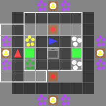
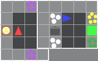
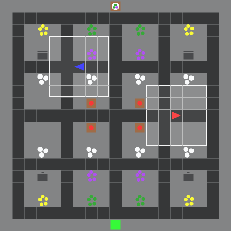
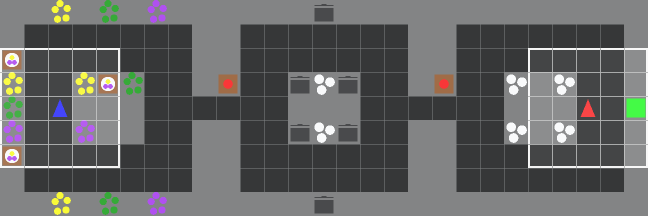

<h1 align="center">Coding Agents Are Zero-Shot Coordinators</h1>

<p align="center"><strong>Can coding agents design policies that coordinate with partners they have never played with?</strong></p>

<p align="center">
  <a href="#astra--fable-on-overcooked-v2">Episodes</a> ·
  <a href="#set-up-with-an-agent">Agent setup</a> ·
  <a href="#install-on-the-execution-host">Quickstart</a> ·
  <a href="#task-previews">Task previews</a> ·
  <a href="#run-one-environment">Run one environment</a> ·
  <a href="#results">Results</a> ·
  <a href="coding_agent_zsc/">Tasks</a>
</p>

Each coding agent develops a two-player policy using only **self-play** feedback. We measure **cross-play** by pairing independently developed policies. The main suite covers six Overcooked V2 layouts, three Yōkai settings, and two Hanabi settings.

<a name="astra--fable-on-overcooked-v2"></a>

## Astra 🔴 × Fable 🔵 on Overcooked V2

<table>
  <tr>
    <td align="center" valign="top">
      <strong>Grounded Coordination Simple</strong><br>
      
    </td>
    <td align="center" valign="top">
      <strong>Grounded Coordination Ring</strong><br>
      
    </td>
    <td align="center" valign="top">
      <strong>Test-time Simple</strong><br>
      
    </td>
    <td align="center" valign="top">
      <strong>Test-time Wide</strong><br>
      
    </td>
  </tr>
  <tr>
    <td align="center" valign="top">
      <strong>Demo Cook Simple</strong><br>
      
    </td>
    <td align="center" valign="top">
      <strong>Demo Cook Wide</strong><br>
      
    </td>
    <td align="center" valign="top">
      <strong>Block Grid</strong><br>
      
    </td>
    <td align="center" valign="top">
      <strong>Pipeline Cook</strong><br>
      
    </td>
  </tr>
</table>

## Set up with an agent

Paste this into your coding agent from the repository checkout:

```text
Set up this repository on my Linux Docker host.
```

## Install on the execution host

Use Linux with Docker and Python 3.11+. From this checkout:

```sh
python -m venv .venv
source .venv/bin/activate
pip install .
docker build -t autoastra-zsc:cpu runtime/
```

## Task previews

After `pip install .`, you can inspect the sandbox tree and every file the agent sees. Creating a preview requires neither Docker nor model credentials. For example, to preview Hanabi H-Group for seed 0 with the paper’s selection rule:

```sh
printf '%s\n' '{"selection": "model", "seed": 0}' > preview-config.json
autoastra preview coding_agent_zsc.hanabi.two_player_h_group_level_1:p0 \
  --provider codex --run-config preview-config.json \
  --output previews/hanabi_2p_h_group_level_1-p0 --print-to previews/hanabi-p0.md
```

<details>
<summary><strong>Browse saved previews for the main experiments</strong></summary>

Each row lists the six prompt variants in seed order (p0–p5).

| Environment | Saved previews |
| --- | --- |
| Overcooked V2 — Demo Cook Simple | [p0](docs/previews/demo_cook_simple/codex/p0.md) · [p1](docs/previews/demo_cook_simple/codex/p1.md) · [p2](docs/previews/demo_cook_simple/codex/p2.md) · [p3](docs/previews/demo_cook_simple/codex/p3.md) · [p4](docs/previews/demo_cook_simple/codex/p4.md) · [p5](docs/previews/demo_cook_simple/codex/p5.md) |
| Overcooked V2 — Demo Cook Wide | [p0](docs/previews/demo_cook_wide/codex/p0.md) · [p1](docs/previews/demo_cook_wide/codex/p1.md) · [p2](docs/previews/demo_cook_wide/codex/p2.md) · [p3](docs/previews/demo_cook_wide/codex/p3.md) · [p4](docs/previews/demo_cook_wide/codex/p4.md) · [p5](docs/previews/demo_cook_wide/codex/p5.md) |
| Overcooked V2 — Grounded Coordination Simple | [p0](docs/previews/grounded_coord_simple/codex/p0.md) · [p1](docs/previews/grounded_coord_simple/codex/p1.md) · [p2](docs/previews/grounded_coord_simple/codex/p2.md) · [p3](docs/previews/grounded_coord_simple/codex/p3.md) · [p4](docs/previews/grounded_coord_simple/codex/p4.md) · [p5](docs/previews/grounded_coord_simple/codex/p5.md) |
| Overcooked V2 — Grounded Coordination Ring | [p0](docs/previews/grounded_coord_ring/codex/p0.md) · [p1](docs/previews/grounded_coord_ring/codex/p1.md) · [p2](docs/previews/grounded_coord_ring/codex/p2.md) · [p3](docs/previews/grounded_coord_ring/codex/p3.md) · [p4](docs/previews/grounded_coord_ring/codex/p4.md) · [p5](docs/previews/grounded_coord_ring/codex/p5.md) |
| Overcooked V2 — Test Time Simple | [p0](docs/previews/test_time_simple/codex/p0.md) · [p1](docs/previews/test_time_simple/codex/p1.md) · [p2](docs/previews/test_time_simple/codex/p2.md) · [p3](docs/previews/test_time_simple/codex/p3.md) · [p4](docs/previews/test_time_simple/codex/p4.md) · [p5](docs/previews/test_time_simple/codex/p5.md) |
| Overcooked V2 — Test Time Wide | [p0](docs/previews/test_time_wide/codex/p0.md) · [p1](docs/previews/test_time_wide/codex/p1.md) · [p2](docs/previews/test_time_wide/codex/p2.md) · [p3](docs/previews/test_time_wide/codex/p3.md) · [p4](docs/previews/test_time_wide/codex/p4.md) · [p5](docs/previews/test_time_wide/codex/p5.md) |
| Two-Player Hanabi | [p0](docs/previews/hanabi_2p/codex/p0.md) · [p1](docs/previews/hanabi_2p/codex/p1.md) · [p2](docs/previews/hanabi_2p/codex/p2.md) · [p3](docs/previews/hanabi_2p/codex/p3.md) · [p4](docs/previews/hanabi_2p/codex/p4.md) · [p5](docs/previews/hanabi_2p/codex/p5.md) |
| Two-Player Hanabi (H-Group Level 1) | [p0](docs/previews/hanabi_2p_h_group_level_1/codex/p0.md) · [p1](docs/previews/hanabi_2p_h_group_level_1/codex/p1.md) · [p2](docs/previews/hanabi_2p_h_group_level_1/codex/p2.md) · [p3](docs/previews/hanabi_2p_h_group_level_1/codex/p3.md) · [p4](docs/previews/hanabi_2p_h_group_level_1/codex/p4.md) · [p5](docs/previews/hanabi_2p_h_group_level_1/codex/p5.md) |
| Two-Player Yōkai (9 Cards, Standard) | [p0](docs/previews/yokai_2p_9c_standard/codex/p0.md) · [p1](docs/previews/yokai_2p_9c_standard/codex/p1.md) · [p2](docs/previews/yokai_2p_9c_standard/codex/p2.md) · [p3](docs/previews/yokai_2p_9c_standard/codex/p3.md) · [p4](docs/previews/yokai_2p_9c_standard/codex/p4.md) · [p5](docs/previews/yokai_2p_9c_standard/codex/p5.md) |
| Two-Player Yōkai (9 Cards, Revealed Color History) | [p0](docs/previews/yokai_2p_9c/codex/p0.md) · [p1](docs/previews/yokai_2p_9c/codex/p1.md) · [p2](docs/previews/yokai_2p_9c/codex/p2.md) · [p3](docs/previews/yokai_2p_9c/codex/p3.md) · [p4](docs/previews/yokai_2p_9c/codex/p4.md) · [p5](docs/previews/yokai_2p_9c/codex/p5.md) |
| Two-Player Yōkai (16 Cards, Revealed Color History) | [p0](docs/previews/yokai_2p_16c/codex/p0.md) · [p1](docs/previews/yokai_2p_16c/codex/p1.md) · [p2](docs/previews/yokai_2p_16c/codex/p2.md) · [p3](docs/previews/yokai_2p_16c/codex/p3.md) · [p4](docs/previews/yokai_2p_16c/codex/p4.md) · [p5](docs/previews/yokai_2p_16c/codex/p5.md) |

</details>

## Set up model access

On the Linux host that will run the experiments, install the agent CLI and configure its credentials. For a single-model run through OpenRouter, export `OPENROUTER_API_KEY` in the launch shell and pass `--provider openrouter --model PROVIDER/MODEL` to `coding-zsc`.

For sign-in instructions and the key each provider uses, expand **Configure model access** in the [AutoAstra quickstart](https://github.com/shshnkreddy/autoastra#run-the-demo).

## Run one environment

With Codex configured, this command runs six independent seeds in parallel, then evaluates the six selected policies in all 36 ordered pairings.

```sh
coding-zsc --model gpt-6.1-sol --env cat_dog --jobs 6 --output runs/cat-dog
```

Open `runs/cat-dog/reports/cat_dog/summary.json` for the self-play (SP) and cross-play (IXP) scores, or `xp.csv` in the same directory for the full matrix.

<details>
<summary><strong>Experiment settings</strong></summary>

| Setting | Default |
| --- | --- |
| Development | Two hours per seed, unlimited tokens and evaluations. Each candidate gets 1,024 self-play episodes and a 600-second evaluation timeout. |
| Selection | Uses the best development score. Pass `--selection model` to use the agent’s nominated revision. |
| Parallelism | One model and environment at a time. `--jobs` controls concurrent seeds (1–6, default 1). |
| Held-out scoring | 1,024 episodes per ordered policy pair, with common root seed `2000003`. |

Seeds 0–5 use prompt variants p0–p5 respectively.

</details>

## Results

The [final paper policies](paper_policies/) cover seven models, eleven environments, and six seeds. After installation, score a saved population directly from this checkout:

```sh
coding-zsc-xp paper_policies/astra_high/grounded_coord_simple/seed-* --output reports/astra
```

To compare two models on the same environment:

```sh
coding-zsc-between --env grounded_coord_simple \
  --population astra=paper_policies/astra_high/grounded_coord_simple \
  --population fable=paper_policies/fable51/grounded_coord_simple --output reports/astra-fable
```

Each model’s `reports/<environment>/xp.csv` is a 6 × 6 matrix. **SP** averages the six diagonal scores, where one policy plays both seats. **IXP** averages the 30 off-diagonal scores, where the seats use policies from different seeds. A heatmap and JSON summary sit beside the CSV. For newly generated runs, the final policies and experiment ledgers live under each environment’s `seed-0/` through `seed-5/` directories.

<details>
<summary><strong>Score existing runs</strong></summary>

```sh
coding-zsc-xp runs/sol/grounded_coord_simple/seed-* --output reports/within
coding-zsc-between --env grounded_coord_simple \
  --population sol=runs/sol/grounded_coord_simple \
  --population claude=runs/claude/grounded_coord_simple --output reports/between
```

Reusing an output directory preserves completed populations and cached evaluation cells. If generation stopped with an incomplete population, use a fresh output directory to regenerate it.

</details>

[License](runtime/LICENSE) · [Third-party notices](runtime/THIRD_PARTY_NOTICES.md)

## Citation
