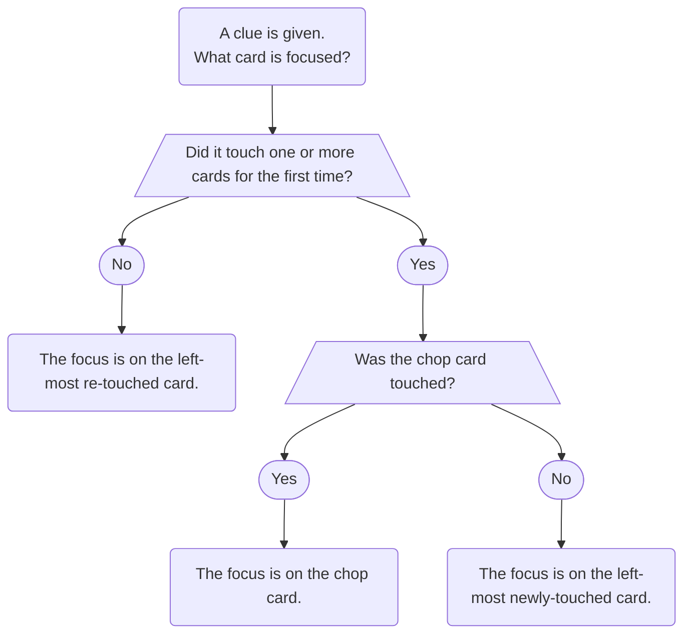

# Research task

```text
hanabi_2p_h_group_level_1-p3/
└── task/
    ├── CLAUDE.md
    ├── bin/
    │   ├── experiment-ledger
    │   ├── fitness-eval
    │   └── lifetime
    ├── context/
    │   ├── conventions/
    │   │   └── h_group_level_1/
    │   │       ├── INDEX.md
    │   │       ├── LICENSE
    │   │       ├── README.md
    │   │       ├── docs/
    │   │       │   ├── beginner/
    │   │       │   │   ├── 2-save-question-1.md
    │   │       │   │   ├── 2-save-question-2.md
    │   │       │   │   ├── 2-save-question-3.md
    │   │       │   │   ├── 2-save.md
    │   │       │   │   ├── 5-save-question-1.md
    │   │       │   │   ├── 5-save-question-2.md
    │   │       │   │   ├── 5-save.md
    │   │       │   │   ├── card-layout.md
    │   │       │   │   ├── card-notes.md
    │   │       │   │   ├── chop-question-1.md
    │   │       │   │   ├── chop-question-2.md
    │   │       │   │   ├── chop-question-3.md
    │   │       │   │   ├── chop-question-4.md
    │   │       │   │   ├── chop.md
    │   │       │   │   ├── clue-interpretation-question-1.md
    │   │       │   │   ├── clue-interpretation-question-2.md
    │   │       │   │   ├── clue-interpretation-question-3.md
    │   │       │   │   ├── clue-interpretation-question-4.md
    │   │       │   │   ├── clue-interpretation.md
    │   │       │   │   ├── critical-save-question-1.md
    │   │       │   │   ├── critical-save-question-2.md
    │   │       │   │   ├── critical-save-question-3.md
    │   │       │   │   ├── critical-save-question-4.md
    │   │       │   │   ├── critical-save.md
    │   │       │   │   ├── delayed-play-clues-question-1.md
    │   │       │   │   ├── delayed-play-clues-question-2.md
    │   │       │   │   ├── delayed-play-clues-question-3.md
    │   │       │   │   ├── delayed-play-clues.md
    │   │       │   │   ├── early-game-question-1.md
    │   │       │   │   ├── early-game-question-2.md
    │   │       │   │   ├── early-game-question-3.md
    │   │       │   │   ├── early-game-question-4.md
    │   │       │   │   ├── early-game.md
    │   │       │   │   ├── finesse-question-1.md
    │   │       │   │   ├── finesse-question-2.md
    │   │       │   │   ├── finesse.md
    │   │       │   │   ├── good-touch-principle-question-1.md
    │   │       │   │   ├── good-touch-principle-question-2.md
    │   │       │   │   ├── good-touch-principle-question-3.md
    │   │       │   │   ├── good-touch-principle-question-4.md
    │   │       │   │   ├── good-touch-principle.md
    │   │       │   │   ├── minimum-clue-value-principle-question-1.md
    │   │       │   │   ├── minimum-clue-value-principle.md
    │   │       │   │   ├── other-general-strategy-question-1.md
    │   │       │   │   ├── other-general-strategy-question-2.md
    │   │       │   │   ├── other-general-strategy-question-3.md
    │   │       │   │   ├── other-general-strategy-question-4.md
    │   │       │   │   ├── other-general-strategy-question-5.md
    │   │       │   │   ├── other-general-strategy.md
    │   │       │   │   ├── play-clues-question-1.md
    │   │       │   │   ├── play-clues-question-2.md
    │   │       │   │   ├── play-clues.md
    │   │       │   │   ├── prompt-question-1.md
    │   │       │   │   ├── prompt-question-2.md
    │   │       │   │   ├── prompt-question-3.md
    │   │       │   │   ├── prompt.md
    │   │       │   │   ├── save-clues.md
    │   │       │   │   ├── save-principle-question-1.md
    │   │       │   │   ├── save-principle-question-2.md
    │   │       │   │   ├── save-principle.md
    │   │       │   │   ├── single-card-focus-question-1.md
    │   │       │   │   ├── single-card-focus-question-2.md
    │   │       │   │   ├── single-card-focus-question-3.md
    │   │       │   │   ├── single-card-focus-question-4.md
    │   │       │   │   ├── single-card-focus.md
    │   │       │   │   ├── special-moves.md
    │   │       │   │   ├── three-main-principles.md
    │   │       │   │   └── two-types-of-clues.md
    │   │       │   ├── beginner.md
    │   │       │   └── level-1.md
    │   │       ├── examples/
    │   │       │   ├── 2-save/
    │   │       │   │   ├── 2-save-illegal.yml
    │   │       │   │   └── 2-save.yml
    │   │       │   ├── 2-save-question-1/
    │   │       │   │   ├── 2-save-answer-1.yml
    │   │       │   │   └── 2-save-question-1.yml
    │   │       │   ├── 2-save-question-2/
    │   │       │   │   ├── 2-save-answer-2.yml
    │   │       │   │   └── 2-save-question-2.yml
    │   │       │   ├── 2-save-question-3/
    │   │       │   │   ├── 2-save-answer-3.yml
    │   │       │   │   └── 2-save-question-3.yml
    │   │       │   ├── 5-save/
    │   │       │   │   └── 5-save.yml
    │   │       │   ├── 5-save-question-1/
    │   │       │   │   ├── 5-save-answer-1.yml
    │   │       │   │   └── 5-save-question-1.yml
    │   │       │   ├── 5-save-question-2/
    │   │       │   │   ├── 5-save-answer-2.yml
    │   │       │   │   └── 5-save-question-2.yml
    │   │       │   ├── card-layout/
    │   │       │   │   ├── card-layout-1.yml
    │   │       │   │   ├── card-layout-2.yml
    │   │       │   │   └── card-layout-3.yml
    │   │       │   ├── card-notes/
    │   │       │   │   └── card-notes-1.yml
    │   │       │   ├── chop/
    │   │       │   │   ├── chop-1.yml
    │   │       │   │   └── chop-2.yml
    │   │       │   ├── chop-question-1/
    │   │       │   │   ├── chop-answer-1.yml
    │   │       │   │   └── chop-question-1.yml
    │   │       │   ├── chop-question-2/
    │   │       │   │   ├── chop-answer-2.yml
    │   │       │   │   └── chop-question-2.yml
    │   │       │   ├── chop-question-3/
    │   │       │   │   ├── chop-answer-3.yml
    │   │       │   │   └── chop-question-3.yml
    │   │       │   ├── chop-question-4/
    │   │       │   │   └── chop-question-4.yml
    │   │       │   ├── clue-interpretation-question-1/
    │   │       │   │   ├── clue-interpretation-answer-1.yml
    │   │       │   │   └── clue-interpretation-question-1.yml
    │   │       │   ├── clue-interpretation-question-2/
    │   │       │   │   ├── clue-interpretation-answer-2.yml
    │   │       │   │   └── clue-interpretation-question-2.yml
    │   │       │   ├── clue-interpretation-question-3/
    │   │       │   │   ├── clue-interpretation-answer-3.yml
    │   │       │   │   └── clue-interpretation-question-3.yml
    │   │       │   ├── clue-interpretation-question-4/
    │   │       │   │   ├── clue-interpretation-answer-4.yml
    │   │       │   │   └── clue-interpretation-question-4.yml
    │   │       │   ├── critical-save/
    │   │       │   │   └── critical-save.yml
    │   │       │   ├── critical-save-question-1/
    │   │       │   │   ├── critical-save-answer-1.yml
    │   │       │   │   └── critical-save-question-1.yml
    │   │       │   ├── critical-save-question-2/
    │   │       │   │   ├── critical-save-answer-2.yml
    │   │       │   │   └── critical-save-question-2.yml
    │   │       │   ├── critical-save-question-3/
    │   │       │   │   ├── critical-save-answer-3.yml
    │   │       │   │   └── critical-save-question-3.yml
    │   │       │   ├── critical-save-question-4/
    │   │       │   │   ├── critical-save-answer-4.yml
    │   │       │   │   └── critical-save-question-4.yml
    │   │       │   ├── delayed-play-clues/
    │   │       │   │   └── delayed-play-clues.yml
    │   │       │   ├── delayed-play-clues-question-1/
    │   │       │   │   ├── delayed-play-clues-answer-1.yml
    │   │       │   │   └── delayed-play-clues-question-1.yml
    │   │       │   ├── delayed-play-clues-question-2/
    │   │       │   │   ├── delayed-play-clues-answer-2.yml
    │   │       │   │   └── delayed-play-clues-question-2.yml
    │   │       │   ├── delayed-play-clues-question-3/
    │   │       │   │   ├── delayed-play-clues-answer-3.yml
    │   │       │   │   └── delayed-play-clues-question-3.yml
    │   │       │   ├── early-game-question-1/
    │   │       │   │   ├── early-game-answer-1.yml
    │   │       │   │   └── early-game-question-1.yml
    │   │       │   ├── early-game-question-2/
    │   │       │   │   ├── early-game-answer-2.yml
    │   │       │   │   └── early-game-question-2.yml
    │   │       │   ├── early-game-question-3/
    │   │       │   │   ├── early-game-answer-3.yml
    │   │       │   │   └── early-game-question-3.yml
    │   │       │   ├── early-game-question-4/
    │   │       │   │   ├── early-game-answer-4.yml
    │   │       │   │   └── early-game-question-4.yml
    │   │       │   ├── finesse/
    │   │       │   │   ├── finesse-1.yml
    │   │       │   │   └── finesse-2.yml
    │   │       │   ├── finesse-question-1/
    │   │       │   │   ├── finesse-answer-1.yml
    │   │       │   │   └── finesse-question-1.yml
    │   │       │   ├── finesse-question-2/
    │   │       │   │   ├── finesse-answer-2.yml
    │   │       │   │   └── finesse-question-2.yml
    │   │       │   ├── good-touch-principle/
    │   │       │   │   ├── good-touch-principle-1-correct.yml
    │   │       │   │   ├── good-touch-principle-1-illegal.yml
    │   │       │   │   ├── good-touch-principle-2.yml
    │   │       │   │   └── good-touch-principle-3.yml
    │   │       │   ├── good-touch-principle-question-1/
    │   │       │   │   ├── good-touch-principle-answer-1.yml
    │   │       │   │   └── good-touch-principle-question-1.yml
    │   │       │   ├── good-touch-principle-question-2/
    │   │       │   │   ├── good-touch-principle-answer-2.yml
    │   │       │   │   └── good-touch-principle-question-2.yml
    │   │       │   ├── good-touch-principle-question-3/
    │   │       │   │   ├── good-touch-principle-answer-3.yml
    │   │       │   │   └── good-touch-principle-question-3.yml
    │   │       │   ├── good-touch-principle-question-4/
    │   │       │   │   ├── good-touch-principle-answer-4.yml
    │   │       │   │   └── good-touch-principle-question-4.yml
    │   │       │   ├── minimum-clue-value-principle/
    │   │       │   │   └── tempo-clue.yml
    │   │       │   ├── minimum-clue-value-principle-question-1/
    │   │       │   │   ├── minimum-clue-value-principle-answer-1.yml
    │   │       │   │   └── minimum-clue-value-principle-question-1.yml
    │   │       │   ├── other-general-strategy-question-1/
    │   │       │   │   ├── other-general-strategy-answer-1.yml
    │   │       │   │   └── other-general-strategy-question-1.yml
    │   │       │   ├── other-general-strategy-question-2/
    │   │       │   │   ├── other-general-strategy-answer-2.yml
    │   │       │   │   └── other-general-strategy-question-2.yml
    │   │       │   ├── other-general-strategy-question-3/
    │   │       │   │   ├── other-general-strategy-answer-3.yml
    │   │       │   │   └── other-general-strategy-question-3.yml
    │   │       │   ├── other-general-strategy-question-4/
    │   │       │   │   ├── other-general-strategy-answer-4.yml
    │   │       │   │   └── other-general-strategy-question-4.yml
    │   │       │   ├── other-general-strategy-question-5/
    │   │       │   │   ├── other-general-strategy-answer-5.yml
    │   │       │   │   └── other-general-strategy-question-5.yml
    │   │       │   ├── play-clues/
    │   │       │   │   ├── play-clue-1.yml
    │   │       │   │   └── play-clue-2.yml
    │   │       │   ├── play-clues-question-1/
    │   │       │   │   ├── play-clues-answer-1.yml
    │   │       │   │   └── play-clues-question-1.yml
    │   │       │   ├── play-clues-question-2/
    │   │       │   │   ├── play-clues-answer-2.yml
    │   │       │   │   └── play-clues-question-2.yml
    │   │       │   ├── prompt/
    │   │       │   │   ├── prompt-1.yml
    │   │       │   │   ├── prompt-2.yml
    │   │       │   │   ├── prompt-3.yml
    │   │       │   │   └── prompt-4.yml
    │   │       │   ├── prompt-question-1/
    │   │       │   │   ├── prompt-answer-1.yml
    │   │       │   │   └── prompt-question-1.yml
    │   │       │   ├── prompt-question-2/
    │   │       │   │   ├── prompt-answer-2.yml
    │   │       │   │   └── prompt-question-2.yml
    │   │       │   ├── prompt-question-3/
    │   │       │   │   ├── prompt-answer-3.yml
    │   │       │   │   └── prompt-question-3.yml
    │   │       │   ├── save-principle/
    │   │       │   │   └── save-principle.yml
    │   │       │   ├── save-principle-question-1/
    │   │       │   │   ├── save-principle-answer-1.yml
    │   │       │   │   └── save-principle-question-1.yml
    │   │       │   ├── save-principle-question-2/
    │   │       │   │   ├── save-principle-answer-2.yml
    │   │       │   │   └── save-principle-question-2.yml
    │   │       │   ├── single-card-focus/
    │   │       │   │   ├── chop-focus.yml
    │   │       │   │   └── leftmost-focus.yml
    │   │       │   ├── single-card-focus-question-1/
    │   │       │   │   ├── single-card-focus-answer-1.yml
    │   │       │   │   └── single-card-focus-question-1.yml
    │   │       │   ├── single-card-focus-question-2/
    │   │       │   │   ├── single-card-focus-answer-2.yml
    │   │       │   │   └── single-card-focus-question-2.yml
    │   │       │   ├── single-card-focus-question-3/
    │   │       │   │   ├── single-card-focus-answer-3.yml
    │   │       │   │   └── single-card-focus-question-3.yml
    │   │       │   └── single-card-focus-question-4/
    │   │       │       ├── single-card-focus-answer-4.yml
    │   │       │       └── single-card-focus-question-4.yml
    │   │       ├── instructions.md
    │   │       ├── runtime_mapping.md
    │   │       └── source_manifest.json
    │   ├── environment/
    │   │   ├── README.md
    │   │   ├── config.yaml
    │   │   └── specification.json
    │   ├── fitness_api.md
    │   ├── ledger.py
    │   ├── policy_api.md
    │   ├── run_config.json
    │   └── task_spec.md
    ├── ledger/
    │   ├── ledger.jsonl
    │   └── snapshots/
    └── workspace/
        ├── final_solution.py
        └── scratch.py
```

## task/CLAUDE.md

````markdown
# Autoresearch agent

You are an autoresearch agent. Aim to maximise cross-play return with independently generated partners. During development, `fitness-eval` measures only self-play return, the mean team return over 1,024 episodes with your policy in both seats. A higher self-play score alone cannot tell you whether a change improves cross-play. Cross-play scores become available after the independent runs finish, when the XP wrapper evaluates their frozen policies together on held-out episodes.

## Understand the task

The task information is provided in `context/task_spec.md`. It describes the
goal, required solution interface, available information, and constraints.

Work from `workspace/`. From that directory, read `../context/task_spec.md`
and `../context/fitness_api.md`. Implement your solution in `final_solution.py`.
Use `scratch.py` for informal tests. Keep the final solution self-contained.
The files in `context/`, the commands in `bin/`, and this file are read-only.

## Keep an experiment ledger

The ledger provides provenance for the research process. Someone reviewing
the run should be able to reconstruct what you tried, why you tried it,
which source was evaluated, what happened, and how the evidence informed
your next change. Record unsuccessful experiments as well as improvements.

Use `experiment-ledger` to maintain this history. Each registered revision
gets an attempt ID and an immutable source snapshot. The runner records
official evaluation results and errors against that exact revision. Your
entries explain the hypothesis, interpretation, limitations, and next step.

Follow this sequence for each experiment.

1. Review previous results with `experiment-ledger history`.
2. Make a focused change and register the source before official evaluation.
   State the hypothesis, planned change, and success criterion. Include
   `--parent` with the earlier attempt ID when revising an existing candidate.
3. Evaluate the registered source with `fitness-eval final_solution.py`.
4. Record informal test observations as exploratory. Include what you tested
   and the result so that someone else can understand the observation.
5. Conclude the attempt. Explain what the evidence supports, its limitations,
   and what you plan to try next. Choose `keep`, `reject`, or `follow_up`.

For example, register and score an initial candidate with

```sh
experiment-ledger register final_solution.py \
  --title "Initial solution" \
  --hypothesis "The initial method will satisfy the solution interface" \
  --planned-change "Implement the first complete solution" \
  --success-criterion "Complete an official development evaluation"
fitness-eval final_solution.py
```

Use the attempt ID returned by registration in subsequent entries. These
examples assume the returned ID is `A00`.

```sh
experiment-ledger observe --attempt-id A00 --kind exploratory \
  --summary "Describe the informal test and its observed result"
experiment-ledger conclude --attempt-id A00 --decision follow_up \
  --summary "Explain the result, limitations, and next experiment"
experiment-ledger inspect A00
experiment-ledger restore A00
```

The ledger and archived revisions are maintained by the runner and are readable
at `../ledger/ledger.jsonl` and `../ledger/snapshots/`. The ledger implementation
is readable at `../context/ledger.py`. These files are read-only. Use the ledger
commands to append records or restore a working copy. Register a new revision
after changing previously evaluated source.

## Use the fitness API

From `workspace/`, run `fitness-eval final_solution.py`. The commands in
`../bin/` will be on PATH during a research run. Calling `fitness-eval` without
a path uses `final_solution.py`.

The evaluator scores the registered solution on development data. Interpret
the score as described in `../context/task_spec.md`.
A failed evaluation produces an error record without a valid fitness score.
Consult `../context/fitness_api.md` for the interface and result semantics.

Informal checks in `scratch.py` help you investigate ideas. Label their
observations exploratory in the ledger. Official fitness comes from
`fitness-eval`. Calling that command from a scratch test still counts as
an official evaluation.

Use `lifetime` to check elapsed time and remaining evaluation allowances.
When present, `../context/run_config.json` records the effective run settings.
A `null` value for `max_tokens` or `max_evaluations` means that budget is unlimited.
Token usage is available when the model runner reports it; otherwise it is
shown as unknown. Time starts when the sandbox service starts. New evaluations
are rejected when a configured time, evaluation, or tracked token budget is
exhausted. You can still inspect the ledger and record conclusions.

Choose the scored revision you expect to best satisfy the task objective. Run experiment-ledger select A00 --reason "your reasoning" with its attempt ID. You may update your choice. Without a selection the run has no final solution.

Commands print JSON. Evaluation failures print an error record and return a
nonzero exit code. Ledger entries and immutable source snapshots are stored
outside your workspace and remain available to the host after shutdown.
````

## task/bin/experiment-ledger

```python
#!/usr/bin/env python3
"""Client installed under each of the three task/bin command names."""

import argparse
import base64
import json
from pathlib import Path
import socket
import sys

LIMIT = 4 * 1024 * 1024
WORKSPACE = Path('/task/workspace')


def source_path(value):
    path = Path(value).resolve()
    if not path.is_relative_to(WORKSPACE):
        raise ValueError('Source must be inside /task/workspace')
    return path


def main():
    name = Path(sys.argv[0]).name
    parser = argparse.ArgumentParser(prog=name)
    if name == 'fitness-eval':
        parser.description = 'Evaluate an exact registered source revision on the development split.'
        parser.add_argument('source', nargs='?', default='final_solution.py')
        parser.add_argument('--attempt-id')
    elif name == 'experiment-ledger':
        parser.description = 'Record experiments and inspect immutable source and evaluation history.'
        commands = parser.add_subparsers(dest='action', required=True)
        register = commands.add_parser('register')
        register.add_argument('source', nargs='?', default='final_solution.py')
        for field in ('title', 'hypothesis', 'planned-change', 'success-criterion'):
            register.add_argument('--' + field, required=True)
        register.add_argument('--parent')
        select = commands.add_parser('select')
        select.add_argument('attempt_id')
        select.add_argument('--reason', required=True)
        commands.add_parser('history')
        inspect = commands.add_parser('inspect')
        inspect.add_argument('attempt_id')
        restore = commands.add_parser('restore')
        restore.add_argument('attempt_id')
        restore.add_argument('--output', default='final_solution.py')
        observe = commands.add_parser('observe')
        observe.add_argument('--attempt-id', required=True)
        observe.add_argument('--kind', choices=['exploratory'], default='exploratory')
        observe.add_argument('--summary', required=True)
        conclude = commands.add_parser('conclude')
        conclude.add_argument('--attempt-id', required=True)
        conclude.add_argument('--decision', choices=['keep', 'reject', 'follow_up'], required=True)
        conclude.add_argument('--summary', required=True)
    elif name == 'lifetime':
        parser.description = 'Show elapsed time, evaluation usage, and available budget accounting.'
    else:
        parser.error('Unknown command')
    args = vars(parser.parse_args())
    try:
        payload = {'command': name, **args}
        if 'source' in args:
            path = source_path(args['source'])
            with path.open('rb') as stream:
                source = stream.read(1024 * 1024 + 1)
            if len(source) > 1024 * 1024:
                raise ValueError('Source must be at most 1 MiB')
            source.decode('utf-8')
            payload['source'] = base64.b64encode(source).decode()
        output = source_path(args['output']) if args.get('action') == 'restore' else None
        with socket.socket(socket.AF_UNIX) as connection:
            connection.settimeout(3600)
            connection.connect('/run/autoastra/agent.sock')
            connection.sendall(json.dumps(payload, allow_nan=False).encode() + b'\n')
            with connection.makefile('rb') as stream:
                line = stream.readline(LIMIT + 1)
        if len(line) > LIMIT or not line.endswith(b'\n'):
            raise RuntimeError('Invalid service response')
        response = json.loads(line)
        if not response['ok']:
            raise RuntimeError(response['error'])
        result = response['result']
        if output is not None:
            output.write_bytes(base64.b64decode(result.pop('source'), validate=True))
            result['restored_to'] = str(output)
        print(json.dumps(result, indent=2, allow_nan=False))
        return 1 if result.get('status') == 'error' else 0
    except (OSError, ValueError, RuntimeError, KeyError) as error:
        parser.exit(1, f'{name}: {error}\n')


if __name__ == '__main__':
    raise SystemExit(main())
```

## task/bin/fitness-eval

```python
#!/usr/bin/env python3
"""Client installed under each of the three task/bin command names."""

import argparse
import base64
import json
from pathlib import Path
import socket
import sys

LIMIT = 4 * 1024 * 1024
WORKSPACE = Path('/task/workspace')


def source_path(value):
    path = Path(value).resolve()
    if not path.is_relative_to(WORKSPACE):
        raise ValueError('Source must be inside /task/workspace')
    return path


def main():
    name = Path(sys.argv[0]).name
    parser = argparse.ArgumentParser(prog=name)
    if name == 'fitness-eval':
        parser.description = 'Evaluate an exact registered source revision on the development split.'
        parser.add_argument('source', nargs='?', default='final_solution.py')
        parser.add_argument('--attempt-id')
    elif name == 'experiment-ledger':
        parser.description = 'Record experiments and inspect immutable source and evaluation history.'
        commands = parser.add_subparsers(dest='action', required=True)
        register = commands.add_parser('register')
        register.add_argument('source', nargs='?', default='final_solution.py')
        for field in ('title', 'hypothesis', 'planned-change', 'success-criterion'):
            register.add_argument('--' + field, required=True)
        register.add_argument('--parent')
        select = commands.add_parser('select')
        select.add_argument('attempt_id')
        select.add_argument('--reason', required=True)
        commands.add_parser('history')
        inspect = commands.add_parser('inspect')
        inspect.add_argument('attempt_id')
        restore = commands.add_parser('restore')
        restore.add_argument('attempt_id')
        restore.add_argument('--output', default='final_solution.py')
        observe = commands.add_parser('observe')
        observe.add_argument('--attempt-id', required=True)
        observe.add_argument('--kind', choices=['exploratory'], default='exploratory')
        observe.add_argument('--summary', required=True)
        conclude = commands.add_parser('conclude')
        conclude.add_argument('--attempt-id', required=True)
        conclude.add_argument('--decision', choices=['keep', 'reject', 'follow_up'], required=True)
        conclude.add_argument('--summary', required=True)
    elif name == 'lifetime':
        parser.description = 'Show elapsed time, evaluation usage, and available budget accounting.'
    else:
        parser.error('Unknown command')
    args = vars(parser.parse_args())
    try:
        payload = {'command': name, **args}
        if 'source' in args:
            path = source_path(args['source'])
            with path.open('rb') as stream:
                source = stream.read(1024 * 1024 + 1)
            if len(source) > 1024 * 1024:
                raise ValueError('Source must be at most 1 MiB')
            source.decode('utf-8')
            payload['source'] = base64.b64encode(source).decode()
        output = source_path(args['output']) if args.get('action') == 'restore' else None
        with socket.socket(socket.AF_UNIX) as connection:
            connection.settimeout(3600)
            connection.connect('/run/autoastra/agent.sock')
            connection.sendall(json.dumps(payload, allow_nan=False).encode() + b'\n')
            with connection.makefile('rb') as stream:
                line = stream.readline(LIMIT + 1)
        if len(line) > LIMIT or not line.endswith(b'\n'):
            raise RuntimeError('Invalid service response')
        response = json.loads(line)
        if not response['ok']:
            raise RuntimeError(response['error'])
        result = response['result']
        if output is not None:
            output.write_bytes(base64.b64decode(result.pop('source'), validate=True))
            result['restored_to'] = str(output)
        print(json.dumps(result, indent=2, allow_nan=False))
        return 1 if result.get('status') == 'error' else 0
    except (OSError, ValueError, RuntimeError, KeyError) as error:
        parser.exit(1, f'{name}: {error}\n')


if __name__ == '__main__':
    raise SystemExit(main())
```

## task/bin/lifetime

```python
#!/usr/bin/env python3
"""Client installed under each of the three task/bin command names."""

import argparse
import base64
import json
from pathlib import Path
import socket
import sys

LIMIT = 4 * 1024 * 1024
WORKSPACE = Path('/task/workspace')


def source_path(value):
    path = Path(value).resolve()
    if not path.is_relative_to(WORKSPACE):
        raise ValueError('Source must be inside /task/workspace')
    return path


def main():
    name = Path(sys.argv[0]).name
    parser = argparse.ArgumentParser(prog=name)
    if name == 'fitness-eval':
        parser.description = 'Evaluate an exact registered source revision on the development split.'
        parser.add_argument('source', nargs='?', default='final_solution.py')
        parser.add_argument('--attempt-id')
    elif name == 'experiment-ledger':
        parser.description = 'Record experiments and inspect immutable source and evaluation history.'
        commands = parser.add_subparsers(dest='action', required=True)
        register = commands.add_parser('register')
        register.add_argument('source', nargs='?', default='final_solution.py')
        for field in ('title', 'hypothesis', 'planned-change', 'success-criterion'):
            register.add_argument('--' + field, required=True)
        register.add_argument('--parent')
        select = commands.add_parser('select')
        select.add_argument('attempt_id')
        select.add_argument('--reason', required=True)
        commands.add_parser('history')
        inspect = commands.add_parser('inspect')
        inspect.add_argument('attempt_id')
        restore = commands.add_parser('restore')
        restore.add_argument('attempt_id')
        restore.add_argument('--output', default='final_solution.py')
        observe = commands.add_parser('observe')
        observe.add_argument('--attempt-id', required=True)
        observe.add_argument('--kind', choices=['exploratory'], default='exploratory')
        observe.add_argument('--summary', required=True)
        conclude = commands.add_parser('conclude')
        conclude.add_argument('--attempt-id', required=True)
        conclude.add_argument('--decision', choices=['keep', 'reject', 'follow_up'], required=True)
        conclude.add_argument('--summary', required=True)
    elif name == 'lifetime':
        parser.description = 'Show elapsed time, evaluation usage, and available budget accounting.'
    else:
        parser.error('Unknown command')
    args = vars(parser.parse_args())
    try:
        payload = {'command': name, **args}
        if 'source' in args:
            path = source_path(args['source'])
            with path.open('rb') as stream:
                source = stream.read(1024 * 1024 + 1)
            if len(source) > 1024 * 1024:
                raise ValueError('Source must be at most 1 MiB')
            source.decode('utf-8')
            payload['source'] = base64.b64encode(source).decode()
        output = source_path(args['output']) if args.get('action') == 'restore' else None
        with socket.socket(socket.AF_UNIX) as connection:
            connection.settimeout(3600)
            connection.connect('/run/autoastra/agent.sock')
            connection.sendall(json.dumps(payload, allow_nan=False).encode() + b'\n')
            with connection.makefile('rb') as stream:
                line = stream.readline(LIMIT + 1)
        if len(line) > LIMIT or not line.endswith(b'\n'):
            raise RuntimeError('Invalid service response')
        response = json.loads(line)
        if not response['ok']:
            raise RuntimeError(response['error'])
        result = response['result']
        if output is not None:
            output.write_bytes(base64.b64decode(result.pop('source'), validate=True))
            result['restored_to'] = str(output)
        print(json.dumps(result, indent=2, allow_nan=False))
        return 1 if result.get('status') == 'error' else 0
    except (OSError, ValueError, RuntimeError, KeyError) as error:
        parser.exit(1, f'{name}: {error}\n')


if __name__ == '__main__':
    raise SystemExit(main())
```

## task/context/conventions/h_group_level_1/INDEX.md

```markdown
# Copied H-group Level 1 documentation

Read the chapters in this order. Questions and solutions are both expanded; all example diagrams are available as fenced YAML and linked local files.

See [runtime mapping](runtime_mapping.md) for native slots and the two-player scope.

- [Intro](docs/beginner.md)
- [Card Layout](docs/beginner/card-layout.md)
- [The Chop](docs/beginner/chop.md)
- [The Chop (Question 1)](docs/beginner/chop-question-1.md)
- [The Chop (Question 2)](docs/beginner/chop-question-2.md)
- [The Chop (Question 3)](docs/beginner/chop-question-3.md)
- [The Chop (Question 4)](docs/beginner/chop-question-4.md)
- [Card Notes](docs/beginner/card-notes.md)
- [The Two Types of Clues](docs/beginner/two-types-of-clues.md)
- [Play Clues](docs/beginner/play-clues.md)
- [Play Clues (Question 1)](docs/beginner/play-clues-question-1.md)
- [Play Clues (Question 2)](docs/beginner/play-clues-question-2.md)
- [Delayed Play Clues](docs/beginner/delayed-play-clues.md)
- [Delayed Play Clues (Question 1)](docs/beginner/delayed-play-clues-question-1.md)
- [Delayed Play Clues (Question 2)](docs/beginner/delayed-play-clues-question-2.md)
- [Delayed Play Clues (Question 3)](docs/beginner/delayed-play-clues-question-3.md)
- [Save Clues](docs/beginner/save-clues.md)
- [The 5 Save](docs/beginner/5-save.md)
- [The 5 Save (Question 1)](docs/beginner/5-save-question-1.md)
- [The 5 Save (Question 2)](docs/beginner/5-save-question-2.md)
- [The 2 Save](docs/beginner/2-save.md)
- [The 2 Save (Question 1)](docs/beginner/2-save-question-1.md)
- [The 2 Save (Question 2)](docs/beginner/2-save-question-2.md)
- [The 2 Save (Question 3)](docs/beginner/2-save-question-3.md)
- [The Critical Save](docs/beginner/critical-save.md)
- [The Critical Save (Question 1)](docs/beginner/critical-save-question-1.md)
- [The Critical Save (Question 2)](docs/beginner/critical-save-question-2.md)
- [The Critical Save (Question 3)](docs/beginner/critical-save-question-3.md)
- [The Critical Save (Question 4)](docs/beginner/critical-save-question-4.md)
- [Single Card Focus](docs/beginner/single-card-focus.md)
- [Single Card Focus (Question 1)](docs/beginner/single-card-focus-question-1.md)
- [Single Card Focus (Question 2)](docs/beginner/single-card-focus-question-2.md)
- [Single Card Focus (Question 3)](docs/beginner/single-card-focus-question-3.md)
- [Single Card Focus (Question 4)](docs/beginner/single-card-focus-question-4.md)
- [Clue Interpretation](docs/beginner/clue-interpretation.md)
- [Clue Interpretation (Question 1)](docs/beginner/clue-interpretation-question-1.md)
- [Clue Interpretation (Question 2)](docs/beginner/clue-interpretation-question-2.md)
- [Clue Interpretation (Question 3)](docs/beginner/clue-interpretation-question-3.md)
- [Clue Interpretation (Question 4)](docs/beginner/clue-interpretation-question-4.md)
- [The Three Main Principles](docs/beginner/three-main-principles.md)
- [Good Touch Principle (GTP)](docs/beginner/good-touch-principle.md)
- [Good Touch Principle (Question 1)](docs/beginner/good-touch-principle-question-1.md)
- [Good Touch Principle (Question 2)](docs/beginner/good-touch-principle-question-2.md)
- [Good Touch Principle (Question 3)](docs/beginner/good-touch-principle-question-3.md)
- [Good Touch Principle (Question 4)](docs/beginner/good-touch-principle-question-4.md)
- [Save Principle](docs/beginner/save-principle.md)
- [Save Principle (Question 1)](docs/beginner/save-principle-question-1.md)
- [Save Principle (Question 2)](docs/beginner/save-principle-question-2.md)
- [Minimum Clue Value Principle (MCVP)](docs/beginner/minimum-clue-value-principle.md)
- [Minimum Clue Value Principle (Question 1)](docs/beginner/minimum-clue-value-principle-question-1.md)
- [The Early Game](docs/beginner/early-game.md)
- [The Early Game (Question 1)](docs/beginner/early-game-question-1.md)
- [The Early Game (Question 2)](docs/beginner/early-game-question-2.md)
- [The Early Game (Question 3)](docs/beginner/early-game-question-3.md)
- [The Early Game (Question 4)](docs/beginner/early-game-question-4.md)
- [Other General Strategy](docs/beginner/other-general-strategy.md)
- [Other General Strategy (Question 1)](docs/beginner/other-general-strategy-question-1.md)
- [Other General Strategy (Question 2)](docs/beginner/other-general-strategy-question-2.md)
- [Other General Strategy (Question 3)](docs/beginner/other-general-strategy-question-3.md)
- [Other General Strategy (Question 4)](docs/beginner/other-general-strategy-question-4.md)
- [Other General Strategy (Question 5)](docs/beginner/other-general-strategy-question-5.md)
- [Special Moves](docs/beginner/special-moves.md)
- [The Prompt](docs/beginner/prompt.md)
- [The Prompt (Question 1)](docs/beginner/prompt-question-1.md)
- [The Prompt (Question 2)](docs/beginner/prompt-question-2.md)
- [The Prompt (Question 3)](docs/beginner/prompt-question-3.md)
- [The Finesse](docs/beginner/finesse.md)
- [The Finesse (Question 1)](docs/beginner/finesse-question-1.md)
- [The Finesse (Question 2)](docs/beginner/finesse-question-2.md)
- [Level 1 - Fundamentals](docs/level-1.md)
```

## task/context/conventions/h_group_level_1/LICENSE

```text
Attribution-ShareAlike 4.0 International

=======================================================================

Creative Commons Corporation ("Creative Commons") is not a law firm and
does not provide legal services or legal advice. Distribution of
Creative Commons public licenses does not create a lawyer-client or
other relationship. Creative Commons makes its licenses and related
information available on an "as-is" basis. Creative Commons gives no
warranties regarding its licenses, any material licensed under their
terms and conditions, or any related information. Creative Commons
disclaims all liability for damages resulting from their use to the
fullest extent possible.

Using Creative Commons Public Licenses

Creative Commons public licenses provide a standard set of terms and
conditions that creators and other rights holders may use to share
original works of authorship and other material subject to copyright
and certain other rights specified in the public license below. The
following considerations are for informational purposes only, are not
exhaustive, and do not form part of our licenses.

     Considerations for licensors: Our public licenses are
     intended for use by those authorized to give the public
     permission to use material in ways otherwise restricted by
     copyright and certain other rights. Our licenses are
     irrevocable. Licensors should read and understand the terms
     and conditions of the license they choose before applying it.
     Licensors should also secure all rights necessary before
     applying our licenses so that the public can reuse the
     material as expected. Licensors should clearly mark any
     material not subject to the license. This includes other CC-
     licensed material, or material used under an exception or
     limitation to copyright. More considerations for licensors:
	wiki.creativecommons.org/Considerations_for_licensors

     Considerations for the public: By using one of our public
     licenses, a licensor grants the public permission to use the
     licensed material under specified terms and conditions. If
     the licensor's permission is not necessary for any reason--for
     example, because of any applicable exception or limitation to
     copyright--then that use is not regulated by the license. Our
     licenses grant only permissions under copyright and certain
     other rights that a licensor has authority to grant. Use of
     the licensed material may still be restricted for other
     reasons, including because others have copyright or other
     rights in the material. A licensor may make special requests,
     such as asking that all changes be marked or described.
     Although not required by our licenses, you are encouraged to
     respect those requests where reasonable. More_considerations
     for the public: 
	wiki.creativecommons.org/Considerations_for_licensees

=======================================================================

Creative Commons Attribution-ShareAlike 4.0 International Public
License

By exercising the Licensed Rights (defined below), You accept and agree
to be bound by the terms and conditions of this Creative Commons
Attribution-ShareAlike 4.0 International Public License ("Public
License"). To the extent this Public License may be interpreted as a
contract, You are granted the Licensed Rights in consideration of Your
acceptance of these terms and conditions, and the Licensor grants You
such rights in consideration of benefits the Licensor receives from
making the Licensed Material available under these terms and
conditions.


Section 1 -- Definitions.

  a. Adapted Material means material subject to Copyright and Similar
     Rights that is derived from or based upon the Licensed Material
     and in which the Licensed Material is translated, altered,
     arranged, transformed, or otherwise modified in a manner requiring
     permission under the Copyright and Similar Rights held by the
     Licensor. For purposes of this Public License, where the Licensed
     Material is a musical work, performance, or sound recording,
     Adapted Material is always produced where the Licensed Material is
     synched in timed relation with a moving image.

  b. Adapter's License means the license You apply to Your Copyright
     and Similar Rights in Your contributions to Adapted Material in
     accordance with the terms and conditions of this Public License.

  c. BY-SA Compatible License means a license listed at
     creativecommons.org/compatiblelicenses, approved by Creative
     Commons as essentially the equivalent of this Public License.

  d. Copyright and Similar Rights means copyright and/or similar rights
     closely related to copyright including, without limitation,
     performance, broadcast, sound recording, and Sui Generis Database
     Rights, without regard to how the rights are labeled or
     categorized. For purposes of this Public License, the rights
     specified in Section 2(b)(1)-(2) are not Copyright and Similar
     Rights.

  e. Effective Technological Measures means those measures that, in the
     absence of proper authority, may not be circumvented under laws
     fulfilling obligations under Article 11 of the WIPO Copyright
     Treaty adopted on December 20, 1996, and/or similar international
     agreements.

  f. Exceptions and Limitations means fair use, fair dealing, and/or
     any other exception or limitation to Copyright and Similar Rights
     that applies to Your use of the Licensed Material.

  g. License Elements means the license attributes listed in the name
     of a Creative Commons Public License. The License Elements of this
     Public License are Attribution and ShareAlike.

  h. Licensed Material means the artistic or literary work, database,
     or other material to which the Licensor applied this Public
     License.

  i. Licensed Rights means the rights granted to You subject to the
     terms and conditions of this Public License, which are limited to
     all Copyright and Similar Rights that apply to Your use of the
     Licensed Material and that the Licensor has authority to license.

  j. Licensor means the individual(s) or entity(ies) granting rights
     under this Public License.

  k. Share means to provide material to the public by any means or
     process that requires permission under the Licensed Rights, such
     as reproduction, public display, public performance, distribution,
     dissemination, communication, or importation, and to make material
     available to the public including in ways that members of the
     public may access the material from a place and at a time
     individually chosen by them.

  l. Sui Generis Database Rights means rights other than copyright
     resulting from Directive 96/9/EC of the European Parliament and of
     the Council of 11 March 1996 on the legal protection of databases,
     as amended and/or succeeded, as well as other essentially
     equivalent rights anywhere in the world.

  m. You means the individual or entity exercising the Licensed Rights
     under this Public License. Your has a corresponding meaning.


Section 2 -- Scope.

  a. License grant.

       1. Subject to the terms and conditions of this Public License,
          the Licensor hereby grants You a worldwide, royalty-free,
          non-sublicensable, non-exclusive, irrevocable license to
          exercise the Licensed Rights in the Licensed Material to:

            a. reproduce and Share the Licensed Material, in whole or
               in part; and

            b. produce, reproduce, and Share Adapted Material.

       2. Exceptions and Limitations. For the avoidance of doubt, where
          Exceptions and Limitations apply to Your use, this Public
          License does not apply, and You do not need to comply with
          its terms and conditions.

       3. Term. The term of this Public License is specified in Section
          6(a).

       4. Media and formats; technical modifications allowed. The
          Licensor authorizes You to exercise the Licensed Rights in
          all media and formats whether now known or hereafter created,
          and to make technical modifications necessary to do so. The
          Licensor waives and/or agrees not to assert any right or
          authority to forbid You from making technical modifications
          necessary to exercise the Licensed Rights, including
          technical modifications necessary to circumvent Effective
          Technological Measures. For purposes of this Public License,
          simply making modifications authorized by this Section 2(a)
          (4) never produces Adapted Material.

       5. Downstream recipients.

            a. Offer from the Licensor -- Licensed Material. Every
               recipient of the Licensed Material automatically
               receives an offer from the Licensor to exercise the
               Licensed Rights under the terms and conditions of this
               Public License.

            b. Additional offer from the Licensor -- Adapted Material.
               Every recipient of Adapted Material from You
               automatically receives an offer from the Licensor to
               exercise the Licensed Rights in the Adapted Material
               under the conditions of the Adapter's License You apply.

            c. No downstream restrictions. You may not offer or impose
               any additional or different terms or conditions on, or
               apply any Effective Technological Measures to, the
               Licensed Material if doing so restricts exercise of the
               Licensed Rights by any recipient of the Licensed
               Material.

       6. No endorsement. Nothing in this Public License constitutes or
          may be construed as permission to assert or imply that You
          are, or that Your use of the Licensed Material is, connected
          with, or sponsored, endorsed, or granted official status by,
          the Licensor or others designated to receive attribution as
          provided in Section 3(a)(1)(A)(i).

  b. Other rights.

       1. Moral rights, such as the right of integrity, are not
          licensed under this Public License, nor are publicity,
          privacy, and/or other similar personality rights; however, to
          the extent possible, the Licensor waives and/or agrees not to
          assert any such rights held by the Licensor to the limited
          extent necessary to allow You to exercise the Licensed
          Rights, but not otherwise.

       2. Patent and trademark rights are not licensed under this
          Public License.

       3. To the extent possible, the Licensor waives any right to
          collect royalties from You for the exercise of the Licensed
          Rights, whether directly or through a collecting society
          under any voluntary or waivable statutory or compulsory
          licensing scheme. In all other cases the Licensor expressly
          reserves any right to collect such royalties.


Section 3 -- License Conditions.

Your exercise of the Licensed Rights is expressly made subject to the
following conditions.

  a. Attribution.

       1. If You Share the Licensed Material (including in modified
          form), You must:

            a. retain the following if it is supplied by the Licensor
               with the Licensed Material:

                 i. identification of the creator(s) of the Licensed
                    Material and any others designated to receive
                    attribution, in any reasonable manner requested by
                    the Licensor (including by pseudonym if
                    designated);

                ii. a copyright notice;

               iii. a notice that refers to this Public License;

                iv. a notice that refers to the disclaimer of
                    warranties;

                 v. a URI or hyperlink to the Licensed Material to the
                    extent reasonably practicable;

            b. indicate if You modified the Licensed Material and
               retain an indication of any previous modifications; and

            c. indicate the Licensed Material is licensed under this
               Public License, and include the text of, or the URI or
               hyperlink to, this Public License.

       2. You may satisfy the conditions in Section 3(a)(1) in any
          reasonable manner based on the medium, means, and context in
          which You Share the Licensed Material. For example, it may be
          reasonable to satisfy the conditions by providing a URI or
          hyperlink to a resource that includes the required
          information.

       3. If requested by the Licensor, You must remove any of the
          information required by Section 3(a)(1)(A) to the extent
          reasonably practicable.

  b. ShareAlike.

     In addition to the conditions in Section 3(a), if You Share
     Adapted Material You produce, the following conditions also apply.

       1. The Adapter's License You apply must be a Creative Commons
          license with the same License Elements, this version or
          later, or a BY-SA Compatible License.

       2. You must include the text of, or the URI or hyperlink to, the
          Adapter's License You apply. You may satisfy this condition
          in any reasonable manner based on the medium, means, and
          context in which You Share Adapted Material.

       3. You may not offer or impose any additional or different terms
          or conditions on, or apply any Effective Technological
          Measures to, Adapted Material that restrict exercise of the
          rights granted under the Adapter's License You apply.


Section 4 -- Sui Generis Database Rights.

Where the Licensed Rights include Sui Generis Database Rights that
apply to Your use of the Licensed Material:

  a. for the avoidance of doubt, Section 2(a)(1) grants You the right
     to extract, reuse, reproduce, and Share all or a substantial
     portion of the contents of the database;

  b. if You include all or a substantial portion of the database
     contents in a database in which You have Sui Generis Database
     Rights, then the database in which You have Sui Generis Database
     Rights (but not its individual contents) is Adapted Material,

     including for purposes of Section 3(b); and
  c. You must comply with the conditions in Section 3(a) if You Share
     all or a substantial portion of the contents of the database.

For the avoidance of doubt, this Section 4 supplements and does not
replace Your obligations under this Public License where the Licensed
Rights include other Copyright and Similar Rights.


Section 5 -- Disclaimer of Warranties and Limitation of Liability.

  a. UNLESS OTHERWISE SEPARATELY UNDERTAKEN BY THE LICENSOR, TO THE
     EXTENT POSSIBLE, THE LICENSOR OFFERS THE LICENSED MATERIAL AS-IS
     AND AS-AVAILABLE, AND MAKES NO REPRESENTATIONS OR WARRANTIES OF
     ANY KIND CONCERNING THE LICENSED MATERIAL, WHETHER EXPRESS,
     IMPLIED, STATUTORY, OR OTHER. THIS INCLUDES, WITHOUT LIMITATION,
     WARRANTIES OF TITLE, MERCHANTABILITY, FITNESS FOR A PARTICULAR
     PURPOSE, NON-INFRINGEMENT, ABSENCE OF LATENT OR OTHER DEFECTS,
     ACCURACY, OR THE PRESENCE OR ABSENCE OF ERRORS, WHETHER OR NOT
     KNOWN OR DISCOVERABLE. WHERE DISCLAIMERS OF WARRANTIES ARE NOT
     ALLOWED IN FULL OR IN PART, THIS DISCLAIMER MAY NOT APPLY TO YOU.

  b. TO THE EXTENT POSSIBLE, IN NO EVENT WILL THE LICENSOR BE LIABLE
     TO YOU ON ANY LEGAL THEORY (INCLUDING, WITHOUT LIMITATION,
     NEGLIGENCE) OR OTHERWISE FOR ANY DIRECT, SPECIAL, INDIRECT,
     INCIDENTAL, CONSEQUENTIAL, PUNITIVE, EXEMPLARY, OR OTHER LOSSES,
     COSTS, EXPENSES, OR DAMAGES ARISING OUT OF THIS PUBLIC LICENSE OR
     USE OF THE LICENSED MATERIAL, EVEN IF THE LICENSOR HAS BEEN
     ADVISED OF THE POSSIBILITY OF SUCH LOSSES, COSTS, EXPENSES, OR
     DAMAGES. WHERE A LIMITATION OF LIABILITY IS NOT ALLOWED IN FULL OR
     IN PART, THIS LIMITATION MAY NOT APPLY TO YOU.

  c. The disclaimer of warranties and limitation of liability provided
     above shall be interpreted in a manner that, to the extent
     possible, most closely approximates an absolute disclaimer and
     waiver of all liability.


Section 6 -- Term and Termination.

  a. This Public License applies for the term of the Copyright and
     Similar Rights licensed here. However, if You fail to comply with
     this Public License, then Your rights under this Public License
     terminate automatically.

  b. Where Your right to use the Licensed Material has terminated under
     Section 6(a), it reinstates:

       1. automatically as of the date the violation is cured, provided
          it is cured within 30 days of Your discovery of the
          violation; or

       2. upon express reinstatement by the Licensor.

     For the avoidance of doubt, this Section 6(b) does not affect any
     right the Licensor may have to seek remedies for Your violations
     of this Public License.

  c. For the avoidance of doubt, the Licensor may also offer the
     Licensed Material under separate terms or conditions or stop
     distributing the Licensed Material at any time; however, doing so
     will not terminate this Public License.

  d. Sections 1, 5, 6, 7, and 8 survive termination of this Public
     License.


Section 7 -- Other Terms and Conditions.

  a. The Licensor shall not be bound by any additional or different
     terms or conditions communicated by You unless expressly agreed.

  b. Any arrangements, understandings, or agreements regarding the
     Licensed Material not stated herein are separate from and
     independent of the terms and conditions of this Public License.


Section 8 -- Interpretation.

  a. For the avoidance of doubt, this Public License does not, and
     shall not be interpreted to, reduce, limit, restrict, or impose
     conditions on any use of the Licensed Material that could lawfully
     be made without permission under this Public License.

  b. To the extent possible, if any provision of this Public License is
     deemed unenforceable, it shall be automatically reformed to the
     minimum extent necessary to make it enforceable. If the provision
     cannot be reformed, it shall be severed from this Public License
     without affecting the enforceability of the remaining terms and
     conditions.

  c. No term or condition of this Public License will be waived and no
     failure to comply consented to unless expressly agreed to by the
     Licensor.

  d. Nothing in this Public License constitutes or may be interpreted
     as a limitation upon, or waiver of, any privileges and immunities
     that apply to the Licensor or You, including from the legal
     processes of any jurisdiction or authority.


=======================================================================

Creative Commons is not a party to its public licenses.
Notwithstanding, Creative Commons may elect to apply one of its public
licenses to material it publishes and in those instances will be
considered the "Licensor." Except for the limited purpose of indicating
that material is shared under a Creative Commons public license or as
otherwise permitted by the Creative Commons policies published at
creativecommons.org/policies, Creative Commons does not authorize the
use of the trademark "Creative Commons" or any other trademark or logo
of Creative Commons without its prior written consent including,
without limitation, in connection with any unauthorized modifications
to any of its public licenses or any other arrangements,
understandings, or agreements concerning use of licensed material. For
the avoidance of doubt, this paragraph does not form part of the public
licenses.

Creative Commons may be contacted at creativecommons.org.
```

## task/context/conventions/h_group_level_1/README.md

```markdown
# H-group Level 1 shared convention context

Your partners are independently generated policies that follow H-group Level 1
conventions. All receive the same documentation and runtime mapping. The documented
convention meanings are the shared coordination protocol. Seek competent play and
robust coordination with other convention-following agents. Assume shared convention
meanings, while allowing differences in aspects such as implementation, tactical
choices, risk thresholds, and tie-breaking wherever the conventions leave choices
open. The configured XP or SP objective still determines policy selection.

## Reading order

1. Read [agent instructions](instructions.md) and [runtime mapping](runtime_mapping.md).
2. Read the [beginner's guide overview](docs/beginner.md), then the chapters in
   the [documentation index](INDEX.md). Every question includes its solution and
   local example data. Questions are reference material, not required experiments.
3. Read the [Level 1 reference](docs/level-1.md) for additional detail. Where the
   beginner's guide is abbreviated, use this reference's Level 1 refinements.

The copied chapters are the reference for convention meanings. The runtime
mapping translates their notation and identifies which examples apply to two
players. The task's actual game rules, legal-action mask, and information boundary
remain authoritative. Agent instructions describe this experiment's partner
assumption; they do not define new Hanabi signals.

## Offline source snapshot

Source: [H-group conventions](https://hanabi.github.io/),
[repository](https://github.com/hanabi/hanabi.github.io), revision
`a1b0e25ec3536b61dc48efe09468d534b5806962`.

The bundle contains copied prose, expanded questions/solutions, and the original
YAML diagrams. It needs no browser, website build, or network access. Only Level 1
and its beginner prerequisites are included. Higher-level extensions, variants,
website navigation, and human course-progression instructions are excluded.
The [source manifest](source_manifest.json) records per-file source URLs, hashes,
and every category of transformation or omission. No whole-site glossary or
higher-level convention reference is bundled.

## Attribution and license

Documentation and examples are by the H-group convention contributors and are
licensed under [Creative Commons Attribution-ShareAlike 4.0 International](LICENSE).
This offline adaptation, including the accompanying explanatory guides, is also
provided under CC BY-SA 4.0. Adaptations comprise Markdown presentation, local
example expansion, scoped omissions, and the separately identified experiment
instructions/runtime mapping. This bundle is not endorsed by the H-group.
```

## task/context/conventions/h_group_level_1/docs/beginner/2-save-question-1.md

````markdown
> Copied from [H-group: The 2 Save (Question 1)](https://github.com/hanabi/hanabi.github.io/blob/a1b0e25ec3536b61dc48efe09468d534b5806962/docs/beginner/2-save-question-1.mdx). CC BY-SA 4.0; offline formatting and scoped omissions are recorded in [the source manifest](../../source_manifest.json).

# The 2 Save (Question 1)

## Question

- Alice clues number 2 to Bob, touching his slot 4.
- From Bob's perspective, is this a _Play Clue_ or a _Save Clue_?
- What _card note_ does Bob write?

[Example diagram: TwoSaveQuestion1](../../examples/2-save-question-1/2-save-question-1.yml)

```yaml
stacks:
  - r: 3
  - y: 0
  - g: 0
  - b: 1
  - p: 2
players:
  - clueGiver: true
    cards:
      - type: x
      - type: x
      - type: x
      - type: x
      - type: x
  - cards:
      - type: x
      - type: x
      - type: x
      - type: 2
        clue: 2
      - type: x
  - cards:
      - type: y5
        border: false
      - type: y1
      - type: r3
        border: false
      - type: r2
        border: false
      - type: b2
        border: false
```

## Solution

- This cannot be a _Save Clue_ because the clue did not touch the card on Bob's chop. Thus, it must be a _Play Clue_.
- Bob writes a _card note_ that includes the following identities:
  - yellow 2 (as a _Delayed Play Clue_ through Cathy's yellow 1)
  - blue 2 (directly playable)

[Example diagram: TwoSaveAnswer1](../../examples/2-save-question-1/2-save-answer-1.yml)

```yaml
stacks:
  - r: 3
  - y: 0
  - g: 0
  - b: 1
  - p: 2
players:
  - clueGiver: true
    cards:
      - type: x
      - type: x
      - type: x
      - type: x
      - type: x
  - cards:
      - type: x
      - type: x
      - type: x
      - type: 2
        clue: 2
        middleNote: y2, b2
        below: Play
      - type: x
        below: Chop
  - cards:
      - type: y5
        border: false
      - type: y1
      - type: r3
        border: false
      - type: r2
        border: false
      - type: b2
        border: false
```
````

## task/context/conventions/h_group_level_1/docs/beginner/2-save-question-2.md

````markdown
> Copied from [H-group: The 2 Save (Question 2)](https://github.com/hanabi/hanabi.github.io/blob/a1b0e25ec3536b61dc48efe09468d534b5806962/docs/beginner/2-save-question-2.mdx). CC BY-SA 4.0; offline formatting and scoped omissions are recorded in [the source manifest](../../source_manifest.json).

# The 2 Save (Question 2)

## Question

- Previously in the game, Bob was given a _Play Clue_ on a 1. He had planned on playing it on his next turn.
- Now, Alice clues number 2 to Bob, touching his slot 5.
- From Bob's perspective, is this a _Play Clue_ or a _Save Clue_?
- What _card note_ does Bob write? (Be specific.)

[Example diagram: TwoSaveQuestion2](../../examples/2-save-question-2/2-save-question-2.yml)

```yaml
stacks:
  - r: 0
  - y: 1
  - g: 2
  - b: 0
  - p: 0
players:
  - clueGiver: true
    cards:
      - type: x
      - type: x
      - type: x
      - type: x
      - type: x
  - cards:
      - type: 1
      - type: x
      - type: x
      - type: x
      - type: 2
        clue: 2
  - cards:
      - type: g5
        border: false
      - type: b3
        border: false
      - type: g4
        border: false
      - type: p3
        border: false
      - type: p3
        border: false
```

## Solution

- Bob already has a _card note_ of "r1, b1, p1" on his 1 (because these are the 1's left to play on the stacks).
- If this is a _Play Clue_, then the identity of his 2 would be:
  - a yellow 2 (directly playable)
  - or a _Delayed Play Clue_ on the 2 that matches his unknown 1 (e.g. red 2, blue 2, or purple 2)
- However, since Alice's clue touched Bob's chop, it could also be a _Save Clue_. If it is a _Save Clue_, then it could be a _2 Save_ on an unplayable 2.
- Bob does not know whether or not this is a _Play Clue_ or a _Save Clue_, but he has to treat it as a _Save Clue_ for the time being until he gets more information.
- Thus, Bob writes a _card note_ of "r2, y2, b2, p2".
  - (It cannot be a green 2 because that card is already played and is useless to the team; Alice would not waste a clue on a useless card like that.)

[Example diagram: TwoSaveAnswer2](../../examples/2-save-question-2/2-save-answer-2.yml)

```yaml
stacks:
  - r: 0
  - y: 1
  - g: 2
  - b: 0
  - p: 0
players:
  - clueGiver: true
    cards:
      - type: x
      - type: x
      - type: x
      - type: x
      - type: x
  - cards:
      - type: 1
      - type: x
      - type: x
      - type: x
      - type: 2
        clue: 2
        below: sp
  - cards:
      - type: g5
        border: false
      - type: b3
        border: false
      - type: g4
        border: false
      - type: p3
        border: false
      - type: p3
        border: false
```
````

## task/context/conventions/h_group_level_1/docs/beginner/2-save-question-3.md

````markdown
> Copied from [H-group: The 2 Save (Question 3)](https://github.com/hanabi/hanabi.github.io/blob/a1b0e25ec3536b61dc48efe09468d534b5806962/docs/beginner/2-save-question-3.mdx). CC BY-SA 4.0; offline formatting and scoped omissions are recorded in [the source manifest](../../source_manifest.json).

# The 2 Save (Question 3)

## Question

- What action should Alice perform?

[Example diagram: TwoSaveQuestion3](../../examples/2-save-question-3/2-save-question-3.yml)

```yaml
stacks:
  - r: 0
  - y: 0
  - g: 0
  - b: 2
  - p: 1
players:
  - clueGiver: true
    cards:
      - type: x
      - type: x
      - type: x
      - type: 5
      - type: 5
  - cards:
      - type: r4
        border: false
      - type: p3
        border: false
      - type: y2
        border: false
      - type: r2
        border: false
      - type: g2
        border: false
  - cards:
      - type: y5
        border: false
      - type: g2
        border: false
      - type: g1
        border: false
      - type: g1
        border: false
      - type: y2
        border: false
```

## Solution

- Alice is not allowed to perform a _2 Save_ on Bob's green 2 because the other copy of the green 2 is present in Cathy's hand and is not on chop.
- Alice is not allowed to perform a _2 Save_ on Cathy's yellow 2 because the other copy of the yellow 2 is present in Bob's hand and is not on chop.
- Thus, Alice should discard.

[Example diagram: TwoSaveAnswer3](../../examples/2-save-question-3/2-save-answer-3.yml)

```yaml
stacks:
  - r: 0
  - y: 0
  - g: 0
  - b: 2
  - p: 1
players:
  - clueGiver: true
    cards:
      - type: x
      - type: x
      - type: x
        below: Discard
      - type: 5
      - type: 5
  - cards:
      - type: r4
        border: false
      - type: p3
        border: false
      - type: y2
        border: false
        below: Dupe
      - type: r2
        border: false
      - type: g2
        border: false
        below: Dupe
  - cards:
      - type: y5
        border: false
      - type: g2
        border: false
        below: Dupe
      - type: g1
        border: false
      - type: g1
        border: false
      - type: y2
        border: false
        below: Dupe
```
````

## task/context/conventions/h_group_level_1/docs/beginner/2-save.md

````markdown
> Copied from [H-group: The 2 Save](https://github.com/hanabi/hanabi.github.io/blob/a1b0e25ec3536b61dc48efe09468d534b5806962/docs/beginner/2-save.mdx). CC BY-SA 4.0; offline formatting and scoped omissions are recorded in [the source manifest](../../source_manifest.json).

# The 2 Save

- Even though there are two copies of each 2, we agree that 2's are so important that we need to save them in a manner similar to 5's.
- We agree that 2's should be saved with **a number 2 clue**. This is called a _2 Save_.
- In the example below:
  - Alice clues Bob number 2, which touches a 2 on slot 5.
  - Before this clue, Bob did not have any clued cards in his hand.
  - Since the clue was focused on his chop, Bob knows that this must be a _2 Save_ on the 2. It can be any 2 in the game.

[Example diagram: TwoSave](../../examples/2-save/2-save.yml)

```yaml
players:
  - clueGiver: true
    cards:
      - type: x
      - type: x
      - type: x
      - type: x
      - type: x
  - cards:
      - type: x
      - type: x
      - type: x
      - type: x
      - type: 2
        clue: 2
        below: Save
```

### When Multiple Copies are Visible

- You can think of the _2 Save_ as a last resort to save a 2. Thus, players are not allowed to perform a _2 Save_ on a 2 if that same 2 is visible in someone else's hand.
- This is because the team does not actually need to save that 2 quite yet - they can save the other copy later on.
- For example, in a 3-player game:
  - Bob has a red 2 on slot 5 (his chop).
  - Cathy has a red 2 on slot 3.
  - Thus, it would be illegal for Alice to perform a _2 Save_ on Bob's red 2.

[Example diagram: TwoSaveIllegal](../../examples/2-save/2-save-illegal.yml)

```yaml
players:
  - clueGiver: true
    cards:
      - type: x
      - type: x
      - type: x
      - type: x
      - type: x
  - cards:
      - type: g5
        border: false
      - type: b3
        border: false
      - type: b3
        border: false
      - type: y3
        border: false
      - type: r2
        border: false
        below: Dupe
  - cards:
      - type: b5
        border: false
      - type: y2
        border: false
      - type: r2
        border: false
        below: Dupe
      - type: y3
        border: false
      - type: y4
        border: false
```
````

## task/context/conventions/h_group_level_1/docs/beginner/5-save-question-1.md

````markdown
> Copied from [H-group: The 5 Save (Question 1)](https://github.com/hanabi/hanabi.github.io/blob/a1b0e25ec3536b61dc48efe09468d534b5806962/docs/beginner/5-save-question-1.mdx). CC BY-SA 4.0; offline formatting and scoped omissions are recorded in [the source manifest](../../source_manifest.json).

# The 5 Save (Question 1)

## Question

- What action should Alice perform?

[Example diagram: FiveSaveQuestion1](../../examples/5-save-question-1/5-save-question-1.yml)

```yaml
stacks:
  - r: 1
  - y: 2
  - g: 0
  - b: 1
  - p: 1
discarded:
  - g3
players:
  - clueGiver: true
    cards:
      - type: x
      - type: x
      - type: x
      - type: x
  - cards:
      - type: p4
        border: false
      - type: g4
        border: false
      - type: y5
        border: false
      - type: y1
        border: false
  - cards:
      - type: y4
        border: false
      - type: g4
        border: false
      - type: g3
      - type: g2
  - cards:
      - type: p5
        border: false
      - type: b5
        border: false
      - type: p3
        border: false
      - type: p3
        border: false
```

## Solution

- Bob has a one 5 in his hand. However, it is not on chop.
- Donald has two 5's in his hand. However, neither of them are on chop.
- Alice knows that you are **only allowed** to give _Save Clues_ to cards that are on chop.
- Thus, Alice has nothing to do and should discard.

[Example diagram: FiveSaveAnswer1](../../examples/5-save-question-1/5-save-answer-1.yml)

```yaml
stacks:
  - r: 1
  - y: 2
  - g: 0
  - b: 1
  - p: 1
discarded:
  - g3
players:
  - clueGiver: true
    cards:
      - type: x
      - type: x
      - type: x
      - type: x
        below: Discard
  - cards:
      - type: p4
        border: false
      - type: g4
        border: false
      - type: y5
        border: false
      - type: y1
        border: false
        below: Chop
  - cards:
      - type: y4
        border: false
      - type: g4
        border: false
        below: Chop
      - type: g3
      - type: g2
  - cards:
      - type: p5
        border: false
      - type: b5
        border: false
      - type: p3
        border: false
      - type: p3
        border: false
        below: Chop
```
````

## task/context/conventions/h_group_level_1/docs/beginner/5-save-question-2.md

````markdown
> Copied from [H-group: The 5 Save (Question 2)](https://github.com/hanabi/hanabi.github.io/blob/a1b0e25ec3536b61dc48efe09468d534b5806962/docs/beginner/5-save-question-2.mdx). CC BY-SA 4.0; offline formatting and scoped omissions are recorded in [the source manifest](../../source_manifest.json).

# The 5 Save (Question 2)

## Question

- List all of the legal actions that Alice can perform.
- What action should Alice perform?

[Example diagram: FiveSaveQuestion2](../../examples/5-save-question-2/5-save-question-2.yml)

```yaml
stacks:
  - r: 1
  - y: 0
  - g: 0
  - b: 3
  - p: 2
players:
  - clueGiver: true
    cards:
      - type: x
      - type: x
      - type: x
      - type: x
  - cards:
      - type: r1
        border: false
      - type: p5
        border: false
      - type: g5
        border: false
      - type: y2
        border: false
  - cards:
      - type: r4
        border: false
      - type: y5
        border: false
      - type: b5
      - type: y2
```

## Solution

- Bob has a yellow 2 on chop, which would normally need to be saved. However, Cathy already has the other copy clued in her hand, so Bob's yellow 2 is trash and should be ignored.
- Bob also has two 5's, but neither of them are on chop, so they cannot be saved yet.
- Cathy has two 5's. One of them is already saved (i.e. has a clue on it), but one of them is not already saved and is on chop.
  - (Cathy's chop is slot 2 because the cards on slot 3 and slot 4 have a clue on them.)
- Thus, the actions that Alice can perform are:
  - to save Cathy's 5
  - to discard
- But which is better? In this situation, either Alice or Bob can save the 5:
  - If Alice saves Cathy's 5, then Bob would discard a yellow 2 (which is trash).
  - If Alice discards, then she would discard an unknown card, and Bob would save Cathy's 5.
- Since discarding trash is better than discarding an unknown card, Alice should give the clue to let Bob discard.

[Example diagram: FiveSaveAnswer2](../../examples/5-save-question-2/5-save-answer-2.yml)

```yaml
stacks:
  - r: 1
  - y: 0
  - g: 0
  - b: 3
  - p: 2
players:
  - clueGiver: true
    cards:
      - type: x
      - type: x
      - type: x
      - type: x
  - cards:
      - type: r1
        border: false
      - type: p5
        border: false
      - type: g5
        border: false
      - type: y2
        border: false
  - cards:
      - type: r4
        border: false
      - type: y5
        clue: 5
        below: Save
      - type: b5
        clue: 5
        retouched: true
      - type: y2
```
````

## task/context/conventions/h_group_level_1/docs/beginner/5-save.md

````markdown
> Copied from [H-group: The 5 Save](https://github.com/hanabi/hanabi.github.io/blob/a1b0e25ec3536b61dc48efe09468d534b5806962/docs/beginner/5-save.mdx). CC BY-SA 4.0; offline formatting and scoped omissions are recorded in [the source manifest](../../source_manifest.json).

# The 5 Save

- In Hanabi, there is only one copy of each 5. So, we need to stop players from discarding them.
- We agree that 5's must be saved with **a number 5 clue**. This is called a _5 Save_.
- In the example below:
  - Alice clues Bob number 5, which touches a single 5 on slot 5.
  - Before this clue, Bob did not have any clued cards in his hand.
  - Since the clue was focused on his chop, Bob knows that this must be a _5 Save_ on the 5. It can be any 5 in the game.

[Example diagram: FiveSave](../../examples/5-save/5-save.yml)

```yaml
players:
  - clueGiver: true
    cards:
      - type: x
      - type: x
      - type: x
      - type: x
      - type: x
  - cards:
      - type: x
      - type: x
      - type: x
      - type: x
      - type: 5
        clue: 5
        below: Save
```
````

## task/context/conventions/h_group_level_1/docs/beginner/card-layout.md

````markdown
> Copied from [H-group: Card Layout](https://github.com/hanabi/hanabi.github.io/blob/a1b0e25ec3536b61dc48efe09468d534b5806962/docs/beginner/card-layout.mdx). CC BY-SA 4.0; offline formatting and scoped omissions are recorded in [the source manifest](../../source_manifest.json).

# Card Layout

In this guide, there will be some images to show off the concepts introduced.

## Play Stacks & Player Hands

- The five **play stacks** are on the left.
- The **player hands** are on the right.
- Alice is always player 1. (She will always go first.)
- Bob is always player 2. (He will always go second.)
- Cards are drawn and added to the left side to each hand.
  - Thus, Alice's newest card is the blue 1 and Bob's newest card is the red 2.
- Conversely, the oldest card is the rightmost card.
  - Thus, Alice's oldest card is the blue 5 and Bob's oldest card is the red 1.
- A card's _slot_ refers to its position in the hand, from left to right.
  - Thus, the blue 1 is on slot 1, the blue 2 is on slot 2, etc.

[Example diagram: CardLayout1](../../examples/card-layout/card-layout-1.yml)

```yaml
stacks:
  - r: 0
  - y: 0
  - g: 0
  - b: 0
  - p: 0
players:
  - cards:
      - type: b1
        border: false
        below:
          text:
            - Slot 1
            - Newest
      - type: b2
        border: false
        below: Slot 2
      - type: b3
        border: false
        below: Slot 3
      - type: b4
        border: false
        below: Slot 4
      - type: b5
        border: false
        below:
          text:
            - Slot 5
            - Oldest
  - cards:
      - type: r2
        border: false
        below:
          text:
            - Slot 1
            - Newest
      - type: r3
        border: false
        below: Slot 2
      - type: r4
        border: false
        below: Slot 3
      - type: r5
        border: false
        below: Slot 4
      - type: r1
        border: false
        below:
          text:
            - Slot 5
            - Oldest
```

## Clues

- Arrows indicate that a card was "touched" by the last clue that was given.
- Clued cards will have permanent yellow borders around them. Unclued cards will not have these yellow borders.

[Example diagram: CardLayout2](../../examples/card-layout/card-layout-2.yml)

```yaml
players:
  - clueGiver: true
    cards:
      - type: x
      - type: x
      - type: x
      - type: x
      - type: x
  - cards:
      - type: x
      - type: x
      - type: x
      - type: x
      - type: x
  - cards:
      - type: x
      - type: x
      - type: 1
        clue: 1
      - type: 1
        clue: 1
      - type: x
```

- When a card is "touched" by a clue for the first time, a white arrow will point to the card and a yellow border will be applied.
- When an already-clued card is "retouched" by subsequent clues, a gray arrow will point to the card.

[Example diagram: CardLayout3](../../examples/card-layout/card-layout-3.yml)

```yaml
players:
  - cards:
      - type: x
      - type: x
      - type: x
      - type: x
      - type: x
  - clueGiver: true
    cards:
      - type: x
      - type: x
      - type: x
      - type: x
      - type: x
  - cards:
      - type: b
        clue: b
      - type: x
      - type: 1
      - type: b1
        clue: b
        retouched: true
      - type: x
```
````

## task/context/conventions/h_group_level_1/docs/beginner/card-notes.md

````markdown
> Copied from [H-group: Card Notes](https://github.com/hanabi/hanabi.github.io/blob/a1b0e25ec3536b61dc48efe09468d534b5806962/docs/beginner/card-notes.mdx). CC BY-SA 4.0; offline formatting and scoped omissions are recorded in [the source manifest](../../source_manifest.json).

# Card Notes

When you play Hanabi, you will need to write _card notes_. This page explains why.

## Explicit and Implicit Information

- In Hanabi, players will know _explicit_ information and _implicit_ information about the cards in their hand:
  - _Explicit_ information is from the clues "on" the card.
  - _Implicit_ information is from the context of the game _when_ the card was clued.
- For example, in a 3-player game:
  - It is the first turn of the game.
  - Alice clues Bob red, touching a card on his slot 1. Alice intends for this to be a _Play Clue_, signaling to Bob that he has a red 1 and that he should play it on the stacks right now.
  - From Bob's perspective, he knows that _explicitly_, his red card can be red 1, red 2, red 3, red 4, or red 5.
  - But Bob also knows that _implicitly_, Alice intends for him to play this red card, so it must be exactly the red 1.
  - Colors in card notes are conventionally shortened to the first letter.

[Example diagram: CardNotes1](../../examples/card-notes/card-notes-1.yml)

```yaml
players:
  - cards:
      - type: x
      - type: x
      - type: x
      - type: x
      - type: x
  - cards:
      - type: r
        clue: r
        middleNote: r1
      - type: x
      - type: x
      - type: x
      - type: x
```

## Players Need to Track Implicit Information

- On [Hanab Live](https://hanab.live/), the interface automatically will keep track of clues that touch cards. And the interface will automatically narrow down the identities of the cards as they "get" more clues.
- However, this automated tracking of _explicit_ information is not sufficient - there is a lot more _implicit_ information than _explicit_ information.
- In Hanabi games where players only give basic _Play Clues_ to each other (like in the previous example), remembering all of the _implicit_ information about the cards is easy. But as games get more and more complicated, remembering _implicit_ information about every card in the game is impossible.
- Thus, in order to play Hanabi properly, players **must** go above and beyond the automated _explicit_ tracking and record all of the implicit information themselves.

## Avoiding Mistakes

- Since the red clue above was so simple, you may think that writing a note of "r1" is silly and a waste of time. However, realize that Bob **might not play the red 1 for many, many turns**, at which point the game state may have dramatically changed.
- The most common beginner mistake that we see is failing to write a note on a card, and then forgetting that piece of information later on in the game.
- Do not forget to do this! Write _card notes_ after **every single clue**, no matter how simple or complicated it is!
````

## task/context/conventions/h_group_level_1/docs/beginner/chop-question-1.md

````markdown
> Copied from [H-group: The Chop (Question 1)](https://github.com/hanabi/hanabi.github.io/blob/a1b0e25ec3536b61dc48efe09468d534b5806962/docs/beginner/chop-question-1.mdx). CC BY-SA 4.0; offline formatting and scoped omissions are recorded in [the source manifest](../../source_manifest.json).

# The Chop (Question 1)

## Question

- What slot is Alice's chop?

[Example diagram: ChopQuestion1](../../examples/chop-question-1/chop-question-1.yml)

```yaml
players:
  - cards:
      - type: b5
        border: false
      - type: y1
        border: false
      - type: y2
        border: false
      - type: y3
        border: false
      - type: g1
        border: false
```

## Solution

- Slot 5, the green 1 (because no cards have clues on them).

[Example diagram: ChopAnswer1](../../examples/chop-question-1/chop-answer-1.yml)

```yaml
players:
  - cards:
      - type: b5
        border: false
      - type: y1
        border: false
      - type: y2
        border: false
      - type: y3
        border: false
      - type: g1
        border: false
        below: Chop
```
````

## task/context/conventions/h_group_level_1/docs/beginner/chop-question-2.md

````markdown
> Copied from [H-group: The Chop (Question 2)](https://github.com/hanabi/hanabi.github.io/blob/a1b0e25ec3536b61dc48efe09468d534b5806962/docs/beginner/chop-question-2.mdx). CC BY-SA 4.0; offline formatting and scoped omissions are recorded in [the source manifest](../../source_manifest.json).

# The Chop (Question 2)

## Question

- What slot is Alice's chop?

[Example diagram: ChopQuestion2](../../examples/chop-question-2/chop-question-2.yml)

```yaml
players:
  - cards:
      - type: y2
        border: false
      - type: b3
        border: false
      - type: g2
      - type: p4
      - type: b1
```

## Solution

- Slot 2, the blue 3 (because slot 3, slot 4, and slot 5 have clues on them).

[Example diagram: ChopAnswer2](../../examples/chop-question-2/chop-answer-2.yml)

```yaml
players:
  - cards:
      - type: y2
        border: false
      - type: b3
        border: false
        below: Chop
      - type: g2
      - type: p4
      - type: b1
```
````

## task/context/conventions/h_group_level_1/docs/beginner/chop-question-3.md

````markdown
> Copied from [H-group: The Chop (Question 3)](https://github.com/hanabi/hanabi.github.io/blob/a1b0e25ec3536b61dc48efe09468d534b5806962/docs/beginner/chop-question-3.mdx). CC BY-SA 4.0; offline formatting and scoped omissions are recorded in [the source manifest](../../source_manifest.json).

# The Chop (Question 3)

## Question

- What slot is Alice's chop?

[Example diagram: ChopQuestion3](../../examples/chop-question-3/chop-question-3.yml)

```yaml
players:
  - cards:
      - type: y1
        border: false
      - type: r3
      - type: b2
        border: false
      - type: r4
      - type: r5
```

## Solution

- Slot 3, the blue 2 (because slots 4 and 5 have clues on them).

[Example diagram: ChopAnswer3](../../examples/chop-question-3/chop-answer-3.yml)

```yaml
players:
  - cards:
      - type: y1
        border: false
      - type: r3
      - type: b2
        border: false
        below: Chop
      - type: r4
      - type: r5
```
````

## task/context/conventions/h_group_level_1/docs/beginner/chop-question-4.md

````markdown
> Copied from [H-group: The Chop (Question 4)](https://github.com/hanabi/hanabi.github.io/blob/a1b0e25ec3536b61dc48efe09468d534b5806962/docs/beginner/chop-question-4.mdx). CC BY-SA 4.0; offline formatting and scoped omissions are recorded in [the source manifest](../../source_manifest.json).

# The Chop (Question 4)

## Question

- What slot is Alice's chop?

## Solution

- This is a trick question. Alice **does not have a chop**, because all of her cards are clued. Alice is **not allowed to discard**.

[Example diagram: ChopQuestion4](../../examples/chop-question-4/chop-question-4.yml)

```yaml
players:
  - cards:
      - type: g4
      - type: p3
      - type: p4
      - type: g5
      - type: b5
```
````

## task/context/conventions/h_group_level_1/docs/beginner/chop.md

````markdown
> Copied from [H-group: The Chop](https://github.com/hanabi/hanabi.github.io/blob/a1b0e25ec3536b61dc48efe09468d534b5806962/docs/beginner/chop.mdx). CC BY-SA 4.0; offline formatting and scoped omissions are recorded in [the source manifest](../../source_manifest.json).

# The Chop

- In Hanabi, players discard cards from their hand to generate clues for the team. But which card should they discard?
- The rightmost **unclued card** in a player's hand is called their "chop" card.
  - This is a metaphor of a card being "on the chopping block".
- When a player needs to discard, they should discard their chop card. This way, **everyone discards in a predictable way**.

## Without Clues

- In the example below:
  - Alice's chop card is the red 5 (on slot 5).
  - Bob's chop card is the red 3 (on slot 5).

[Example diagram: Chop1](../../examples/chop/chop-1.yml)

```yaml
players:
  - cards:
      - type: y3
        border: false
      - type: b1
        border: false
      - type: y2
        border: false
      - type: g1
        border: false
      - type: r5
        border: false
        below: Chop
  - cards:
      - type: g5
        border: false
      - type: r2
        border: false
      - type: b4
        border: false
      - type: b3
        border: false
      - type: r3
        border: false
        below: Chop
```

## With Clues

- In the example below:
  - Alice's chop card is the blue 4 (on slot 4), because slot 5 is already clued.
  - Bob's chop card is the blue 3 (on slot 2), because slot 3, slot 4, and slot 5 are already clued.

[Example diagram: Chop2](../../examples/chop/chop-2.yml)

```yaml
players:
  - cards:
      - type: r2
        border: false
      - type: r3
        border: false
      - type: r3
        border: false
      - type: b4
        border: false
        below: Chop
      - type: r5
  - cards:
      - type: b4
        border: false
      - type: b3
        border: false
        below: Chop
      - type: g3
      - type: g4
      - type: g5
```
````

## task/context/conventions/h_group_level_1/docs/beginner/clue-interpretation-question-1.md

````markdown
> Copied from [H-group: Clue Interpretation (Question 1)](https://github.com/hanabi/hanabi.github.io/blob/a1b0e25ec3536b61dc48efe09468d534b5806962/docs/beginner/clue-interpretation-question-1.mdx). CC BY-SA 4.0; offline formatting and scoped omissions are recorded in [the source manifest](../../source_manifest.json).

# Clue Interpretation (Question 1)

## Question

- Cathy has a completely unclued hand.
- Alice clues green to Cathy, touching slot 3 and slot 4.

1. What slot is focused?
1. Is this a _Play Clue_ or a _Save Clue_?
1. What _card note_ does Cathy write on the focused card?

[Example diagram: ClueInterpretationQuestion1](../../examples/clue-interpretation-question-1/clue-interpretation-question-1.yml)

```yaml
stacks:
  - r: 1
  - y: 3
  - g: 2
  - b: 3
  - p: 1
discarded:
  - g1
  - b2
  - g3
players:
  - clueGiver: true
    cards:
      - type: x
      - type: x
      - type: x
      - type: x
  - cards:
      - type: x
      - type: x
      - type: x
      - type: x
  - cards:
      - type: x
      - type: x
      - type: g
        clue: g
      - type: g
        clue: g
  - cards:
      - type: b3
        border: false
      - type: g2
        border: false
      - type: p3
      - type: r3
```

## Solution

1. Slot 4 is focused (i.e. the chop card).
1. Since green 2 is played on the stacks, the card on slot 4 must be either a green 3, a green 4, or a green 5.
   - If it is a green 3, then this would be a _Chop-Focus Play Clue_. That is legal.
   - If it is a green 4, then it wouldn't make any sense, because green 4 is neither playable nor critical. (All clues must either be _Play Clues_ or _Save Clues_.)
   - If it is a green 5, then it wouldn't make any sense, because green 5 is not playable. Green 5 is critical, but it must be saved with a number 5 clue as a _5 Save_.
   - Thus, it must be a _Chop-Focus Play Clue_ on the green 3.
1. Cathy writes a _card note_ of "g3" on her slot 4 card.

[Example diagram: ClueInterpretationAnswer1](../../examples/clue-interpretation-question-1/clue-interpretation-answer-1.yml)

```yaml
stacks:
  - r: 1
  - y: 3
  - g: 2
  - b: 3
  - p: 1
discarded:
  - g1
  - b2
  - g3
players:
  - clueGiver: true
    cards:
      - type: x
      - type: x
      - type: x
      - type: x
  - cards:
      - type: x
      - type: x
      - type: x
      - type: x
  - cards:
      - type: x
      - type: x
      - type: g
        clue: g
      - type: g
        clue: g
        middleNote: g3
        below: Play
  - cards:
      - type: b3
        border: false
      - type: g2
        border: false
      - type: p3
      - type: r3
```
````

## task/context/conventions/h_group_level_1/docs/beginner/clue-interpretation-question-2.md

````markdown
> Copied from [H-group: Clue Interpretation (Question 2)](https://github.com/hanabi/hanabi.github.io/blob/a1b0e25ec3536b61dc48efe09468d534b5806962/docs/beginner/clue-interpretation-question-2.mdx). CC BY-SA 4.0; offline formatting and scoped omissions are recorded in [the source manifest](../../source_manifest.json).

# Clue Interpretation (Question 2)

## Question

- Bob has a completely unclued hand.
- Alice clues number 2 to Bob, touching slot 5.

1. What slot is focused?
1. Is this a _Play Clue_ or a _Save Clue_?
1. What _card note_ does Bob write on his slot 5 card?

[Example diagram: ClueInterpretationQuestion2](../../examples/clue-interpretation-question-2/clue-interpretation-question-2.yml)

```yaml
stacks:
  - r: 2
  - y: 1
  - g: 1
  - b: 2
  - p: 3
players:
  - clueGiver: true
    cards:
      - type: x
      - type: x
      - type: x
      - type: x
      - type: x
  - cards:
      - type: x
      - type: x
      - type: x
      - type: x
      - type: 2
        clue: 2
  - cards:
      - type: x
      - type: x
      - type: x
      - type: x
      - type: x
```

## Solution

1. Slot 5 is focused.
1. This is a _Play Clue_.
   - (Normally, this would look like a _2 Save_ clue, but all of the 2's are currently playable. So it can't be a _2 Save_ and is just a simple _Play Clue_ instead.)
1. Bob writes a _card note_ of "y2, g2".

[Example diagram: ClueInterpretationAnswer2](../../examples/clue-interpretation-question-2/clue-interpretation-answer-2.yml)

```yaml
stacks:
  - r: 2
  - y: 1
  - g: 1
  - b: 2
  - p: 3
players:
  - clueGiver: true
    cards:
      - type: x
      - type: x
      - type: x
      - type: x
      - type: x
  - cards:
      - type: x
      - type: x
      - type: x
      - type: x
      - type: 2
        clue: 2
        middleNote: y2, g2
        below: Play
  - cards:
      - type: x
      - type: x
      - type: x
      - type: x
      - type: x
```
````

## task/context/conventions/h_group_level_1/docs/beginner/clue-interpretation-question-3.md

````markdown
> Copied from [H-group: Clue Interpretation (Question 3)](https://github.com/hanabi/hanabi.github.io/blob/a1b0e25ec3536b61dc48efe09468d534b5806962/docs/beginner/clue-interpretation-question-3.mdx). CC BY-SA 4.0; offline formatting and scoped omissions are recorded in [the source manifest](../../source_manifest.json).

# Clue Interpretation (Question 3)

## Question

- Bob has a clued 2 and a clued 5 in his hand.
- Alice clues red to Bob, touching slot 2, slot 3, slot 4, and slot 5.

1. What slot is focused?
1. Is this a _Play Clue_ or a _Save Clue_?
1. What _card note_ does Bob write on the focused card?

[Example diagram: ClueInterpretationQuestion3](../../examples/clue-interpretation-question-3/clue-interpretation-question-3.yml)

```yaml
stacks:
  - r: 1
  - y: 0
  - g: 3
  - b: 5
  - p: 4
players:
  - clueGiver: true
    cards:
      - type: x
      - type: x
      - type: x
      - type: x
      - type: x
  - cards:
      - type: x
      - type: r
        clue: r
      - type: r
        clue: r
      - type: r2
        clue: r
        retouched: true
      - type: r5
        clue: r
        retouched: true
  - cards:
      - type: x
      - type: x
      - type: x
      - type: x
      - type: x
```

## Solution

1. Slot 3 is focused (i.e. the "new" card that was on chop).
1. Red 1 is played on the stacks and Bob already has a red 2 and a red 5. Thus, the focused red card can be either a red 3 or a red 4.
   - If it is a red 3, then this would be a _Chop-Focus Delayed Play Clue_ through his own red 2. That is legal.
   - If it is a red 4, then it wouldn't make any sense, because red 4 is neither playable nor critical. (All clues must either be _Play Clues_ or _Save Clues_.)
   - Thus, it must be a _Chop-Focus Delayed Play Clue_ on the red 3.
1. Bob writes a _card note_ of "r3" on his slot 3 card.

[Example diagram: ClueInterpretationAnswer3](../../examples/clue-interpretation-question-3/clue-interpretation-answer-3.yml)

```yaml
stacks:
  - r: 1
  - y: 0
  - g: 3
  - b: 5
  - p: 4
players:
  - clueGiver: true
    cards:
      - type: x
      - type: x
      - type: x
      - type: x
      - type: x
  - cards:
      - type: x
      - type: r
        clue: r
      - type: r
        clue: r
        middleNote: r3
        below: Play
      - type: r2
        clue: r
        retouched: true
      - type: r5
        clue: r
        retouched: true
  - cards:
      - type: x
      - type: x
      - type: x
      - type: x
      - type: x
```
````

## task/context/conventions/h_group_level_1/docs/beginner/clue-interpretation-question-4.md

````markdown
> Copied from [H-group: Clue Interpretation (Question 4)](https://github.com/hanabi/hanabi.github.io/blob/a1b0e25ec3536b61dc48efe09468d534b5806962/docs/beginner/clue-interpretation-question-4.mdx). CC BY-SA 4.0; offline formatting and scoped omissions are recorded in [the source manifest](../../source_manifest.json).

# Clue Interpretation (Question 4)

## Question

- Bob has a clued 2 in this hand.
- Alice clues blue to Bob, touching slot 3, slot 4, and slot 5.

1. What slot is focused?
1. Is this a _Play Clue_ or a _Save Clue_?
1. What _card note_ does Bob write on the focused card?

[Example diagram: ClueInterpretationQuestion4](../../examples/clue-interpretation-question-4/clue-interpretation-question-4.yml)

```yaml
stacks:
  - r: 5
  - y: 0
  - g: 2
  - b: 1
  - p: 2
discarded:
  - b3
  - b4
players:
  - clueGiver: true
    cards:
      - type: x
      - type: x
      - type: x
      - type: x
      - type: x
  - cards:
      - type: x
      - type: x
      - type: b
        clue: b
      - type: b
        clue: b
      - type: b2
        clue: b
        retouched: true
  - cards:
      - type: x
      - type: x
      - type: x
      - type: x
      - type: x
```

## Solution

1. Slot 4 is focused (i.e. the "new" card that was on chop).
1. Blue 1 is played on the stacks and Bob already has a blue 2. Thus, the focused blue card can be either a blue 3, a blue 4, or a blue 5.
   - If it is a blue 3, then this would be a _Chop-Focus Delayed Play Clue_ through his own blue 2. That is legal.
   - If it is a blue 4, then this would be a _Critical Save_ on the blue 4.
   - If it is a blue 5, then it wouldn't make any sense, because blue 5 is not playable. Blue 5 is critical, but it must be saved with a number 5 clue as a _5 Save_.
   - Thus, this can either be a _Chop-Focus Delayed Play Clue_ on the blue 3 or a _Critical Save_ on the blue 4.
1. Bob writes a _card note_ of "b3, b4" on his slot 4 card.

- Note that before this clue, Bob was not able to play the 2 in his hand, because it could have been the yellow 2 (which is not playable).
- This blue clue "filled in" his 2 to be the blue 2, so now Bob can go ahead and play it.
- However, this does **not** make the clue a _Play Clue_. Since it was focused on slot 4, it is first and foremost a potential _Save Clue_. The clue also happened to make the blue 2 playable as a side effect. (Blue 2 was not the focus of the clue.)

[Example diagram: ClueInterpretationAnswer4](../../examples/clue-interpretation-question-4/clue-interpretation-answer-4.yml)

```yaml
stacks:
  - r: 5
  - y: 0
  - g: 2
  - b: 1
  - p: 2
discarded:
  - b3
  - b4
players:
  - clueGiver: true
    cards:
      - type: x
      - type: x
      - type: x
      - type: x
      - type: x
  - cards:
      - type: x
      - type: x
      - type: b
        clue: b
      - type: b
        clue: b
        middleNote: b3, b4
        below: sp
      - type: b2
        clue: b
        retouched: true
  - cards:
      - type: x
      - type: x
      - type: x
      - type: x
      - type: x
```
````

## task/context/conventions/h_group_level_1/docs/beginner/clue-interpretation.md

```markdown
> Copied from [H-group: Clue Interpretation](https://github.com/hanabi/hanabi.github.io/blob/a1b0e25ec3536b61dc48efe09468d534b5806962/docs/beginner/clue-interpretation.mdx). CC BY-SA 4.0; offline formatting and scoped omissions are recorded in [the source manifest](../../source_manifest.json).

# Clue Interpretation

## Clue Overview

In conclusion, there are:

1. _Play Clues_
   - normal _Play Clues_
   - _Delayed Play Clues_
1. _Save Clues_
   - the _5 Save_
   - the _2 Save_
   - the _Critical Save_

And only one card is _focused_ by a clue.

## Clue Interpretation Algorithm

When a clue happens and you need to figure out what it means, **always ask yourself the following questions**:

1. What slot is focused?
   - Use the 4-step process we covered in the previous section.
1. Is it a _Play Clue_ or a _Save Clue_ or could it still be either?
   - Non-chop clues are always _Play Clues_.
   - Chop clues can be either a _Play Clue_ or a _Save Clue_.
1. What is the identity of the card?
   - Record as a _card note_ all possible identities for a playable card (if it could be a _Play Clue_) AND all possible identities for a saved card (if it could be a _Save Clue_).

Following these steps every time can help you avoid mistakes.
```

## task/context/conventions/h_group_level_1/docs/beginner/critical-save-question-1.md

````markdown
> Copied from [H-group: The Critical Save (Question 1)](https://github.com/hanabi/hanabi.github.io/blob/a1b0e25ec3536b61dc48efe09468d534b5806962/docs/beginner/critical-save-question-1.mdx). CC BY-SA 4.0; offline formatting and scoped omissions are recorded in [the source manifest](../../source_manifest.json).

# The Critical Save (Question 1)

## Question

- Alice clues number 3 to Bob, touching a card on slot 3.
- Is this a _Play Clue_ or a _Save Clue_?
- What _card note_ does Bob write?

[Example diagram: CriticalSaveQuestion1](../../examples/critical-save-question-1/critical-save-question-1.yml)

```yaml
stacks:
  - r: 1
  - y: 2
  - g: 0
  - b: 0
  - p: 3
discarded:
  - g3
players:
  - clueGiver: true
    cards:
      - type: x
      - type: x
      - type: x
      - type: x
      - type: x
  - cards:
      - type: x
      - type: x
      - type: 3
        clue: 3
      - type: 4
      - type: 4
  - cards:
      - type: p4
        border: false
      - type: r2
      - type: y1
        border: false
      - type: y2
        border: false
      - type: y4
        border: false
```

## Solution

- Bob knows that this could be a _Play Clue_ on:
  - a yellow 3 (directly playable)
  - a red 3 (as a _Delayed Play Clue_ through Cathy's red 2)
- However, since it touched his chop, it could also be a _Save Clue_. Since green 3 is in the trash, a number 3 clue matches that, so it could be the matching green 3.
- Bob does not know whether or not this is a _Play Clue_ or a _Save Clue_, but he has to treat it as a _Save Clue_ for the time being until he gets more information.
- Bob writes a _card note_ of "r3, y3, g3".

[Example diagram: CriticalSaveAnswer1](../../examples/critical-save-question-1/critical-save-answer-1.yml)

```yaml
stacks:
  - r: 1
  - y: 2
  - g: 0
  - b: 0
  - p: 3
discarded:
  - g3
players:
  - clueGiver: true
    cards:
      - type: x
      - type: x
      - type: x
      - type: x
      - type: x
  - cards:
      - type: x
      - type: x
      - type: 3
        clue: 3
        below: sp
      - type: 4
      - type: 4
  - cards:
      - type: p4
        border: false
      - type: r2
      - type: y1
        border: false
      - type: y2
        border: false
      - type: y4
        border: false
```
````

## task/context/conventions/h_group_level_1/docs/beginner/critical-save-question-2.md

````markdown
> Copied from [H-group: The Critical Save (Question 2)](https://github.com/hanabi/hanabi.github.io/blob/a1b0e25ec3536b61dc48efe09468d534b5806962/docs/beginner/critical-save-question-2.mdx). CC BY-SA 4.0; offline formatting and scoped omissions are recorded in [the source manifest](../../source_manifest.json).

# The Critical Save (Question 2)

## Question

- The team has 2 clue tokens left.
- Cathy has two critical cards in a row.
- What action should Alice perform?

[Example diagram: CriticalSaveQuestion2](../../examples/critical-save-question-2/critical-save-question-2.yml)

```yaml
stacks:
  - r: 4
  - y: 0
  - g: 1
  - b: 2
  - p: 0
discarded:
  - p3
  - p4
players:
  - clueGiver: true
    cards:
      - type: x
      - type: x
      - type: x
      - type: x
      - type: x
  - cards:
      - type: x
      - type: x
      - type: x
      - type: x
      - type: x
  - cards:
      - type: r1
        border: false
      - type: r1
        border: false
      - type: g4
        border: false
      - type: p3
        border: false
      - type: p5
        border: false
```

## Solution

- Alice might be tempted to clue purple to Cathy, which would "get" both purple cards in one fell swoop.
- However, it would be illegal for Alice to do that because 5's must be saved with a _5 Save_.
- Thus, Alice should clue number 5 to Cathy as a _5 Save_.
- Next, Bob would clue purple to Cathy as a _Critical Save_ on the purple 3.
- Cathy would write a _card note_ on her slot 4 card that contains the following identities:
  - purple 1 (as a _Play Clue_)
  - purple 3 (as a _Critical Save_)
  - purple 4 (as a _Critical Save_)

[Example diagram: CriticalSaveAnswer2](../../examples/critical-save-question-2/critical-save-answer-2.yml)

```yaml
stacks:
  - r: 4
  - y: 0
  - g: 1
  - b: 2
  - p: 0
discarded:
  - p3
  - p4
players:
  - clueGiver: true
    cards:
      - type: x
      - type: x
      - type: x
      - type: x
      - type: x
  - cards:
      - type: x
      - type: x
      - type: x
      - type: x
      - type: x
  - cards:
      - type: r1
        border: false
      - type: r1
        border: false
      - type: g4
        border: false
      - type: p3
        border: false
      - type: p5
        clue: 5
        middleNote: 5
        below: Save
  - text: Then Bob clues
  - clueGiver: true
    offset: -2
    cards:
      - type: x
      - type: x
      - type: x
      - type: x
      - type: x
  - cards:
      - type: r1
        border: false
      - type: r1
        border: false
      - type: g4
        border: false
      - type: p3
        clue: p
        middleNote: p134
        below: sp
      - type: p5
        clue: p
        retouched: true
        middleNote: p5
```
````

## task/context/conventions/h_group_level_1/docs/beginner/critical-save-question-3.md

````markdown
> Copied from [H-group: The Critical Save (Question 3)](https://github.com/hanabi/hanabi.github.io/blob/a1b0e25ec3536b61dc48efe09468d534b5806962/docs/beginner/critical-save-question-3.mdx). CC BY-SA 4.0; offline formatting and scoped omissions are recorded in [the source manifest](../../source_manifest.json).

# The Critical Save (Question 3)

## Question

- Alice clues yellow to Bob, touching a card on slot 4.
- Is this a _Play Clue_ or a _Save Clue_?
- What _card note_ does Bob write? (Be specific.)

[Example diagram: CriticalSaveQuestion3](../../examples/critical-save-question-3/critical-save-question-3.yml)

```yaml
stacks:
  - r: 2
  - y: 0
  - g: 1
  - b: 4
  - p: 3
discarded:
  - y3
  - y4
players:
  - clueGiver: true
    cards:
      - type: x
      - type: x
      - type: x
      - type: x
      - type: x
  - cards:
      - type: x
      - type: x
      - type: x
      - type: y
        clue: y
      - type: 3
  - cards:
      - type: g3
        border: false
      - type: g4
        border: false
      - type: y3
        border: false
      - type: g1
        border: false
      - type: p1
        border: false
```

## Solution

- Bob knows that this could be a _Play Clue_ on the yellow 1.
- However, since it touched his chop, it could also be a _Save Clue_:
  - It cannot be a yellow 2, because a yellow 2 would have to be saved with a _2 Save_.
  - It cannot be a yellow 3, because there are only two copies of yellow 3 in the deck, and Bob sees that one copy is in the trash and one copy is in Cathy's hand.
  - It could be a yellow 4, because one copy of yellow 4 is in the trash.
  - It cannot be a yellow 5, because a yellow 5 would have to be saved with a _5 Save_.
- Bob does not know whether or not this is a _Play Clue_ or a _Save Clue_, but he has to treat it as a _Save Clue_ for the time being until he gets more information.
- Bob writes a _card note_ that includes the following identities:
  - yellow 1 (as a _Play Clue_)
  - yellow 4 (as a _Critical Save_)

[Example diagram: CriticalSaveAnswer3](../../examples/critical-save-question-3/critical-save-answer-3.yml)

```yaml
stacks:
  - r: 2
  - y: 0
  - g: 1
  - b: 4
  - p: 3
discarded:
  - y3
  - y4
players:
  - clueGiver: true
    cards:
      - type: x
      - type: x
      - type: x
      - type: x
      - type: x
  - cards:
      - type: x
      - type: x
      - type: x
      - type: y12345
        crossedOut: 3
        clue: y
        middleNote: y1, y4
        below: sp
      - type: 3
  - cards:
      - type: g3
        border: false
      - type: g4
        border: false
      - type: y3
        border: false
      - type: g1
        border: false
      - type: p1
        border: false
```
````

## task/context/conventions/h_group_level_1/docs/beginner/critical-save-question-4.md

````markdown
> Copied from [H-group: The Critical Save (Question 4)](https://github.com/hanabi/hanabi.github.io/blob/a1b0e25ec3536b61dc48efe09468d534b5806962/docs/beginner/critical-save-question-4.mdx). CC BY-SA 4.0; offline formatting and scoped omissions are recorded in [the source manifest](../../source_manifest.json).

# The Critical Save (Question 4)

## Question

- Alice clues red to Bob, touching a card on slot 5.
- Is this a _Play Clue_ or a _Save Clue_?
- What _card note_ does Bob write? (Be specific.)

[Example diagram: CriticalSaveQuestion4](../../examples/critical-save-question-4/critical-save-question-4.yml)

```yaml
stacks:
  - r: 0
  - y: 2
  - g: 2
  - b: 2
  - p: 2
discarded:
  - r2
players:
  - clueGiver: true
    cards:
      - type: x
      - type: x
      - type: x
      - type: x
      - type: x
  - cards:
      - type: x
      - type: x
      - type: x
      - type: x
      - type: r
        clue: r
  - cards:
      - type: p1
        border: false
      - type: g1
        border: false
      - type: b2
        border: false
      - type: b1
        border: false
      - type: g2
        border: false
```

## Solution

- Bob knows that this could be a _Play Clue_ on the red 1.
- However, since it touched his chop, it could also be a _Save Clue_. Since red 2 is in the trash and a red clue matches that card, it could be red 2.
- Bob does not know whether or not this is a _Play Clue_ or a _Save Clue_, but he has to treat it as a _Save Clue_ for the time being until he gets more information.
- Bob writes a _card note_ that includes the following identities:
  - red 1 (as a _Play Clue_)
  - red 2 (as a _Critical Save_)
- Note that most of the time, players save 2's with a _2 Save_. However, if the first copy of a 2 gets discarded, the second copy of that 2 can be _Critical Saved_ in the exact same way that a 3 or a 4 would be.

[Example diagram: CriticalSaveAnswer4](../../examples/critical-save-question-4/critical-save-answer-4.yml)

```yaml
stacks:
  - r: 0
  - y: 2
  - g: 2
  - b: 2
  - p: 2
discarded:
  - r2
players:
  - clueGiver: true
    cards:
      - type: x
      - type: x
      - type: x
      - type: x
      - type: x
  - cards:
      - type: x
      - type: x
      - type: x
      - type: x
      - type: r
        clue: r
        middleNote: r1, r2
        below: sp
  - cards:
      - type: p1
        border: false
      - type: g1
        border: false
      - type: b2
        border: false
      - type: b1
        border: false
      - type: g2
        border: false
```
````

## task/context/conventions/h_group_level_1/docs/beginner/critical-save.md

````markdown
> Copied from [H-group: The Critical Save](https://github.com/hanabi/hanabi.github.io/blob/a1b0e25ec3536b61dc48efe09468d534b5806962/docs/beginner/critical-save.mdx). CC BY-SA 4.0; offline formatting and scoped omissions are recorded in [the source manifest](../../source_manifest.json).

# The Critical Save

- Critical cards are defined as the final card of a suit and rank combination that is not discarded yet. For example:
  - If Alice has a red 2 in her hand, and the other copy of red 2 is in the deck, then Alice's red 2 is not critical.
  - If Alice has a red 2 in her hand, and the other copy of red 2 is already discarded, then Alice's red 2 is critical.
  - If Alice has a red 5 in her hand, then it is always critical. (There is only one copy of each 5 in a Hanabi deck.)
- Obviously, critical cards need to be given _Save Clues_ so that they are not discarded. (If a critical card was discarded, then the maximum score of the game would decrease.)
- As long as the critical card is not a 5, we agree that players can save critical cards with **either a color clue or a number clue**.
- In the example below:
  - Alice clues Bob blue, which touches a card on slot 4.
  - Before this clue, the only clued card in Bob's hand was the 5 on slot 5.
  - Bob's first instinct is that this could be a _Play Clue_ on the blue 2. However, since the clue was focused on his chop, this could also be a _Save Clue_.
  - Bob looks through the discard pile and finds that there is a blue 4 there. Thus, this could be a _Save Clue_ on the blue 4. So, Bob knows that for now, he has to hold on to the card.
  - Bob marks the card as either a blue 2 or a blue 4, so that he can keep track of it for later. Then, he discards.

[Example diagram: CriticalSave](../../examples/critical-save/critical-save.yml)

```yaml
stacks:
  - r: 1
  - y: 1
  - g: 0
  - b: 1
  - p: 0
discarded:
  - b4
players:
  - clueGiver: true
    cards:
      - type: x
      - type: x
      - type: x
      - type: x
      - type: x
  - cards:
      - type: x
      - type: x
      - type: x
      - type: b
        clue: b
        middleNote: b2, b4
        below: sp
      - type: rygp5
```
````

## task/context/conventions/h_group_level_1/docs/beginner/delayed-play-clues-question-1.md

````markdown
> Copied from [H-group: Delayed Play Clues (Question 1)](https://github.com/hanabi/hanabi.github.io/blob/a1b0e25ec3536b61dc48efe09468d534b5806962/docs/beginner/delayed-play-clues-question-1.mdx). CC BY-SA 4.0; offline formatting and scoped omissions are recorded in [the source manifest](../../source_manifest.json).

# Delayed Play Clues (Question 1)

## Question

- Alice clues red to Donald, which touches one card on slot 2. (This is a _Play Clue_.)
- Bob clues red to Cathy, which touches one card on slot 3. (This is a _Play Clue_.)
- Cathy writes a _card note_ with the identity of the card.

1. What _card note_ does Cathy write?
1. Is this a _Delayed Play Clue_?
1. What action should Cathy perform?

[Example diagram: DelayedPlayCluesQuestion1](../../examples/delayed-play-clues-question-1/delayed-play-clues-question-1.yml)

```yaml
stacks:
  - r: 1
  - y: 4
  - g: 4
  - b: 2
  - p: 3
players:
  - cards:
      - type: x
      - type: x
      - type: x
      - type: x
  - clueGiver: true
    cards:
      - type: x
      - type: x
      - type: x
      - type: x
  - cards:
      - type: x
      - type: x
      - type: r
        clue: r
        below: Play
      - type: x
  - cards:
      - type: x
      - type: r2
      - type: x
      - type: x
```

## Solution

1. Cathy writes a _card note_ of "r3".
1. Yes, this is a _Delayed Play Clue_ through the red 2.
1. Since Cathy cannot play the red 3 yet, she should give an unrelated clue or discard.

[Example diagram: DelayedPlayCluesAnswer1](../../examples/delayed-play-clues-question-1/delayed-play-clues-answer-1.yml)

```yaml
stacks:
  - r: 1
  - y: 4
  - g: 4
  - b: 2
  - p: 3
players:
  - cards:
      - type: x
      - type: x
      - type: x
      - type: x
  - clueGiver: true
    cards:
      - type: x
      - type: x
      - type: x
      - type: x
  - cards:
      - type: x
      - type: x
      - type: r
        clue: r
        middleNote: r3
        below: Play
      - type: x
  - cards:
      - type: x
      - type: r2
      - type: x
      - type: x
```
````

## task/context/conventions/h_group_level_1/docs/beginner/delayed-play-clues-question-2.md

````markdown
> Copied from [H-group: Delayed Play Clues (Question 2)](https://github.com/hanabi/hanabi.github.io/blob/a1b0e25ec3536b61dc48efe09468d534b5806962/docs/beginner/delayed-play-clues-question-2.mdx). CC BY-SA 4.0; offline formatting and scoped omissions are recorded in [the source manifest](../../source_manifest.json).

# Delayed Play Clues (Question 2)

## Question

- Previously, Cathy was clued about some 1's, and will go on to play both of them.
- Alice clues number 3 to Bob, which touches one card on slot 1. (This is a _Play Clue_.)
- Bob writes a _card note_ with the identity of the card.

1. What _card note_ does Bob write? (Be specific.)
1. Is this a _Delayed Play Clue_?
1. What action should Bob perform?

[Example diagram: DelayedPlayCluesQuestion2](../../examples/delayed-play-clues-question-2/delayed-play-clues-question-2.yml)

```yaml
stacks:
  - r: 0
  - y: 1
  - g: 0
  - b: 2
  - p: 2
players:
  - clueGiver: true
    cards:
      - type: x
      - type: x
      - type: x
      - type: x
      - type: x
  - cards:
      - type: 3
        clue: 3
        below: Play
      - type: x
      - type: x
      - type: x
      - type: x
  - cards:
      - type: x
      - type: x
      - type: r1
      - type: g1
      - type: x
```

## Solution

1. Bob writes a _card note_ of "b3, p3".
1. No, this is not a _Delayed Play Clue_. Bob's 3 cannot connect to Cathy's red 1 or green 1 because no-one else has any connecting 2's.
1. Bob should probably play the 3 immediately (unless he has a good clue to give).

[Example diagram: DelayedPlayCluesAnswer2](../../examples/delayed-play-clues-question-2/delayed-play-clues-answer-2.yml)

```yaml
stacks:
  - r: 0
  - y: 1
  - g: 0
  - b: 2
  - p: 2
players:
  - clueGiver: true
    cards:
      - type: x
      - type: x
      - type: x
      - type: x
      - type: x
  - cards:
      - type: 3
        clue: 3
        middleNote: bp3
        below: Play
      - type: x
      - type: x
      - type: x
      - type: x
  - cards:
      - type: x
      - type: x
      - type: r1
      - type: g1
      - type: x
```
````

## task/context/conventions/h_group_level_1/docs/beginner/delayed-play-clues-question-3.md

````markdown
> Copied from [H-group: Delayed Play Clues (Question 3)](https://github.com/hanabi/hanabi.github.io/blob/a1b0e25ec3536b61dc48efe09468d534b5806962/docs/beginner/delayed-play-clues-question-3.mdx). CC BY-SA 4.0; offline formatting and scoped omissions are recorded in [the source manifest](../../source_manifest.json).

# Delayed Play Clues (Question 3)

## Question

- Alice clues number 4 to Bob, which touches one card on slot 1. (This is a _Play Clue_.)
- Bob writes a _card note_ with the identity of the card.

1. What _card note_ does Bob write? (Be specific.)
1. Is this a _Delayed Play Clue_?
1. What action should Bob perform?

[Example diagram: DelayedPlayCluesQuestion3](../../examples/delayed-play-clues-question-3/delayed-play-clues-question-3.yml)

```yaml
stacks:
  - r: 3
  - y: 1
  - g: 0
  - b: 2
  - p: 3
players:
  - clueGiver: true
    cards:
      - type: x
      - type: x
      - type: x
      - type: x
  - cards:
      - type: 4
        clue: 4
        below: Play
      - type: x
      - type: x
      - type: x
  - cards:
      - type: r1
        border: false
      - type: y2
      - type: y3
      - type: g5
  - cards:
      - type: p5
        border: false
      - type: g2
        border: false
      - type: p1
        border: false
      - type: b3
```

## Solution

1. Bob writes a _card note_ of "r4, y4, b4, p4".
   - First, it could be a direct _Play Clue_ on a red 4 or a purple 4.
   - Second, it could be a _Delayed Play Clue_ on a yellow 4 through Cathy's yellow 2 and yellow 3.
   - Third, it could be a _Delayed Play Clue_ on a blue 4 through Donald's blue 3.
1. Bob does not know whether this is a _Play Clue_ or a _Delayed Play Clue_. However, since Bob has to treat all _Play Clues_ as potential _Delayed Play Clues_, Bob cannot play the 4 on this turn.
1. Since Bob cannot play the 4 yet, he should give an unrelated clue or discard.

[Example diagram: DelayedPlayCluesAnswer3](../../examples/delayed-play-clues-question-3/delayed-play-clues-answer-3.yml)

```yaml
stacks:
  - r: 3
  - y: 1
  - g: 0
  - b: 2
  - p: 3
players:
  - clueGiver: true
    cards:
      - type: x
      - type: x
      - type: x
      - type: x
  - cards:
      - type: 4
        clue: 4
        below: Play
      - type: x
      - type: x
      - type: x
  - cards:
      - type: r1
        border: false
      - type: y2
      - type: y3
      - type: g5
  - cards:
      - type: p5
        border: false
      - type: g2
        border: false
      - type: p1
        border: false
      - type: b3
```
````

## task/context/conventions/h_group_level_1/docs/beginner/delayed-play-clues.md

````markdown
> Copied from [H-group: Delayed Play Clues](https://github.com/hanabi/hanabi.github.io/blob/a1b0e25ec3536b61dc48efe09468d534b5806962/docs/beginner/delayed-play-clues.mdx). CC BY-SA 4.0; offline formatting and scoped omissions are recorded in [the source manifest](../../source_manifest.json).

# Delayed Play Clues

- It is permitted to give a _Play Clue_ to a card that can only play on the stacks _after_ other people have played cards of the same suit. This is called a _Delayed Play Clue_.
- We agree to treat **all _Play Clues_** as **potential _Delayed Play Clues_**.
- For example, in a 3-player game:
  - Alice clues Bob number 2, which is a _Play Clue_ on a 2.
  - Now, it is Bob's turn. If his 2 is the red 2, then he can play it right now.
  - However, Bob also knows that this could be a _Delayed Play Clue_ through the yellow 1, the green 1, or the blue 1. So, Bob must wait for Cathy to play all of her 1's first before he can try to play the 2.
  - Bob records this information on the card as a note, and then discards.

[Example diagram: DelayedPlayClues](../../examples/delayed-play-clues/delayed-play-clues.yml)

```yaml
stacks:
  - r: 1
  - y: 0
  - g: 0
  - b: 0
  - p: 0
players:
  - clueGiver: true
    cards:
      - type: x
      - type: x
      - type: x
      - type: x
      - type: x
  - cards:
      - type: x
      - type: x
      - type: 2
        clue: 2
        below: Play
      - type: x
      - type: x
  - cards:
      - type: x
      - type: y1
      - type: g1
      - type: b1
      - type: x
```
````

## task/context/conventions/h_group_level_1/docs/beginner/early-game-question-1.md

````markdown
> Copied from [H-group: The Early Game (Question 1)](https://github.com/hanabi/hanabi.github.io/blob/a1b0e25ec3536b61dc48efe09468d534b5806962/docs/beginner/early-game-question-1.mdx). CC BY-SA 4.0; offline formatting and scoped omissions are recorded in [the source manifest](../../source_manifest.json).

# The Early Game (Question 1)

## Question

- On the first turn of the game, Alice clues number 1 to Cathy, touching three cards.
- Bob discards a red 1.
- Is it now the _Early Game_ or the _Mid-Game_?

[Example diagram: EarlyGameQuestion1](../../examples/early-game-question-1/early-game-question-1.yml)

```yaml
stacks:
  - r: 0
  - y: 0
  - g: 0
  - b: 0
  - p: 0
discarded:
  - r1
players:
  - cards:
      - type: x
      - type: x
      - type: x
      - type: x
      - type: x
  - cards:
      - type: x
      - type: x
      - type: x
      - type: x
      - type: x
  - clueGiver: true
    cards:
      - type: b1
      - type: g1
      - type: r1
      - type: x
      - type: x
```

## Solution

- It is the _Mid-Game_ because Bob discarded his chop card.

[Example diagram: EarlyGameAnswer1](../../examples/early-game-question-1/early-game-answer-1.yml)

```yaml
stacks:
  - r: 0
  - y: 0
  - g: 0
  - b: 0
  - p: 0
bigText:
  text: Mid-Game
discarded:
  - r1
players:
  - cards:
      - type: x
      - type: x
      - type: x
      - type: x
      - type: x
  - cards:
      - type: x
      - type: x
      - type: x
      - type: x
      - type: x
  - clueGiver: true
    cards:
      - type: b1
      - type: g1
      - type: r1
      - type: x
      - type: x
```
````

## task/context/conventions/h_group_level_1/docs/beginner/early-game-question-2.md

````markdown
> Copied from [H-group: The Early Game (Question 2)](https://github.com/hanabi/hanabi.github.io/blob/a1b0e25ec3536b61dc48efe09468d534b5806962/docs/beginner/early-game-question-2.mdx). CC BY-SA 4.0; offline formatting and scoped omissions are recorded in [the source manifest](../../source_manifest.json).

# The Early Game (Question 2)

## Question

- It is currently the _Early Game_. There is 1 clue token left.
- Previously, Bob was clued about some 1's. He will go on to play the purple 1 and the green 1 in the future.
- What action should Alice perform?

[Example diagram: EarlyGameQuestion2](../../examples/early-game-question-2/early-game-question-2.yml)

```yaml
stacks:
  - r: 1
  - y: 2
  - g: 0
  - b: 1
  - p: 0
bigText:
  text: Early Game
players:
  - clueGiver: true
    cards:
      - type: x
      - type: x
      - type: x
      - type: x
      - type: 5
  - cards:
      - type: r1
        border: false
      - type: g2
        border: false
      - type: p1
      - type: g1
      - type: y2
        border: false
  - cards:
      - type: b3
        border: false
      - type: p4
        border: false
      - type: p4
        border: false
      - type: p5
      - type: g5
```

## Solution

- The **only** legal action that Alice can perform is to clue green to Bob as a _Delayed Play Clue_ on the green 2.
  - Other than this green clue, there are no other possible legal clues to give.
  - Alice cannot clue number 2 to Bob, since that would touch the yellow 2 and would violate _Good Touch Principle_.
  - Alice is not allowed to discard because it is the _Early Game_ and not all of the _Play Clues_ have been extinguished yet.

[Example diagram: EarlyGameAnswer2](../../examples/early-game-question-2/early-game-answer-2.yml)

```yaml
stacks:
  - r: 1
  - y: 2
  - g: 0
  - b: 1
  - p: 0
bigText:
  text: Early Game
players:
  - clueGiver: true
    cards:
      - type: x
      - type: x
      - type: x
      - type: x
      - type: 5
  - cards:
      - type: r1
        border: false
      - type: g2
        clue: g
        middleNote: g2
        below: Play
      - type: p1
      - type: g1
        clue: g
        retouched: true
        middleNote: g1
      - type: y2
        border: false
  - cards:
      - type: b3
        border: false
      - type: p4
        border: false
      - type: p4
        border: false
      - type: p5
      - type: g5
```
````

## task/context/conventions/h_group_level_1/docs/beginner/early-game-question-3.md

````markdown
> Copied from [H-group: The Early Game (Question 3)](https://github.com/hanabi/hanabi.github.io/blob/a1b0e25ec3536b61dc48efe09468d534b5806962/docs/beginner/early-game-question-3.mdx). CC BY-SA 4.0; offline formatting and scoped omissions are recorded in [the source manifest](../../source_manifest.json).

# The Early Game (Question 3)

## Question

- It is currently the _Early Game_. There is 1 clue token left.
- What action should Alice perform?

[Example diagram: EarlyGameQuestion3](../../examples/early-game-question-3/early-game-question-3.yml)

```yaml
stacks:
  - r: 1
  - y: 0
  - g: 1
  - b: 0
  - p: 1
bigText:
  text: Early Game
players:
  - clueGiver: true
    cards:
      - type: x
      - type: x
      - type: x
      - type: x
  - cards:
      - type: p4
        border: false
      - type: r2
      - type: r3
      - type: p1
        border: false
  - cards:
      - type: g1
        border: false
      - type: p2
        border: false
      - type: r2
        border: false
      - type: y4
        border: false
  - cards:
      - type: g4
        border: false
      - type: r1
        border: false
      - type: g5
        border: false
      - type: b4
        border: false
```

## Solution

- The **only** legal action that Alice can perform is to clue purple to Cathy as a _Play Clue_ on the purple 2.
  - Alice cannot clue number 2 to Cathy, since that would touch the red 2 and would violate _Good Touch Principle_.

[Example diagram: EarlyGameAnswer3](../../examples/early-game-question-3/early-game-answer-3.yml)

```yaml
stacks:
  - r: 1
  - y: 0
  - g: 1
  - b: 0
  - p: 1
bigText:
  text: Early Game
players:
  - clueGiver: true
    cards:
      - type: x
      - type: x
      - type: x
      - type: x
  - cards:
      - type: p4
        border: false
      - type: r2
      - type: r3
      - type: p1
        border: false
  - cards:
      - type: g1
        border: false
      - type: p2
        clue: p
        middleNote: p2
        below: Play
      - type: r2
        border: false
      - type: y4
        border: false
  - cards:
      - type: g4
        border: false
      - type: r1
        border: false
      - type: g5
        border: false
      - type: b4
        border: false
```
````

## task/context/conventions/h_group_level_1/docs/beginner/early-game-question-4.md

````markdown
> Copied from [H-group: The Early Game (Question 4)](https://github.com/hanabi/hanabi.github.io/blob/a1b0e25ec3536b61dc48efe09468d534b5806962/docs/beginner/early-game-question-4.mdx). CC BY-SA 4.0; offline formatting and scoped omissions are recorded in [the source manifest](../../source_manifest.json).

# The Early Game (Question 4)

## Question

- It is currently the _Early Game_. There is 1 clue token left.
- What action should Alice perform?

[Example diagram: EarlyGameQuestion4](../../examples/early-game-question-4/early-game-question-4.yml)

```yaml
stacks:
  - r: 2
  - y: 1
  - g: 3
  - b: 1
  - p: 0
bigText:
  text: Early Game
players:
  - clueGiver: true
    cards:
      - type: x
      - type: x
      - type: x
      - type: x
  - cards:
      - type: r4
        border: false
      - type: r1
        border: false
      - type: p3
        border: false
      - type: g1
        border: false
  - cards:
      - type: p2
        border: false
      - type: b4
        border: false
      - type: b4
        border: false
      - type: r2
        border: false
  - cards:
      - type: p5
        border: false
      - type: g3
        border: false
      - type: b1
        border: false
      - type: r1
        border: false
```

## Solution

- With beginner conventions, there are no legal actions that can be performed. Thus, Alice must discard.

[Example diagram: EarlyGameAnswer4](../../examples/early-game-question-4/early-game-answer-4.yml)

```yaml
stacks:
  - r: 2
  - y: 1
  - g: 3
  - b: 1
  - p: 0
bigText:
  text: Early Game
players:
  - clueGiver: true
    cards:
      - type: x
      - type: x
      - type: x
      - type: x
        below: Discard
  - cards:
      - type: r4
        border: false
      - type: r1
        border: false
      - type: p3
        border: false
      - type: g1
        border: false
  - cards:
      - type: p2
        border: false
      - type: b4
        border: false
      - type: b4
        border: false
      - type: r2
        border: false
  - cards:
      - type: p5
        border: false
      - type: g3
        border: false
      - type: b1
        border: false
      - type: r1
        border: false
```
````

## task/context/conventions/h_group_level_1/docs/beginner/early-game.md

```markdown
> Copied from [H-group: The Early Game](https://github.com/hanabi/hanabi.github.io/blob/a1b0e25ec3536b61dc48efe09468d534b5806962/docs/beginner/early-game.mdx). CC BY-SA 4.0; offline formatting and scoped omissions are recorded in [the source manifest](../../source_manifest.json).

# The Early Game

- In Hanabi, the beginning of the game can be stressful - there can be a lot of important cards on chop. For this reason, it is nice if players can be certain that their teammates will give a clue instead of discarding.
- We formalize this concept as _The Early Game_. The _Early Game_ is defined as the period of time before any player has discarded their chop card. When they do, they initiate the _Mid-Game_.
- Everyone agrees that they **must** "extinguish" all of the available _Play Clues_ and _Save Clues_ before initiating the _Mid-Game_. (There are no cards in the discard pile yet, but _Save Clues_ still need to be given to all of the 5's on chop and all of the 2's on chop that are not present in someone else's hand.)
```

## task/context/conventions/h_group_level_1/docs/beginner/finesse-question-1.md

````markdown
> Copied from [H-group: The Finesse (Question 1)](https://github.com/hanabi/hanabi.github.io/blob/a1b0e25ec3536b61dc48efe09468d534b5806962/docs/beginner/finesse-question-1.mdx). CC BY-SA 4.0; offline formatting and scoped omissions are recorded in [the source manifest](../../source_manifest.json).

# The Finesse (Question 1)

## Question

- Enumerate the 5 legal clues that Alice can give right now, along with their clue names.
- What is the best clue?

[Example diagram: FinesseQuestion1](../../examples/finesse-question-1/finesse-question-1.yml)

```yaml
stacks:
  - r: 0
  - y: 1
  - g: 2
  - b: 0
  - p: 1
players:
  - clueGiver: true
    cards:
      - type: x
      - type: x
      - type: x
      - type: x
      - type: x
  - cards:
      - type: b1
        border: false
      - type: y5
      - type: r4
        border: false
      - type: g5
      - type: r3
        border: false
  - cards:
      - type: p4
        border: false
      - type: y2
        border: false
      - type: b2
        border: false
      - type: g4
      - type: p3
```

## Solution

1. Alice can clue blue to Bob, touching the blue 1 as a _Play Clue_.
1. Alice can clue number 1 to Bob, touching the blue 1 as a _Play Clue_.
1. Alice can clue yellow to Cathy, touching the yellow 2 as a _Play Clue_.
1. Alice can clue blue to Cathy, touching the blue 2 as a _Finesse_ on the blue 1.
1. Alice can clue number 2 to Cathy, touching the yellow 2 and the blue 2 as a _2 Save_.

The best clue is the _Finesse_ because it gets two cards played right now. (The team can give a _Play Clue_ to the yellow 2 later on.)

[Example diagram: FinesseAnswer1](../../examples/finesse-question-1/finesse-answer-1.yml)

```yaml
stacks:
  - r: 0
  - y: 1
  - g: 2
  - b: 0
  - p: 1
players:
  - clueGiver: true
    cards:
      - type: x
      - type: x
      - type: x
      - type: x
      - type: x
  - cards:
      - type: b1
        border: false
        below: Finesse
      - type: y5
      - type: r4
        border: false
      - type: g5
      - type: r3
        border: false
  - cards:
      - type: p4
        border: false
      - type: y2
        border: false
      - type: b2
        clue: b
        middleNote: b2
        below: Play
      - type: g4
      - type: p3
```
````

## task/context/conventions/h_group_level_1/docs/beginner/finesse-question-2.md

````markdown
> Copied from [H-group: The Finesse (Question 2)](https://github.com/hanabi/hanabi.github.io/blob/a1b0e25ec3536b61dc48efe09468d534b5806962/docs/beginner/finesse-question-2.mdx). CC BY-SA 4.0; offline formatting and scoped omissions are recorded in [the source manifest](../../source_manifest.json).

# The Finesse (Question 2)

## Question

- Alice clues yellow to Cathy, touching a yellow 4 as a _Play Clue_.
- From Bob's perspective, is this a _Finesse_? Why or why not?

[Example diagram: FinesseQuestion2](../../examples/finesse-question-2/finesse-question-2.yml)

```yaml
stacks:
  - r: 0
  - y: 2
  - g: 2
  - b: 4
  - p: 4
players:
  - clueGiver: true
    cards:
      - type: x
      - type: x
      - type: x
      - type: x
      - type: x
  - cards:
      - type: x
      - type: x
      - type: x
      - type: 3
      - type: 5
  - cards:
      - type: y4
        clue: y
        below: Play
      - type: x
      - type: x
      - type: x
      - type: x
```

## Solution

- No, it is not a _Finesse_.
- Bob has a clued 3 in his hand, which could be the yellow 3. Therefore, this could be a _Prompt_ on Bob.
- Bob knows that _Prompts_ take precedence over _Finesses_. Since a _Prompt_ is possible, it cannot be a _Finesse_.

[Example diagram: FinesseAnswer2](../../examples/finesse-question-2/finesse-answer-2.yml)

```yaml
stacks:
  - r: 0
  - y: 2
  - g: 2
  - b: 4
  - p: 4
players:
  - clueGiver: true
    cards:
      - type: x
      - type: x
      - type: x
      - type: x
      - type: x
  - cards:
      - type: x
      - type: x
      - type: x
      - type: 3
        middleNote: y3
        below: Prompt
      - type: 5
  - cards:
      - type: y4
        clue: y
        middleNote: y4
        below: Play
      - type: x
      - type: x
      - type: x
      - type: x
```
````

## task/context/conventions/h_group_level_1/docs/beginner/finesse.md

````markdown
> Copied from [H-group: The Finesse](https://github.com/hanabi/hanabi.github.io/blob/a1b0e25ec3536b61dc48efe09468d534b5806962/docs/beginner/finesse.mdx). CC BY-SA 4.0; offline formatting and scoped omissions are recorded in [the source manifest](../../source_manifest.json).

# The Finesse

- Normally, players play cards that have been clued by someone else on the team.
- However, it is also possible to tell a player to blind-play a card without any clues on it at all.
- In the example below:
  - Bob has no clued cards in his hand.
  - Alice clues red to Cathy, touching a red 4. This must be a _Play Clue_ on the red 4.
  - Bob sees that the red 4 is currently unplayable. Assuming Alice is not making a mistake, this clue implies that someone has the red 3.
  - Bob does not see a red 3 clued in anyone else's hand. So, Alice must be promising him that he has a red 3.
  - Normally, this would indicate a _Prompt_. But Bob does not have any red cards and Bob does not have any 3's. So where is the red 3?
  - Bob knows that this must be a _Finesse_ - he is promised that his leftmost unclued card is the red 3.
  - Bob blind-plays his slot 1 card, and it is the red 3.
  - Cathy sees the blind-play happen immediately after this red clue, so she knows that she must have the connecting red card, the red 4.
  - Cathy plays the red 4.

[Example diagram: Finesse1](../../examples/finesse/finesse-1.yml)

```yaml
stacks:
  - r: 2
  - y: 2
  - g: 2
  - b: 2
  - p: 2
players:
  - clueGiver: true
    cards:
      - type: x
      - type: x
      - type: x
      - type: x
      - type: x
  - cards:
      - type: x
        above: Red 3
        below: Finesse
      - type: x
      - type: x
      - type: x
      - type: x

  - cards:
      - type: x
      - type: x
      - type: r
        clue: r
        middleNote: r4
        below: Play
      - type: x
      - type: x
```

### Prompts > Finesses

- **_Prompts_ always take precedence over _Finesses_**.
- This means that if Alice has to decide between:
  1. playing a card in her hand with a red clue on it, and
  1. blind-playing a potential red card from her _Finesse Position_
- Then Alice should always do #1.

### Finesse Urgency

- When a _Finesse_ occurs, it causes temporary information desynchronization.
- For example, in the previous scenario, if Bob discarded instead of blind-played, Cathy would go on to think that she had the red 3. But she really doesn't have the red 3, which means that information is not synchronized throughout the team.
- For this reason, blind-playing a card into a _Finesse_ is very important - by doing so, it resynchronizes all of the information. So, **if a player is _Finessed_, they should usually blind-play the card immediately**, even if they have other important cards to play or some good clue to give.

### Finesse Position

- We define the _Finesse Position_ as the slot that a player's leftmost unclued card is in.
- A player's _Finesse Position_ can move around, and if it does, it is still possible to _Finesse_ them.
- In the example below:
  - Alice clues Cathy red, which touches two red cards on slot 1 and slot 2.
  - Cathy assumes that the slot 1 card is a red 1.
  - Next, Bob clues Donald blue, which touches a blue 2.
  - Now, it is Cathy's turn. Cathy knows that she must have the blue 1 and that Bob is trying to perform a _Finesse_.
  - Blind-playing the blue 1 is more important than playing the red 1.
  - Normally, Cathy's _Finesse Position_ would be her leftmost card. However, since Cathy's slot 1 and slot 2 card are already clued, her _Finesse Position_ card has shifted down to her slot 3. Thus, Cathy must blind-play the blue 1 from slot 3.

[Example diagram: Finesse2](../../examples/finesse/finesse-2.yml)

```yaml
stacks:
  - r: 0
  - y: 0
  - g: 0
  - b: 0
  - p: 0
players:
  - cards:
      - type: x
      - type: x
      - type: x
      - type: x
  - cards:
      - type: x
      - type: x
      - type: x
      - type: x
  - cards:
      - type: r
        middleNote: r1
      - type: r
      - type: x
        above: Blue 1
        below: Finesse
      - type: x
  - cards:
      - type: b
        clue: b
        middleNote: b2
        below: Play
      - type: x
      - type: x
      - type: x
```
````

## task/context/conventions/h_group_level_1/docs/beginner/good-touch-principle-question-1.md

````markdown
> Copied from [H-group: Good Touch Principle (Question 1)](https://github.com/hanabi/hanabi.github.io/blob/a1b0e25ec3536b61dc48efe09468d534b5806962/docs/beginner/good-touch-principle-question-1.mdx). CC BY-SA 4.0; offline formatting and scoped omissions are recorded in [the source manifest](../../source_manifest.json).

# Good Touch Principle (Question 1)

## Question

- What action should Alice perform?

[Example diagram: GoodTouchPrincipleQuestion1](../../examples/good-touch-principle-question-1/good-touch-principle-question-1.yml)

```yaml
stacks:
  - r: 1
  - y: 4
  - g: 5
  - b: 2
  - p: 1
players:
  - clueGiver: true
    cards:
      - type: x
      - type: x
      - type: x
      - type: x
      - type: x
  - cards:
      - type: p1
        border: false
      - type: r3
        border: false
      - type: g1
        border: false
      - type: b2
        border: false
      - type: b3
        border: false
  - cards:
      - type: x
      - type: x
      - type: x
      - type: x
      - type: x
```

## Solution

- Alice needs to give a _Play Clue_ to Bob's blue 3 before it is discarded.
- If Alice clues blue, then it would focus the blue 3, but the blue 2 would be duplicated (because it is already played on the stacks).
- If Alice clues number 3, then it would focus the blue 3, but it would also touch the red 3. The red 3 is useful to the team in the future, so this is a good thing.
- Thus, Alice should clue number 3 to Bob.

[Example diagram: GoodTouchPrincipleAnswer1](../../examples/good-touch-principle-question-1/good-touch-principle-answer-1.yml)

```yaml
stacks:
  - r: 1
  - y: 4
  - g: 5
  - b: 2
  - p: 1
players:
  - clueGiver: true
    cards:
      - type: x
      - type: x
      - type: x
      - type: x
      - type: x
  - cards:
      - type: p1
        border: false
      - type: r3
        clue: 3
      - type: g1
        border: false
      - type: b2
        border: false
      - type: b3
        clue: 3
        middleNote: b3
        below: Play
  - cards:
      - type: x
      - type: x
      - type: x
      - type: x
      - type: x
```
````

## task/context/conventions/h_group_level_1/docs/beginner/good-touch-principle-question-2.md

````markdown
> Copied from [H-group: Good Touch Principle (Question 2)](https://github.com/hanabi/hanabi.github.io/blob/a1b0e25ec3536b61dc48efe09468d534b5806962/docs/beginner/good-touch-principle-question-2.mdx). CC BY-SA 4.0; offline formatting and scoped omissions are recorded in [the source manifest](../../source_manifest.json).

# Good Touch Principle (Question 2)

## Question

- What action should Alice perform?
- If Alice should give a clue, what _card note_ will be written on the focused card? (Be specific.)

[Example diagram: GoodTouchPrincipleQuestion2](../../examples/good-touch-principle-question-2/good-touch-principle-question-2.yml)

```yaml
stacks:
  - r: 1
  - y: 0
  - g: 0
  - b: 3
  - p: 3
players:
  - clueGiver: true
    cards:
      - type: x
      - type: x
      - type: x
      - type: x
      - type: x
  - cards:
      - type: p1
        border: false
      - type: p5
        border: false
      - type: r4
        border: false
      - type: b1
        border: false
      - type: r2
        border: false
  - cards:
      - type: g2
        border: false
      - type: p2
        border: false
      - type: r3
      - type: r4
      - type: g3
```

## Solution

- Alice needs to give a _Play Clue_ to Bob's red 2 before it is discarded.
- If Alice clues red, then it would focus the red 2, but the red 4 would be duplicated (because it is already clued in Cathy's hand).
- If Alice clues number 2, then it would only touch the red 2.
- Thus, Alice should clue number 2 to Bob.
- Bob will write a _card note_ with the following identities:
  - red 2 (as a _Play Clue_)
  - yellow 2 (as a _2 Save_)
- (Bob knows that it cannot be a _2 Save_ on a green 2 because that card is present in Cathy's hand and it is not on chop yet.)

[Example diagram: GoodTouchPrincipleAnswer2](../../examples/good-touch-principle-question-2/good-touch-principle-answer-2.yml)

```yaml
stacks:
  - r: 1
  - y: 0
  - g: 0
  - b: 3
  - p: 3
players:
  - clueGiver: true
    cards:
      - type: x
      - type: x
      - type: x
      - type: x
      - type: x
  - cards:
      - type: p1
        border: false
      - type: p5
        border: false
      - type: r4
        border: false
      - type: b1
        border: false
      - type: r2
        clue: 2
        middleNote: r2, y2
        below: sp
  - cards:
      - type: g2
        border: false
      - type: p2
        border: false
      - type: r3
      - type: r4
      - type: g3
```
````

## task/context/conventions/h_group_level_1/docs/beginner/good-touch-principle-question-3.md

````markdown
> Copied from [H-group: Good Touch Principle (Question 3)](https://github.com/hanabi/hanabi.github.io/blob/a1b0e25ec3536b61dc48efe09468d534b5806962/docs/beginner/good-touch-principle-question-3.mdx). CC BY-SA 4.0; offline formatting and scoped omissions are recorded in [the source manifest](../../source_manifest.json).

# Good Touch Principle (Question 3)

## Question

- Alice has a clued 2 in her hand of an unknown color. (It was _2 Saved_ earlier on in the game.)
- What action should Alice perform?
- If Alice should give a clue, what card note will be written on the focused card?

[Example diagram: GoodTouchPrincipleQuestion3](../../examples/good-touch-principle-question-3/good-touch-principle-question-3.yml)

```yaml
stacks:
  - r: 0
  - y: 1
  - g: 1
  - b: 0
  - p: 0
players:
  - clueGiver: true
    cards:
      - type: x
      - type: x
      - type: x
      - type: x
      - type: 2
  - cards:
      - type: y2
        border: false
      - type: p3
        border: false
      - type: b3
        border: false
      - type: p5
        border: false
      - type: p3
        border: false
  - cards:
      - type: b4
        border: false
      - type: b5
        border: false
      - type: b4
        border: false
      - type: g1
        border: false
      - type: g3
        border: false
```

## Solution

- Alice could clue yellow to Bob or clue number 2 to Bob. Either clue would be a _Play Clue_ on the yellow 2.
- However, it is possible that Alice's clued 2 is a yellow 2. If it is, then Alice would be violating _Good Touch Principle_ and would be wasting a clue.
- Thus, it is not Alice's responsibility to clue the yellow 2. Someone else on the team will take care of that. Alice should discard, since there are no other clues to give.

[Example diagram: GoodTouchPrincipleAnswer3](../../examples/good-touch-principle-question-3/good-touch-principle-answer-3.yml)

```yaml
stacks:
  - r: 0
  - y: 1
  - g: 1
  - b: 0
  - p: 0
players:
  - clueGiver: true
    cards:
      - type: x
      - type: x
      - type: x
      - type: x
        below: Discard
      - type: 2
        middleNote: y2?
  - cards:
      - type: y2
        border: false
      - type: p3
        border: false
      - type: b3
        border: false
      - type: p5
        border: false
      - type: p3
        border: false
  - cards:
      - type: b4
        border: false
      - type: b5
        border: false
      - type: b4
        border: false
      - type: g1
        border: false
      - type: g3
        border: false
```
````

## task/context/conventions/h_group_level_1/docs/beginner/good-touch-principle-question-4.md

````markdown
> Copied from [H-group: Good Touch Principle (Question 4)](https://github.com/hanabi/hanabi.github.io/blob/a1b0e25ec3536b61dc48efe09468d534b5806962/docs/beginner/good-touch-principle-question-4.mdx). CC BY-SA 4.0; offline formatting and scoped omissions are recorded in [the source manifest](../../source_manifest.json).

# Good Touch Principle (Question 4)

## Question

- Green 3 needs be played on the stacks.
- What action should Alice perform?
- If Alice should give a clue, what card note will be written on the focused card?

[Example diagram: GoodTouchPrincipleQuestion4](../../examples/good-touch-principle-question-4/good-touch-principle-question-4.yml)

```yaml
stacks:
  - r: 0
  - y: 0
  - g: 2
  - b: 0
  - p: 0
players:
  - clueGiver: true
    cards:
      - type: x
      - type: x
      - type: x
      - type: x
      - type: x
  - cards:
      - type: p3
        border: false
      - type: r2
        border: false
      - type: g3
        border: false
      - type: p4
        border: false
      - type: g3
        border: false
  - cards:
      - type: r5
        border: false
      - type: b3
        border: false
      - type: y4
        border: false
      - type: y2
        border: false
      - type: g1
        border: false
```

## Solution

- Both a color and number clue would duplicate the green 3 and violate _Good Touch Principle_.
- Thus, Alice should wait patiently for Bob to discard the green 3. Once the first copy of the green 3 is discarded, the team can clue the remaining green 3.
- Since there are no legal clues to give, Alice must discard.

[Example diagram: GoodTouchPrincipleAnswer4](../../examples/good-touch-principle-question-4/good-touch-principle-answer-4.yml)

```yaml
stacks:
  - r: 0
  - y: 0
  - g: 2
  - b: 0
  - p: 0
players:
  - clueGiver: true
    cards:
      - type: x
      - type: x
      - type: x
      - type: x
      - type: x
        below: Discard
  - cards:
      - type: p3
        border: false
      - type: r2
        border: false
      - type: g3
        border: false
        below: Dupe
      - type: p4
        border: false
      - type: g3
        border: false
        below: Dupe
  - cards:
      - type: r5
        border: false
      - type: b3
        border: false
      - type: y4
        border: false
      - type: y2
        border: false
      - type: g1
        border: false
```
````

## task/context/conventions/h_group_level_1/docs/beginner/good-touch-principle.md

````markdown
> Copied from [H-group: Good Touch Principle (GTP)](https://github.com/hanabi/hanabi.github.io/blob/a1b0e25ec3536b61dc48efe09468d534b5806962/docs/beginner/good-touch-principle.mdx). CC BY-SA 4.0; offline formatting and scoped omissions are recorded in [the source manifest](../../source_manifest.json).

# Good Touch Principle (GTP)

- When cluing cards, we follow _Good Touch Principle_ - **we only touch cards that will eventually be played**.
  - It would be a _Bad Touch_ if someone touched a card that was already played on the stacks or was already clued in someone else's hand.
- _Good Touch Principle_ is a powerful building block for logic and reasoning. If everyone only touches good cards, then players can greatly narrow down the possibilities for the clued cards in their hand!
- In the example below:
  - Alice wants to give a _Play Clue_ to the red 2.
  - Alice has a choice between cluing red and cluing number 2.
  - If she clues number 2, it would uniquely touch the red 2 on slot 1.
  - If she clues red, then it would touch slot 1, slot 2, and slot 3. This clue would violate _Good Touch Principle_, since the red 4's would be duplicated in Bob's hand.
  - Thus, the correct clue for Alice to give is number 2.

[Example diagram: GoodTouchPrinciple1Correct](../../examples/good-touch-principle/good-touch-principle-1-correct.yml)

```yaml
stacks:
  - r: 1
  - y: 0
  - g: 0
  - b: 0
  - p: 0
bigText:
  text: Correct
  color: Green
players:
  - clueGiver: true
    cards:
      - type: x
      - type: x
      - type: x
      - type: x
      - type: x
  - cards:
      - type: r2
        clue: 2
        below: Play
      - type: r4
        border: false
      - type: r4
        border: false
      - type: x
      - type: x
```

[Example diagram: GoodTouchPrinciple1Illegal](../../examples/good-touch-principle/good-touch-principle-1-illegal.yml)

```yaml
stacks:
  - r: 1
  - y: 0
  - g: 0
  - b: 0
  - p: 0
bigText:
  text: Illegal!
players:
  - clueGiver: true
    cards:
      - type: x
      - type: x
      - type: x
      - type: x
      - type: x
  - cards:
      - type: r2
        clue: r
        below: Play
      - type: r4
        clue: r
        below: Dupe
      - type: r4
        clue: r
        below: Dupe
      - type: x
      - type: x
```

- In the example below:
  - Alice has an unknown purple card in her hand.
  - Alice can see that the purple stack is played up to purple 4. The only other useful purple card left is the purple 5.
  - Alice also knows that according to _Good Touch Principle_, every clued card will eventually be played.
  - Thus, by process of elimination, she can reason that the unknown purple card in her hand must be purple 5, and she can immediately play it.

[Example diagram: GoodTouchPrinciple2](../../examples/good-touch-principle/good-touch-principle-2.yml)

```yaml
stacks:
  - r: 3
  - y: 2
  - g: 2
  - b: 2
  - p: 4
players:
  - cards:
      - type: x
      - type: x
      - type: x
      - type: p
      - type: x
  - text: "From Good Touch Principle:"
  - offset: -1
    cards:
      - type: x
      - type: x
      - type: x
      - type: p
        middleNote: p5
        below:
          text: Play
          color: cyan
      - type: x
```

- In the example below:
  - In the middle of a game, Alice clues yellow to Bob, touching slot 2 and slot 3.
  - The focus of the clue is on slot 2. This must be a _Play Clue_, so Bob marks his slot 2 card as a yellow 3.
  - Slot 3 was also touched by the clue, but it was not the focus. From _Good Touch Principle_, Bob knows that it must be playable in the future.
  - Therefore, Bob marks his slot 3 card as either yellow 4, or yellow 5.

[Example diagram: GoodTouchPrinciple3](../../examples/good-touch-principle/good-touch-principle-3.yml)

```yaml
stacks:
  - r: 1
  - y: 2
  - g: 0
  - b: 1
  - p: 0
players:
  - clueGiver: true
    cards:
      - type: x
      - type: x
      - type: x
      - type: x
      - type: x
  - cards:
      - type: x
      - type: y
        clue: y
        middleNote: y3
        below: Play
      - type: y
        clue: y
        middleNote: y4, y5
      - type: x
      - type: x
```
````

## task/context/conventions/h_group_level_1/docs/beginner/minimum-clue-value-principle-question-1.md

````markdown
> Copied from [H-group: Minimum Clue Value Principle (Question 1)](https://github.com/hanabi/hanabi.github.io/blob/a1b0e25ec3536b61dc48efe09468d534b5806962/docs/beginner/minimum-clue-value-principle-question-1.mdx). CC BY-SA 4.0; offline formatting and scoped omissions are recorded in [the source manifest](../../source_manifest.json).

# Minimum Clue Value Principle (Question 1)

## Question

- Alice is in a special situation where she cannot discard.
- Bob's blue 4 has been previously touched with a blue clue.
- Cathy's red 2 and yellow 2 have previously been touched with a number 2 clue.
- Enumerate all of the legal _Tempo Clues_ that Alice can give.

[Example diagram: MinimumClueValuePrincipleQuestion1](../../examples/minimum-clue-value-principle-question-1/minimum-clue-value-principle-question-1.yml)

```yaml
stacks:
  - r: 1
  - y: 1
  - g: 0
  - b: 3
  - p: 0
bigText:
  text: Must clue
  color: cyan
players:
  - clueGiver: true
    cards:
      - type: x
      - type: x
      - type: x
      - type: x
      - type: x
  - cards:
      - type: p5
        border: false
      - type: g5
        border: false
      - type: g3
        border: false
      - type: b4
        middleNote: b
      - type: r1
        border: false
  - cards:
      - type: b2
        border: false
      - type: g4
        border: false
      - type: y1
        border: false
      - type: r2
        middleNote: 2
      - type: y2
        middleNote: 2
```

## Solution

- Alice could give a _Tempo Clue_ to the blue 4 in Bob's hand:
  - A number 4 clue would be legal, since it would only touch slot 4. This would "fill-in" the 4 to be a blue 4.
  - A blue clue would be legal, since it would only touch slot 4. This would not "fill-in" the card, but the clue would still mean to "play the card", so it would still work properly.
- Alice could give a _Tempo Clue_ to the red 2 in Cathy's hand:
  - A number 2 clue would not be legal, since it would focus slot 1 instead of slot 4.
  - A red clue would be legal, since it would only touch slot 4.
- Alice cannot give a _Tempo Clue_ to the yellow 2 in Cathy's hand:
  - A number 2 clue would not be legal, since it would focus slot 1 instead of slot 5.
  - A yellow clue would not be legal, since it would focus slot 3 instead of slot 5.

[Example diagram: MinimumClueValuePrincipleAnswer1](../../examples/minimum-clue-value-principle-question-1/minimum-clue-value-principle-answer-1.yml)

```yaml
stacks:
  - r: 1
  - y: 1
  - g: 0
  - b: 3
  - p: 0
bigText:
  text: Must clue
  color: cyan
players:
  - clueGiver: true
    cards:
      - type: x
      - type: x
      - type: x
      - type: x
      - type: x
  - cards:
      - type: p5
        border: false
      - type: g5
        border: false
      - type: g3
        border: false
      - type: b4
        clue: 4
        retouched: true
        middleNote: b4
        below: Tempo
      - type: r1
        border: false
  - text: OR
  - offset: -1
    cards:
      - type: p5
        border: false
      - type: g5
        border: false
      - type: g3
        border: false
      - type: b4
        clue: b
        retouched: true
        middleNote: b4
        below: Tempo
      - type: r1
        border: false
  - text: OR
  - cards:
      - type: b2
        border: false
      - type: g4
        border: false
      - type: y1
        border: false
      - type: r2
        clue: r
        retouched: true
        middleNote: r2
        below: Tempo
      - type: y2
        middleNote: 2
```
````

## task/context/conventions/h_group_level_1/docs/beginner/minimum-clue-value-principle.md

````markdown
> Copied from [H-group: Minimum Clue Value Principle (MCVP)](https://github.com/hanabi/hanabi.github.io/blob/a1b0e25ec3536b61dc48efe09468d534b5806962/docs/beginner/minimum-clue-value-principle.mdx). CC BY-SA 4.0; offline formatting and scoped omissions are recorded in [the source manifest](../../source_manifest.json).

# Minimum Clue Value Principle (MCVP)

### No Nonsense Clues

- Usually, players only discard when they have nothing else to do. But don't take this the wrong way.
- Players are **not allowed** to just clue any card:
  - Players are **only allowed** to give _Play Clues_ to actual playable cards.
  - Players are **only allowed** to give _Save Clues_ to the specific cards outlined in the _Save Principle_ section.
- If a player has no cards to play and cannot give a legal _Play Clue_ or _Save Clue_, then they **must discard**.

### Tempo Clues

- Furthermore, players might be tempted to **clue a card again that already has a clue on it** in order to make it play right now. We call this kind of clue a _Tempo Clue_.
- A _Tempo Clue_ is defined as a _Play Clue_ that does not "get" any brand new cards.
- _Tempo Clues_ are quite inefficient - the team is using two clues to get one card. Since _Tempo Clues_ are so bad, we say that players are **only allowed to perform _Tempo Clues_ in special situations**, like when a player is forced to give a clue.
- For example, in a 3-player game:
  - Alice is in a special situation where she cannot discard.
  - Bob has a 2 in his hand that was saved with a _2 Save_ clue earlier on in the game. He does not know what color it is but assumes that it is either a red 2 (which is playable) or a blue 2 (which is not playable).
  - Alice clues red to Bob, "filling in" the red 2. This is a _Tempo Clue_ because there are no new cards introduced. (Since this is so inefficient, Alice would never do this unless she were in a special stalling situation.)
  - Bob can now play the red 2.

[Example diagram: TempoClue](../../examples/minimum-clue-value-principle/tempo-clue.yml)

```yaml
stacks:
  - r: 1
  - y: 3
  - g: 3
  - b: 0
  - p: 3
players:
  - clueGiver: true
    cards:
      - type: 5
      - type: 5
      - type: 5
      - type: 5
      - type: 5
  - cards:
      - type: x
      - type: x
      - type: x
      - type: x
      - type: r2
        clue: r
        retouched: true
        below: Tempo
  - cards:
      - type: x
      - type: x
      - type: x
      - type: x
      - type: x
```

### Minimum Clue Value Principle (MCVP)

- So, if a player only has the option to give a _Tempo Clue_ or to discard, then they **must discard**.
- We formally express this concept as _Minimum Clue Value Principle_: **all clues must get at least one previously unclued card played or saved**.
- In other words, as a group, we hold ourselves to a high standard, and we don't give inefficient clues.
````

## task/context/conventions/h_group_level_1/docs/beginner/other-general-strategy-question-1.md

````markdown
> Copied from [H-group: Other General Strategy (Question 1)](https://github.com/hanabi/hanabi.github.io/blob/a1b0e25ec3536b61dc48efe09468d534b5806962/docs/beginner/other-general-strategy-question-1.mdx). CC BY-SA 4.0; offline formatting and scoped omissions are recorded in [the source manifest](../../source_manifest.json).

# Other General Strategy (Question 1)

## Question

- It is Alice's turn and she has a yellow 2 to play.
- Cathy has a critical blue 5 on chop.
- Should Alice play the yellow 2 or save Cathy's blue 5?

[Example diagram: OtherGeneralStrategyQuestion1](../../examples/other-general-strategy-question-1/other-general-strategy-question-1.yml)

```yaml
stacks:
  - r: 0
  - y: 1
  - g: 0
  - b: 1
  - p: 3
discarded:
  - g3
  - g4
  - p4
players:
  - clueGiver: true
    cards:
      - type: y2
        middleNote: y2
      - type: x
      - type: x
      - type: x
      - type: x
  - cards:
      - type: p2
        border: false
      - type: b1
        border: false
      - type: r4
        border: false
      - type: y1
        border: false
      - type: p3
        border: false
  - cards:
      - type: r3
        border: false
      - type: r3
        border: false
      - type: y1
        border: false
      - type: y5
        border: false
      - type: b5
        border: false
```

## Solution

- Alice has a playable card and Bob doesn't have anything to do.
- Thus, it would be bad teamwork for Alice to save Cathy's blue 5.
- Alice should play the yellow 2 and let Bob handle saving Cathy's blue 5.

[Example diagram: OtherGeneralStrategyAnswer1](../../examples/other-general-strategy-question-1/other-general-strategy-answer-1.yml)

```yaml
stacks:
  - r: 0
  - y: 1
  - g: 0
  - b: 1
  - p: 3
discarded:
  - g3
  - g4
  - p4
players:
  - clueGiver: true
    cards:
      - type: y2
        middleNote: y2
        below:
          text: Play
          color: cyan
      - type: x
      - type: x
      - type: x
      - type: x
  - cards:
      - type: p2
        border: false
      - type: b1
        border: false
      - type: r4
        border: false
      - type: y1
        border: false
      - type: p3
        border: false
  - cards:
      - type: r3
        border: false
      - type: r3
        border: false
      - type: y1
        border: false
      - type: y5
        border: false
      - type: b5
        border: false
```
````

## task/context/conventions/h_group_level_1/docs/beginner/other-general-strategy-question-2.md

````markdown
> Copied from [H-group: Other General Strategy (Question 2)](https://github.com/hanabi/hanabi.github.io/blob/a1b0e25ec3536b61dc48efe09468d534b5806962/docs/beginner/other-general-strategy-question-2.mdx). CC BY-SA 4.0; offline formatting and scoped omissions are recorded in [the source manifest](../../source_manifest.json).

# Other General Strategy (Question 2)

## Question

- It is the _Early Game_.
- Enumerate all of the legal clues that Alice can give.
- Of these possibilities, what clue should Alice give?

[Example diagram: OtherGeneralStrategyQuestion2](../../examples/other-general-strategy-question-2/other-general-strategy-question-2.yml)

```yaml
stacks:
  - r: 1
  - y: 2
  - g: 2
  - b: 0
  - p: 3
bigText:
  text: Early Game
players:
  - clueGiver: true
    cards:
      - type: x
      - type: x
      - type: x
      - type: x
      - type: 2
  - cards:
      - type: b4
        border: false
      - type: p3
        border: false
      - type: r1
        border: false
      - type: g2
        border: false
      - type: b4
        border: false
  - cards:
      - type: r3
        border: false
      - type: g3
        border: false
      - type: y2
        border: false
      - type: p1
        border: false
      - type: r5
        border: false
```

## Solution

- Alice can clue green to Cathy as a _Play Clue_ on the green 3.
- Alice can clue number 5 to Cathy as a _5 Save_ on the red 5.
- It makes more sense for Alice to give the _Play Clue_ instead of the _Save Clue_, since Cathy won't be discarding anything on her turn if she is preoccupied with playing a card.

[Example diagram: OtherGeneralStrategyAnswer2](../../examples/other-general-strategy-question-2/other-general-strategy-answer-2.yml)

```yaml
stacks:
  - r: 1
  - y: 2
  - g: 2
  - b: 0
  - p: 3
bigText:
  text: Early Game
players:
  - clueGiver: true
    cards:
      - type: x
      - type: x
      - type: x
      - type: x
      - type: 2
  - cards:
      - type: b4
        border: false
      - type: p3
        border: false
      - type: r1
        border: false
      - type: g2
        border: false
      - type: b4
        border: false
  - cards:
      - type: r3
        border: false
      - type: g3
        clue: g
        middleNote: g3
        below: Play
      - type: y2
        border: false
      - type: p1
        border: false
      - type: r5
        border: false
```
````

## task/context/conventions/h_group_level_1/docs/beginner/other-general-strategy-question-3.md

````markdown
> Copied from [H-group: Other General Strategy (Question 3)](https://github.com/hanabi/hanabi.github.io/blob/a1b0e25ec3536b61dc48efe09468d534b5806962/docs/beginner/other-general-strategy-question-3.mdx). CC BY-SA 4.0; offline formatting and scoped omissions are recorded in [the source manifest](../../source_manifest.json).

# Other General Strategy (Question 3)

## Question

- Enumerate all of the legal clues that Alice can give.
- Of these possibilities, what clue should Alice give?

[Example diagram: OtherGeneralStrategyQuestion3](../../examples/other-general-strategy-question-3/other-general-strategy-question-3.yml)

```yaml
stacks:
  - r: 3
  - y: 1
  - g: 3
  - b: 0
  - p: 3
players:
  - clueGiver: true
    cards:
      - type: x
      - type: x
      - type: x
      - type: x
      - type: x
  - cards:
      - type: y3
        border: false
      - type: r2
        border: false
      - type: g2
        border: false
      - type: r1
        border: false
      - type: b5
        border: false
  - cards:
      - type: b4
        border: false
      - type: y2
      - type: p4
        border: false
      - type: r3
        border: false
      - type: p1
        border: false
```

## Solution

- Alice can clue yellow to Bob as a _Play Clue_ on the yellow 3 (through Cathy's yellow 2).
- Alice can clue number 3 to Bob as a _Play Clue_ on the yellow 3 (through Cathy's yellow 2).
- Alice can clue number 5 to Bob as a _5 Save_ on the blue 5.
- Normally, Alice would prefer to give a _Play Clue_ over a _Save Clue_. However, in this case, her _Play Clue_ would be a _Delayed Play Clue_, because Bob would not be able to play the card yet. (Bob would have to wait for Cathy to play the yellow 2.)
- So, if Alice gave a _Play Clue_ to the yellow 3, then Bob might have nothing to do and might discard the critical blue 5. This means that Alice must perform some other action.
- Thus, Alice should clue number 5 to Bob as a _5 Save_.

[Example diagram: OtherGeneralStrategyAnswer3](../../examples/other-general-strategy-question-3/other-general-strategy-answer-3.yml)

```yaml
stacks:
  - r: 3
  - y: 1
  - g: 3
  - b: 0
  - p: 3
players:
  - clueGiver: true
    cards:
      - type: x
      - type: x
      - type: x
      - type: x
      - type: x
  - cards:
      - type: y3
        border: false
      - type: r2
        border: false
      - type: g2
        border: false
      - type: r1
        border: false
      - type: b5
        clue: 5
        below: Save
  - cards:
      - type: b4
        border: false
      - type: y2
      - type: p4
        border: false
      - type: r3
        border: false
      - type: p1
        border: false
```
````

## task/context/conventions/h_group_level_1/docs/beginner/other-general-strategy-question-4.md

````markdown
> Copied from [H-group: Other General Strategy (Question 4)](https://github.com/hanabi/hanabi.github.io/blob/a1b0e25ec3536b61dc48efe09468d534b5806962/docs/beginner/other-general-strategy-question-4.mdx). CC BY-SA 4.0; offline formatting and scoped omissions are recorded in [the source manifest](../../source_manifest.json).

# Other General Strategy (Question 4)

## Question

- Enumerate all of the legal clues that Alice can give.
- Of these possibilities, what clue should Alice give?

[Example diagram: OtherGeneralStrategyQuestion4](../../examples/other-general-strategy-question-4/other-general-strategy-question-4.yml)

```yaml
stacks:
  - r: 4
  - y: 1
  - g: 4
  - b: 1
  - p: 1
players:
  - clueGiver: true
    cards:
      - type: x
      - type: x
      - type: x
      - type: x
      - type: x
  - cards:
      - type: r3
        border: false
      - type: b2
        border: false
      - type: y1
        border: false
      - type: p1
        border: false
      - type: p1
        border: false
  - cards:
      - type: x
      - type: x
      - type: x
      - type: x
      - type: x
```

## Solution

- Alice can clue blue to Bob as a _Play Clue_ on the blue 2.
  - If she did that, Bob would write a _card note_ of "b2".
- Alice can clue number 2 to Bob as a _Play Clue_ on the blue 2.
  - If she did that, Bob would write a _card note_ of "y2, b2, p2".
- By default, Alice knows that color clues should be preferred over number clues. Specifically, in this situation, Alice knows that a blue clue will communicate the exact identity of the card, while a number clue would communicate three different possibilities.
- Thus, Alice should give a blue clue to Bob.

[Example diagram: OtherGeneralStrategyAnswer4](../../examples/other-general-strategy-question-4/other-general-strategy-answer-4.yml)

```yaml
stacks:
  - r: 4
  - y: 1
  - g: 4
  - b: 1
  - p: 1
players:
  - clueGiver: true
    cards:
      - type: x
      - type: x
      - type: x
      - type: x
      - type: x
  - cards:
      - type: r3
        border: false
      - type: b2
        clue: b
        middleNote: b2
        below: Play
      - type: y1
        border: false
      - type: p1
        border: false
      - type: p1
        border: false
  - cards:
      - type: x
      - type: x
      - type: x
      - type: x
      - type: x
```
````

## task/context/conventions/h_group_level_1/docs/beginner/other-general-strategy-question-5.md

````markdown
> Copied from [H-group: Other General Strategy (Question 5)](https://github.com/hanabi/hanabi.github.io/blob/a1b0e25ec3536b61dc48efe09468d534b5806962/docs/beginner/other-general-strategy-question-5.mdx). CC BY-SA 4.0; offline formatting and scoped omissions are recorded in [the source manifest](../../source_manifest.json).

# Other General Strategy (Question 5)

## Question

- Enumerate all of the legal clues that Alice can give.
- Of these possibilities, what clue should Alice give?

[Example diagram: OtherGeneralStrategyQuestion5](../../examples/other-general-strategy-question-5/other-general-strategy-question-5.yml)

```yaml
stacks:
  - r: 5
  - y: 0
  - g: 2
  - b: 4
  - p: 1
players:
  - clueGiver: true
    cards:
      - type: x
      - type: x
      - type: x
      - type: x
      - type: x
  - cards:
      - type: y5
        border: false
      - type: b4
        border: false
      - type: g3
        border: false
      - type: y3
        border: false
      - type: r1
        border: false
  - cards:
      - type: x
      - type: x
      - type: x
      - type: x
      - type: x
```

## Solution

- Alice can clue green to Bob as a _Play Clue_ on the green 3.
  - This would "get" one card.
- Alice can clue number 3 to Bob as a _Play Clue_ on the green 3.
  - This would "get" two cards. (Bob would play the green 3 and hold on to the yellow 3 for later.)
- Alice knows that normally, color clues are preferred to number clues. But that's only when the color clue and the number clue are more or less "the same". Here, it is much better to get two cards than to get one card, so Alice should clue number 3.

[Example diagram: OtherGeneralStrategyAnswer5](../../examples/other-general-strategy-question-5/other-general-strategy-answer-5.yml)

```yaml
stacks:
  - r: 5
  - y: 0
  - g: 2
  - b: 4
  - p: 1
players:
  - clueGiver: true
    cards:
      - type: x
      - type: x
      - type: x
      - type: x
      - type: x
  - cards:
      - type: y5
        border: false
      - type: b4
        border: false
      - type: g3
        clue: 3
        middleNote: g3
        below: Play
      - type: y3
        clue: 3
        middleNote: y3, p3
      - type: r1
        border: false
  - cards:
      - type: x
      - type: x
      - type: x
      - type: x
      - type: x
```
````

## task/context/conventions/h_group_level_1/docs/beginner/other-general-strategy.md

```markdown
> Copied from [H-group: Other General Strategy](https://github.com/hanabi/hanabi.github.io/blob/a1b0e25ec3536b61dc48efe09468d534b5806962/docs/beginner/other-general-strategy.mdx). CC BY-SA 4.0; offline formatting and scoped omissions are recorded in [the source manifest](../../source_manifest.json).

# Other General Strategy

- In general, players can use the three main principles to guide their actions:
  - _Good Touch Principle_
  - _Save Principle_
  - _Minimum Clue Value Principle_
- But besides that, here are some other things that you should get in the habit of thinking about.

### Check Team Chops

- The first thing you should do on your turn is to **look at the chop cards of everyone on the team**.
- Are there any cards on chop that need to be saved (or played)? If so, do you have to do it, or can someone else do it?
  - If no-one else can do it, then you need to give the _Save Clue_ (or _Play Clue_), even if you have a card to play.
  - If someone else can do it, would it be better for you to save the card, or for them? If they have a card to play and you do not have a card to play, then it is better teamwork for you to save the card.

### Give _Play Clues_ Over _Save Clues_

- If a player could be given an immediate _Play Clue_ **or** a _Save Clue_, then just give them a _Play Clue_.
- There's no need to save a card now if you can preoccupy the player with playing a card!

### Prefer Color Clues

- In general, if you have a choice, **color clues should be given over number clues**. This is because color clues are usually more specific, telling the player the exact identity of the card.
- Of course, don't be afraid to disregard this advice and use number clues if it "gets" additional cards or it helps to "fill in" other cards in the hand.

### Discard Without Fear

- **Don't be afraid of discarding**. If you discard something important, it won't be your fault - it is your teammates' responsibility to save any important cards.
```

## task/context/conventions/h_group_level_1/docs/beginner/play-clues-question-1.md

````markdown
> Copied from [H-group: Play Clues (Question 1)](https://github.com/hanabi/hanabi.github.io/blob/a1b0e25ec3536b61dc48efe09468d534b5806962/docs/beginner/play-clues-question-1.mdx). CC BY-SA 4.0; offline formatting and scoped omissions are recorded in [the source manifest](../../source_manifest.json).

# Play Clues (Question 1)

## Question

- Alice clues blue to Bob, which touches one card on slot 3.
- From Bob's perspective, this must be a _Play Clue_. Bob marks down the identity of the card.
- What _card note_ (i.e. card identity) does Bob write?

[Example diagram: PlayCluesQuestion1](../../examples/play-clues-question-1/play-clues-question-1.yml)

```yaml
stacks:
  - r: 5
  - y: 3
  - g: 2
  - b: 1
  - p: 2
players:
  - clueGiver: true
    cards:
      - type: x
      - type: x
      - type: x
      - type: x
      - type: x
  - cards:
      - type: x
      - type: x
      - type: b
        clue: b
        below: Play
      - type: x
      - type: x
```

## Solution

- Bob writes "b2".
  - (Since the blue 1 is already played, the next blue card to play is the blue 2.)

[Example diagram: PlayCluesAnswer1](../../examples/play-clues-question-1/play-clues-answer-1.yml)

```yaml
stacks:
  - r: 5
  - y: 3
  - g: 2
  - b: 1
  - p: 2
players:
  - clueGiver: true
    cards:
      - type: x
      - type: x
      - type: x
      - type: x
      - type: x
  - cards:
      - type: x
      - type: x
      - type: b
        clue: b
        middleNote: b2
        below: Play
      - type: x
      - type: x
```
````

## task/context/conventions/h_group_level_1/docs/beginner/play-clues-question-2.md

````markdown
> Copied from [H-group: Play Clues (Question 2)](https://github.com/hanabi/hanabi.github.io/blob/a1b0e25ec3536b61dc48efe09468d534b5806962/docs/beginner/play-clues-question-2.mdx). CC BY-SA 4.0; offline formatting and scoped omissions are recorded in [the source manifest](../../source_manifest.json).

# Play Clues (Question 2)

## Question

- Alice clues number 4 to Bob, which touches one card on slot 4.
- From Bob's perspective, this must be a _Play Clue_. Bob marks down the identity of the card.
- What _card note_ does Bob write? (Be specific.)

[Example diagram: PlayCluesQuestion2](../../examples/play-clues-question-2/play-clues-question-2.yml)

```yaml
stacks:
  - r: 3
  - y: 4
  - g: 3
  - b: 3
  - p: 2
players:
  - clueGiver: true
    cards:
      - type: x
      - type: x
      - type: x
      - type: x
      - type: x
  - cards:
      - type: x
      - type: x
      - type: x
      - type: 4
        clue: 4
        below: Play
      - type: x
```

## Solution

- Bob writes "r4, g4, b4".
  - (These are the suits that have playable 4's, so the card can be any of these possibilities.)

[Example diagram: PlayCluesAnswer2](../../examples/play-clues-question-2/play-clues-answer-2.yml)

```yaml
stacks:
  - r: 3
  - y: 4
  - g: 3
  - b: 3
  - p: 2
players:
  - clueGiver: true
    cards:
      - type: x
      - type: x
      - type: x
      - type: x
      - type: x
  - cards:
      - type: x
      - type: x
      - type: x
      - type: 4
        clue: 4
        middleNote: rgb4
        below: Play
      - type: x
```
````

## task/context/conventions/h_group_level_1/docs/beginner/play-clues.md

````markdown
> Copied from [H-group: Play Clues](https://github.com/hanabi/hanabi.github.io/blob/a1b0e25ec3536b61dc48efe09468d534b5806962/docs/beginner/play-clues.mdx). CC BY-SA 4.0; offline formatting and scoped omissions are recorded in [the source manifest](../../source_manifest.json).

# Play Clues

- The first type of clue is called a _Play Clue_.
- The goal of Hanabi is to get all of the cards played on the stacks. Thus, we give _Play Clues_ to each other to communicate that specific cards are playable.
- Here, Alice clues red to Bob, touching a card on slot 2.
- This is a message to "play this card". Thus, it must be the red 1 (because no red cards are played on the stacks yet).
- After the clue, all players make a note on the card that it is a red 1.

[Example diagram: PlayClue1](../../examples/play-clues/play-clue-1.yml)

```yaml
stacks:
  - r: 0
  - y: 0
  - g: 0
  - b: 0
  - p: 0
players:
  - clueGiver: true
    cards:
      - type: x
      - type: x
      - type: x
      - type: x
      - type: x
  - cards:
      - type: x
      - type: r
        clue: r
        middleNote: r1
        below: Play
      - type: x
      - type: x
      - type: x
```

- _Play Clues_ can be given with either a color clue or a number clue.
- Here, Alice clues number 1 to Bob, touching a card on slot 3.
- Similar to before, this is a message to "play this card". Thus, it must be a yellow 1 or a blue 1 (since those are the only two 1's that are not played yet).
- After the clue, all players make a note on the card that it is yellow 1 or a blue 1.

[Example diagram: PlayClue2](../../examples/play-clues/play-clue-2.yml)

```yaml
stacks:
  - r: 2
  - y: 0
  - g: 1
  - b: 0
  - p: 3
players:
  - clueGiver: true
    cards:
      - type: x
      - type: x
      - type: x
      - type: x
      - type: x
  - cards:
      - type: x
      - type: x
      - type: 1
        clue: 1
        middleNote: y1, b1
        below: Play
      - type: x
      - type: x
```
````

## task/context/conventions/h_group_level_1/docs/beginner/prompt-question-1.md

````markdown
> Copied from [H-group: The Prompt (Question 1)](https://github.com/hanabi/hanabi.github.io/blob/a1b0e25ec3536b61dc48efe09468d534b5806962/docs/beginner/prompt-question-1.mdx). CC BY-SA 4.0; offline formatting and scoped omissions are recorded in [the source manifest](../../source_manifest.json).

# The Prompt (Question 1)

## Question

- Bob has two unknown 2's previously clued in his hand.
- Cathy has an unknown 5 and an unknown 4 previously clued in her hand.
- Alice clues red to Cathy.
- What is Bob's interpretation of Alice's clue?

[Example diagram: PromptQuestion1](../../examples/prompt-question-1/prompt-question-1.yml)

```yaml
stacks:
  - r: 1
  - y: 0
  - g: 3
  - b: 0
  - p: 5
discarded:
  - g1
  - g4
  - r3
  - b3
players:
  - clueGiver: true
    cards:
      - type: x
      - type: x
      - type: x
      - type: x
      - type: x
  - cards:
      - type: x
      - type: x
      - type: 2
      - type: 2
      - type: x
  - cards:
      - type: b4
        border: false
      - type: y3
        border: false
      - type: r3
        clue: r
      - type: g4
      - type: r5
        clue: r
        retouched: true
```

## Solution

- Since the red 3 is in this trash, this is a _Critical Save_ on the red 3 (i.e. a _Save Clue_).
- Bob should therefore not react in any way.
- If the red 3 were not in the trash, then it would be a _Prompt_ on Bob's leftmost 2.

[Example diagram: PromptAnswer1](../../examples/prompt-question-1/prompt-answer-1.yml)

```yaml
stacks:
  - r: 1
  - y: 0
  - g: 3
  - b: 0
  - p: 5
discarded:
  - g1
  - g4
  - r3
  - b3
players:
  - clueGiver: true
    cards:
      - type: x
      - type: x
      - type: x
      - type: x
      - type: x
  - cards:
      - type: x
      - type: x
      - type: 2
      - type: 2
      - type: x
  - cards:
      - type: b4
        border: false
      - type: y3
        border: false
      - type: r3
        clue: r
        below: Save
      - type: g4
      - type: r5
        clue: r
        retouched: true
```
````

## task/context/conventions/h_group_level_1/docs/beginner/prompt-question-2.md

````markdown
> Copied from [H-group: The Prompt (Question 2)](https://github.com/hanabi/hanabi.github.io/blob/a1b0e25ec3536b61dc48efe09468d534b5806962/docs/beginner/prompt-question-2.mdx). CC BY-SA 4.0; offline formatting and scoped omissions are recorded in [the source manifest](../../source_manifest.json).

# The Prompt (Question 2)

## Question

- Cathy has two unknown 3's in her hand.
- What are the two possible clues that Alice can give?
- Which one is better and why?

[Example diagram: PromptQuestion2](../../examples/prompt-question-2/prompt-question-2.yml)

```yaml
stacks:
  - r: 1
  - y: 2
  - g: 1
  - b: 2
  - p: 1
players:
  - clueGiver: true
    cards:
      - type: x
      - type: x
      - type: x
      - type: x
      - type: x
  - cards:
      - type: y4
        border: false
      - type: b4
        border: false
      - type: p1
        border: false
      - type: g1
        border: false
      - type: p4
        border: false
  - cards:
      - type: y2
        border: false
      - type: r1
        border: false
      - type: y3
      - type: b3
      - type: p5
```

## Solution

- First, Alice can clue yellow to Bob:
  - This would be a _Play Clue_ on the yellow 4, which would _Prompt_ Cathy.
  - Cathy would play her leftmost 3 and then stop.
- Second, Alice can also clue blue to Bob:
  - This would be a _Play Clue_ on the blue 4, which would _Prompt_ Cathy.
  - Cathy would try to play blue 3 from slot 3. However, it would be yellow 3, which would successfully play.
  - Cathy would know that she is promised to have the blue 3, so she would go on to play her other 3 as the blue 3.
- The second clue is better than the first clue because it gets Cathy to play two cards instead of one.

[Example diagram: PromptAnswer2](../../examples/prompt-question-2/prompt-answer-2.yml)

```yaml
stacks:
  - r: 1
  - y: 2
  - g: 1
  - b: 2
  - p: 1
players:
  - clueGiver: true
    cards:
      - type: x
      - type: x
      - type: x
      - type: x
      - type: x
  - cards:
      - type: y4
        border: false
      - type: b4
        clue: b
        middleNote: b4
        below: Play
      - type: p1
        border: false
      - type: g1
        border: false
      - type: p4
        border: false
  - cards:
      - type: y2
        border: false
      - type: r1
        border: false
      - type: y3
        middleNote: b3?
        below: Prompt
      - type: b3
        middleNote: b3
        below: Prompt
      - type: p5
```
````

## task/context/conventions/h_group_level_1/docs/beginner/prompt-question-3.md

````markdown
> Copied from [H-group: The Prompt (Question 3)](https://github.com/hanabi/hanabi.github.io/blob/a1b0e25ec3536b61dc48efe09468d534b5806962/docs/beginner/prompt-question-3.mdx). CC BY-SA 4.0; offline formatting and scoped omissions are recorded in [the source manifest](../../source_manifest.json).

# The Prompt (Question 3)

## Question

- Cathy has two unknown purple cards in her hand.
- Alice wants to give a _Play Clue_ to the purple 4.
- What clue should Alice give?

[Example diagram: PromptQuestion3](../../examples/prompt-question-3/prompt-question-3.yml)

```yaml
stacks:
  - r: 0
  - y: 0
  - g: 1
  - b: 2
  - p: 1
players:
  - clueGiver: true
    cards:
      - type: x
      - type: x
      - type: x
      - type: x
      - type: x
  - cards:
      - type: b1
        border: false
      - type: p4
        border: false
      - type: b2
        border: false
      - type: g1
        border: false
      - type: r5
  - cards:
      - type: g4
        border: false
      - type: b1
        border: false
      - type: g4
        border: false
      - type: p3
        middleNote: p
      - type: p2
        middleNote: p
```

## Solution

- It is possible for Alice to give a _Play Clue_ to the purple 4 either by cluing purple or by cluing number 4. Both clues would focus the purple 4.
- However, this would signal a _Prompt_ to Cathy, and she would play her purple cards from left to right. That means that the purple 3 would misplay from slot 4.
- Thus, Alice is not allowed to give a _Play Clue_ to the purple 4.
- Instead, Alice can clue number 3 to Cathy. This would focus the purple 3 as a _Self-Prompt_.
- After that, Alice can give a _Play Clue_ to the purple 4 without any problems.
- Note that normally, players are not supposed to give _Tempo Clues_, because they do not meet _Minimum Clue Value Principle_. But here, Alice has a very good reason to give a _Tempo Clue_ - Cathy's cards are "out of order". So, it is okay to break the rule.

[Example diagram: PromptAnswer3](../../examples/prompt-question-3/prompt-answer-3.yml)

```yaml
stacks:
  - r: 0
  - y: 0
  - g: 1
  - b: 2
  - p: 1
players:
  - clueGiver: true
    cards:
      - type: x
      - type: x
      - type: x
      - type: x
      - type: x
  - cards:
      - type: b1
        border: false
      - type: p4
        border: false
      - type: b2
        border: false
      - type: g1
        border: false
      - type: r5
  - cards:
      - type: g4
        border: false
      - type: b1
        border: false
      - type: g4
        border: false
      - type: p3
        clue: 3
        middleNote: p3
        below: Play
      - type: p2
        middleNote: p2
        below: Prompt
```
````

## task/context/conventions/h_group_level_1/docs/beginner/prompt.md

````markdown
> Copied from [H-group: The Prompt](https://github.com/hanabi/hanabi.github.io/blob/a1b0e25ec3536b61dc48efe09468d534b5806962/docs/beginner/prompt.mdx). CC BY-SA 4.0; offline formatting and scoped omissions are recorded in [the source manifest](../../source_manifest.json).

# The Prompt

- In the example below:
  - Bob has a clued red card in his hand, but the full identity of the card is still unknown to him. In this situation, he knows he is supposed to just keep the card in his hand and continue to discard unclued cards.
  - Alice clues red to Cathy, which touches a red 4. This must be a _Play Clue_ on the red 4.
  - Bob sees that red 4 is currently unplayable, since the red 3 is not played yet. Thus, this clue implies that someone has the red 3.
  - Bob does not see a red 3 clued in anyone else's hand. So, Alice must be promising him that his unknown red card is red 3 and that he can safely play it.

[Example diagram: Prompt1](../../examples/prompt/prompt-1.yml)

```yaml
stacks:
  - r: 2
  - y: 2
  - g: 2
  - b: 2
  - p: 2
players:
  - clueGiver: true
    cards:
      - type: x
      - type: x
      - type: x
      - type: x
      - type: x
  - cards:
      - type: x
      - type: x
      - type: r
        above: Red 3
        below: Prompt
      - type: x
      - type: x
  - cards:
      - type: x
      - type: r
        clue: r
        middleNote: r4
        below: Play
      - type: x
      - type: x
      - type: x
```

- We call this move a _Prompt_ because it is "prompting" a player to play a card that they would have otherwise held on to for a while longer.
- In this way, clues can deliver messages to a different player than the person who actually received the clue.
- If a player is _Prompted_ and there are multiple cards in the hand that the _Prompt_ could apply to, they should play the leftmost.
- In the example below:
  - Bob is _Prompted_ for a red 3 in the exact same way as the previous example.
  - Bob has two different cards clued as red in slot 4 and slot 5.
  - Since both cards are unknown to Bob, Bob should choose to play the slot 4 card since it is the leftmost.

[Example diagram: Prompt2](../../examples/prompt/prompt-2.yml)

```yaml
stacks:
  - r: 2
  - y: 2
  - g: 2
  - b: 2
  - p: 2
players:
  - clueGiver: true
    cards:
      - type: x
      - type: x
      - type: x
      - type: x
      - type: x
  - cards:
      - type: x
      - type: x
      - type: x
      - type: r
        above: Red 3
        below: Prompt
      - type: r
  - cards:
      - type: x
      - type: r
        clue: r
        middleNote: r4
        below: Play
      - type: x
      - type: x
      - type: x
```

- In the example below:
  - Bob has an unknown 3 in his hand.
  - Alice clues number 4 to Bob, which touches a 4. It must be a _Play Clue_ on the 4.
  - There is no 4 that could possibly be playable right now. Thus, this must be a _Self-Prompt_, meaning that Bob's 3 must be either green 3 or blue 3.
  - Bob plays his 3, and it is blue 3. Thus, he knows that the 4 must connect and be a blue 4.

[Example diagram: Prompt3](../../examples/prompt/prompt-3.yml)

```yaml
stacks:
  - r: 1
  - y: 1
  - g: 2
  - b: 2
  - p: 1
players:
  - clueGiver: true
    cards:
      - type: x
      - type: x
      - type: x
      - type: x
      - type: x
  - cards:
      - type: x
      - type: 4
        clue: 4
        middleNote: gb4
        below: Play
      - type: x
      - type: 3
        above: Blue 3
        middleNote: gb3
        below: Prompt
      - type: x
  - text: "After blue 3 plays:"
  - offset: -1
    cards:
      - type: x
      - type: x
      - type: 4
        middleNote: b4
      - type: x
      - type: x
```

- The _Prompt_ is a **promise** that the player has the connecting card. Therefore, if the leftmost card is not the correct one, the player should continue to play his clued cards (left to right) until the expected card is found. (It is the responsibility of the player giving the clue to ensure that all those previous cards will play successfully.)
- In the example below:
  - Bob has three separate unknown 3's in his hand.
  - Alice clues red to Cathy, which touches a red 4. This is a _Play Clue_ on the red 4.
  - Bob knows that he must have the red 3 and this is a _Prompt_. Bob plays his leftmost 3 from slot 2.
  - However, after playing it, Bob sees that it is not the red 3 - it was the blue 3 (which played successfully). Bob now knows that the next-leftmost 3 must be the red 3 (on slot 3).
  - Cathy can see the clued red 3 in Bob's hand. Thus, she knows from the _Good Touch Principle_ that her red card must be the red 4.
  - Cathy does something unrelated.
  - On his next turn, Bob tries to play his slot 3 card as the red 3. However, after playing it, Bob sees that it was not the red 3 - it was the green 3 (which played successfully). Bob now knows that his final 3 must be the red 3 (on slot 4).
  - On his next turn, Bob plays his slot 4 card, and it is red 3.
  - Cathy can now finally play her red 4.

[Example diagram: Prompt4](../../examples/prompt/prompt-4.yml)

```yaml
stacks:
  - r: 2
  - y: 1
  - g: 2
  - b: 2
  - p: 1
players:
  - clueGiver: true
    cards:
      - type: x
      - type: x
      - type: x
      - type: x
      - type: x
  - cards:
      - type: x
      - type: 3
        above: Blue 3
        middleNote: r3?
        below: Prompt
      - type: 3
        above: Green 3
        middleNote: r3?
        below: Prompt
      - type: 3
        above: Red 3
        middleNote: r3!
        below: Prompt
      - type: x
  - space
  - cards:
      - type: x
      - type: x
      - type: r
        clue: r
        middleNote: r4
        below: Play
      - type: x
      - type: x
```
````

## task/context/conventions/h_group_level_1/docs/beginner/save-clues.md

```markdown
> Copied from [H-group: Save Clues](https://github.com/hanabi/hanabi.github.io/blob/a1b0e25ec3536b61dc48efe09468d534b5806962/docs/beginner/save-clues.mdx). CC BY-SA 4.0; offline formatting and scoped omissions are recorded in [the source manifest](../../source_manifest.json).

# Save Clues

- The second type of clue is called a _Save Clue_.
- In Hanabi, there are only so many copies of a particular card. If all copies of a card are discarded, then it is impossible to get the maximum score. Thus, we give _Save Clues_ to communicate that specific cards should be saved for later.

### On Chop Cards Only

- _Save Clues_ **can only be given to cards on chop**.
  - So, if a clue is focused on a non-chop card, then it must be a _Play Clue_ instead.

### List of Savable Cards

- The team **must save** the following cards (and are **only allowed** to save the following cards):
  - All 5's
  - Unique 2's (i.e. 2's that are the only copy currently visible)
  - Critical cards (i.e. cards that have all other copies discarded)
- The reason for saving 5's and critical cards is obvious: if they are discarded, the maximum score lowers.
- The reason for saving 2's is not obvious. We agree to treat 2's similar to critical cards because they are really important for consistently getting the maximum score.

### Sometimes You Won't Know, So Hold It

- Sometimes, a clue that focuses the chop card could be either a _Play Clue_ or a _Save Clue_.
- When this happens, the player receiving the clue must **consider both possibilities** and hold on to the card until they know for sure.
- Specifically, this means that they will write a _card note_ that includes all of the possibilities for a _Play Clue_ and all of the possibilities for a _Save Clue_.

### Three Types of Save Clues

- Corresponding to the list above, there are three types of _Save Clues_:
  - _The 5 Save_
  - _The 2 Save_
  - _The Critical Save_
- Let's go through each individually.
```

## task/context/conventions/h_group_level_1/docs/beginner/save-principle-question-1.md

````markdown
> Copied from [H-group: Save Principle (Question 1)](https://github.com/hanabi/hanabi.github.io/blob/a1b0e25ec3536b61dc48efe09468d534b5806962/docs/beginner/save-principle-question-1.mdx). CC BY-SA 4.0; offline formatting and scoped omissions are recorded in [the source manifest](../../source_manifest.json).

# Save Principle (Question 1)

## Question

- Alice clues blue to Bob, touching a card on slot 1. This must be a _Play Clue_ on the blue 1.
- Should Bob play the blue 1?

[Example diagram: SavePrincipleQuestion1](../../examples/save-principle-question-1/save-principle-question-1.yml)

```yaml
stacks:
  - r: 1
  - y: 1
  - g: 0
  - b: 0
  - p: 3
discarded:
  - g4
players:
  - clueGiver: true
    cards:
      - type: x
      - type: x
      - type: x
      - type: x
      - type: x
  - cards:
      - type: b
        clue: b
        middleNote: b1
        below: Play
      - type: x
      - type: x
      - type: x
      - type: x
  - cards:
      - type: r1
        border: false
      - type: p4
        border: false
      - type: p3
        border: false
      - type: r1
        border: false
      - type: g4
        border: false
```

## Solution

- No. If Bob plays the blue 1 and Cathy discards the green 4, then the maximum score would be decreased.
- As long as there is a chance that Cathy will discard, Bob **must** save the green 4 right now before playing any playable cards.

[Example diagram: SavePrincipleAnswer1](../../examples/save-principle-question-1/save-principle-answer-1.yml)

```yaml
stacks:
  - r: 1
  - y: 1
  - g: 0
  - b: 0
  - p: 3
discarded:
  - g4
players:
  - cards:
      - type: x
      - type: x
      - type: x
      - type: x
      - type: x
  - clueGiver: true
    cards:
      - type: b
        middleNote: b1
      - type: x
      - type: x
      - type: x
      - type: x
  - cards:
      - type: r1
        border: false
      - type: p4
        clue: 4
      - type: p3
        border: false
      - type: r1
        border: false
      - type: g4
        clue: 4
        middleNote: g4, p4
        below: sp
```
````

## task/context/conventions/h_group_level_1/docs/beginner/save-principle-question-2.md

````markdown
> Copied from [H-group: Save Principle (Question 2)](https://github.com/hanabi/hanabi.github.io/blob/a1b0e25ec3536b61dc48efe09468d534b5806962/docs/beginner/save-principle-question-2.mdx). CC BY-SA 4.0; offline formatting and scoped omissions are recorded in [the source manifest](../../source_manifest.json).

# Save Principle (Question 2)

## Question

- What action should Alice perform?
- If Alice should give a clue, what _card note_ will be written on the focused card? (Be specific.)

[Example diagram: SavePrincipleQuestion2](../../examples/save-principle-question-2/save-principle-question-2.yml)

```yaml
stacks:
  - r: 2
  - y: 0
  - g: 1
  - b: 1
  - p: 0
players:
  - clueGiver: true
    cards:
      - type: x
      - type: x
      - type: x
      - type: x
      - type: x
  - cards:
      - type: g4
        border: false
      - type: b5
        border: false
      - type: g1
        border: false
      - type: r2
        border: false
      - type: y2
        border: false
  - cards:
      - type: r5
        border: false
      - type: p3
        border: false
      - type: g3
        border: false
      - type: p5
      - type: p4
```

## Solution

- Alice needs to give a _Save Clue_ to Bob's yellow 2 before it is discarded (because everyone agrees that all unique 2's **must** be saved).
- Alice is not allowed to clue yellow, because 2's must be saved with a _2 Save_.
  - If Alice did clue yellow, then it would look like a _Play Clue_ on a yellow card and Bob would try to play it as the yellow 1.
- If Alice clues number 2, then it would be a _2 Save_ on the yellow 2, but it would also duplicate the red 2 (which is already played on the stacks).
- Thus, Alice should clue number 2 to Bob as a _2 Save_ (because it is more important to save cards than it is to satisfy _Good Touch Principle_).
- That clue would be focused on slot 5. Bob will write a _card note_ with the following identities:
  - green 2, blue 2 (as a _Play Clue_)
  - yellow 2, purple 2 (as a _2 Save_)

[Example diagram: SavePrincipleAnswer2](../../examples/save-principle-question-2/save-principle-answer-2.yml)

```yaml
stacks:
  - r: 2
  - y: 0
  - g: 1
  - b: 1
  - p: 0
players:
  - clueGiver: true
    cards:
      - type: x
      - type: x
      - type: x
      - type: x
      - type: x
  - cards:
      - type: g4
        border: false
      - type: b5
        border: false
      - type: g1
        border: false
      - type: r2
        clue: 2
        middleNote: 2, !r
      - type: y2
        clue: 2
        middleNote: 2, !r
        below: sp
  - cards:
      - type: r5
        border: false
      - type: p3
        border: false
      - type: g3
        border: false
      - type: p5
      - type: p4
```
````

## task/context/conventions/h_group_level_1/docs/beginner/save-principle.md

````markdown
> Copied from [H-group: Save Principle](https://github.com/hanabi/hanabi.github.io/blob/a1b0e25ec3536b61dc48efe09468d534b5806962/docs/beginner/save-principle.mdx). CC BY-SA 4.0; offline formatting and scoped omissions are recorded in [the source manifest](../../source_manifest.json).

# Save Principle

- Earlier, we explained that the team must save certain types of cards with _Save Clues_.
- But above and beyond this, we also agree that we must "get" all of the playable cards. In other words, **we don't let each other discard playable cards!**
- So, the **full list** of what we must **not discard** is the following:
  - All 5's
  - Unique 2's (i.e. 2's that are the only copy currently visible)
  - Critical cards (i.e. cards that have all other copies discarded)
  - Unique playable cards (i.e. playable cards that are the only copy currently visible)
- Not letting each other discard important cards is called _Save Principle_ and **it is the most important principle of them all**. You are allowed to **break any other principle or rule** in order to prevent a card in this list from being discarded.

### Violating Good Touch Principle

- Sometimes, you will have to violate _Good Touch Principle_ in order to save a specific card, and that is okay.
- When this happens, the clue receiver will write wrong notes on some of their cards.
- In the example below:
  - Alice needs to save the final blue 3 on Bob's chop.
  - Alice knows that she is allowed to perform _Critical Saves_ with either a color clue or a number clue.
  - If Alice clues blue, it will violate _Good Touch Principle_ because it will also touch both copies of blue 4.
  - If Alice clues number 3, it will violate _Good Touch Principle_ because it will touch the red 3 (and the red 3 is already played on the stacks).
  - Here, Alice knows that it is better to violate _Good Touch Principle_ than to lose the chance at a perfect score. Thus, Alice must choose between the lesser of two evils and decide between cluing blue and cluing number 3.
  - Alice decides to clue blue to Bob instead of number 3 because at least one of the blue 4's will be useful later on.
  - Bob will write "b2, b3" on his saved card on slot 5. (From Bob's perspective, the card could be either a _Play Clue_ on blue 2, or a _Save Clue_ on blue 3.)
  - From _Good Touch Principle_, Bob will write "b2, b3, b4, b5" on his two other blue cards.

[Example diagram: SavePrinciple](../../examples/save-principle/save-principle.yml)

```yaml
stacks:
  - r: 3
  - y: 0
  - g: 2
  - b: 1
  - p: 0
discarded:
  - b3
players:
  - clueGiver: true
    cards:
      - type: x
      - type: x
      - type: x
      - type: x
      - type: x
  - cards:
      - type: b4
        border: false
      - type: r3
        border: false
      - type: g1
        border: false
      - type: b4
        border: false
      - type: b3
        border: false
  - text: "Save Principle overrides Good Touch Principle:"
  - space
  - offset: -1
    cards:
      - type: b4
        clue: b
        middleNote: b2345
      - type: r3
        border: false
      - type: g1
        border: false
      - type: b4
        clue: b
        middleNote: b2345
      - type: b3
        clue: b
        middleNote: b2, b3
        below: Save
```
````

## task/context/conventions/h_group_level_1/docs/beginner/single-card-focus-question-1.md

````markdown
> Copied from [H-group: Single Card Focus (Question 1)](https://github.com/hanabi/hanabi.github.io/blob/a1b0e25ec3536b61dc48efe09468d534b5806962/docs/beginner/single-card-focus-question-1.mdx). CC BY-SA 4.0; offline formatting and scoped omissions are recorded in [the source manifest](../../source_manifest.json).

# Single Card Focus (Question 1)

## Question

- Bob has a completely unclued hand.
- Alice clues purple to Bob, touching four cards.
- Which slot is focused?

[Example diagram: SingleCardFocusQuestion1](../../examples/single-card-focus-question-1/single-card-focus-question-1.yml)

```yaml
players:
  - clueGiver: true
    cards:
      - type: x
      - type: x
      - type: x
      - type: x
      - type: x
  - cards:
      - type: p
        clue: p
      - type: p
        clue: p
      - type: p
        clue: p
      - type: p
        clue: p
      - type: x
  - cards:
      - type: x
      - type: x
      - type: x
      - type: x
      - type: x
```

## Solution

- Slot 1, because it is the leftmost card.
  - (All of the cards are "new" and none of them are on chop.)

[Example diagram: SingleCardFocusAnswer1](../../examples/single-card-focus-question-1/single-card-focus-answer-1.yml)

```yaml
players:
  - clueGiver: true
    cards:
      - type: x
      - type: x
      - type: x
      - type: x
      - type: x
  - cards:
      - type: p
        clue: p
        below: Focus
      - type: p
        clue: p
      - type: p
        clue: p
      - type: p
        clue: p
      - type: x
  - cards:
      - type: x
      - type: x
      - type: x
      - type: x
      - type: x
```
````

## task/context/conventions/h_group_level_1/docs/beginner/single-card-focus-question-2.md

````markdown
> Copied from [H-group: Single Card Focus (Question 2)](https://github.com/hanabi/hanabi.github.io/blob/a1b0e25ec3536b61dc48efe09468d534b5806962/docs/beginner/single-card-focus-question-2.mdx). CC BY-SA 4.0; offline formatting and scoped omissions are recorded in [the source manifest](../../source_manifest.json).

# Single Card Focus (Question 2)

## Question

- Bob has a completely unclued hand.
- Alice clues green to Bob, touching five cards.
- Which slot is focused?

[Example diagram: SingleCardFocusQuestion2](../../examples/single-card-focus-question-2/single-card-focus-question-2.yml)

```yaml
players:
  - clueGiver: true
    cards:
      - type: x
      - type: x
      - type: x
      - type: x
      - type: x
  - cards:
      - type: g
        clue: g
      - type: g
        clue: g
      - type: g
        clue: g
      - type: g
        clue: g
      - type: g
        clue: g
  - cards:
      - type: x
      - type: x
      - type: x
      - type: x
      - type: x
```

## Solution

- Slot 5, because it is the chop card.
  - (All of the cards are "new".)

[Example diagram: SingleCardFocusAnswer2](../../examples/single-card-focus-question-2/single-card-focus-answer-2.yml)

```yaml
players:
  - clueGiver: true
    cards:
      - type: x
      - type: x
      - type: x
      - type: x
      - type: x
  - cards:
      - type: g
        clue: g
      - type: g
        clue: g
      - type: g
        clue: g
      - type: g
        clue: g
      - type: g
        clue: g
        below: Focus
  - cards:
      - type: x
      - type: x
      - type: x
      - type: x
      - type: x
```
````

## task/context/conventions/h_group_level_1/docs/beginner/single-card-focus-question-3.md

````markdown
> Copied from [H-group: Single Card Focus (Question 3)](https://github.com/hanabi/hanabi.github.io/blob/a1b0e25ec3536b61dc48efe09468d534b5806962/docs/beginner/single-card-focus-question-3.mdx). CC BY-SA 4.0; offline formatting and scoped omissions are recorded in [the source manifest](../../source_manifest.json).

# Single Card Focus (Question 3)

## Question

- Bob has two 2's clued in his hand.
- Alice clues blue to Bob, touching two cards.
- Which slot is focused?

[Example diagram: SingleCardFocusQuestion3](../../examples/single-card-focus-question-3/single-card-focus-question-3.yml)

```yaml
players:
  - clueGiver: true
    cards:
      - type: x
      - type: x
      - type: x
      - type: x
      - type: x
  - cards:
      - type: x
      - type: b2
        clue: b
        retouched: true
      - type: b
        clue: b
      - type: x
      - type: 2
  - cards:
      - type: x
      - type: x
      - type: x
      - type: x
      - type: x
```

## Solution

- Slot 3, because it is the only new card.
  - (Slot 2 was previously touched, so the blue clue "fills it in".)

[Example diagram: SingleCardFocusAnswer3](../../examples/single-card-focus-question-3/single-card-focus-answer-3.yml)

```yaml
players:
  - clueGiver: true
    cards:
      - type: x
      - type: x
      - type: x
      - type: x
      - type: x
  - cards:
      - type: x
      - type: b2
        clue: b
        retouched: true
      - type: b
        clue: b
        below: Focus
      - type: x
      - type: 2
  - cards:
      - type: x
      - type: x
      - type: x
      - type: x
      - type: x
```
````

## task/context/conventions/h_group_level_1/docs/beginner/single-card-focus-question-4.md

````markdown
> Copied from [H-group: Single Card Focus (Question 4)](https://github.com/hanabi/hanabi.github.io/blob/a1b0e25ec3536b61dc48efe09468d534b5806962/docs/beginner/single-card-focus-question-4.mdx). CC BY-SA 4.0; offline formatting and scoped omissions are recorded in [the source manifest](../../source_manifest.json).

# Single Card Focus (Question 4)

## Question

- Bob has a 5 and a 2 clued in his hand.
- Alice clues red to Bob, touching three cards.
- Which slot is focused?

[Example diagram: SingleCardFocusQuestion4](../../examples/single-card-focus-question-4/single-card-focus-question-4.yml)

```yaml
players:
  - clueGiver: true
    cards:
      - type: x
      - type: x
      - type: x
      - type: x
      - type: x
  - cards:
      - type: x
      - type: r
        clue: r
      - type: r
        clue: r
      - type: 5
      - type: r2
        clue: r
        retouched: true
  - cards:
      - type: x
      - type: x
      - type: x
      - type: x
      - type: x
```

## Solution

- Slot 3, because there are two new cards and slot 3 is the chop.
  - (Slot 5 was previously touched, so the red clue "fills it in".)

[Example diagram: SingleCardFocusAnswer4](../../examples/single-card-focus-question-4/single-card-focus-answer-4.yml)

```yaml
players:
  - clueGiver: true
    cards:
      - type: x
      - type: x
      - type: x
      - type: x
      - type: x
  - cards:
      - type: x
      - type: r
        clue: r
      - type: r
        clue: r
        below: Focus
      - type: 5
      - type: r2
        clue: r
        retouched: true
  - cards:
      - type: x
      - type: x
      - type: x
      - type: x
      - type: x
```
````

## task/context/conventions/h_group_level_1/docs/beginner/single-card-focus.md

````markdown
> Copied from [H-group: Single Card Focus](https://github.com/hanabi/hanabi.github.io/blob/a1b0e25ec3536b61dc48efe09468d534b5806962/docs/beginner/single-card-focus.mdx). CC BY-SA 4.0; offline formatting and scoped omissions are recorded in [the source manifest](../../source_manifest.json).

# Single Card Focus

- So far, we have learned about the two types of clues: _Play Clues_ and _Save Clues_.
- But all of the _Play Clues_ and _Save Clues_ that we have seen so far have only "touched" a single card.
- Obviously, it is also possible to give a clue that touches **two or more** cards.
- We agree that if a clue touches two or more cards, the clue only delivers a message about **one specific card**. This is referred to as the _focus_ of the clue.
- With every clue, only **one card is focused**. Nothing specific is implied about non-focused cards (except that they will be useful at some point later on).
- For example, if Alice gives a _Play Clue_ to Bob that touches two cards, then Bob can **only play the focused card**. He has to hold on to the non-focused card for later.

### New Cards

- When determining the focus of a clue, you need to look for "new" cards.
- New cards are specifically defined as **cards that are touched by a clue that did not have any clues "on" them already**.

### Determining the Focus

So, when two or more cards are touched by a clue, which card is focused?

1. If no cards are new, then **the focus is on the leftmost re-touched card**.
1. If the chop card was touched, then **the focus is on the chop**.
   (This is still true even if other cards were touched in addition to
   the chop!)
1. Otherwise, **the focus is on the leftmost new card**.

### Example 1: Leftmost Focus

- In the example below, Alice clues red to Bob. This must be a _Play Clue_.
- Before this clue, Bob's hand was completely unclued. So, with this clue, **two new cards were introduced** - the red card on slot 2 and the red card on slot 4.
- Bob knows that in this situation, the focus of the clue is the leftmost of the two new cards. This must be a _Play Clue_ on the next red card.

[Example diagram: LeftMostFocus](../../examples/single-card-focus/leftmost-focus.yml)

```yaml
players:
  - clueGiver: true
    cards:
      - type: x
      - type: x
      - type: x
      - type: x
      - type: x
  - cards:
      - type: x
      - type: r
        clue: r
        below: Focus
      - type: x
      - type: r
        clue: r
      - type: x
```

### Example 2: Chop-Focus

- In the example below, no cards have been discarded and Alice clues red to Bob. This must be a _Play Clue_.
- Before this clue, Bob's hand was completely unclued. So, with this clue, **three new cards were introduced** - slot 1, slot 2, and slot 5.
- Before this clue, Bob's chop was slot 5. So, since the clue touched his chop and _Chop-Focus_ has precedence, this must be a _Chop-Focus Play Clue_ on the next red card.

[Example diagram: ChopFocus](../../examples/single-card-focus/chop-focus.yml)

```yaml
players:
  - clueGiver: true
    cards:
      - type: x
      - type: x
      - type: x
      - type: x
      - type: x
  - cards:
      - type: r
        clue: r
      - type: r
        clue: r
      - type: x
      - type: x
      - type: r
        clue: r
        below: Focus
```

- Note that even though it touches Bob's chop card, Bob knows that this cannot be a _Save Clue_. Specifically:
  - It can't be a _5 Save_ on a red 5, because Alice would have clued number 5 for that.
  - It can't be a _2 Save_ on a red 2, because Alice would have clued number 2 for that.
  - It can't be a _Critical Save_, because there are no red cards in the trash yet.
````

## task/context/conventions/h_group_level_1/docs/beginner/special-moves.md

```markdown
> Copied from [H-group: Special Moves](https://github.com/hanabi/hanabi.github.io/blob/a1b0e25ec3536b61dc48efe09468d534b5806962/docs/beginner/special-moves.mdx). CC BY-SA 4.0; offline formatting and scoped omissions are recorded in [the source manifest](../../source_manifest.json).

# Special Moves

- Hanabi is a game of trying to be as efficient as possible, since there is a limited number of clues.
- Thus, it is ideal to get **two** or more cards to play from **one** clue.
- Players can use two special "moves" to do this: _Prompts_ and _Finesses_.
- Let's go through each of them individually.
```

## task/context/conventions/h_group_level_1/docs/beginner/three-main-principles.md

```markdown
> Copied from [H-group: The Three Main Principles](https://github.com/hanabi/hanabi.github.io/blob/a1b0e25ec3536b61dc48efe09468d534b5806962/docs/beginner/three-main-principles.mdx). CC BY-SA 4.0; offline formatting and scoped omissions are recorded in [the source manifest](../../source_manifest.json).

# The Three Main Principles

- So far, we have covered:
  - how to discard (i.e. the chop)
  - how to tell what a clue means (i.e. a _Play Clue_ or a _Save Clue_)
  - how to tell what the focus of a clue is (i.e. _Chop-Focus_ or leftmost)
- But that doesn't really tell you much about the _strategy_ involved in playing Hanabi. How do players find the best move for a certain situation?
- Hanabi is very complicated, so it is impossible to write a guide on how to find the best move. (And that's a good thing, because the game continues to be interesting to play, even after thousands of games!)
- Luckily, beginners can focus on internalizing just **three main principles**:
  1. _Good Touch Principle_
  1. _Save Principle_
  1. _Minimum Clue Value Principle_
- Let's go through each principle individually.
```

## task/context/conventions/h_group_level_1/docs/beginner/two-types-of-clues.md

```markdown
> Copied from [H-group: The Two Types of Clues](https://github.com/hanabi/hanabi.github.io/blob/a1b0e25ec3536b61dc48efe09468d534b5806962/docs/beginner/two-types-of-clues.mdx). CC BY-SA 4.0; offline formatting and scoped omissions are recorded in [the source manifest](../../source_manifest.json).

# The Two Types of Clues

- Fundamentally, Hanabi is all about giving clues. Different groups have different definitions of what clues should mean.
- In our group, clues **always** have a specific meaning.
- Players are **only** allowed to give **two types of clues**:
  - a _Play Clue_ (meaning to play the focused card)
  - a _Save Clue_ (meaning to save the focused card for later)
- If players cannot give a valid _Play Clue_ or a valid _Save Clue_, then they **must discard**.
- Let's go through _Play Clues_ and _Save Clues_ individually.
```

## task/context/conventions/h_group_level_1/docs/beginner.md

```markdown
> Copied from [H-group: Intro](https://github.com/hanabi/hanabi.github.io/blob/a1b0e25ec3536b61dc48efe09468d534b5806962/docs/beginner.mdx). CC BY-SA 4.0; offline formatting and scoped omissions are recorded in [the source manifest](../source_manifest.json).

# The Beginner's Guide

## Overview

In this guide, you'll learn the following strategies:

1. _The Chop_ - The oldest unclued card.
1. _Card Notes_ - After every clue, manually record information for later.
1. Two types of clues:
   - _Play Clues_ - Promise that a card can be played.
   - _Save Clues_ - Prevent a card from being discarded.
1. _Single Focus_ - Only one card is the focus of every clue.
1. _Good Touch Principle_ - Only clue cards that will be played. Do not clue cards that will never be played.
1. _Save Principle_ - Save all important cards.
1. _Minimum Clue Value Principle_ - Get at least one new card with every clue.
1. _Prompts_ & _Finesses_ - If possible, get two or more cards played with one clue.
```

## task/context/conventions/h_group_level_1/docs/level-1.md

````markdown
> Copied from [H-group: Level 1 - Fundamentals](https://github.com/hanabi/hanabi.github.io/blob/a1b0e25ec3536b61dc48efe09468d534b5806962/docs/level-1.mdx). CC BY-SA 4.0; offline formatting and scoped omissions are recorded in [the source manifest](../source_manifest.json).

# Level 1 - Fundamentals

## Conventions

### The Chop

- When players have to discard, they typically discard their rightmost unclued card.
- A player's chop is formally defined as **the next unclued card that they would discard if they had nothing else to do**.
- If a player has a clued card that is known to be useless, then they will typically **discard the useless card first**, before discarding their chop. (But the useless card does **not** count as the chop - their chop remains the rightmost unclued card.)

### The Definition of Playable

- _Playable_ is a property of a card. To start with, see the section on [_Delayed Play Clues_](beginner/delayed-play-clues.md) from the beginner's guide.
- When we say that an unclued card is currently _playable_, we do **not** mean that the card would be able to play on the stacks right this instant. If an unclued card is _playable_, then what we really mean is that it would be legal for someone to give either a _Play Clue_ **or** a _Delayed Play Clue_ to the card.
- In other words, if an unclued _playable_ card was given a _Delayed Play Clue_, that card would eventually play on the stack without any additional clues needing to be given by anyone else - all of the in-between cards, if any, would be present and accounted for at the moment that the _Play Clue_ was given.

### The Definition of Trash

- Trash is a property of a card. A card is considered trash if it can never play on the stacks or if two or more copies of the card are currently _Clued_.
- Since we play with _Good Touch Principle_, we intentionally avoid touching trash cards.
- In rare cases, it can be possible for a card to be both _playable_ and trash at the same time.

### Save Clues

- You are **only** allowed to give a _Save Clue_ to a card that is on chop.
  - This means that if a clue focuses a non-chop card, then it must be a _Play Clue_!
- You are **not** allowed to give a _Save Clue_ to any card you want. You are **only** allowed to give a _Save Clue_ on these specific cards:
  1. 5's (with a number 5 clue, as a _5 Save_)
  1. 2's (with a number 2 clue, as a _2 Save_)
  1. Critical cards (with either color or number)
- Additionally, everyone in the group also agrees to never let anyone discard a (unique) playable card. However, a clue to a unique playable card is defined as a _Play Clue_, not a _Save Clue_.

### Clue Focus

The process for determining the focus of a clue is as follows:

1. If no new cards were touched, then **the focus is on the leftmost re-touched card**.
1. If the chop card was touched, then **the focus is on the chop**.
1. Otherwise, **the focus is on the leftmost newly touched card**.

This process is represented in the following flowchart:



### Good Touch Principle

- See the section on [_Good Touch Principle_](beginner/good-touch-principle.md) from the beginner's guide.

### Save Principle

- See the section on [_Save Principle_](beginner/save-principle.md) from the beginner's guide.

### Minimum Clue Value Principle

- See the section on [_Minimum Clue Value Principle_](beginner/minimum-clue-value-principle.md) from the beginner's guide.

### The Early Game

- The _Early Game_ is the period of time before any player has discarded their chop card.
- Players **must** "extinguish" all of the available _Play Clues_ and _Save Clues_ on the board before ending the _Early Game_.
  - As outlined in the [beginner's guide](beginner/minimum-clue-value-principle.md), "extinguishing" all the _Play Clues_ does **not** include giving _Tempo Clues_. _Tempo Clues_ do not meet _Minimum Clue Value Principle_, so in general, they should not be given.

## Special Moves

### The 5 Save

- A _5 Save_ is when someone uses a number 5 clue to touch a previously-unclued 5 on someone's chop. (Everyone agrees that this is just a _Save Clue_ instead of a _Play Clue_.)
- By definition, you can only perform a _5 Save_ with a number clue. (If a color clue was used to touch an unclued 5, then it would be a _Play Clue_ instead.)

### The 2 Save

- A _2 Save_ is when someone uses a number 2 clue to touch a previously-unclued 2 on someone's chop. (Everyone agrees that this is just a _Save Clue_ instead of a _Play Clue_.)
- By definition, you can only perform a _2 Save_ with a number clue. (If a color clue was used to touch an unclued 2, then it would be a _Play Clue_ instead.)
  - The exception is if the other copy of the 2 is in the discard pile. Then, touching the card with a color clue would be a _Critical Save_. But that would not be classified as a _2 Save_.

#### The Visible Rule

- Players are **not allowed** to perform a _2 Save_ on a 2 if the other copy of the 2 is visible in someone else's hand.

#### Double Chop 2's

- The exception to the _Visible Rule_ is when the same 2 is on two players' chops at the same time. In that situation, players are allowed to _2 Save_ either one. And if it is the _Early Game_, then players **must** save one of them before discarding to initiate the _Mid-Game_.

### The Prompt

- A _Prompt_ is when you get a player to play a clued card that was previously unknown.
- If the player **was already going to play** the card, then **it isn't a _Prompt_**. _Prompts_ can only be on cards that were not going to play otherwise.
- If a player is _Prompted_ and there are multiple cards in their hand that the _Prompt_ could apply to, they should play the **leftmost**.
- An example of a _Prompt_ can be found in the [beginner's guide](beginner/prompt.md).

### The Finesse

- A _Finesse_ is when you get a player to blind-play a card to fulfill a promise that a certain card is playable right now.
- _Finesses_ are covered in detail in the [beginner's guide](beginner/finesse.md).
- _Finesses_ must be on "connecting" cards. (For example, the red 1 leads directly into the red 2, so they are considered to be a "connecting" pair of cards.)
- When a player is _Finessed_, they should blind-play their card right away in order to demonstrate it!

### Finesse Position

- A player's _Finesse Position_ refers to the slot that their **leftmost unclued card** is in.

### Finessed Cards

- Even though _Finessed_ cards are unclued, you can think of them as having an invisible clue on them. (Because they are already "gotten".)
- Thus, if a clue touches a _Finessed_ card and some other card that did not have a clue on it, then the focus of the clue would be on the other card (because the focus of a clue is always on the "new" card introduced).

### Prompts > Finesses

- **_Prompts_ always take precedence over _Finesses_**.
- This means that if Alice has to decide between:
  1. playing a card in her hand with a red clue on it, and
  1. blind-playing a potential red card from her _Finesse Position_
- Then Alice should always play the clued card.

## Challenge Questions

The challenge questions for level 1 are listed in the [beginner's guide](beginner.md).
````

## task/context/conventions/h_group_level_1/examples/2-save/2-save-illegal.yml

```text
players:
  - clueGiver: true
    cards:
      - type: x
      - type: x
      - type: x
      - type: x
      - type: x
  - cards:
      - type: g5
        border: false
      - type: b3
        border: false
      - type: b3
        border: false
      - type: y3
        border: false
      - type: r2
        border: false
        below: Dupe
  - cards:
      - type: b5
        border: false
      - type: y2
        border: false
      - type: r2
        border: false
        below: Dupe
      - type: y3
        border: false
      - type: y4
        border: false
```

## task/context/conventions/h_group_level_1/examples/2-save/2-save.yml

```text
players:
  - clueGiver: true
    cards:
      - type: x
      - type: x
      - type: x
      - type: x
      - type: x
  - cards:
      - type: x
      - type: x
      - type: x
      - type: x
      - type: 2
        clue: 2
        below: Save
```

## task/context/conventions/h_group_level_1/examples/2-save-question-1/2-save-answer-1.yml

```text
stacks:
  - r: 3
  - y: 0
  - g: 0
  - b: 1
  - p: 2
players:
  - clueGiver: true
    cards:
      - type: x
      - type: x
      - type: x
      - type: x
      - type: x
  - cards:
      - type: x
      - type: x
      - type: x
      - type: 2
        clue: 2
        middleNote: y2, b2
        below: Play
      - type: x
        below: Chop
  - cards:
      - type: y5
        border: false
      - type: y1
      - type: r3
        border: false
      - type: r2
        border: false
      - type: b2
        border: false
```

## task/context/conventions/h_group_level_1/examples/2-save-question-1/2-save-question-1.yml

```text
stacks:
  - r: 3
  - y: 0
  - g: 0
  - b: 1
  - p: 2
players:
  - clueGiver: true
    cards:
      - type: x
      - type: x
      - type: x
      - type: x
      - type: x
  - cards:
      - type: x
      - type: x
      - type: x
      - type: 2
        clue: 2
      - type: x
  - cards:
      - type: y5
        border: false
      - type: y1
      - type: r3
        border: false
      - type: r2
        border: false
      - type: b2
        border: false
```

## task/context/conventions/h_group_level_1/examples/2-save-question-2/2-save-answer-2.yml

```text
stacks:
  - r: 0
  - y: 1
  - g: 2
  - b: 0
  - p: 0
players:
  - clueGiver: true
    cards:
      - type: x
      - type: x
      - type: x
      - type: x
      - type: x
  - cards:
      - type: 1
      - type: x
      - type: x
      - type: x
      - type: 2
        clue: 2
        below: sp
  - cards:
      - type: g5
        border: false
      - type: b3
        border: false
      - type: g4
        border: false
      - type: p3
        border: false
      - type: p3
        border: false
```

## task/context/conventions/h_group_level_1/examples/2-save-question-2/2-save-question-2.yml

```text
stacks:
  - r: 0
  - y: 1
  - g: 2
  - b: 0
  - p: 0
players:
  - clueGiver: true
    cards:
      - type: x
      - type: x
      - type: x
      - type: x
      - type: x
  - cards:
      - type: 1
      - type: x
      - type: x
      - type: x
      - type: 2
        clue: 2
  - cards:
      - type: g5
        border: false
      - type: b3
        border: false
      - type: g4
        border: false
      - type: p3
        border: false
      - type: p3
        border: false
```

## task/context/conventions/h_group_level_1/examples/2-save-question-3/2-save-answer-3.yml

```text
stacks:
  - r: 0
  - y: 0
  - g: 0
  - b: 2
  - p: 1
players:
  - clueGiver: true
    cards:
      - type: x
      - type: x
      - type: x
        below: Discard
      - type: 5
      - type: 5
  - cards:
      - type: r4
        border: false
      - type: p3
        border: false
      - type: y2
        border: false
        below: Dupe
      - type: r2
        border: false
      - type: g2
        border: false
        below: Dupe
  - cards:
      - type: y5
        border: false
      - type: g2
        border: false
        below: Dupe
      - type: g1
        border: false
      - type: g1
        border: false
      - type: y2
        border: false
        below: Dupe
```

## task/context/conventions/h_group_level_1/examples/2-save-question-3/2-save-question-3.yml

```text
stacks:
  - r: 0
  - y: 0
  - g: 0
  - b: 2
  - p: 1
players:
  - clueGiver: true
    cards:
      - type: x
      - type: x
      - type: x
      - type: 5
      - type: 5
  - cards:
      - type: r4
        border: false
      - type: p3
        border: false
      - type: y2
        border: false
      - type: r2
        border: false
      - type: g2
        border: false
  - cards:
      - type: y5
        border: false
      - type: g2
        border: false
      - type: g1
        border: false
      - type: g1
        border: false
      - type: y2
        border: false
```

## task/context/conventions/h_group_level_1/examples/5-save/5-save.yml

```text
players:
  - clueGiver: true
    cards:
      - type: x
      - type: x
      - type: x
      - type: x
      - type: x
  - cards:
      - type: x
      - type: x
      - type: x
      - type: x
      - type: 5
        clue: 5
        below: Save
```

## task/context/conventions/h_group_level_1/examples/5-save-question-1/5-save-answer-1.yml

```text
stacks:
  - r: 1
  - y: 2
  - g: 0
  - b: 1
  - p: 1
discarded:
  - g3
players:
  - clueGiver: true
    cards:
      - type: x
      - type: x
      - type: x
      - type: x
        below: Discard
  - cards:
      - type: p4
        border: false
      - type: g4
        border: false
      - type: y5
        border: false
      - type: y1
        border: false
        below: Chop
  - cards:
      - type: y4
        border: false
      - type: g4
        border: false
        below: Chop
      - type: g3
      - type: g2
  - cards:
      - type: p5
        border: false
      - type: b5
        border: false
      - type: p3
        border: false
      - type: p3
        border: false
        below: Chop
```

## task/context/conventions/h_group_level_1/examples/5-save-question-1/5-save-question-1.yml

```text
stacks:
  - r: 1
  - y: 2
  - g: 0
  - b: 1
  - p: 1
discarded:
  - g3
players:
  - clueGiver: true
    cards:
      - type: x
      - type: x
      - type: x
      - type: x
  - cards:
      - type: p4
        border: false
      - type: g4
        border: false
      - type: y5
        border: false
      - type: y1
        border: false
  - cards:
      - type: y4
        border: false
      - type: g4
        border: false
      - type: g3
      - type: g2
  - cards:
      - type: p5
        border: false
      - type: b5
        border: false
      - type: p3
        border: false
      - type: p3
        border: false
```

## task/context/conventions/h_group_level_1/examples/5-save-question-2/5-save-answer-2.yml

```text
stacks:
  - r: 1
  - y: 0
  - g: 0
  - b: 3
  - p: 2
players:
  - clueGiver: true
    cards:
      - type: x
      - type: x
      - type: x
      - type: x
  - cards:
      - type: r1
        border: false
      - type: p5
        border: false
      - type: g5
        border: false
      - type: y2
        border: false
  - cards:
      - type: r4
        border: false
      - type: y5
        clue: 5
        below: Save
      - type: b5
        clue: 5
        retouched: true
      - type: y2
```

## task/context/conventions/h_group_level_1/examples/5-save-question-2/5-save-question-2.yml

```text
stacks:
  - r: 1
  - y: 0
  - g: 0
  - b: 3
  - p: 2
players:
  - clueGiver: true
    cards:
      - type: x
      - type: x
      - type: x
      - type: x
  - cards:
      - type: r1
        border: false
      - type: p5
        border: false
      - type: g5
        border: false
      - type: y2
        border: false
  - cards:
      - type: r4
        border: false
      - type: y5
        border: false
      - type: b5
      - type: y2
```

## task/context/conventions/h_group_level_1/examples/card-layout/card-layout-1.yml

```text
stacks:
  - r: 0
  - y: 0
  - g: 0
  - b: 0
  - p: 0
players:
  - cards:
      - type: b1
        border: false
        below:
          text:
            - Slot 1
            - Newest
      - type: b2
        border: false
        below: Slot 2
      - type: b3
        border: false
        below: Slot 3
      - type: b4
        border: false
        below: Slot 4
      - type: b5
        border: false
        below:
          text:
            - Slot 5
            - Oldest
  - cards:
      - type: r2
        border: false
        below:
          text:
            - Slot 1
            - Newest
      - type: r3
        border: false
        below: Slot 2
      - type: r4
        border: false
        below: Slot 3
      - type: r5
        border: false
        below: Slot 4
      - type: r1
        border: false
        below:
          text:
            - Slot 5
            - Oldest
```

## task/context/conventions/h_group_level_1/examples/card-layout/card-layout-2.yml

```text
players:
  - clueGiver: true
    cards:
      - type: x
      - type: x
      - type: x
      - type: x
      - type: x
  - cards:
      - type: x
      - type: x
      - type: x
      - type: x
      - type: x
  - cards:
      - type: x
      - type: x
      - type: 1
        clue: 1
      - type: 1
        clue: 1
      - type: x
```

## task/context/conventions/h_group_level_1/examples/card-layout/card-layout-3.yml

```text
players:
  - cards:
      - type: x
      - type: x
      - type: x
      - type: x
      - type: x
  - clueGiver: true
    cards:
      - type: x
      - type: x
      - type: x
      - type: x
      - type: x
  - cards:
      - type: b
        clue: b
      - type: x
      - type: 1
      - type: b1
        clue: b
        retouched: true
      - type: x
```

## task/context/conventions/h_group_level_1/examples/card-notes/card-notes-1.yml

```text
players:
  - cards:
      - type: x
      - type: x
      - type: x
      - type: x
      - type: x
  - cards:
      - type: r
        clue: r
        middleNote: r1
      - type: x
      - type: x
      - type: x
      - type: x
```

## task/context/conventions/h_group_level_1/examples/chop/chop-1.yml

```text
players:
  - cards:
      - type: y3
        border: false
      - type: b1
        border: false
      - type: y2
        border: false
      - type: g1
        border: false
      - type: r5
        border: false
        below: Chop
  - cards:
      - type: g5
        border: false
      - type: r2
        border: false
      - type: b4
        border: false
      - type: b3
        border: false
      - type: r3
        border: false
        below: Chop
```

## task/context/conventions/h_group_level_1/examples/chop/chop-2.yml

```text
players:
  - cards:
      - type: r2
        border: false
      - type: r3
        border: false
      - type: r3
        border: false
      - type: b4
        border: false
        below: Chop
      - type: r5
  - cards:
      - type: b4
        border: false
      - type: b3
        border: false
        below: Chop
      - type: g3
      - type: g4
      - type: g5
```

## task/context/conventions/h_group_level_1/examples/chop-question-1/chop-answer-1.yml

```text
players:
  - cards:
      - type: b5
        border: false
      - type: y1
        border: false
      - type: y2
        border: false
      - type: y3
        border: false
      - type: g1
        border: false
        below: Chop
```

## task/context/conventions/h_group_level_1/examples/chop-question-1/chop-question-1.yml

```text
players:
  - cards:
      - type: b5
        border: false
      - type: y1
        border: false
      - type: y2
        border: false
      - type: y3
        border: false
      - type: g1
        border: false
```

## task/context/conventions/h_group_level_1/examples/chop-question-2/chop-answer-2.yml

```text
players:
  - cards:
      - type: y2
        border: false
      - type: b3
        border: false
        below: Chop
      - type: g2
      - type: p4
      - type: b1
```

## task/context/conventions/h_group_level_1/examples/chop-question-2/chop-question-2.yml

```text
players:
  - cards:
      - type: y2
        border: false
      - type: b3
        border: false
      - type: g2
      - type: p4
      - type: b1
```

## task/context/conventions/h_group_level_1/examples/chop-question-3/chop-answer-3.yml

```text
players:
  - cards:
      - type: y1
        border: false
      - type: r3
      - type: b2
        border: false
        below: Chop
      - type: r4
      - type: r5
```

## task/context/conventions/h_group_level_1/examples/chop-question-3/chop-question-3.yml

```text
players:
  - cards:
      - type: y1
        border: false
      - type: r3
      - type: b2
        border: false
      - type: r4
      - type: r5
```

## task/context/conventions/h_group_level_1/examples/chop-question-4/chop-question-4.yml

```text
players:
  - cards:
      - type: g4
      - type: p3
      - type: p4
      - type: g5
      - type: b5
```

## task/context/conventions/h_group_level_1/examples/clue-interpretation-question-1/clue-interpretation-answer-1.yml

```text
stacks:
  - r: 1
  - y: 3
  - g: 2
  - b: 3
  - p: 1
discarded:
  - g1
  - b2
  - g3
players:
  - clueGiver: true
    cards:
      - type: x
      - type: x
      - type: x
      - type: x
  - cards:
      - type: x
      - type: x
      - type: x
      - type: x
  - cards:
      - type: x
      - type: x
      - type: g
        clue: g
      - type: g
        clue: g
        middleNote: g3
        below: Play
  - cards:
      - type: b3
        border: false
      - type: g2
        border: false
      - type: p3
      - type: r3
```

## task/context/conventions/h_group_level_1/examples/clue-interpretation-question-1/clue-interpretation-question-1.yml

```text
stacks:
  - r: 1
  - y: 3
  - g: 2
  - b: 3
  - p: 1
discarded:
  - g1
  - b2
  - g3
players:
  - clueGiver: true
    cards:
      - type: x
      - type: x
      - type: x
      - type: x
  - cards:
      - type: x
      - type: x
      - type: x
      - type: x
  - cards:
      - type: x
      - type: x
      - type: g
        clue: g
      - type: g
        clue: g
  - cards:
      - type: b3
        border: false
      - type: g2
        border: false
      - type: p3
      - type: r3
```

## task/context/conventions/h_group_level_1/examples/clue-interpretation-question-2/clue-interpretation-answer-2.yml

```text
stacks:
  - r: 2
  - y: 1
  - g: 1
  - b: 2
  - p: 3
players:
  - clueGiver: true
    cards:
      - type: x
      - type: x
      - type: x
      - type: x
      - type: x
  - cards:
      - type: x
      - type: x
      - type: x
      - type: x
      - type: 2
        clue: 2
        middleNote: y2, g2
        below: Play
  - cards:
      - type: x
      - type: x
      - type: x
      - type: x
      - type: x
```

## task/context/conventions/h_group_level_1/examples/clue-interpretation-question-2/clue-interpretation-question-2.yml

```text
stacks:
  - r: 2
  - y: 1
  - g: 1
  - b: 2
  - p: 3
players:
  - clueGiver: true
    cards:
      - type: x
      - type: x
      - type: x
      - type: x
      - type: x
  - cards:
      - type: x
      - type: x
      - type: x
      - type: x
      - type: 2
        clue: 2
  - cards:
      - type: x
      - type: x
      - type: x
      - type: x
      - type: x
```

## task/context/conventions/h_group_level_1/examples/clue-interpretation-question-3/clue-interpretation-answer-3.yml

```text
stacks:
  - r: 1
  - y: 0
  - g: 3
  - b: 5
  - p: 4
players:
  - clueGiver: true
    cards:
      - type: x
      - type: x
      - type: x
      - type: x
      - type: x
  - cards:
      - type: x
      - type: r
        clue: r
      - type: r
        clue: r
        middleNote: r3
        below: Play
      - type: r2
        clue: r
        retouched: true
      - type: r5
        clue: r
        retouched: true
  - cards:
      - type: x
      - type: x
      - type: x
      - type: x
      - type: x
```

## task/context/conventions/h_group_level_1/examples/clue-interpretation-question-3/clue-interpretation-question-3.yml

```text
stacks:
  - r: 1
  - y: 0
  - g: 3
  - b: 5
  - p: 4
players:
  - clueGiver: true
    cards:
      - type: x
      - type: x
      - type: x
      - type: x
      - type: x
  - cards:
      - type: x
      - type: r
        clue: r
      - type: r
        clue: r
      - type: r2
        clue: r
        retouched: true
      - type: r5
        clue: r
        retouched: true
  - cards:
      - type: x
      - type: x
      - type: x
      - type: x
      - type: x
```

## task/context/conventions/h_group_level_1/examples/clue-interpretation-question-4/clue-interpretation-answer-4.yml

```text
stacks:
  - r: 5
  - y: 0
  - g: 2
  - b: 1
  - p: 2
discarded:
  - b3
  - b4
players:
  - clueGiver: true
    cards:
      - type: x
      - type: x
      - type: x
      - type: x
      - type: x
  - cards:
      - type: x
      - type: x
      - type: b
        clue: b
      - type: b
        clue: b
        middleNote: b3, b4
        below: sp
      - type: b2
        clue: b
        retouched: true
  - cards:
      - type: x
      - type: x
      - type: x
      - type: x
      - type: x
```

## task/context/conventions/h_group_level_1/examples/clue-interpretation-question-4/clue-interpretation-question-4.yml

```text
stacks:
  - r: 5
  - y: 0
  - g: 2
  - b: 1
  - p: 2
discarded:
  - b3
  - b4
players:
  - clueGiver: true
    cards:
      - type: x
      - type: x
      - type: x
      - type: x
      - type: x
  - cards:
      - type: x
      - type: x
      - type: b
        clue: b
      - type: b
        clue: b
      - type: b2
        clue: b
        retouched: true
  - cards:
      - type: x
      - type: x
      - type: x
      - type: x
      - type: x
```

## task/context/conventions/h_group_level_1/examples/critical-save/critical-save.yml

```text
stacks:
  - r: 1
  - y: 1
  - g: 0
  - b: 1
  - p: 0
discarded:
  - b4
players:
  - clueGiver: true
    cards:
      - type: x
      - type: x
      - type: x
      - type: x
      - type: x
  - cards:
      - type: x
      - type: x
      - type: x
      - type: b
        clue: b
        middleNote: b2, b4
        below: sp
      - type: rygp5
```

## task/context/conventions/h_group_level_1/examples/critical-save-question-1/critical-save-answer-1.yml

```text
stacks:
  - r: 1
  - y: 2
  - g: 0
  - b: 0
  - p: 3
discarded:
  - g3
players:
  - clueGiver: true
    cards:
      - type: x
      - type: x
      - type: x
      - type: x
      - type: x
  - cards:
      - type: x
      - type: x
      - type: 3
        clue: 3
        below: sp
      - type: 4
      - type: 4
  - cards:
      - type: p4
        border: false
      - type: r2
      - type: y1
        border: false
      - type: y2
        border: false
      - type: y4
        border: false
```

## task/context/conventions/h_group_level_1/examples/critical-save-question-1/critical-save-question-1.yml

```text
stacks:
  - r: 1
  - y: 2
  - g: 0
  - b: 0
  - p: 3
discarded:
  - g3
players:
  - clueGiver: true
    cards:
      - type: x
      - type: x
      - type: x
      - type: x
      - type: x
  - cards:
      - type: x
      - type: x
      - type: 3
        clue: 3
      - type: 4
      - type: 4
  - cards:
      - type: p4
        border: false
      - type: r2
      - type: y1
        border: false
      - type: y2
        border: false
      - type: y4
        border: false
```

## task/context/conventions/h_group_level_1/examples/critical-save-question-2/critical-save-answer-2.yml

```text
stacks:
  - r: 4
  - y: 0
  - g: 1
  - b: 2
  - p: 0
discarded:
  - p3
  - p4
players:
  - clueGiver: true
    cards:
      - type: x
      - type: x
      - type: x
      - type: x
      - type: x
  - cards:
      - type: x
      - type: x
      - type: x
      - type: x
      - type: x
  - cards:
      - type: r1
        border: false
      - type: r1
        border: false
      - type: g4
        border: false
      - type: p3
        border: false
      - type: p5
        clue: 5
        middleNote: 5
        below: Save
  - text: Then Bob clues
  - clueGiver: true
    offset: -2
    cards:
      - type: x
      - type: x
      - type: x
      - type: x
      - type: x
  - cards:
      - type: r1
        border: false
      - type: r1
        border: false
      - type: g4
        border: false
      - type: p3
        clue: p
        middleNote: p134
        below: sp
      - type: p5
        clue: p
        retouched: true
        middleNote: p5
```

## task/context/conventions/h_group_level_1/examples/critical-save-question-2/critical-save-question-2.yml

```text
stacks:
  - r: 4
  - y: 0
  - g: 1
  - b: 2
  - p: 0
discarded:
  - p3
  - p4
players:
  - clueGiver: true
    cards:
      - type: x
      - type: x
      - type: x
      - type: x
      - type: x
  - cards:
      - type: x
      - type: x
      - type: x
      - type: x
      - type: x
  - cards:
      - type: r1
        border: false
      - type: r1
        border: false
      - type: g4
        border: false
      - type: p3
        border: false
      - type: p5
        border: false
```

## task/context/conventions/h_group_level_1/examples/critical-save-question-3/critical-save-answer-3.yml

```text
stacks:
  - r: 2
  - y: 0
  - g: 1
  - b: 4
  - p: 3
discarded:
  - y3
  - y4
players:
  - clueGiver: true
    cards:
      - type: x
      - type: x
      - type: x
      - type: x
      - type: x
  - cards:
      - type: x
      - type: x
      - type: x
      - type: y12345
        crossedOut: 3
        clue: y
        middleNote: y1, y4
        below: sp
      - type: 3
  - cards:
      - type: g3
        border: false
      - type: g4
        border: false
      - type: y3
        border: false
      - type: g1
        border: false
      - type: p1
        border: false
```

## task/context/conventions/h_group_level_1/examples/critical-save-question-3/critical-save-question-3.yml

```text
stacks:
  - r: 2
  - y: 0
  - g: 1
  - b: 4
  - p: 3
discarded:
  - y3
  - y4
players:
  - clueGiver: true
    cards:
      - type: x
      - type: x
      - type: x
      - type: x
      - type: x
  - cards:
      - type: x
      - type: x
      - type: x
      - type: y
        clue: y
      - type: 3
  - cards:
      - type: g3
        border: false
      - type: g4
        border: false
      - type: y3
        border: false
      - type: g1
        border: false
      - type: p1
        border: false
```

## task/context/conventions/h_group_level_1/examples/critical-save-question-4/critical-save-answer-4.yml

```text
stacks:
  - r: 0
  - y: 2
  - g: 2
  - b: 2
  - p: 2
discarded:
  - r2
players:
  - clueGiver: true
    cards:
      - type: x
      - type: x
      - type: x
      - type: x
      - type: x
  - cards:
      - type: x
      - type: x
      - type: x
      - type: x
      - type: r
        clue: r
        middleNote: r1, r2
        below: sp
  - cards:
      - type: p1
        border: false
      - type: g1
        border: false
      - type: b2
        border: false
      - type: b1
        border: false
      - type: g2
        border: false
```

## task/context/conventions/h_group_level_1/examples/critical-save-question-4/critical-save-question-4.yml

```text
stacks:
  - r: 0
  - y: 2
  - g: 2
  - b: 2
  - p: 2
discarded:
  - r2
players:
  - clueGiver: true
    cards:
      - type: x
      - type: x
      - type: x
      - type: x
      - type: x
  - cards:
      - type: x
      - type: x
      - type: x
      - type: x
      - type: r
        clue: r
  - cards:
      - type: p1
        border: false
      - type: g1
        border: false
      - type: b2
        border: false
      - type: b1
        border: false
      - type: g2
        border: false
```

## task/context/conventions/h_group_level_1/examples/delayed-play-clues/delayed-play-clues.yml

```text
stacks:
  - r: 1
  - y: 0
  - g: 0
  - b: 0
  - p: 0
players:
  - clueGiver: true
    cards:
      - type: x
      - type: x
      - type: x
      - type: x
      - type: x
  - cards:
      - type: x
      - type: x
      - type: 2
        clue: 2
        below: Play
      - type: x
      - type: x
  - cards:
      - type: x
      - type: y1
      - type: g1
      - type: b1
      - type: x
```

## task/context/conventions/h_group_level_1/examples/delayed-play-clues-question-1/delayed-play-clues-answer-1.yml

```text
stacks:
  - r: 1
  - y: 4
  - g: 4
  - b: 2
  - p: 3
players:
  - cards:
      - type: x
      - type: x
      - type: x
      - type: x
  - clueGiver: true
    cards:
      - type: x
      - type: x
      - type: x
      - type: x
  - cards:
      - type: x
      - type: x
      - type: r
        clue: r
        middleNote: r3
        below: Play
      - type: x
  - cards:
      - type: x
      - type: r2
      - type: x
      - type: x
```

## task/context/conventions/h_group_level_1/examples/delayed-play-clues-question-1/delayed-play-clues-question-1.yml

```text
stacks:
  - r: 1
  - y: 4
  - g: 4
  - b: 2
  - p: 3
players:
  - cards:
      - type: x
      - type: x
      - type: x
      - type: x
  - clueGiver: true
    cards:
      - type: x
      - type: x
      - type: x
      - type: x
  - cards:
      - type: x
      - type: x
      - type: r
        clue: r
        below: Play
      - type: x
  - cards:
      - type: x
      - type: r2
      - type: x
      - type: x
```

## task/context/conventions/h_group_level_1/examples/delayed-play-clues-question-2/delayed-play-clues-answer-2.yml

```text
stacks:
  - r: 0
  - y: 1
  - g: 0
  - b: 2
  - p: 2
players:
  - clueGiver: true
    cards:
      - type: x
      - type: x
      - type: x
      - type: x
      - type: x
  - cards:
      - type: 3
        clue: 3
        middleNote: bp3
        below: Play
      - type: x
      - type: x
      - type: x
      - type: x
  - cards:
      - type: x
      - type: x
      - type: r1
      - type: g1
      - type: x
```

## task/context/conventions/h_group_level_1/examples/delayed-play-clues-question-2/delayed-play-clues-question-2.yml

```text
stacks:
  - r: 0
  - y: 1
  - g: 0
  - b: 2
  - p: 2
players:
  - clueGiver: true
    cards:
      - type: x
      - type: x
      - type: x
      - type: x
      - type: x
  - cards:
      - type: 3
        clue: 3
        below: Play
      - type: x
      - type: x
      - type: x
      - type: x
  - cards:
      - type: x
      - type: x
      - type: r1
      - type: g1
      - type: x
```

## task/context/conventions/h_group_level_1/examples/delayed-play-clues-question-3/delayed-play-clues-answer-3.yml

```text
stacks:
  - r: 3
  - y: 1
  - g: 0
  - b: 2
  - p: 3
players:
  - clueGiver: true
    cards:
      - type: x
      - type: x
      - type: x
      - type: x
  - cards:
      - type: 4
        clue: 4
        below: Play
      - type: x
      - type: x
      - type: x
  - cards:
      - type: r1
        border: false
      - type: y2
      - type: y3
      - type: g5
  - cards:
      - type: p5
        border: false
      - type: g2
        border: false
      - type: p1
        border: false
      - type: b3
```

## task/context/conventions/h_group_level_1/examples/delayed-play-clues-question-3/delayed-play-clues-question-3.yml

```text
stacks:
  - r: 3
  - y: 1
  - g: 0
  - b: 2
  - p: 3
players:
  - clueGiver: true
    cards:
      - type: x
      - type: x
      - type: x
      - type: x
  - cards:
      - type: 4
        clue: 4
        below: Play
      - type: x
      - type: x
      - type: x
  - cards:
      - type: r1
        border: false
      - type: y2
      - type: y3
      - type: g5
  - cards:
      - type: p5
        border: false
      - type: g2
        border: false
      - type: p1
        border: false
      - type: b3
```

## task/context/conventions/h_group_level_1/examples/early-game-question-1/early-game-answer-1.yml

```text
stacks:
  - r: 0
  - y: 0
  - g: 0
  - b: 0
  - p: 0
bigText:
  text: Mid-Game
discarded:
  - r1
players:
  - cards:
      - type: x
      - type: x
      - type: x
      - type: x
      - type: x
  - cards:
      - type: x
      - type: x
      - type: x
      - type: x
      - type: x
  - clueGiver: true
    cards:
      - type: b1
      - type: g1
      - type: r1
      - type: x
      - type: x
```

## task/context/conventions/h_group_level_1/examples/early-game-question-1/early-game-question-1.yml

```text
stacks:
  - r: 0
  - y: 0
  - g: 0
  - b: 0
  - p: 0
discarded:
  - r1
players:
  - cards:
      - type: x
      - type: x
      - type: x
      - type: x
      - type: x
  - cards:
      - type: x
      - type: x
      - type: x
      - type: x
      - type: x
  - clueGiver: true
    cards:
      - type: b1
      - type: g1
      - type: r1
      - type: x
      - type: x
```

## task/context/conventions/h_group_level_1/examples/early-game-question-2/early-game-answer-2.yml

```text
stacks:
  - r: 1
  - y: 2
  - g: 0
  - b: 1
  - p: 0
bigText:
  text: Early Game
players:
  - clueGiver: true
    cards:
      - type: x
      - type: x
      - type: x
      - type: x
      - type: 5
  - cards:
      - type: r1
        border: false
      - type: g2
        clue: g
        middleNote: g2
        below: Play
      - type: p1
      - type: g1
        clue: g
        retouched: true
        middleNote: g1
      - type: y2
        border: false
  - cards:
      - type: b3
        border: false
      - type: p4
        border: false
      - type: p4
        border: false
      - type: p5
      - type: g5
```

## task/context/conventions/h_group_level_1/examples/early-game-question-2/early-game-question-2.yml

```text
stacks:
  - r: 1
  - y: 2
  - g: 0
  - b: 1
  - p: 0
bigText:
  text: Early Game
players:
  - clueGiver: true
    cards:
      - type: x
      - type: x
      - type: x
      - type: x
      - type: 5
  - cards:
      - type: r1
        border: false
      - type: g2
        border: false
      - type: p1
      - type: g1
      - type: y2
        border: false
  - cards:
      - type: b3
        border: false
      - type: p4
        border: false
      - type: p4
        border: false
      - type: p5
      - type: g5
```

## task/context/conventions/h_group_level_1/examples/early-game-question-3/early-game-answer-3.yml

```text
stacks:
  - r: 1
  - y: 0
  - g: 1
  - b: 0
  - p: 1
bigText:
  text: Early Game
players:
  - clueGiver: true
    cards:
      - type: x
      - type: x
      - type: x
      - type: x
  - cards:
      - type: p4
        border: false
      - type: r2
      - type: r3
      - type: p1
        border: false
  - cards:
      - type: g1
        border: false
      - type: p2
        clue: p
        middleNote: p2
        below: Play
      - type: r2
        border: false
      - type: y4
        border: false
  - cards:
      - type: g4
        border: false
      - type: r1
        border: false
      - type: g5
        border: false
      - type: b4
        border: false
```

## task/context/conventions/h_group_level_1/examples/early-game-question-3/early-game-question-3.yml

```text
stacks:
  - r: 1
  - y: 0
  - g: 1
  - b: 0
  - p: 1
bigText:
  text: Early Game
players:
  - clueGiver: true
    cards:
      - type: x
      - type: x
      - type: x
      - type: x
  - cards:
      - type: p4
        border: false
      - type: r2
      - type: r3
      - type: p1
        border: false
  - cards:
      - type: g1
        border: false
      - type: p2
        border: false
      - type: r2
        border: false
      - type: y4
        border: false
  - cards:
      - type: g4
        border: false
      - type: r1
        border: false
      - type: g5
        border: false
      - type: b4
        border: false
```

## task/context/conventions/h_group_level_1/examples/early-game-question-4/early-game-answer-4.yml

```text
stacks:
  - r: 2
  - y: 1
  - g: 3
  - b: 1
  - p: 0
bigText:
  text: Early Game
players:
  - clueGiver: true
    cards:
      - type: x
      - type: x
      - type: x
      - type: x
        below: Discard
  - cards:
      - type: r4
        border: false
      - type: r1
        border: false
      - type: p3
        border: false
      - type: g1
        border: false
  - cards:
      - type: p2
        border: false
      - type: b4
        border: false
      - type: b4
        border: false
      - type: r2
        border: false
  - cards:
      - type: p5
        border: false
      - type: g3
        border: false
      - type: b1
        border: false
      - type: r1
        border: false
```

## task/context/conventions/h_group_level_1/examples/early-game-question-4/early-game-question-4.yml

```text
stacks:
  - r: 2
  - y: 1
  - g: 3
  - b: 1
  - p: 0
bigText:
  text: Early Game
players:
  - clueGiver: true
    cards:
      - type: x
      - type: x
      - type: x
      - type: x
  - cards:
      - type: r4
        border: false
      - type: r1
        border: false
      - type: p3
        border: false
      - type: g1
        border: false
  - cards:
      - type: p2
        border: false
      - type: b4
        border: false
      - type: b4
        border: false
      - type: r2
        border: false
  - cards:
      - type: p5
        border: false
      - type: g3
        border: false
      - type: b1
        border: false
      - type: r1
        border: false
```

## task/context/conventions/h_group_level_1/examples/finesse/finesse-1.yml

```text
stacks:
  - r: 2
  - y: 2
  - g: 2
  - b: 2
  - p: 2
players:
  - clueGiver: true
    cards:
      - type: x
      - type: x
      - type: x
      - type: x
      - type: x
  - cards:
      - type: x
        above: Red 3
        below: Finesse
      - type: x
      - type: x
      - type: x
      - type: x

  - cards:
      - type: x
      - type: x
      - type: r
        clue: r
        middleNote: r4
        below: Play
      - type: x
      - type: x
```

## task/context/conventions/h_group_level_1/examples/finesse/finesse-2.yml

```text
stacks:
  - r: 0
  - y: 0
  - g: 0
  - b: 0
  - p: 0
players:
  - cards:
      - type: x
      - type: x
      - type: x
      - type: x
  - cards:
      - type: x
      - type: x
      - type: x
      - type: x
  - cards:
      - type: r
        middleNote: r1
      - type: r
      - type: x
        above: Blue 1
        below: Finesse
      - type: x
  - cards:
      - type: b
        clue: b
        middleNote: b2
        below: Play
      - type: x
      - type: x
      - type: x
```

## task/context/conventions/h_group_level_1/examples/finesse-question-1/finesse-answer-1.yml

```text
stacks:
  - r: 0
  - y: 1
  - g: 2
  - b: 0
  - p: 1
players:
  - clueGiver: true
    cards:
      - type: x
      - type: x
      - type: x
      - type: x
      - type: x
  - cards:
      - type: b1
        border: false
        below: Finesse
      - type: y5
      - type: r4
        border: false
      - type: g5
      - type: r3
        border: false
  - cards:
      - type: p4
        border: false
      - type: y2
        border: false
      - type: b2
        clue: b
        middleNote: b2
        below: Play
      - type: g4
      - type: p3
```

## task/context/conventions/h_group_level_1/examples/finesse-question-1/finesse-question-1.yml

```text
stacks:
  - r: 0
  - y: 1
  - g: 2
  - b: 0
  - p: 1
players:
  - clueGiver: true
    cards:
      - type: x
      - type: x
      - type: x
      - type: x
      - type: x
  - cards:
      - type: b1
        border: false
      - type: y5
      - type: r4
        border: false
      - type: g5
      - type: r3
        border: false
  - cards:
      - type: p4
        border: false
      - type: y2
        border: false
      - type: b2
        border: false
      - type: g4
      - type: p3
```

## task/context/conventions/h_group_level_1/examples/finesse-question-2/finesse-answer-2.yml

```text
stacks:
  - r: 0
  - y: 2
  - g: 2
  - b: 4
  - p: 4
players:
  - clueGiver: true
    cards:
      - type: x
      - type: x
      - type: x
      - type: x
      - type: x
  - cards:
      - type: x
      - type: x
      - type: x
      - type: 3
        middleNote: y3
        below: Prompt
      - type: 5
  - cards:
      - type: y4
        clue: y
        middleNote: y4
        below: Play
      - type: x
      - type: x
      - type: x
      - type: x
```

## task/context/conventions/h_group_level_1/examples/finesse-question-2/finesse-question-2.yml

```text
stacks:
  - r: 0
  - y: 2
  - g: 2
  - b: 4
  - p: 4
players:
  - clueGiver: true
    cards:
      - type: x
      - type: x
      - type: x
      - type: x
      - type: x
  - cards:
      - type: x
      - type: x
      - type: x
      - type: 3
      - type: 5
  - cards:
      - type: y4
        clue: y
        below: Play
      - type: x
      - type: x
      - type: x
      - type: x
```

## task/context/conventions/h_group_level_1/examples/good-touch-principle/good-touch-principle-1-correct.yml

```text
stacks:
  - r: 1
  - y: 0
  - g: 0
  - b: 0
  - p: 0
bigText:
  text: Correct
  color: Green
players:
  - clueGiver: true
    cards:
      - type: x
      - type: x
      - type: x
      - type: x
      - type: x
  - cards:
      - type: r2
        clue: 2
        below: Play
      - type: r4
        border: false
      - type: r4
        border: false
      - type: x
      - type: x
```

## task/context/conventions/h_group_level_1/examples/good-touch-principle/good-touch-principle-1-illegal.yml

```text
stacks:
  - r: 1
  - y: 0
  - g: 0
  - b: 0
  - p: 0
bigText:
  text: Illegal!
players:
  - clueGiver: true
    cards:
      - type: x
      - type: x
      - type: x
      - type: x
      - type: x
  - cards:
      - type: r2
        clue: r
        below: Play
      - type: r4
        clue: r
        below: Dupe
      - type: r4
        clue: r
        below: Dupe
      - type: x
      - type: x
```

## task/context/conventions/h_group_level_1/examples/good-touch-principle/good-touch-principle-2.yml

```text
stacks:
  - r: 3
  - y: 2
  - g: 2
  - b: 2
  - p: 4
players:
  - cards:
      - type: x
      - type: x
      - type: x
      - type: p
      - type: x
  - text: "From Good Touch Principle:"
  - offset: -1
    cards:
      - type: x
      - type: x
      - type: x
      - type: p
        middleNote: p5
        below:
          text: Play
          color: cyan
      - type: x
```

## task/context/conventions/h_group_level_1/examples/good-touch-principle/good-touch-principle-3.yml

```text
stacks:
  - r: 1
  - y: 2
  - g: 0
  - b: 1
  - p: 0
players:
  - clueGiver: true
    cards:
      - type: x
      - type: x
      - type: x
      - type: x
      - type: x
  - cards:
      - type: x
      - type: y
        clue: y
        middleNote: y3
        below: Play
      - type: y
        clue: y
        middleNote: y4, y5
      - type: x
      - type: x
```

## task/context/conventions/h_group_level_1/examples/good-touch-principle-question-1/good-touch-principle-answer-1.yml

```text
stacks:
  - r: 1
  - y: 4
  - g: 5
  - b: 2
  - p: 1
players:
  - clueGiver: true
    cards:
      - type: x
      - type: x
      - type: x
      - type: x
      - type: x
  - cards:
      - type: p1
        border: false
      - type: r3
        clue: 3
      - type: g1
        border: false
      - type: b2
        border: false
      - type: b3
        clue: 3
        middleNote: b3
        below: Play
  - cards:
      - type: x
      - type: x
      - type: x
      - type: x
      - type: x
```

## task/context/conventions/h_group_level_1/examples/good-touch-principle-question-1/good-touch-principle-question-1.yml

```text
stacks:
  - r: 1
  - y: 4
  - g: 5
  - b: 2
  - p: 1
players:
  - clueGiver: true
    cards:
      - type: x
      - type: x
      - type: x
      - type: x
      - type: x
  - cards:
      - type: p1
        border: false
      - type: r3
        border: false
      - type: g1
        border: false
      - type: b2
        border: false
      - type: b3
        border: false
  - cards:
      - type: x
      - type: x
      - type: x
      - type: x
      - type: x
```

## task/context/conventions/h_group_level_1/examples/good-touch-principle-question-2/good-touch-principle-answer-2.yml

```text
stacks:
  - r: 1
  - y: 0
  - g: 0
  - b: 3
  - p: 3
players:
  - clueGiver: true
    cards:
      - type: x
      - type: x
      - type: x
      - type: x
      - type: x
  - cards:
      - type: p1
        border: false
      - type: p5
        border: false
      - type: r4
        border: false
      - type: b1
        border: false
      - type: r2
        clue: 2
        middleNote: r2, y2
        below: sp
  - cards:
      - type: g2
        border: false
      - type: p2
        border: false
      - type: r3
      - type: r4
      - type: g3
```

## task/context/conventions/h_group_level_1/examples/good-touch-principle-question-2/good-touch-principle-question-2.yml

```text
stacks:
  - r: 1
  - y: 0
  - g: 0
  - b: 3
  - p: 3
players:
  - clueGiver: true
    cards:
      - type: x
      - type: x
      - type: x
      - type: x
      - type: x
  - cards:
      - type: p1
        border: false
      - type: p5
        border: false
      - type: r4
        border: false
      - type: b1
        border: false
      - type: r2
        border: false
  - cards:
      - type: g2
        border: false
      - type: p2
        border: false
      - type: r3
      - type: r4
      - type: g3
```

## task/context/conventions/h_group_level_1/examples/good-touch-principle-question-3/good-touch-principle-answer-3.yml

```text
stacks:
  - r: 0
  - y: 1
  - g: 1
  - b: 0
  - p: 0
players:
  - clueGiver: true
    cards:
      - type: x
      - type: x
      - type: x
      - type: x
        below: Discard
      - type: 2
        middleNote: y2?
  - cards:
      - type: y2
        border: false
      - type: p3
        border: false
      - type: b3
        border: false
      - type: p5
        border: false
      - type: p3
        border: false
  - cards:
      - type: b4
        border: false
      - type: b5
        border: false
      - type: b4
        border: false
      - type: g1
        border: false
      - type: g3
        border: false
```

## task/context/conventions/h_group_level_1/examples/good-touch-principle-question-3/good-touch-principle-question-3.yml

```text
stacks:
  - r: 0
  - y: 1
  - g: 1
  - b: 0
  - p: 0
players:
  - clueGiver: true
    cards:
      - type: x
      - type: x
      - type: x
      - type: x
      - type: 2
  - cards:
      - type: y2
        border: false
      - type: p3
        border: false
      - type: b3
        border: false
      - type: p5
        border: false
      - type: p3
        border: false
  - cards:
      - type: b4
        border: false
      - type: b5
        border: false
      - type: b4
        border: false
      - type: g1
        border: false
      - type: g3
        border: false
```

## task/context/conventions/h_group_level_1/examples/good-touch-principle-question-4/good-touch-principle-answer-4.yml

```text
stacks:
  - r: 0
  - y: 0
  - g: 2
  - b: 0
  - p: 0
players:
  - clueGiver: true
    cards:
      - type: x
      - type: x
      - type: x
      - type: x
      - type: x
        below: Discard
  - cards:
      - type: p3
        border: false
      - type: r2
        border: false
      - type: g3
        border: false
        below: Dupe
      - type: p4
        border: false
      - type: g3
        border: false
        below: Dupe
  - cards:
      - type: r5
        border: false
      - type: b3
        border: false
      - type: y4
        border: false
      - type: y2
        border: false
      - type: g1
        border: false
```

## task/context/conventions/h_group_level_1/examples/good-touch-principle-question-4/good-touch-principle-question-4.yml

```text
stacks:
  - r: 0
  - y: 0
  - g: 2
  - b: 0
  - p: 0
players:
  - clueGiver: true
    cards:
      - type: x
      - type: x
      - type: x
      - type: x
      - type: x
  - cards:
      - type: p3
        border: false
      - type: r2
        border: false
      - type: g3
        border: false
      - type: p4
        border: false
      - type: g3
        border: false
  - cards:
      - type: r5
        border: false
      - type: b3
        border: false
      - type: y4
        border: false
      - type: y2
        border: false
      - type: g1
        border: false
```

## task/context/conventions/h_group_level_1/examples/minimum-clue-value-principle/tempo-clue.yml

```text
stacks:
  - r: 1
  - y: 3
  - g: 3
  - b: 0
  - p: 3
players:
  - clueGiver: true
    cards:
      - type: 5
      - type: 5
      - type: 5
      - type: 5
      - type: 5
  - cards:
      - type: x
      - type: x
      - type: x
      - type: x
      - type: r2
        clue: r
        retouched: true
        below: Tempo
  - cards:
      - type: x
      - type: x
      - type: x
      - type: x
      - type: x
```

## task/context/conventions/h_group_level_1/examples/minimum-clue-value-principle-question-1/minimum-clue-value-principle-answer-1.yml

```text
stacks:
  - r: 1
  - y: 1
  - g: 0
  - b: 3
  - p: 0
bigText:
  text: Must clue
  color: cyan
players:
  - clueGiver: true
    cards:
      - type: x
      - type: x
      - type: x
      - type: x
      - type: x
  - cards:
      - type: p5
        border: false
      - type: g5
        border: false
      - type: g3
        border: false
      - type: b4
        clue: 4
        retouched: true
        middleNote: b4
        below: Tempo
      - type: r1
        border: false
  - text: OR
  - offset: -1
    cards:
      - type: p5
        border: false
      - type: g5
        border: false
      - type: g3
        border: false
      - type: b4
        clue: b
        retouched: true
        middleNote: b4
        below: Tempo
      - type: r1
        border: false
  - text: OR
  - cards:
      - type: b2
        border: false
      - type: g4
        border: false
      - type: y1
        border: false
      - type: r2
        clue: r
        retouched: true
        middleNote: r2
        below: Tempo
      - type: y2
        middleNote: 2
```

## task/context/conventions/h_group_level_1/examples/minimum-clue-value-principle-question-1/minimum-clue-value-principle-question-1.yml

```text
stacks:
  - r: 1
  - y: 1
  - g: 0
  - b: 3
  - p: 0
bigText:
  text: Must clue
  color: cyan
players:
  - clueGiver: true
    cards:
      - type: x
      - type: x
      - type: x
      - type: x
      - type: x
  - cards:
      - type: p5
        border: false
      - type: g5
        border: false
      - type: g3
        border: false
      - type: b4
        middleNote: b
      - type: r1
        border: false
  - cards:
      - type: b2
        border: false
      - type: g4
        border: false
      - type: y1
        border: false
      - type: r2
        middleNote: 2
      - type: y2
        middleNote: 2
```

## task/context/conventions/h_group_level_1/examples/other-general-strategy-question-1/other-general-strategy-answer-1.yml

```text
stacks:
  - r: 0
  - y: 1
  - g: 0
  - b: 1
  - p: 3
discarded:
  - g3
  - g4
  - p4
players:
  - clueGiver: true
    cards:
      - type: y2
        middleNote: y2
        below:
          text: Play
          color: cyan
      - type: x
      - type: x
      - type: x
      - type: x
  - cards:
      - type: p2
        border: false
      - type: b1
        border: false
      - type: r4
        border: false
      - type: y1
        border: false
      - type: p3
        border: false
  - cards:
      - type: r3
        border: false
      - type: r3
        border: false
      - type: y1
        border: false
      - type: y5
        border: false
      - type: b5
        border: false
```

## task/context/conventions/h_group_level_1/examples/other-general-strategy-question-1/other-general-strategy-question-1.yml

```text
stacks:
  - r: 0
  - y: 1
  - g: 0
  - b: 1
  - p: 3
discarded:
  - g3
  - g4
  - p4
players:
  - clueGiver: true
    cards:
      - type: y2
        middleNote: y2
      - type: x
      - type: x
      - type: x
      - type: x
  - cards:
      - type: p2
        border: false
      - type: b1
        border: false
      - type: r4
        border: false
      - type: y1
        border: false
      - type: p3
        border: false
  - cards:
      - type: r3
        border: false
      - type: r3
        border: false
      - type: y1
        border: false
      - type: y5
        border: false
      - type: b5
        border: false
```

## task/context/conventions/h_group_level_1/examples/other-general-strategy-question-2/other-general-strategy-answer-2.yml

```text
stacks:
  - r: 1
  - y: 2
  - g: 2
  - b: 0
  - p: 3
bigText:
  text: Early Game
players:
  - clueGiver: true
    cards:
      - type: x
      - type: x
      - type: x
      - type: x
      - type: 2
  - cards:
      - type: b4
        border: false
      - type: p3
        border: false
      - type: r1
        border: false
      - type: g2
        border: false
      - type: b4
        border: false
  - cards:
      - type: r3
        border: false
      - type: g3
        clue: g
        middleNote: g3
        below: Play
      - type: y2
        border: false
      - type: p1
        border: false
      - type: r5
        border: false
```

## task/context/conventions/h_group_level_1/examples/other-general-strategy-question-2/other-general-strategy-question-2.yml

```text
stacks:
  - r: 1
  - y: 2
  - g: 2
  - b: 0
  - p: 3
bigText:
  text: Early Game
players:
  - clueGiver: true
    cards:
      - type: x
      - type: x
      - type: x
      - type: x
      - type: 2
  - cards:
      - type: b4
        border: false
      - type: p3
        border: false
      - type: r1
        border: false
      - type: g2
        border: false
      - type: b4
        border: false
  - cards:
      - type: r3
        border: false
      - type: g3
        border: false
      - type: y2
        border: false
      - type: p1
        border: false
      - type: r5
        border: false
```

## task/context/conventions/h_group_level_1/examples/other-general-strategy-question-3/other-general-strategy-answer-3.yml

```text
stacks:
  - r: 3
  - y: 1
  - g: 3
  - b: 0
  - p: 3
players:
  - clueGiver: true
    cards:
      - type: x
      - type: x
      - type: x
      - type: x
      - type: x
  - cards:
      - type: y3
        border: false
      - type: r2
        border: false
      - type: g2
        border: false
      - type: r1
        border: false
      - type: b5
        clue: 5
        below: Save
  - cards:
      - type: b4
        border: false
      - type: y2
      - type: p4
        border: false
      - type: r3
        border: false
      - type: p1
        border: false
```

## task/context/conventions/h_group_level_1/examples/other-general-strategy-question-3/other-general-strategy-question-3.yml

```text
stacks:
  - r: 3
  - y: 1
  - g: 3
  - b: 0
  - p: 3
players:
  - clueGiver: true
    cards:
      - type: x
      - type: x
      - type: x
      - type: x
      - type: x
  - cards:
      - type: y3
        border: false
      - type: r2
        border: false
      - type: g2
        border: false
      - type: r1
        border: false
      - type: b5
        border: false
  - cards:
      - type: b4
        border: false
      - type: y2
      - type: p4
        border: false
      - type: r3
        border: false
      - type: p1
        border: false
```

## task/context/conventions/h_group_level_1/examples/other-general-strategy-question-4/other-general-strategy-answer-4.yml

```text
stacks:
  - r: 4
  - y: 1
  - g: 4
  - b: 1
  - p: 1
players:
  - clueGiver: true
    cards:
      - type: x
      - type: x
      - type: x
      - type: x
      - type: x
  - cards:
      - type: r3
        border: false
      - type: b2
        clue: b
        middleNote: b2
        below: Play
      - type: y1
        border: false
      - type: p1
        border: false
      - type: p1
        border: false
  - cards:
      - type: x
      - type: x
      - type: x
      - type: x
      - type: x
```

## task/context/conventions/h_group_level_1/examples/other-general-strategy-question-4/other-general-strategy-question-4.yml

```text
stacks:
  - r: 4
  - y: 1
  - g: 4
  - b: 1
  - p: 1
players:
  - clueGiver: true
    cards:
      - type: x
      - type: x
      - type: x
      - type: x
      - type: x
  - cards:
      - type: r3
        border: false
      - type: b2
        border: false
      - type: y1
        border: false
      - type: p1
        border: false
      - type: p1
        border: false
  - cards:
      - type: x
      - type: x
      - type: x
      - type: x
      - type: x
```

## task/context/conventions/h_group_level_1/examples/other-general-strategy-question-5/other-general-strategy-answer-5.yml

```text
stacks:
  - r: 5
  - y: 0
  - g: 2
  - b: 4
  - p: 1
players:
  - clueGiver: true
    cards:
      - type: x
      - type: x
      - type: x
      - type: x
      - type: x
  - cards:
      - type: y5
        border: false
      - type: b4
        border: false
      - type: g3
        clue: 3
        middleNote: g3
        below: Play
      - type: y3
        clue: 3
        middleNote: y3, p3
      - type: r1
        border: false
  - cards:
      - type: x
      - type: x
      - type: x
      - type: x
      - type: x
```

## task/context/conventions/h_group_level_1/examples/other-general-strategy-question-5/other-general-strategy-question-5.yml

```text
stacks:
  - r: 5
  - y: 0
  - g: 2
  - b: 4
  - p: 1
players:
  - clueGiver: true
    cards:
      - type: x
      - type: x
      - type: x
      - type: x
      - type: x
  - cards:
      - type: y5
        border: false
      - type: b4
        border: false
      - type: g3
        border: false
      - type: y3
        border: false
      - type: r1
        border: false
  - cards:
      - type: x
      - type: x
      - type: x
      - type: x
      - type: x
```

## task/context/conventions/h_group_level_1/examples/play-clues/play-clue-1.yml

```text
stacks:
  - r: 0
  - y: 0
  - g: 0
  - b: 0
  - p: 0
players:
  - clueGiver: true
    cards:
      - type: x
      - type: x
      - type: x
      - type: x
      - type: x
  - cards:
      - type: x
      - type: r
        clue: r
        middleNote: r1
        below: Play
      - type: x
      - type: x
      - type: x
```

## task/context/conventions/h_group_level_1/examples/play-clues/play-clue-2.yml

```text
stacks:
  - r: 2
  - y: 0
  - g: 1
  - b: 0
  - p: 3
players:
  - clueGiver: true
    cards:
      - type: x
      - type: x
      - type: x
      - type: x
      - type: x
  - cards:
      - type: x
      - type: x
      - type: 1
        clue: 1
        middleNote: y1, b1
        below: Play
      - type: x
      - type: x
```

## task/context/conventions/h_group_level_1/examples/play-clues-question-1/play-clues-answer-1.yml

```text
stacks:
  - r: 5
  - y: 3
  - g: 2
  - b: 1
  - p: 2
players:
  - clueGiver: true
    cards:
      - type: x
      - type: x
      - type: x
      - type: x
      - type: x
  - cards:
      - type: x
      - type: x
      - type: b
        clue: b
        middleNote: b2
        below: Play
      - type: x
      - type: x
```

## task/context/conventions/h_group_level_1/examples/play-clues-question-1/play-clues-question-1.yml

```text
stacks:
  - r: 5
  - y: 3
  - g: 2
  - b: 1
  - p: 2
players:
  - clueGiver: true
    cards:
      - type: x
      - type: x
      - type: x
      - type: x
      - type: x
  - cards:
      - type: x
      - type: x
      - type: b
        clue: b
        below: Play
      - type: x
      - type: x
```

## task/context/conventions/h_group_level_1/examples/play-clues-question-2/play-clues-answer-2.yml

```text
stacks:
  - r: 3
  - y: 4
  - g: 3
  - b: 3
  - p: 2
players:
  - clueGiver: true
    cards:
      - type: x
      - type: x
      - type: x
      - type: x
      - type: x
  - cards:
      - type: x
      - type: x
      - type: x
      - type: 4
        clue: 4
        middleNote: rgb4
        below: Play
      - type: x
```

## task/context/conventions/h_group_level_1/examples/play-clues-question-2/play-clues-question-2.yml

```text
stacks:
  - r: 3
  - y: 4
  - g: 3
  - b: 3
  - p: 2
players:
  - clueGiver: true
    cards:
      - type: x
      - type: x
      - type: x
      - type: x
      - type: x
  - cards:
      - type: x
      - type: x
      - type: x
      - type: 4
        clue: 4
        below: Play
      - type: x
```

## task/context/conventions/h_group_level_1/examples/prompt/prompt-1.yml

```text
stacks:
  - r: 2
  - y: 2
  - g: 2
  - b: 2
  - p: 2
players:
  - clueGiver: true
    cards:
      - type: x
      - type: x
      - type: x
      - type: x
      - type: x
  - cards:
      - type: x
      - type: x
      - type: r
        above: Red 3
        below: Prompt
      - type: x
      - type: x
  - cards:
      - type: x
      - type: r
        clue: r
        middleNote: r4
        below: Play
      - type: x
      - type: x
      - type: x
```

## task/context/conventions/h_group_level_1/examples/prompt/prompt-2.yml

```text
stacks:
  - r: 2
  - y: 2
  - g: 2
  - b: 2
  - p: 2
players:
  - clueGiver: true
    cards:
      - type: x
      - type: x
      - type: x
      - type: x
      - type: x
  - cards:
      - type: x
      - type: x
      - type: x
      - type: r
        above: Red 3
        below: Prompt
      - type: r
  - cards:
      - type: x
      - type: r
        clue: r
        middleNote: r4
        below: Play
      - type: x
      - type: x
      - type: x
```

## task/context/conventions/h_group_level_1/examples/prompt/prompt-3.yml

```text
stacks:
  - r: 1
  - y: 1
  - g: 2
  - b: 2
  - p: 1
players:
  - clueGiver: true
    cards:
      - type: x
      - type: x
      - type: x
      - type: x
      - type: x
  - cards:
      - type: x
      - type: 4
        clue: 4
        middleNote: gb4
        below: Play
      - type: x
      - type: 3
        above: Blue 3
        middleNote: gb3
        below: Prompt
      - type: x
  - text: "After blue 3 plays:"
  - offset: -1
    cards:
      - type: x
      - type: x
      - type: 4
        middleNote: b4
      - type: x
      - type: x
```

## task/context/conventions/h_group_level_1/examples/prompt/prompt-4.yml

```text
stacks:
  - r: 2
  - y: 1
  - g: 2
  - b: 2
  - p: 1
players:
  - clueGiver: true
    cards:
      - type: x
      - type: x
      - type: x
      - type: x
      - type: x
  - cards:
      - type: x
      - type: 3
        above: Blue 3
        middleNote: r3?
        below: Prompt
      - type: 3
        above: Green 3
        middleNote: r3?
        below: Prompt
      - type: 3
        above: Red 3
        middleNote: r3!
        below: Prompt
      - type: x
  - space
  - cards:
      - type: x
      - type: x
      - type: r
        clue: r
        middleNote: r4
        below: Play
      - type: x
      - type: x
```

## task/context/conventions/h_group_level_1/examples/prompt-question-1/prompt-answer-1.yml

```text
stacks:
  - r: 1
  - y: 0
  - g: 3
  - b: 0
  - p: 5
discarded:
  - g1
  - g4
  - r3
  - b3
players:
  - clueGiver: true
    cards:
      - type: x
      - type: x
      - type: x
      - type: x
      - type: x
  - cards:
      - type: x
      - type: x
      - type: 2
      - type: 2
      - type: x
  - cards:
      - type: b4
        border: false
      - type: y3
        border: false
      - type: r3
        clue: r
        below: Save
      - type: g4
      - type: r5
        clue: r
        retouched: true
```

## task/context/conventions/h_group_level_1/examples/prompt-question-1/prompt-question-1.yml

```text
stacks:
  - r: 1
  - y: 0
  - g: 3
  - b: 0
  - p: 5
discarded:
  - g1
  - g4
  - r3
  - b3
players:
  - clueGiver: true
    cards:
      - type: x
      - type: x
      - type: x
      - type: x
      - type: x
  - cards:
      - type: x
      - type: x
      - type: 2
      - type: 2
      - type: x
  - cards:
      - type: b4
        border: false
      - type: y3
        border: false
      - type: r3
        clue: r
      - type: g4
      - type: r5
        clue: r
        retouched: true
```

## task/context/conventions/h_group_level_1/examples/prompt-question-2/prompt-answer-2.yml

```text
stacks:
  - r: 1
  - y: 2
  - g: 1
  - b: 2
  - p: 1
players:
  - clueGiver: true
    cards:
      - type: x
      - type: x
      - type: x
      - type: x
      - type: x
  - cards:
      - type: y4
        border: false
      - type: b4
        clue: b
        middleNote: b4
        below: Play
      - type: p1
        border: false
      - type: g1
        border: false
      - type: p4
        border: false
  - cards:
      - type: y2
        border: false
      - type: r1
        border: false
      - type: y3
        middleNote: b3?
        below: Prompt
      - type: b3
        middleNote: b3
        below: Prompt
      - type: p5
```

## task/context/conventions/h_group_level_1/examples/prompt-question-2/prompt-question-2.yml

```text
stacks:
  - r: 1
  - y: 2
  - g: 1
  - b: 2
  - p: 1
players:
  - clueGiver: true
    cards:
      - type: x
      - type: x
      - type: x
      - type: x
      - type: x
  - cards:
      - type: y4
        border: false
      - type: b4
        border: false
      - type: p1
        border: false
      - type: g1
        border: false
      - type: p4
        border: false
  - cards:
      - type: y2
        border: false
      - type: r1
        border: false
      - type: y3
      - type: b3
      - type: p5
```

## task/context/conventions/h_group_level_1/examples/prompt-question-3/prompt-answer-3.yml

```text
stacks:
  - r: 0
  - y: 0
  - g: 1
  - b: 2
  - p: 1
players:
  - clueGiver: true
    cards:
      - type: x
      - type: x
      - type: x
      - type: x
      - type: x
  - cards:
      - type: b1
        border: false
      - type: p4
        border: false
      - type: b2
        border: false
      - type: g1
        border: false
      - type: r5
  - cards:
      - type: g4
        border: false
      - type: b1
        border: false
      - type: g4
        border: false
      - type: p3
        clue: 3
        middleNote: p3
        below: Play
      - type: p2
        middleNote: p2
        below: Prompt
```

## task/context/conventions/h_group_level_1/examples/prompt-question-3/prompt-question-3.yml

```text
stacks:
  - r: 0
  - y: 0
  - g: 1
  - b: 2
  - p: 1
players:
  - clueGiver: true
    cards:
      - type: x
      - type: x
      - type: x
      - type: x
      - type: x
  - cards:
      - type: b1
        border: false
      - type: p4
        border: false
      - type: b2
        border: false
      - type: g1
        border: false
      - type: r5
  - cards:
      - type: g4
        border: false
      - type: b1
        border: false
      - type: g4
        border: false
      - type: p3
        middleNote: p
      - type: p2
        middleNote: p
```

## task/context/conventions/h_group_level_1/examples/save-principle/save-principle.yml

```text
stacks:
  - r: 3
  - y: 0
  - g: 2
  - b: 1
  - p: 0
discarded:
  - b3
players:
  - clueGiver: true
    cards:
      - type: x
      - type: x
      - type: x
      - type: x
      - type: x
  - cards:
      - type: b4
        border: false
      - type: r3
        border: false
      - type: g1
        border: false
      - type: b4
        border: false
      - type: b3
        border: false
  - text: "Save Principle overrides Good Touch Principle:"
  - space
  - offset: -1
    cards:
      - type: b4
        clue: b
        middleNote: b2345
      - type: r3
        border: false
      - type: g1
        border: false
      - type: b4
        clue: b
        middleNote: b2345
      - type: b3
        clue: b
        middleNote: b2, b3
        below: Save
```

## task/context/conventions/h_group_level_1/examples/save-principle-question-1/save-principle-answer-1.yml

```text
stacks:
  - r: 1
  - y: 1
  - g: 0
  - b: 0
  - p: 3
discarded:
  - g4
players:
  - cards:
      - type: x
      - type: x
      - type: x
      - type: x
      - type: x
  - clueGiver: true
    cards:
      - type: b
        middleNote: b1
      - type: x
      - type: x
      - type: x
      - type: x
  - cards:
      - type: r1
        border: false
      - type: p4
        clue: 4
      - type: p3
        border: false
      - type: r1
        border: false
      - type: g4
        clue: 4
        middleNote: g4, p4
        below: sp
```

## task/context/conventions/h_group_level_1/examples/save-principle-question-1/save-principle-question-1.yml

```text
stacks:
  - r: 1
  - y: 1
  - g: 0
  - b: 0
  - p: 3
discarded:
  - g4
players:
  - clueGiver: true
    cards:
      - type: x
      - type: x
      - type: x
      - type: x
      - type: x
  - cards:
      - type: b
        clue: b
        middleNote: b1
        below: Play
      - type: x
      - type: x
      - type: x
      - type: x
  - cards:
      - type: r1
        border: false
      - type: p4
        border: false
      - type: p3
        border: false
      - type: r1
        border: false
      - type: g4
        border: false
```

## task/context/conventions/h_group_level_1/examples/save-principle-question-2/save-principle-answer-2.yml

```text
stacks:
  - r: 2
  - y: 0
  - g: 1
  - b: 1
  - p: 0
players:
  - clueGiver: true
    cards:
      - type: x
      - type: x
      - type: x
      - type: x
      - type: x
  - cards:
      - type: g4
        border: false
      - type: b5
        border: false
      - type: g1
        border: false
      - type: r2
        clue: 2
        middleNote: 2, !r
      - type: y2
        clue: 2
        middleNote: 2, !r
        below: sp
  - cards:
      - type: r5
        border: false
      - type: p3
        border: false
      - type: g3
        border: false
      - type: p5
      - type: p4
```

## task/context/conventions/h_group_level_1/examples/save-principle-question-2/save-principle-question-2.yml

```text
stacks:
  - r: 2
  - y: 0
  - g: 1
  - b: 1
  - p: 0
players:
  - clueGiver: true
    cards:
      - type: x
      - type: x
      - type: x
      - type: x
      - type: x
  - cards:
      - type: g4
        border: false
      - type: b5
        border: false
      - type: g1
        border: false
      - type: r2
        border: false
      - type: y2
        border: false
  - cards:
      - type: r5
        border: false
      - type: p3
        border: false
      - type: g3
        border: false
      - type: p5
      - type: p4
```

## task/context/conventions/h_group_level_1/examples/single-card-focus/chop-focus.yml

```text
players:
  - clueGiver: true
    cards:
      - type: x
      - type: x
      - type: x
      - type: x
      - type: x
  - cards:
      - type: r
        clue: r
      - type: r
        clue: r
      - type: x
      - type: x
      - type: r
        clue: r
        below: Focus
```

## task/context/conventions/h_group_level_1/examples/single-card-focus/leftmost-focus.yml

```text
players:
  - clueGiver: true
    cards:
      - type: x
      - type: x
      - type: x
      - type: x
      - type: x
  - cards:
      - type: x
      - type: r
        clue: r
        below: Focus
      - type: x
      - type: r
        clue: r
      - type: x
```

## task/context/conventions/h_group_level_1/examples/single-card-focus-question-1/single-card-focus-answer-1.yml

```text
players:
  - clueGiver: true
    cards:
      - type: x
      - type: x
      - type: x
      - type: x
      - type: x
  - cards:
      - type: p
        clue: p
        below: Focus
      - type: p
        clue: p
      - type: p
        clue: p
      - type: p
        clue: p
      - type: x
  - cards:
      - type: x
      - type: x
      - type: x
      - type: x
      - type: x
```

## task/context/conventions/h_group_level_1/examples/single-card-focus-question-1/single-card-focus-question-1.yml

```text
players:
  - clueGiver: true
    cards:
      - type: x
      - type: x
      - type: x
      - type: x
      - type: x
  - cards:
      - type: p
        clue: p
      - type: p
        clue: p
      - type: p
        clue: p
      - type: p
        clue: p
      - type: x
  - cards:
      - type: x
      - type: x
      - type: x
      - type: x
      - type: x
```

## task/context/conventions/h_group_level_1/examples/single-card-focus-question-2/single-card-focus-answer-2.yml

```text
players:
  - clueGiver: true
    cards:
      - type: x
      - type: x
      - type: x
      - type: x
      - type: x
  - cards:
      - type: g
        clue: g
      - type: g
        clue: g
      - type: g
        clue: g
      - type: g
        clue: g
      - type: g
        clue: g
        below: Focus
  - cards:
      - type: x
      - type: x
      - type: x
      - type: x
      - type: x
```

## task/context/conventions/h_group_level_1/examples/single-card-focus-question-2/single-card-focus-question-2.yml

```text
players:
  - clueGiver: true
    cards:
      - type: x
      - type: x
      - type: x
      - type: x
      - type: x
  - cards:
      - type: g
        clue: g
      - type: g
        clue: g
      - type: g
        clue: g
      - type: g
        clue: g
      - type: g
        clue: g
  - cards:
      - type: x
      - type: x
      - type: x
      - type: x
      - type: x
```

## task/context/conventions/h_group_level_1/examples/single-card-focus-question-3/single-card-focus-answer-3.yml

```text
players:
  - clueGiver: true
    cards:
      - type: x
      - type: x
      - type: x
      - type: x
      - type: x
  - cards:
      - type: x
      - type: b2
        clue: b
        retouched: true
      - type: b
        clue: b
        below: Focus
      - type: x
      - type: 2
  - cards:
      - type: x
      - type: x
      - type: x
      - type: x
      - type: x
```

## task/context/conventions/h_group_level_1/examples/single-card-focus-question-3/single-card-focus-question-3.yml

```text
players:
  - clueGiver: true
    cards:
      - type: x
      - type: x
      - type: x
      - type: x
      - type: x
  - cards:
      - type: x
      - type: b2
        clue: b
        retouched: true
      - type: b
        clue: b
      - type: x
      - type: 2
  - cards:
      - type: x
      - type: x
      - type: x
      - type: x
      - type: x
```

## task/context/conventions/h_group_level_1/examples/single-card-focus-question-4/single-card-focus-answer-4.yml

```text
players:
  - clueGiver: true
    cards:
      - type: x
      - type: x
      - type: x
      - type: x
      - type: x
  - cards:
      - type: x
      - type: r
        clue: r
      - type: r
        clue: r
        below: Focus
      - type: 5
      - type: r2
        clue: r
        retouched: true
  - cards:
      - type: x
      - type: x
      - type: x
      - type: x
      - type: x
```

## task/context/conventions/h_group_level_1/examples/single-card-focus-question-4/single-card-focus-question-4.yml

```text
players:
  - clueGiver: true
    cards:
      - type: x
      - type: x
      - type: x
      - type: x
      - type: x
  - cards:
      - type: x
      - type: r
        clue: r
      - type: r
        clue: r
      - type: 5
      - type: r2
        clue: r
        retouched: true
  - cards:
      - type: x
      - type: x
      - type: x
      - type: x
      - type: x
```

## task/context/conventions/h_group_level_1/instructions.md

```markdown
# Instructions for independently generated policies that follow H-group Level 1 conventions

These are experiment instructions. The [copied documents](INDEX.md) supply the
conventions themselves; read them before designing the policy.

## Shared conventions, independent implementations

Your partners are independently generated policies that follow H-group Level 1
conventions. Every partner receives this same pinned bundle. Use its documented meanings as the shared
coordination protocol. Seek competent play and robust coordination with other
convention-following agents. Assume shared convention meanings, while allowing
differences in aspects such as implementation, tactical choices, risk thresholds,
and tie-breaking wherever the conventions leave choices open. Do not replace this protocol with a
private signaling scheme, or require your partner to know your source code,
optimizer, memory representation, action ranking, risk threshold, or random seed.
Do not import higher-level conventions from prior knowledge or external sources.

Independent implementations may select different convention-consistent clues,
plays or discards, and make different probabilistic judgments where the
documentation leaves uncertainty. Implementation mistakes are also possible;
an observed mistake does not imply a different agreed convention system.
Infer what an action communicates through Level 1 and public history. Do not
infer a private message merely because your own policy would have selected a
different action. Avoid relying on undisclosed tie-breaks between otherwise valid
choices. Positional choices explicitly specified by H-group are shared conventions,
and must use the runtime mapping.

Optimize the objective in the task specification. For XP, seek strong cross-play
with independently generated policies that follow H-group Level 1 conventions
in both seats. Self-play can diagnose
competence and convention mistakes, but does not measure that cross-play target.
For SP, maximize self-play return subject to the same Level 1 requirements; the
SP runner's score-based selection remains unchanged.

## Interpret and give clues using the copied rules

- Track chop, newly touched versus previously clued cards, and clue focus using
  the pre-clue hand. Read [single-card focus](docs/beginner/single-card-focus.md)
  and the [Level 1 refinements](docs/level-1.md).
- Distinguish play clues, delayed play clues, and the permitted chop saves.
  Saving a card is not a promise that it can be played immediately. A clue
  focusing a non-chop card is a play clue; a chop clue may remain ambiguous.
  Preserve all documented play/save interpretations when neither is ruled out.
- Apply Good Touch, Save, and Minimum Clue Value principles, including the
  documented exceptions and the early-game requirement. Do not treat every
  touched card as immediately playable or every rank-2/rank-5 clue as a save.
- Apply the rank-2 visible-copy rule from the clue giver's information, including
  the reference's double-chop exception where its premises are knowable. Never
  inspect your hidden hand to decide whether a copy is visible to you.
- Read prompts (including self-prompts), finesse position, prompt precedence,
  and the treatment of already finessed cards. Use only connections supported by
  the documented evidence and turn structure. The runtime guide explains why
  ordinary three-player finesse examples do not become two-player self-finesses.
- Keep the literal legal-action mask authoritative. The guide sometimes calls a
  convention-breaking clue "illegal"; this is different from an invalid game
  action. A legal forced clue does not authorize a higher-level stall signal.

## Knowledge, memory, and uncertainty

Keep literal positive and negative hint constraints distinct from convention
inferences. The native knowledge features encode literal information; they do not
automatically implement H-group or your partner's intent. Add observation-safe
inference and fixed-shape private memory as needed.

Treat card notes as private memory about your own and your partner's publicly
established information. Carry notes with cards when slots shift, clear them for
new cards, and ignore empty slots. Maintain relevant clue history and dependencies
across turns instead of recomputing old clues as though they were given now.

When evidence is ambiguous, preserve the alternatives. When public evidence
contradicts an inferred promise, revise the inference; never override literal
facts or invent a higher-level convention to explain the contradiction. Choose
subsequent actions whose meanings remain understandable under Level 1. This
does not require one particular belief architecture or numerical risk threshold.

## Development review

In your normal strategy notes and ledger, explain which documented convention
an intentional signal uses, what the recipient can infer, and which uncertainty
remains. Inspect failures involving focus, save/play ambiguity, positional
mapping, delayed dependencies, or assumptions about a partner's action choice.
Use only the task's permitted development tools and available evidence.

No convention implementation, partner policy, hidden state, or shared private
memory is supplied by this bundle. Implement a policy within the existing API
and information boundary.
```

## task/context/conventions/h_group_level_1/runtime_mapping.md

```markdown
# Mapping H-group documentation to this task

This is an explicit adaptation for the repository's standard two-player Hanabi
environment. Game rules and encodings are in the task specification and policy
API. The copied H-group prose uses its original display conventions.

## Hand order and slots

H-group draws on the left: leftmost is newest, rightmost is oldest. Native
arrays have the opposite order: removal shifts later entries toward index zero,
and a draw appends at the end. For this bundle, interpret a native hand at reset
and thereafter as the sequence of **occupied native slots in descending index
order** when reading H-group examples or positional rules.

| H-group description | Native interpretation |
| --- | --- |
| Leftmost eligible card | Highest occupied native index satisfying the condition |
| Rightmost eligible card | Lowest occupied native index satisfying the condition |
| Chop | Lowest occupied native index among unclued cards |
| Finesse position | Highest occupied native index among unclued cards |
| Leftmost newly touched / re-touched card | Highest occupied native index in the corresponding set |
| Leftmost compatible prompted card | Highest occupied native index among compatible clued candidates |

For a full hand, H-group slots `1,2,3,4,5` map to native indices `4,3,2,1,0`.
For occupied native indices `0,1,2`, H-group's left-to-right hand is `2,1,0`;
do not use the fixed full-hand formula after the hand shrinks.

Example: native indices `1` and `3` are clued and all five slots are occupied.
Chop is native `0`; finesse position is native `4`. If a clue newly touches
native `2` and `4` and misses chop, focus is native `4`. If it also touches chop,
focus is native `0`. Determine these sets before applying the clue's new tags.

On removing native slot `1`, the old slots `2,3,4` move to `1,2,3`. A draw is a
fresh card at `4`; without a draw the appended entry is empty. Apply the same
remapping to literal constraints, inferred identities, saved status, and pending
dependencies. Never move an old card's note onto a new draw. An all-clued hand
has no ordinary chop; an empty slot is never chop, focus, or finesse position.
The Level 1 treatment of already finessed cards still applies when determining
which cards are conventionally new.

## Ranks, suits, players, and actions

- Human rank `r` in `1..5` is native rank index `r - 1` in `0..4`.
- Native suits are anonymous IDs. For translating these examples, use the
  fixed label legend `r=0, y=1, g=2, b=3, p=4` (red, yellow, green, blue, purple).
  This is a documentation label assignment, not an additional game variant.
- Alice/Bob/Cathy/etc. denote positions in an example's turn order, not special
  policy roles. Actual game player 0 moves first. Public last-action player
  fields are observer-relative as documented in the policy API; do not equate
  their indices with the example names or absolute seats.
- Encode plays/discards with native indices, not H-group slot numbers. The legal
  mask determines which actual actions may be returned. No runtime arrays or
  action IDs are reversed by enabling this context.

## Which special moves apply to two players?

The guide teaches several ideas using three or more players. Preserve the
example's distinct clue giver, intermediate reactor, and clue recipient when
reasoning about its premises. Ordinary examples of a finesse use those three
distinct players; this task has no third player. Do not collapse them into a
Level 2 self-finesse, reverse finesse, or any invented two-player signal.

The [prompt chapter](docs/beginner/prompt.md) explicitly includes a **self-prompt**:
the recipient already has a clued connector and a new play clue establishes the
connection. That is part of this Level 1 source and can apply to two players.
For instance, its rank-4 example connects through an already-clued rank 3 before
the rank 4 plays. Follow the documented evidence and retained ambiguity; this is
not permission to blind-play an unclued connector.

Delayed play clues, saves, clue focus, the principles, and early-game reasoning
remain relevant when their premises hold. Only observations and public history
may establish those premises; the example author's knowledge is not an extra
runtime observation.

## Reading the original YAML diagrams

The local Markdown expands each diagram at its original location. The linked
`.yml` file is an unmodified copy of the upstream diagram data. These diagrams
are pedagogical states, not executable policy examples or complete game seeds.

| Field or notation | Meaning |
| --- | --- |
| `stacks` | Played stack heights, keyed by suit abbreviation |
| `players` / `cards` | Example participants and cards, in H-group order |
| `clueGiver: true` | Participant giving the illustrated clue |
| `type: x` | Unclued card with identity unspecified in this depiction |
| `type: r`, `type: 3`, `type: r3` | Displayed color, rank, or identity information |
| `type: b234`, `middleNote: gb4` | Possibility shorthand, e.g. blue 2/3/4 or green/blue 4 |
| `border: false` | Displayed identity need not have been clued; suppress the usual clued border |
| `clue` / `retouched: true` | Current clue's touch / an already-clued card being re-touched |
| `middleNote` | The player's inferred card note, which may exceed literal information |
| `above` / `below` | Explanatory identity or action labels; not extra information visible to every player |
| `trash`, `crossedOut` | Useless-card annotation or excluded possibilities |
| `text`, `space`, `offset`, `name` | Narrative/layout or repeated-player labels, not game moves |

Read a diagram together with its surrounding explanation and question/solution
heading. Some deliberately show invalid clues or misconceptions. Omitted stack
or card details are unspecified, not necessarily empty or known.

The notation explanation is adapted from the upstream
[example-image format documentation](https://github.com/hanabi/hanabi.github.io/blob/a1b0e25ec3536b61dc48efe09468d534b5806962/docs/example-images.mdx).
No higher-level examples from that technical page are included here.
```

## task/context/conventions/h_group_level_1/source_manifest.json

```json
{
  "schema_version": 1,
  "profile": "h_group_level_1",
  "source_repository": "https://github.com/hanabi/hanabi.github.io",
  "source_revision": "a1b0e25ec3536b61dc48efe09468d534b5806962",
  "archive_url": "https://codeload.github.com/hanabi/hanabi.github.io/tar.gz/a1b0e25ec3536b61dc48efe09468d534b5806962",
  "archive_sha256": "87220a20050d7eb12add3e2c9b0f9c839cc6b35ea23ec62940feed5232681e68",
  "license": "CC-BY-SA-4.0",
  "omitted_pages": {
    "docs/beginner/next-steps.mdx": "Human onboarding and game-lobby navigation."
  },
  "scope": "Level 1 reference and beginner chapters/questions only; no higher-level, variant, or extras pages.",
  "files": {
    "docs/beginner.md": {
      "source_path": "docs/beginner.mdx",
      "source_url": "https://github.com/hanabi/hanabi.github.io/blob/a1b0e25ec3536b61dc48efe09468d534b5806962/docs/beginner.mdx",
      "source_sha256": "26566d7a56776569f0bc380608dbec5ab81d17b1d88aeda59dac1e2c83db7057",
      "sha256": "6f96f047cd941441df1f6b998f329547e14cfb6903de97fed1e0cebcfeba1780",
      "bytes": 986,
      "changes": [
        "Converted front matter, MDX progress/tabs/imports and diagram components to Markdown; expanded both question and solution; rewrote included links locally; added attribution.",
        "Omitted human onboarding and practice-game prerequisites.",
        "Omitted next-page navigation."
      ]
    },
    "examples/card-layout/card-layout-1.yml": {
      "source_path": "docs/beginner/card-layout/card-layout-1.yml",
      "source_url": "https://github.com/hanabi/hanabi.github.io/blob/a1b0e25ec3536b61dc48efe09468d534b5806962/docs/beginner/card-layout/card-layout-1.yml",
      "source_sha256": "5ce6cd967a5562cfb88d4f41bbda8dc5fd82cc76261ebe2460631474c373f82e",
      "sha256": "5ce6cd967a5562cfb88d4f41bbda8dc5fd82cc76261ebe2460631474c373f82e",
      "bytes": 898,
      "changes": []
    },
    "examples/card-layout/card-layout-2.yml": {
      "source_path": "docs/beginner/card-layout/card-layout-2.yml",
      "source_url": "https://github.com/hanabi/hanabi.github.io/blob/a1b0e25ec3536b61dc48efe09468d534b5806962/docs/beginner/card-layout/card-layout-2.yml",
      "source_sha256": "9169832655e82c0d12bcbbdc5f2c98a830eab9a4d0366271225b7cea85de239f",
      "sha256": "9169832655e82c0d12bcbbdc5f2c98a830eab9a4d0366271225b7cea85de239f",
      "bytes": 334,
      "changes": []
    },
    "examples/card-layout/card-layout-3.yml": {
      "source_path": "docs/beginner/card-layout/card-layout-3.yml",
      "source_url": "https://github.com/hanabi/hanabi.github.io/blob/a1b0e25ec3536b61dc48efe09468d534b5806962/docs/beginner/card-layout/card-layout-3.yml",
      "source_sha256": "ad86cea3a98fc983c574a0a47d0fd532df20e0dafa145c02944cdd74a0ef0324",
      "sha256": "ad86cea3a98fc983c574a0a47d0fd532df20e0dafa145c02944cdd74a0ef0324",
      "bytes": 359,
      "changes": []
    },
    "docs/beginner/card-layout.md": {
      "source_path": "docs/beginner/card-layout.mdx",
      "source_url": "https://github.com/hanabi/hanabi.github.io/blob/a1b0e25ec3536b61dc48efe09468d534b5806962/docs/beginner/card-layout.mdx",
      "source_sha256": "85a99f3e15e6fe5dbf8b04851ab2637404fc4e47a84af4efd8785f7e41790188",
      "sha256": "69c485c5db1207895ae2b9279f15699ba64b11249756af8c0cb295fde71182df",
      "bytes": 3309,
      "changes": [
        "Converted front matter, MDX progress/tabs/imports and diagram components to Markdown; expanded both question and solution; rewrote included links locally; added attribution.",
        "Omitted website solution-tab instructions; solutions are expanded locally."
      ]
    },
    "examples/chop/chop-1.yml": {
      "source_path": "docs/beginner/chop/chop-1.yml",
      "source_url": "https://github.com/hanabi/hanabi.github.io/blob/a1b0e25ec3536b61dc48efe09468d534b5806962/docs/beginner/chop/chop-1.yml",
      "source_sha256": "4303ff438e3dfcc7d6a1d3fd2f7d8c2d3110b48c17c9bf950d655a7ad1e9b300",
      "sha256": "4303ff438e3dfcc7d6a1d3fd2f7d8c2d3110b48c17c9bf950d655a7ad1e9b300",
      "bytes": 461,
      "changes": []
    },
    "examples/chop/chop-2.yml": {
      "source_path": "docs/beginner/chop/chop-2.yml",
      "source_url": "https://github.com/hanabi/hanabi.github.io/blob/a1b0e25ec3536b61dc48efe09468d534b5806962/docs/beginner/chop/chop-2.yml",
      "source_sha256": "dd0da1a704f24b23e6005107d50e3d8f0ac97760669f8847b388643a5c529052",
      "sha256": "dd0da1a704f24b23e6005107d50e3d8f0ac97760669f8847b388643a5c529052",
      "bytes": 373,
      "changes": []
    },
    "docs/beginner/chop.md": {
      "source_path": "docs/beginner/chop.mdx",
      "source_url": "https://github.com/hanabi/hanabi.github.io/blob/a1b0e25ec3536b61dc48efe09468d534b5806962/docs/beginner/chop.mdx",
      "source_sha256": "9cea5c70003cc52b92a2450c3f537cb187169fd3649dea6bce95f24394a6aa2e",
      "sha256": "9b744bd5d0cff445953c680551a38e6c16d516221cc4b7d772d2a6d8fc9d65f7",
      "bytes": 2007,
      "changes": [
        "Converted front matter, MDX progress/tabs/imports and diagram components to Markdown; expanded both question and solution; rewrote included links locally; added attribution."
      ]
    },
    "examples/chop-question-1/chop-question-1.yml": {
      "source_path": "docs/beginner/chop-question-1/chop-question-1.yml",
      "source_url": "https://github.com/hanabi/hanabi.github.io/blob/a1b0e25ec3536b61dc48efe09468d534b5806962/docs/beginner/chop-question-1/chop-question-1.yml",
      "source_sha256": "ca6a4ddddb351aadb3b816dedab0e4e90ce85305c452ad8390ee4da5e69fa111",
      "sha256": "ca6a4ddddb351aadb3b816dedab0e4e90ce85305c452ad8390ee4da5e69fa111",
      "bytes": 215,
      "changes": []
    },
    "examples/chop-question-1/chop-answer-1.yml": {
      "source_path": "docs/beginner/chop-question-1/chop-answer-1.yml",
      "source_url": "https://github.com/hanabi/hanabi.github.io/blob/a1b0e25ec3536b61dc48efe09468d534b5806962/docs/beginner/chop-question-1/chop-answer-1.yml",
      "source_sha256": "d88e8f041782da8d9815ea9341842822c2c851b46b0f18e2cd5e209187a05ec5",
      "sha256": "d88e8f041782da8d9815ea9341842822c2c851b46b0f18e2cd5e209187a05ec5",
      "bytes": 235,
      "changes": []
    },
    "docs/beginner/chop-question-1.md": {
      "source_path": "docs/beginner/chop-question-1.mdx",
      "source_url": "https://github.com/hanabi/hanabi.github.io/blob/a1b0e25ec3536b61dc48efe09468d534b5806962/docs/beginner/chop-question-1.mdx",
      "source_sha256": "2189cbbb53293f47d05acf6849f1538f08fd1ee9511b6d9922f60a10bb098773",
      "sha256": "a96e28becff51871a8674842b07c8a80df8e66dd32d7958d2626392da8bdb091",
      "bytes": 1080,
      "changes": [
        "Converted front matter, MDX progress/tabs/imports and diagram components to Markdown; expanded both question and solution; rewrote included links locally; added attribution."
      ]
    },
    "examples/chop-question-2/chop-question-2.yml": {
      "source_path": "docs/beginner/chop-question-2/chop-question-2.yml",
      "source_url": "https://github.com/hanabi/hanabi.github.io/blob/a1b0e25ec3536b61dc48efe09468d534b5806962/docs/beginner/chop-question-2/chop-question-2.yml",
      "source_sha256": "238ea360b8ecb4bf57032b57bb97828d64224aceb6a5ffaa8bc1fc6d46e724e1",
      "sha256": "238ea360b8ecb4bf57032b57bb97828d64224aceb6a5ffaa8bc1fc6d46e724e1",
      "bytes": 149,
      "changes": []
    },
    "examples/chop-question-2/chop-answer-2.yml": {
      "source_path": "docs/beginner/chop-question-2/chop-answer-2.yml",
      "source_url": "https://github.com/hanabi/hanabi.github.io/blob/a1b0e25ec3536b61dc48efe09468d534b5806962/docs/beginner/chop-question-2/chop-answer-2.yml",
      "source_sha256": "f9fb0987287b7caa64557441c6330adc6e1c05e9868e35c0818980b6713fe395",
      "sha256": "f9fb0987287b7caa64557441c6330adc6e1c05e9868e35c0818980b6713fe395",
      "bytes": 169,
      "changes": []
    },
    "docs/beginner/chop-question-2.md": {
      "source_path": "docs/beginner/chop-question-2.mdx",
      "source_url": "https://github.com/hanabi/hanabi.github.io/blob/a1b0e25ec3536b61dc48efe09468d534b5806962/docs/beginner/chop-question-2.mdx",
      "source_sha256": "5247b2a5bbcae0ef418945fd28a5b068e6ddbdba13b2b80fca6c3b897679b5fb",
      "sha256": "ab328a0bd76fd57d51adf54141c1bebd8a423279da11679c4cfe4d69394fe44a",
      "bytes": 965,
      "changes": [
        "Converted front matter, MDX progress/tabs/imports and diagram components to Markdown; expanded both question and solution; rewrote included links locally; added attribution."
      ]
    },
    "examples/chop-question-3/chop-question-3.yml": {
      "source_path": "docs/beginner/chop-question-3/chop-question-3.yml",
      "source_url": "https://github.com/hanabi/hanabi.github.io/blob/a1b0e25ec3536b61dc48efe09468d534b5806962/docs/beginner/chop-question-3/chop-question-3.yml",
      "source_sha256": "1b7faa1b2340ef907628ea6836c34c8bfac6ce08984cd7a46fd5c0499c81e283",
      "sha256": "1b7faa1b2340ef907628ea6836c34c8bfac6ce08984cd7a46fd5c0499c81e283",
      "bytes": 149,
      "changes": []
    },
    "examples/chop-question-3/chop-answer-3.yml": {
      "source_path": "docs/beginner/chop-question-3/chop-answer-3.yml",
      "source_url": "https://github.com/hanabi/hanabi.github.io/blob/a1b0e25ec3536b61dc48efe09468d534b5806962/docs/beginner/chop-question-3/chop-answer-3.yml",
      "source_sha256": "d418bf318a4462e7942ef5a1ba28d559aae34c297231757d687588110a2ef1a7",
      "sha256": "d418bf318a4462e7942ef5a1ba28d559aae34c297231757d687588110a2ef1a7",
      "bytes": 169,
      "changes": []
    },
    "docs/beginner/chop-question-3.md": {
      "source_path": "docs/beginner/chop-question-3.mdx",
      "source_url": "https://github.com/hanabi/hanabi.github.io/blob/a1b0e25ec3536b61dc48efe09468d534b5806962/docs/beginner/chop-question-3.mdx",
      "source_sha256": "5a78062642c23b8202b2ed57cba944799d58dac714d6f692bcc2d6bb6192e03d",
      "sha256": "1eb748b40d7244495dec04b744ce227fa41591ed86f4f8fba81e19dc51956d49",
      "bytes": 952,
      "changes": [
        "Converted front matter, MDX progress/tabs/imports and diagram components to Markdown; expanded both question and solution; rewrote included links locally; added attribution."
      ]
    },
    "examples/chop-question-4/chop-question-4.yml": {
      "source_path": "docs/beginner/chop-question-4/chop-question-4.yml",
      "source_url": "https://github.com/hanabi/hanabi.github.io/blob/a1b0e25ec3536b61dc48efe09468d534b5806962/docs/beginner/chop-question-4/chop-question-4.yml",
      "source_sha256": "97c37a0d110ea8f0cc004682b1db14212127c08d193a64139ae05d851f0f4afd",
      "sha256": "97c37a0d110ea8f0cc004682b1db14212127c08d193a64139ae05d851f0f4afd",
      "bytes": 105,
      "changes": []
    },
    "docs/beginner/chop-question-4.md": {
      "source_path": "docs/beginner/chop-question-4.mdx",
      "source_url": "https://github.com/hanabi/hanabi.github.io/blob/a1b0e25ec3536b61dc48efe09468d534b5806962/docs/beginner/chop-question-4.mdx",
      "source_sha256": "939e98d1c0eef0d8621fad42c6e00391b5a964ce30afe7e9fc1caadb2549d9b5",
      "sha256": "02589afe9ffda9f525225b83478ef2b87e7ccfb800ac4d62e0a93c4d224ab82b",
      "bytes": 712,
      "changes": [
        "Converted front matter, MDX progress/tabs/imports and diagram components to Markdown; expanded both question and solution; rewrote included links locally; added attribution."
      ]
    },
    "examples/card-notes/card-notes-1.yml": {
      "source_path": "docs/beginner/card-notes/card-notes-1.yml",
      "source_url": "https://github.com/hanabi/hanabi.github.io/blob/a1b0e25ec3536b61dc48efe09468d534b5806962/docs/beginner/card-notes/card-notes-1.yml",
      "source_sha256": "ecd92ea658adf350b2469943c19ebb60244b4acb93704c40454389ffde3eeaf1",
      "sha256": "ecd92ea658adf350b2469943c19ebb60244b4acb93704c40454389ffde3eeaf1",
      "bytes": 230,
      "changes": []
    },
    "docs/beginner/card-notes.md": {
      "source_path": "docs/beginner/card-notes.mdx",
      "source_url": "https://github.com/hanabi/hanabi.github.io/blob/a1b0e25ec3536b61dc48efe09468d534b5806962/docs/beginner/card-notes.mdx",
      "source_sha256": "8639ec164bf7a8c94bc8ce36cc2e3c1d2c1b54b3cbba4f1a0fa638fc6904bb36",
      "sha256": "6e54b18ed4fea37575548cd31ce8a892ca1eee44325459ae9a08d23fd9afa66e",
      "bytes": 2992,
      "changes": [
        "Converted front matter, MDX progress/tabs/imports and diagram components to Markdown; expanded both question and solution; rewrote included links locally; added attribution.",
        "Omitted right-click UI instructions; private memory mapping is documented separately."
      ]
    },
    "docs/beginner/two-types-of-clues.md": {
      "source_path": "docs/beginner/two-types-of-clues.mdx",
      "source_url": "https://github.com/hanabi/hanabi.github.io/blob/a1b0e25ec3536b61dc48efe09468d534b5806962/docs/beginner/two-types-of-clues.mdx",
      "source_sha256": "f484b65f35f2910b010f80a66c454fc94f6b8bd9717634aec6b5844a3df7154c",
      "sha256": "34c3206ee4eb84fc8fce62a3347ae2ba53d97a5009fe6a8a252667f63db3d34a",
      "bytes": 843,
      "changes": [
        "Converted front matter, MDX progress/tabs/imports and diagram components to Markdown; expanded both question and solution; rewrote included links locally; added attribution."
      ]
    },
    "examples/play-clues/play-clue-1.yml": {
      "source_path": "docs/beginner/play-clues/play-clue-1.yml",
      "source_url": "https://github.com/hanabi/hanabi.github.io/blob/a1b0e25ec3536b61dc48efe09468d534b5806962/docs/beginner/play-clues/play-clue-1.yml",
      "source_sha256": "66134cb3b992d614fe109d707b163297b98592aaec70f3cbae1450f14acd108c",
      "sha256": "66134cb3b992d614fe109d707b163297b98592aaec70f3cbae1450f14acd108c",
      "bytes": 323,
      "changes": []
    },
    "examples/play-clues/play-clue-2.yml": {
      "source_path": "docs/beginner/play-clues/play-clue-2.yml",
      "source_url": "https://github.com/hanabi/hanabi.github.io/blob/a1b0e25ec3536b61dc48efe09468d534b5806962/docs/beginner/play-clues/play-clue-2.yml",
      "source_sha256": "b5cfecbc4ac92f019826a2677af26a6e820f994be58229858fbc8803eaafd1e7",
      "sha256": "b5cfecbc4ac92f019826a2677af26a6e820f994be58229858fbc8803eaafd1e7",
      "bytes": 327,
      "changes": []
    },
    "docs/beginner/play-clues.md": {
      "source_path": "docs/beginner/play-clues.mdx",
      "source_url": "https://github.com/hanabi/hanabi.github.io/blob/a1b0e25ec3536b61dc48efe09468d534b5806962/docs/beginner/play-clues.mdx",
      "source_sha256": "66d9bbc77f489d31a04d589ff8545e338dddebf3519f37a03bd5ff3b3c79b321",
      "sha256": "410ea8b989185370d3fdb766b06c119e5ef3f521ea12e9a1ab315f47343924e6",
      "bytes": 1961,
      "changes": [
        "Converted front matter, MDX progress/tabs/imports and diagram components to Markdown; expanded both question and solution; rewrote included links locally; added attribution."
      ]
    },
    "examples/play-clues-question-1/play-clues-question-1.yml": {
      "source_path": "docs/beginner/play-clues-question-1/play-clues-question-1.yml",
      "source_url": "https://github.com/hanabi/hanabi.github.io/blob/a1b0e25ec3536b61dc48efe09468d534b5806962/docs/beginner/play-clues-question-1/play-clues-question-1.yml",
      "source_sha256": "53d7eb3573874ef0fde811ea0ba31c9e65af95414c66af591cca492b48bc025f",
      "sha256": "53d7eb3573874ef0fde811ea0ba31c9e65af95414c66af591cca492b48bc025f",
      "bytes": 300,
      "changes": []
    },
    "examples/play-clues-question-1/play-clues-answer-1.yml": {
      "source_path": "docs/beginner/play-clues-question-1/play-clues-answer-1.yml",
      "source_url": "https://github.com/hanabi/hanabi.github.io/blob/a1b0e25ec3536b61dc48efe09468d534b5806962/docs/beginner/play-clues-question-1/play-clues-answer-1.yml",
      "source_sha256": "fbedc17ac8a11bc373dd1d204b78caddc3deab7f17816cf195822bd7145bebcc",
      "sha256": "fbedc17ac8a11bc373dd1d204b78caddc3deab7f17816cf195822bd7145bebcc",
      "bytes": 323,
      "changes": []
    },
    "docs/beginner/play-clues-question-1.md": {
      "source_path": "docs/beginner/play-clues-question-1.mdx",
      "source_url": "https://github.com/hanabi/hanabi.github.io/blob/a1b0e25ec3536b61dc48efe09468d534b5806962/docs/beginner/play-clues-question-1.mdx",
      "source_sha256": "d51b99c9bb4cd974333dd460d8e0d29a6942d8fcead7f7f36bee7c75e6f21afd",
      "sha256": "b12ff67ebece0931861b3826d0ac634ae55e248a502729ed81d68aa892067e34",
      "bytes": 1522,
      "changes": [
        "Converted front matter, MDX progress/tabs/imports and diagram components to Markdown; expanded both question and solution; rewrote included links locally; added attribution."
      ]
    },
    "examples/play-clues-question-2/play-clues-question-2.yml": {
      "source_path": "docs/beginner/play-clues-question-2/play-clues-question-2.yml",
      "source_url": "https://github.com/hanabi/hanabi.github.io/blob/a1b0e25ec3536b61dc48efe09468d534b5806962/docs/beginner/play-clues-question-2/play-clues-question-2.yml",
      "source_sha256": "eefe0192ebc21637678e56b2e836bef6530c2e36b95195a904ed211646f6bf03",
      "sha256": "eefe0192ebc21637678e56b2e836bef6530c2e36b95195a904ed211646f6bf03",
      "bytes": 300,
      "changes": []
    },
    "examples/play-clues-question-2/play-clues-answer-2.yml": {
      "source_path": "docs/beginner/play-clues-question-2/play-clues-answer-2.yml",
      "source_url": "https://github.com/hanabi/hanabi.github.io/blob/a1b0e25ec3536b61dc48efe09468d534b5806962/docs/beginner/play-clues-question-2/play-clues-answer-2.yml",
      "source_sha256": "845d80679937b1649925f43006b735fb53b1d89ff70085d2595560fa438b3c37",
      "sha256": "845d80679937b1649925f43006b735fb53b1d89ff70085d2595560fa438b3c37",
      "bytes": 325,
      "changes": []
    },
    "docs/beginner/play-clues-question-2.md": {
      "source_path": "docs/beginner/play-clues-question-2.mdx",
      "source_url": "https://github.com/hanabi/hanabi.github.io/blob/a1b0e25ec3536b61dc48efe09468d534b5806962/docs/beginner/play-clues-question-2.mdx",
      "source_sha256": "be120240d125bb1547b8f38f7c0afb4e1b9cc9d1de206eff7a1a91fc5806fad7",
      "sha256": "14de8b91d83fc51eba6a4289be507b32a99c4c7770ee9c83dba3406be6a26198",
      "bytes": 1543,
      "changes": [
        "Converted front matter, MDX progress/tabs/imports and diagram components to Markdown; expanded both question and solution; rewrote included links locally; added attribution."
      ]
    },
    "examples/delayed-play-clues/delayed-play-clues.yml": {
      "source_path": "docs/beginner/delayed-play-clues/delayed-play-clues.yml",
      "source_url": "https://github.com/hanabi/hanabi.github.io/blob/a1b0e25ec3536b61dc48efe09468d534b5806962/docs/beginner/delayed-play-clues/delayed-play-clues.yml",
      "source_sha256": "88d62a46fd5a0d286166e4703fbb0b8fdc6ebb8b6c871b16ed82231afa0119db",
      "sha256": "88d62a46fd5a0d286166e4703fbb0b8fdc6ebb8b6c871b16ed82231afa0119db",
      "bytes": 394,
      "changes": []
    },
    "docs/beginner/delayed-play-clues.md": {
      "source_path": "docs/beginner/delayed-play-clues.mdx",
      "source_url": "https://github.com/hanabi/hanabi.github.io/blob/a1b0e25ec3536b61dc48efe09468d534b5806962/docs/beginner/delayed-play-clues.mdx",
      "source_sha256": "5fb6de073ec9dec609c562c555b48804f69bb6edd31ff92259291c17493f8b99",
      "sha256": "1ddc8ed63dbe679aca94d7423684cffff9e5dc0ed345da213b2492395687a44b",
      "bytes": 1537,
      "changes": [
        "Converted front matter, MDX progress/tabs/imports and diagram components to Markdown; expanded both question and solution; rewrote included links locally; added attribution."
      ]
    },
    "examples/delayed-play-clues-question-1/delayed-play-clues-question-1.yml": {
      "source_path": "docs/beginner/delayed-play-clues-question-1/delayed-play-clues-question-1.yml",
      "source_url": "https://github.com/hanabi/hanabi.github.io/blob/a1b0e25ec3536b61dc48efe09468d534b5806962/docs/beginner/delayed-play-clues-question-1/delayed-play-clues-question-1.yml",
      "source_sha256": "2495cea8c350ae4b6bc9033667c847295b58280eff39987ff94c32c99378a9ad",
      "sha256": "2495cea8c350ae4b6bc9033667c847295b58280eff39987ff94c32c99378a9ad",
      "bytes": 419,
      "changes": []
    },
    "examples/delayed-play-clues-question-1/delayed-play-clues-answer-1.yml": {
      "source_path": "docs/beginner/delayed-play-clues-question-1/delayed-play-clues-answer-1.yml",
      "source_url": "https://github.com/hanabi/hanabi.github.io/blob/a1b0e25ec3536b61dc48efe09468d534b5806962/docs/beginner/delayed-play-clues-question-1/delayed-play-clues-answer-1.yml",
      "source_sha256": "f9c43d6cae7a0891ce6a09d0564cec8f8b72e1f9d33ea8d972d28c301731c284",
      "sha256": "f9c43d6cae7a0891ce6a09d0564cec8f8b72e1f9d33ea8d972d28c301731c284",
      "bytes": 442,
      "changes": []
    },
    "docs/beginner/delayed-play-clues-question-1.md": {
      "source_path": "docs/beginner/delayed-play-clues-question-1.mdx",
      "source_url": "https://github.com/hanabi/hanabi.github.io/blob/a1b0e25ec3536b61dc48efe09468d534b5806962/docs/beginner/delayed-play-clues-question-1.mdx",
      "source_sha256": "c5f6833c417db19caa271c4bc500173d7a5031ab1da2087aa9118727b8670baf",
      "sha256": "be4fb16af867f2fb68098d3855a477f04db99595e1adf00df2f234270f720462",
      "bytes": 2042,
      "changes": [
        "Converted front matter, MDX progress/tabs/imports and diagram components to Markdown; expanded both question and solution; rewrote included links locally; added attribution."
      ]
    },
    "examples/delayed-play-clues-question-2/delayed-play-clues-question-2.yml": {
      "source_path": "docs/beginner/delayed-play-clues-question-2/delayed-play-clues-question-2.yml",
      "source_url": "https://github.com/hanabi/hanabi.github.io/blob/a1b0e25ec3536b61dc48efe09468d534b5806962/docs/beginner/delayed-play-clues-question-2/delayed-play-clues-question-2.yml",
      "source_sha256": "7636d7d5b0a3e49b331482c12b3284622ff45ac093ea8a61b016a8233c51a400",
      "sha256": "7636d7d5b0a3e49b331482c12b3284622ff45ac093ea8a61b016a8233c51a400",
      "bytes": 393,
      "changes": []
    },
    "examples/delayed-play-clues-question-2/delayed-play-clues-answer-2.yml": {
      "source_path": "docs/beginner/delayed-play-clues-question-2/delayed-play-clues-answer-2.yml",
      "source_url": "https://github.com/hanabi/hanabi.github.io/blob/a1b0e25ec3536b61dc48efe09468d534b5806962/docs/beginner/delayed-play-clues-question-2/delayed-play-clues-answer-2.yml",
      "source_sha256": "b65048f84dfea990594332f7701906b403d626c936dcff54baa6aab60d7d13bf",
      "sha256": "b65048f84dfea990594332f7701906b403d626c936dcff54baa6aab60d7d13bf",
      "bytes": 417,
      "changes": []
    },
    "docs/beginner/delayed-play-clues-question-2.md": {
      "source_path": "docs/beginner/delayed-play-clues-question-2.mdx",
      "source_url": "https://github.com/hanabi/hanabi.github.io/blob/a1b0e25ec3536b61dc48efe09468d534b5806962/docs/beginner/delayed-play-clues-question-2.mdx",
      "source_sha256": "deb1e26f0edaef4ba84f39276d9ae26bb3080f498d42f32cadcc90a70e1fdebf",
      "sha256": "06cd5f6ecc0b4cca58d698624bc39d050fa33df5b9889aba7037bda1356fe478",
      "bytes": 2077,
      "changes": [
        "Converted front matter, MDX progress/tabs/imports and diagram components to Markdown; expanded both question and solution; rewrote included links locally; added attribution."
      ]
    },
    "examples/delayed-play-clues-question-3/delayed-play-clues-question-3.yml": {
      "source_path": "docs/beginner/delayed-play-clues-question-3/delayed-play-clues-question-3.yml",
      "source_url": "https://github.com/hanabi/hanabi.github.io/blob/a1b0e25ec3536b61dc48efe09468d534b5806962/docs/beginner/delayed-play-clues-question-3/delayed-play-clues-question-3.yml",
      "source_sha256": "d336ce5e57cff987e80fbe82a4b73298849024e2776d709b39eb01e857fa38ab",
      "sha256": "d336ce5e57cff987e80fbe82a4b73298849024e2776d709b39eb01e857fa38ab",
      "bytes": 514,
      "changes": []
    },
    "examples/delayed-play-clues-question-3/delayed-play-clues-answer-3.yml": {
      "source_path": "docs/beginner/delayed-play-clues-question-3/delayed-play-clues-answer-3.yml",
      "source_url": "https://github.com/hanabi/hanabi.github.io/blob/a1b0e25ec3536b61dc48efe09468d534b5806962/docs/beginner/delayed-play-clues-question-3/delayed-play-clues-answer-3.yml",
      "source_sha256": "d336ce5e57cff987e80fbe82a4b73298849024e2776d709b39eb01e857fa38ab",
      "sha256": "d336ce5e57cff987e80fbe82a4b73298849024e2776d709b39eb01e857fa38ab",
      "bytes": 514,
      "changes": []
    },
    "docs/beginner/delayed-play-clues-question-3.md": {
      "source_path": "docs/beginner/delayed-play-clues-question-3.mdx",
      "source_url": "https://github.com/hanabi/hanabi.github.io/blob/a1b0e25ec3536b61dc48efe09468d534b5806962/docs/beginner/delayed-play-clues-question-3.mdx",
      "source_sha256": "023b8bb43b2689e00b87b85ffd212250268dbbc8aa5faa14cdde3a77faf8ad8a",
      "sha256": "30b145e98a4d6aee0f00662389cc5d093b482c39c7cd77213a9eee1dcb123de3",
      "bytes": 2532,
      "changes": [
        "Converted front matter, MDX progress/tabs/imports and diagram components to Markdown; expanded both question and solution; rewrote included links locally; added attribution."
      ]
    },
    "docs/beginner/save-clues.md": {
      "source_path": "docs/beginner/save-clues.mdx",
      "source_url": "https://github.com/hanabi/hanabi.github.io/blob/a1b0e25ec3536b61dc48efe09468d534b5806962/docs/beginner/save-clues.mdx",
      "source_sha256": "75c5f45753a31b5ab855c92e88d0a336596603c1e2679751d97cdbaaf643f502",
      "sha256": "aaeaf533144bdbc6642a962e9213d3bfbf7417ed94c0088dfedd0d14a635ad86",
      "bytes": 1952,
      "changes": [
        "Converted front matter, MDX progress/tabs/imports and diagram components to Markdown; expanded both question and solution; rewrote included links locally; added attribution."
      ]
    },
    "examples/5-save/5-save.yml": {
      "source_path": "docs/beginner/5-save/5-save.yml",
      "source_url": "https://github.com/hanabi/hanabi.github.io/blob/a1b0e25ec3536b61dc48efe09468d534b5806962/docs/beginner/5-save/5-save.yml",
      "source_sha256": "19b2ae8904038ab10667878e94dbbf447dbd2892927beaa19ecfc771a2cf4d26",
      "sha256": "19b2ae8904038ab10667878e94dbbf447dbd2892927beaa19ecfc771a2cf4d26",
      "bytes": 247,
      "changes": []
    },
    "docs/beginner/5-save.md": {
      "source_path": "docs/beginner/5-save.mdx",
      "source_url": "https://github.com/hanabi/hanabi.github.io/blob/a1b0e25ec3536b61dc48efe09468d534b5806962/docs/beginner/5-save.mdx",
      "source_sha256": "d554e8fd60a2f51dd15f8e09c61deed19fe8703f54a4e731c798bc15ede4d207",
      "sha256": "bcfb512cc719ed2fddc8b3807fd18bcf4a4bf7c76de5b56e42f22de1d97370e4",
      "bytes": 1075,
      "changes": [
        "Converted front matter, MDX progress/tabs/imports and diagram components to Markdown; expanded both question and solution; rewrote included links locally; added attribution."
      ]
    },
    "examples/5-save-question-1/5-save-question-1.yml": {
      "source_path": "docs/beginner/5-save-question-1/5-save-question-1.yml",
      "source_url": "https://github.com/hanabi/hanabi.github.io/blob/a1b0e25ec3536b61dc48efe09468d534b5806962/docs/beginner/5-save-question-1/5-save-question-1.yml",
      "source_sha256": "bdaac15ca16db4fe7295e8c75f521b638c714da298f6cd107caccef9c0e4356f",
      "sha256": "bdaac15ca16db4fe7295e8c75f521b638c714da298f6cd107caccef9c0e4356f",
      "bytes": 632,
      "changes": []
    },
    "examples/5-save-question-1/5-save-answer-1.yml": {
      "source_path": "docs/beginner/5-save-question-1/5-save-answer-1.yml",
      "source_url": "https://github.com/hanabi/hanabi.github.io/blob/a1b0e25ec3536b61dc48efe09468d534b5806962/docs/beginner/5-save-question-1/5-save-answer-1.yml",
      "source_sha256": "699e8252667904c76376f4e5f19ecb160a4ac5b42672f6aece0c23b7ec05d1a6",
      "sha256": "699e8252667904c76376f4e5f19ecb160a4ac5b42672f6aece0c23b7ec05d1a6",
      "bytes": 715,
      "changes": []
    },
    "docs/beginner/5-save-question-1.md": {
      "source_path": "docs/beginner/5-save-question-1.mdx",
      "source_url": "https://github.com/hanabi/hanabi.github.io/blob/a1b0e25ec3536b61dc48efe09468d534b5806962/docs/beginner/5-save-question-1.mdx",
      "source_sha256": "53404884a5991ff90129f332af0ead3665851ef7cfa22ce3803162e741f410f8",
      "sha256": "d65701d642eb6cd5d5c1351bfd2b3d6e78dee9d1aafda5aef31cf58894e0335a",
      "bytes": 2220,
      "changes": [
        "Converted front matter, MDX progress/tabs/imports and diagram components to Markdown; expanded both question and solution; rewrote included links locally; added attribution."
      ]
    },
    "examples/5-save-question-2/5-save-question-2.yml": {
      "source_path": "docs/beginner/5-save-question-2/5-save-question-2.yml",
      "source_url": "https://github.com/hanabi/hanabi.github.io/blob/a1b0e25ec3536b61dc48efe09468d534b5806962/docs/beginner/5-save-question-2/5-save-question-2.yml",
      "source_sha256": "9055ffdebb32f0b2ca8a71500e8c418bb63d99150ccf20df94978ded96242b13",
      "sha256": "9055ffdebb32f0b2ca8a71500e8c418bb63d99150ccf20df94978ded96242b13",
      "bytes": 447,
      "changes": []
    },
    "examples/5-save-question-2/5-save-answer-2.yml": {
      "source_path": "docs/beginner/5-save-question-2/5-save-answer-2.yml",
      "source_url": "https://github.com/hanabi/hanabi.github.io/blob/a1b0e25ec3536b61dc48efe09468d534b5806962/docs/beginner/5-save-question-2/5-save-answer-2.yml",
      "source_sha256": "04385bc8a39cb1c78fffcb1871b076e508bf8a1d3721c06644fe51cdf21d88b4",
      "sha256": "04385bc8a39cb1c78fffcb1871b076e508bf8a1d3721c06644fe51cdf21d88b4",
      "bytes": 501,
      "changes": []
    },
    "docs/beginner/5-save-question-2.md": {
      "source_path": "docs/beginner/5-save-question-2.mdx",
      "source_url": "https://github.com/hanabi/hanabi.github.io/blob/a1b0e25ec3536b61dc48efe09468d534b5806962/docs/beginner/5-save-question-2.mdx",
      "source_sha256": "30f326ce62960ffcd054960777a53f6b7ba357a06bb5c75844b09c72dd10356f",
      "sha256": "94a9fa2ddab98ce257751a1af03709e687cbe86be5b57895b23e6cb75ac0b2bb",
      "bytes": 2538,
      "changes": [
        "Converted front matter, MDX progress/tabs/imports and diagram components to Markdown; expanded both question and solution; rewrote included links locally; added attribution."
      ]
    },
    "examples/2-save/2-save.yml": {
      "source_path": "docs/beginner/2-save/2-save.yml",
      "source_url": "https://github.com/hanabi/hanabi.github.io/blob/a1b0e25ec3536b61dc48efe09468d534b5806962/docs/beginner/2-save/2-save.yml",
      "source_sha256": "49f87af2657e757b0842fa6b1ac21d3feacc27acee9982e9914c39e8dcf37660",
      "sha256": "49f87af2657e757b0842fa6b1ac21d3feacc27acee9982e9914c39e8dcf37660",
      "bytes": 247,
      "changes": []
    },
    "examples/2-save/2-save-illegal.yml": {
      "source_path": "docs/beginner/2-save/2-save-illegal.yml",
      "source_url": "https://github.com/hanabi/hanabi.github.io/blob/a1b0e25ec3536b61dc48efe09468d534b5806962/docs/beginner/2-save/2-save-illegal.yml",
      "source_sha256": "97a2fca43e9ee2a873b9626bd2a8bb35087ff877eca86b405f51216bd4de9c24",
      "sha256": "97a2fca43e9ee2a873b9626bd2a8bb35087ff877eca86b405f51216bd4de9c24",
      "bytes": 572,
      "changes": []
    },
    "docs/beginner/2-save.md": {
      "source_path": "docs/beginner/2-save.mdx",
      "source_url": "https://github.com/hanabi/hanabi.github.io/blob/a1b0e25ec3536b61dc48efe09468d534b5806962/docs/beginner/2-save.mdx",
      "source_sha256": "127a0c61fc0f1397c7bf4e6dd9fe8d15ca1e35abc1423ec56136305189539783",
      "sha256": "ae6c1f2d71c751ad8fd476b85afa077368d6b99d9f0ee6d666fee384b3ea73c7",
      "bytes": 2283,
      "changes": [
        "Converted front matter, MDX progress/tabs/imports and diagram components to Markdown; expanded both question and solution; rewrote included links locally; added attribution."
      ]
    },
    "examples/2-save-question-1/2-save-question-1.yml": {
      "source_path": "docs/beginner/2-save-question-1/2-save-question-1.yml",
      "source_url": "https://github.com/hanabi/hanabi.github.io/blob/a1b0e25ec3536b61dc48efe09468d534b5806962/docs/beginner/2-save-question-1/2-save-question-1.yml",
      "source_sha256": "c748d1cfa2ab4bd3621287fd1064958070e3b6f330102e707ccf3a9edb81b28a",
      "sha256": "c748d1cfa2ab4bd3621287fd1064958070e3b6f330102e707ccf3a9edb81b28a",
      "bytes": 464,
      "changes": []
    },
    "examples/2-save-question-1/2-save-answer-1.yml": {
      "source_path": "docs/beginner/2-save-question-1/2-save-answer-1.yml",
      "source_url": "https://github.com/hanabi/hanabi.github.io/blob/a1b0e25ec3536b61dc48efe09468d534b5806962/docs/beginner/2-save-question-1/2-save-answer-1.yml",
      "source_sha256": "61337f63f53e43607e056a78c71e2af46cdae87572aed3a598bc1f0bd5bb1743",
      "sha256": "61337f63f53e43607e056a78c71e2af46cdae87572aed3a598bc1f0bd5bb1743",
      "bytes": 531,
      "changes": []
    },
    "docs/beginner/2-save-question-1.md": {
      "source_path": "docs/beginner/2-save-question-1.mdx",
      "source_url": "https://github.com/hanabi/hanabi.github.io/blob/a1b0e25ec3536b61dc48efe09468d534b5806962/docs/beginner/2-save-question-1.mdx",
      "source_sha256": "aebdb5c6666f5a9a6872bba1045a1d986f0bbc0f411fe613550e1bae32bee29b",
      "sha256": "06f3d5ff666bf4c0e376c11f37d6d55aa9df45aa4422f418b34905cb0a604841",
      "bytes": 1989,
      "changes": [
        "Converted front matter, MDX progress/tabs/imports and diagram components to Markdown; expanded both question and solution; rewrote included links locally; added attribution."
      ]
    },
    "examples/2-save-question-2/2-save-question-2.yml": {
      "source_path": "docs/beginner/2-save-question-2/2-save-question-2.yml",
      "source_url": "https://github.com/hanabi/hanabi.github.io/blob/a1b0e25ec3536b61dc48efe09468d534b5806962/docs/beginner/2-save-question-2/2-save-question-2.yml",
      "source_sha256": "b76c1e3b26c30456309120e8bd9bbca5578807a0302367e5dbb8ff4c1312acdf",
      "sha256": "b76c1e3b26c30456309120e8bd9bbca5578807a0302367e5dbb8ff4c1312acdf",
      "bytes": 486,
      "changes": []
    },
    "examples/2-save-question-2/2-save-answer-2.yml": {
      "source_path": "docs/beginner/2-save-question-2/2-save-answer-2.yml",
      "source_url": "https://github.com/hanabi/hanabi.github.io/blob/a1b0e25ec3536b61dc48efe09468d534b5806962/docs/beginner/2-save-question-2/2-save-answer-2.yml",
      "source_sha256": "b420b8e501963d4dedbe868c54da7cd27d75a1fc94456adfe617796e302c664f",
      "sha256": "b420b8e501963d4dedbe868c54da7cd27d75a1fc94456adfe617796e302c664f",
      "bytes": 504,
      "changes": []
    },
    "docs/beginner/2-save-question-2.md": {
      "source_path": "docs/beginner/2-save-question-2.mdx",
      "source_url": "https://github.com/hanabi/hanabi.github.io/blob/a1b0e25ec3536b61dc48efe09468d534b5806962/docs/beginner/2-save-question-2.mdx",
      "source_sha256": "dd3205891a067881f485f1106de97d0da9c9bfd9ffd37a1f13be985e1dda4b6e",
      "sha256": "116b524391b95898ea11933a8a84ae7b0989b0c2a0a3aa518671b4b5ee656f43",
      "bytes": 2669,
      "changes": [
        "Converted front matter, MDX progress/tabs/imports and diagram components to Markdown; expanded both question and solution; rewrote included links locally; added attribution."
      ]
    },
    "examples/2-save-question-3/2-save-question-3.yml": {
      "source_path": "docs/beginner/2-save-question-3/2-save-question-3.yml",
      "source_url": "https://github.com/hanabi/hanabi.github.io/blob/a1b0e25ec3536b61dc48efe09468d534b5806962/docs/beginner/2-save-question-3/2-save-question-3.yml",
      "source_sha256": "58e0939d5b1c50ad75b1d1c3e92aae23eb8923738d2af5cfc6c8c595aae3d75a",
      "sha256": "58e0939d5b1c50ad75b1d1c3e92aae23eb8923738d2af5cfc6c8c595aae3d75a",
      "bytes": 585,
      "changes": []
    },
    "examples/2-save-question-3/2-save-answer-3.yml": {
      "source_path": "docs/beginner/2-save-question-3/2-save-answer-3.yml",
      "source_url": "https://github.com/hanabi/hanabi.github.io/blob/a1b0e25ec3536b61dc48efe09468d534b5806962/docs/beginner/2-save-question-3/2-save-answer-3.yml",
      "source_sha256": "2af5f74fd7eb69d444225c30eb2184a0f0f4387d5863304f3ebb4f2579de430c",
      "sha256": "2af5f74fd7eb69d444225c30eb2184a0f0f4387d5863304f3ebb4f2579de430c",
      "bytes": 688,
      "changes": []
    },
    "docs/beginner/2-save-question-3.md": {
      "source_path": "docs/beginner/2-save-question-3.mdx",
      "source_url": "https://github.com/hanabi/hanabi.github.io/blob/a1b0e25ec3536b61dc48efe09468d534b5806962/docs/beginner/2-save-question-3.mdx",
      "source_sha256": "c21f458388a102b862c660ba04c8214dfedcc941942856775708dff3dfdad712",
      "sha256": "5265d1c9955d0997db0e99505cffd0ce0fe2548906aebf007916efa01c204261",
      "bytes": 2195,
      "changes": [
        "Converted front matter, MDX progress/tabs/imports and diagram components to Markdown; expanded both question and solution; rewrote included links locally; added attribution."
      ]
    },
    "examples/critical-save/critical-save.yml": {
      "source_path": "docs/beginner/critical-save/critical-save.yml",
      "source_url": "https://github.com/hanabi/hanabi.github.io/blob/a1b0e25ec3536b61dc48efe09468d534b5806962/docs/beginner/critical-save/critical-save.yml",
      "source_sha256": "9a00cb7b15e7710c5ce2581cf97f0a891fd6eaa48c86eb3a27e44df7aa5d3b70",
      "sha256": "9a00cb7b15e7710c5ce2581cf97f0a891fd6eaa48c86eb3a27e44df7aa5d3b70",
      "bytes": 347,
      "changes": []
    },
    "docs/beginner/critical-save.md": {
      "source_path": "docs/beginner/critical-save.mdx",
      "source_url": "https://github.com/hanabi/hanabi.github.io/blob/a1b0e25ec3536b61dc48efe09468d534b5806962/docs/beginner/critical-save.mdx",
      "source_sha256": "97e1d0d10fe3e010b4acba7e2774e1835f4e0cff0a155980fda6acb452b2df3e",
      "sha256": "35fff39babe33d644b2827a0a0d6403dd3ffdd6ed60a541438f414c8eae49b56",
      "bytes": 2160,
      "changes": [
        "Converted front matter, MDX progress/tabs/imports and diagram components to Markdown; expanded both question and solution; rewrote included links locally; added attribution."
      ]
    },
    "examples/critical-save-question-1/critical-save-question-1.yml": {
      "source_path": "docs/beginner/critical-save-question-1/critical-save-question-1.yml",
      "source_url": "https://github.com/hanabi/hanabi.github.io/blob/a1b0e25ec3536b61dc48efe09468d534b5806962/docs/beginner/critical-save-question-1/critical-save-question-1.yml",
      "source_sha256": "57868ca73633f5c278f1f49b7b7c67576ab88559c5a08526f38bfb6b733aa544",
      "sha256": "57868ca73633f5c278f1f49b7b7c67576ab88559c5a08526f38bfb6b733aa544",
      "bytes": 482,
      "changes": []
    },
    "examples/critical-save-question-1/critical-save-answer-1.yml": {
      "source_path": "docs/beginner/critical-save-question-1/critical-save-answer-1.yml",
      "source_url": "https://github.com/hanabi/hanabi.github.io/blob/a1b0e25ec3536b61dc48efe09468d534b5806962/docs/beginner/critical-save-question-1/critical-save-answer-1.yml",
      "source_sha256": "a709b7271865d42ed167dc44c8fdd42d707c2d133edd4100183d222f61dcf84e",
      "sha256": "a709b7271865d42ed167dc44c8fdd42d707c2d133edd4100183d222f61dcf84e",
      "bytes": 500,
      "changes": []
    },
    "docs/beginner/critical-save-question-1.md": {
      "source_path": "docs/beginner/critical-save-question-1.mdx",
      "source_url": "https://github.com/hanabi/hanabi.github.io/blob/a1b0e25ec3536b61dc48efe09468d534b5806962/docs/beginner/critical-save-question-1.mdx",
      "source_sha256": "431d750ee4c393a4b8e10cb88a9ce6ff068e9e56b327d284dc6ec73fa18420da",
      "sha256": "c8bc88ad42c8bd95e78c2c4ad7fbbe4e0ea433d2f3128d30a7049c4dc6bf3b3c",
      "bytes": 2259,
      "changes": [
        "Converted front matter, MDX progress/tabs/imports and diagram components to Markdown; expanded both question and solution; rewrote included links locally; added attribution."
      ]
    },
    "examples/critical-save-question-2/critical-save-question-2.yml": {
      "source_path": "docs/beginner/critical-save-question-2/critical-save-question-2.yml",
      "source_url": "https://github.com/hanabi/hanabi.github.io/blob/a1b0e25ec3536b61dc48efe09468d534b5806962/docs/beginner/critical-save-question-2/critical-save-question-2.yml",
      "source_sha256": "d25f4077e552557b7bf7a843b013e024459fc0f6055697971778719d196f5ebd",
      "sha256": "d25f4077e552557b7bf7a843b013e024459fc0f6055697971778719d196f5ebd",
      "bytes": 495,
      "changes": []
    },
    "examples/critical-save-question-2/critical-save-answer-2.yml": {
      "source_path": "docs/beginner/critical-save-question-2/critical-save-answer-2.yml",
      "source_url": "https://github.com/hanabi/hanabi.github.io/blob/a1b0e25ec3536b61dc48efe09468d534b5806962/docs/beginner/critical-save-question-2/critical-save-answer-2.yml",
      "source_sha256": "f5cdf850c68b109bc33427236d0343db5f8543b325dfb2472f20967829ac71df",
      "sha256": "f5cdf850c68b109bc33427236d0343db5f8543b325dfb2472f20967829ac71df",
      "bytes": 966,
      "changes": []
    },
    "docs/beginner/critical-save-question-2.md": {
      "source_path": "docs/beginner/critical-save-question-2.mdx",
      "source_url": "https://github.com/hanabi/hanabi.github.io/blob/a1b0e25ec3536b61dc48efe09468d534b5806962/docs/beginner/critical-save-question-2.mdx",
      "source_sha256": "0be01b346983bf0c86539d0f99a6766e29e4048f7ce5468f633e4b83b885721c",
      "sha256": "910aa182c62730f59d24bb496818d2d0e1bf436a5b2194d94333a4de19cb38af",
      "bytes": 2725,
      "changes": [
        "Converted front matter, MDX progress/tabs/imports and diagram components to Markdown; expanded both question and solution; rewrote included links locally; added attribution."
      ]
    },
    "examples/critical-save-question-3/critical-save-question-3.yml": {
      "source_path": "docs/beginner/critical-save-question-3/critical-save-question-3.yml",
      "source_url": "https://github.com/hanabi/hanabi.github.io/blob/a1b0e25ec3536b61dc48efe09468d534b5806962/docs/beginner/critical-save-question-3/critical-save-question-3.yml",
      "source_sha256": "cf6eef0e38cd8b97ddfc2cde6af52013b9ef4c3983524977c535d0a24109144f",
      "sha256": "cf6eef0e38cd8b97ddfc2cde6af52013b9ef4c3983524977c535d0a24109144f",
      "bytes": 511,
      "changes": []
    },
    "examples/critical-save-question-3/critical-save-answer-3.yml": {
      "source_path": "docs/beginner/critical-save-question-3/critical-save-answer-3.yml",
      "source_url": "https://github.com/hanabi/hanabi.github.io/blob/a1b0e25ec3536b61dc48efe09468d534b5806962/docs/beginner/critical-save-question-3/critical-save-answer-3.yml",
      "source_sha256": "8a787608d6d5a11ef2b347b4167a63fe4ace25e5acb298339f182a53f6c7d60e",
      "sha256": "8a787608d6d5a11ef2b347b4167a63fe4ace25e5acb298339f182a53f6c7d60e",
      "bytes": 583,
      "changes": []
    },
    "docs/beginner/critical-save-question-3.md": {
      "source_path": "docs/beginner/critical-save-question-3.mdx",
      "source_url": "https://github.com/hanabi/hanabi.github.io/blob/a1b0e25ec3536b61dc48efe09468d534b5806962/docs/beginner/critical-save-question-3.mdx",
      "source_sha256": "0192b05f8c5e41094150a278f551477fcdfd689379ec7c6b7bc5ee2e87f21cff",
      "sha256": "cd429e2457d5f68b4bec04840ab5fe34d3d3e47523f643b2b2b603a708833eb7",
      "bytes": 2708,
      "changes": [
        "Converted front matter, MDX progress/tabs/imports and diagram components to Markdown; expanded both question and solution; rewrote included links locally; added attribution."
      ]
    },
    "examples/critical-save-question-4/critical-save-question-4.yml": {
      "source_path": "docs/beginner/critical-save-question-4/critical-save-question-4.yml",
      "source_url": "https://github.com/hanabi/hanabi.github.io/blob/a1b0e25ec3536b61dc48efe09468d534b5806962/docs/beginner/critical-save-question-4/critical-save-question-4.yml",
      "source_sha256": "d633442f13124887c0db62886b68c20799172631d0dab7a9a6d9bc610d5e24ad",
      "sha256": "d633442f13124887c0db62886b68c20799172631d0dab7a9a6d9bc610d5e24ad",
      "bytes": 504,
      "changes": []
    },
    "examples/critical-save-question-4/critical-save-answer-4.yml": {
      "source_path": "docs/beginner/critical-save-question-4/critical-save-answer-4.yml",
      "source_url": "https://github.com/hanabi/hanabi.github.io/blob/a1b0e25ec3536b61dc48efe09468d534b5806962/docs/beginner/critical-save-question-4/critical-save-answer-4.yml",
      "source_sha256": "a994a31a74ee7837c613f4067de5b3d808631320f13ec2cc9f2d5ce283065da7",
      "sha256": "a994a31a74ee7837c613f4067de5b3d808631320f13ec2cc9f2d5ce283065da7",
      "bytes": 549,
      "changes": []
    },
    "docs/beginner/critical-save-question-4.md": {
      "source_path": "docs/beginner/critical-save-question-4.mdx",
      "source_url": "https://github.com/hanabi/hanabi.github.io/blob/a1b0e25ec3536b61dc48efe09468d534b5806962/docs/beginner/critical-save-question-4.mdx",
      "source_sha256": "4e1c1fad23391601d346a1b24abcaaf94245892c9be1420ee9ebd6fb0f8ab7a6",
      "sha256": "773c4cbcddecc32f75a93f53ab1787c0bd78a4527fccea35768f1b838d3b303e",
      "bytes": 2534,
      "changes": [
        "Converted front matter, MDX progress/tabs/imports and diagram components to Markdown; expanded both question and solution; rewrote included links locally; added attribution."
      ]
    },
    "examples/single-card-focus/leftmost-focus.yml": {
      "source_path": "docs/beginner/single-card-focus/leftmost-focus.yml",
      "source_url": "https://github.com/hanabi/hanabi.github.io/blob/a1b0e25ec3536b61dc48efe09468d534b5806962/docs/beginner/single-card-focus/leftmost-focus.yml",
      "source_sha256": "b69c297402390f6bf1f1044de33b96f83836fd764251dc4879d3bffe367abb77",
      "sha256": "b69c297402390f6bf1f1044de33b96f83836fd764251dc4879d3bffe367abb77",
      "bytes": 264,
      "changes": []
    },
    "examples/single-card-focus/chop-focus.yml": {
      "source_path": "docs/beginner/single-card-focus/chop-focus.yml",
      "source_url": "https://github.com/hanabi/hanabi.github.io/blob/a1b0e25ec3536b61dc48efe09468d534b5806962/docs/beginner/single-card-focus/chop-focus.yml",
      "source_sha256": "6570c35b2b324f361d526619c637bc37e1866a6953e5f7dd75de272a0e37a818",
      "sha256": "6570c35b2b324f361d526619c637bc37e1866a6953e5f7dd75de272a0e37a818",
      "bytes": 280,
      "changes": []
    },
    "docs/beginner/single-card-focus.md": {
      "source_path": "docs/beginner/single-card-focus.mdx",
      "source_url": "https://github.com/hanabi/hanabi.github.io/blob/a1b0e25ec3536b61dc48efe09468d534b5806962/docs/beginner/single-card-focus.mdx",
      "source_sha256": "363f4555c3700d1bcd2c3a24c593fd13a5e2e0ebb68cae0e93920f042e85fdf5",
      "sha256": "4a5bedff4916fc3af9e4bc45063aa5fd2458cbd102f6860a767a41b4936f58a1",
      "bytes": 3666,
      "changes": [
        "Converted front matter, MDX progress/tabs/imports and diagram components to Markdown; expanded both question and solution; rewrote included links locally; added attribution."
      ]
    },
    "examples/single-card-focus-question-1/single-card-focus-question-1.yml": {
      "source_path": "docs/beginner/single-card-focus-question-1/single-card-focus-question-1.yml",
      "source_url": "https://github.com/hanabi/hanabi.github.io/blob/a1b0e25ec3536b61dc48efe09468d534b5806962/docs/beginner/single-card-focus-question-1/single-card-focus-question-1.yml",
      "source_sha256": "7f084d3cb8ad7a93130ea54e3d4ac09703deae2b80abfa9e309b05d9acd6cab2",
      "sha256": "7f084d3cb8ad7a93130ea54e3d4ac09703deae2b80abfa9e309b05d9acd6cab2",
      "bytes": 366,
      "changes": []
    },
    "examples/single-card-focus-question-1/single-card-focus-answer-1.yml": {
      "source_path": "docs/beginner/single-card-focus-question-1/single-card-focus-answer-1.yml",
      "source_url": "https://github.com/hanabi/hanabi.github.io/blob/a1b0e25ec3536b61dc48efe09468d534b5806962/docs/beginner/single-card-focus-question-1/single-card-focus-answer-1.yml",
      "source_sha256": "1fbcec8b4a929b3e2ce31211e03d9de9c2cdd243278a9d5bc2eda6c16fa9ade3",
      "sha256": "1fbcec8b4a929b3e2ce31211e03d9de9c2cdd243278a9d5bc2eda6c16fa9ade3",
      "bytes": 387,
      "changes": []
    },
    "docs/beginner/single-card-focus-question-1.md": {
      "source_path": "docs/beginner/single-card-focus-question-1.mdx",
      "source_url": "https://github.com/hanabi/hanabi.github.io/blob/a1b0e25ec3536b61dc48efe09468d534b5806962/docs/beginner/single-card-focus-question-1.mdx",
      "source_sha256": "64e53b76bab4930913eac6577df13ef5002a1c0355df0f89e5f3804112e183cd",
      "sha256": "fcf47178e5798c29d38ac584cfb97c7f656c362c608f96fc4cb0a18fca783a5d",
      "bytes": 1616,
      "changes": [
        "Converted front matter, MDX progress/tabs/imports and diagram components to Markdown; expanded both question and solution; rewrote included links locally; added attribution."
      ]
    },
    "examples/single-card-focus-question-2/single-card-focus-question-2.yml": {
      "source_path": "docs/beginner/single-card-focus-question-2/single-card-focus-question-2.yml",
      "source_url": "https://github.com/hanabi/hanabi.github.io/blob/a1b0e25ec3536b61dc48efe09468d534b5806962/docs/beginner/single-card-focus-question-2/single-card-focus-question-2.yml",
      "source_sha256": "ec451768937e2f0ea2704e5c83059c1b5a0302fe18d39b124d1982e91441e6ee",
      "sha256": "ec451768937e2f0ea2704e5c83059c1b5a0302fe18d39b124d1982e91441e6ee",
      "bytes": 382,
      "changes": []
    },
    "examples/single-card-focus-question-2/single-card-focus-answer-2.yml": {
      "source_path": "docs/beginner/single-card-focus-question-2/single-card-focus-answer-2.yml",
      "source_url": "https://github.com/hanabi/hanabi.github.io/blob/a1b0e25ec3536b61dc48efe09468d534b5806962/docs/beginner/single-card-focus-question-2/single-card-focus-answer-2.yml",
      "source_sha256": "1e92be02b3ba7733aa16c7ac6a19bf8e5ae824735589a7ab865ed6a927be0a2a",
      "sha256": "1e92be02b3ba7733aa16c7ac6a19bf8e5ae824735589a7ab865ed6a927be0a2a",
      "bytes": 403,
      "changes": []
    },
    "docs/beginner/single-card-focus-question-2.md": {
      "source_path": "docs/beginner/single-card-focus-question-2.mdx",
      "source_url": "https://github.com/hanabi/hanabi.github.io/blob/a1b0e25ec3536b61dc48efe09468d534b5806962/docs/beginner/single-card-focus-question-2.mdx",
      "source_sha256": "3b8e066f159323010895f5aad3eb372fa9311a96e6c34735f867b4266ac878a1",
      "sha256": "03312c205a04ef57938dc763b3327ec9b0303c36b115fbb8b20be01cc5a2457e",
      "bytes": 1614,
      "changes": [
        "Converted front matter, MDX progress/tabs/imports and diagram components to Markdown; expanded both question and solution; rewrote included links locally; added attribution."
      ]
    },
    "examples/single-card-focus-question-3/single-card-focus-question-3.yml": {
      "source_path": "docs/beginner/single-card-focus-question-3/single-card-focus-question-3.yml",
      "source_url": "https://github.com/hanabi/hanabi.github.io/blob/a1b0e25ec3536b61dc48efe09468d534b5806962/docs/beginner/single-card-focus-question-3/single-card-focus-question-3.yml",
      "source_sha256": "860ae0abf774fcb56c39c6eaf0c3dada6c789669558cf7b9d0582fa6957ca316",
      "sha256": "860ae0abf774fcb56c39c6eaf0c3dada6c789669558cf7b9d0582fa6957ca316",
      "bytes": 359,
      "changes": []
    },
    "examples/single-card-focus-question-3/single-card-focus-answer-3.yml": {
      "source_path": "docs/beginner/single-card-focus-question-3/single-card-focus-answer-3.yml",
      "source_url": "https://github.com/hanabi/hanabi.github.io/blob/a1b0e25ec3536b61dc48efe09468d534b5806962/docs/beginner/single-card-focus-question-3/single-card-focus-answer-3.yml",
      "source_sha256": "83f4184a819097c772c694922634d579e78cc42800eee796aaf2bee4357c6600",
      "sha256": "83f4184a819097c772c694922634d579e78cc42800eee796aaf2bee4357c6600",
      "bytes": 380,
      "changes": []
    },
    "docs/beginner/single-card-focus-question-3.md": {
      "source_path": "docs/beginner/single-card-focus-question-3.mdx",
      "source_url": "https://github.com/hanabi/hanabi.github.io/blob/a1b0e25ec3536b61dc48efe09468d534b5806962/docs/beginner/single-card-focus-question-3.mdx",
      "source_sha256": "8101fc2c11991973970fcb9393a2c5444212eb3533095d833fc988da4428c01e",
      "sha256": "eba884e1cc9c25134ac7417a1b87bf0b566b91121308987acc2d3ef6bace6f88",
      "bytes": 1605,
      "changes": [
        "Converted front matter, MDX progress/tabs/imports and diagram components to Markdown; expanded both question and solution; rewrote included links locally; added attribution."
      ]
    },
    "examples/single-card-focus-question-4/single-card-focus-question-4.yml": {
      "source_path": "docs/beginner/single-card-focus-question-4/single-card-focus-question-4.yml",
      "source_url": "https://github.com/hanabi/hanabi.github.io/blob/a1b0e25ec3536b61dc48efe09468d534b5806962/docs/beginner/single-card-focus-question-4/single-card-focus-question-4.yml",
      "source_sha256": "869ab06336fc1a8be9f6627b393c7b246971b0dae1fd1d6093b1dd9ce4afe823",
      "sha256": "869ab06336fc1a8be9f6627b393c7b246971b0dae1fd1d6093b1dd9ce4afe823",
      "bytes": 375,
      "changes": []
    },
    "examples/single-card-focus-question-4/single-card-focus-answer-4.yml": {
      "source_path": "docs/beginner/single-card-focus-question-4/single-card-focus-answer-4.yml",
      "source_url": "https://github.com/hanabi/hanabi.github.io/blob/a1b0e25ec3536b61dc48efe09468d534b5806962/docs/beginner/single-card-focus-question-4/single-card-focus-answer-4.yml",
      "source_sha256": "87735f446f0220b406c364e51fa8cff3f5904255b4836f39c3107bc8cc7c31a4",
      "sha256": "87735f446f0220b406c364e51fa8cff3f5904255b4836f39c3107bc8cc7c31a4",
      "bytes": 396,
      "changes": []
    },
    "docs/beginner/single-card-focus-question-4.md": {
      "source_path": "docs/beginner/single-card-focus-question-4.mdx",
      "source_url": "https://github.com/hanabi/hanabi.github.io/blob/a1b0e25ec3536b61dc48efe09468d534b5806962/docs/beginner/single-card-focus-question-4.mdx",
      "source_sha256": "beae9b2ae4a3cbd815d5ae896d4da8c5588e4e01eaaebd61a2a27090e2a7fed7",
      "sha256": "3481df602065b65db370a4e313cdfbc5c6f8117e608d1d220a2a01f504be94de",
      "bytes": 1664,
      "changes": [
        "Converted front matter, MDX progress/tabs/imports and diagram components to Markdown; expanded both question and solution; rewrote included links locally; added attribution."
      ]
    },
    "docs/beginner/clue-interpretation.md": {
      "source_path": "docs/beginner/clue-interpretation.mdx",
      "source_url": "https://github.com/hanabi/hanabi.github.io/blob/a1b0e25ec3536b61dc48efe09468d534b5806962/docs/beginner/clue-interpretation.mdx",
      "source_sha256": "18489ac8845623ef424bea8ce97786c5d4cb9f103c4f6150c63ed8bc69647c9b",
      "sha256": "69259ba8850e1a143313cba91acfa4c82a2bb65188bdfa84778d95363c15d115",
      "bytes": 1244,
      "changes": [
        "Converted front matter, MDX progress/tabs/imports and diagram components to Markdown; expanded both question and solution; rewrote included links locally; added attribution."
      ]
    },
    "examples/clue-interpretation-question-1/clue-interpretation-question-1.yml": {
      "source_path": "docs/beginner/clue-interpretation-question-1/clue-interpretation-question-1.yml",
      "source_url": "https://github.com/hanabi/hanabi.github.io/blob/a1b0e25ec3536b61dc48efe09468d534b5806962/docs/beginner/clue-interpretation-question-1/clue-interpretation-question-1.yml",
      "source_sha256": "db520010f374580994fa148da1f9fde301cf168d357ddcdbd77d4ad9659c36a4",
      "sha256": "db520010f374580994fa148da1f9fde301cf168d357ddcdbd77d4ad9659c36a4",
      "bytes": 494,
      "changes": []
    },
    "examples/clue-interpretation-question-1/clue-interpretation-answer-1.yml": {
      "source_path": "docs/beginner/clue-interpretation-question-1/clue-interpretation-answer-1.yml",
      "source_url": "https://github.com/hanabi/hanabi.github.io/blob/a1b0e25ec3536b61dc48efe09468d534b5806962/docs/beginner/clue-interpretation-question-1/clue-interpretation-answer-1.yml",
      "source_sha256": "1fda7c21cc5f43b3e12675a92b10d0d286d256b3acd85103ebbad5f0a78fbef2",
      "sha256": "1fda7c21cc5f43b3e12675a92b10d0d286d256b3acd85103ebbad5f0a78fbef2",
      "bytes": 537,
      "changes": []
    },
    "docs/beginner/clue-interpretation-question-1.md": {
      "source_path": "docs/beginner/clue-interpretation-question-1.mdx",
      "source_url": "https://github.com/hanabi/hanabi.github.io/blob/a1b0e25ec3536b61dc48efe09468d534b5806962/docs/beginner/clue-interpretation-question-1.mdx",
      "source_sha256": "cb9e6fd5b71bc3f2eb9b9e3626b37dcf10b411057a69a513f30044dd5941d6e8",
      "sha256": "c60bf1341305317083798bb5dd1c00737ee3749b1cd306aae8810303ddc12a40",
      "bytes": 2615,
      "changes": [
        "Converted front matter, MDX progress/tabs/imports and diagram components to Markdown; expanded both question and solution; rewrote included links locally; added attribution."
      ]
    },
    "examples/clue-interpretation-question-2/clue-interpretation-question-2.yml": {
      "source_path": "docs/beginner/clue-interpretation-question-2/clue-interpretation-question-2.yml",
      "source_url": "https://github.com/hanabi/hanabi.github.io/blob/a1b0e25ec3536b61dc48efe09468d534b5806962/docs/beginner/clue-interpretation-question-2/clue-interpretation-question-2.yml",
      "source_sha256": "77709d9f8525adf53ce981c5bda97f805643a0df16c34bc0bb628f5b706e3ca1",
      "sha256": "77709d9f8525adf53ce981c5bda97f805643a0df16c34bc0bb628f5b706e3ca1",
      "bytes": 371,
      "changes": []
    },
    "examples/clue-interpretation-question-2/clue-interpretation-answer-2.yml": {
      "source_path": "docs/beginner/clue-interpretation-question-2/clue-interpretation-answer-2.yml",
      "source_url": "https://github.com/hanabi/hanabi.github.io/blob/a1b0e25ec3536b61dc48efe09468d534b5806962/docs/beginner/clue-interpretation-question-2/clue-interpretation-answer-2.yml",
      "source_sha256": "b153dd9ede6e457951b602dbd131ee141003c337040427e1e818d1a47ad0e306",
      "sha256": "b153dd9ede6e457951b602dbd131ee141003c337040427e1e818d1a47ad0e306",
      "bytes": 418,
      "changes": []
    },
    "docs/beginner/clue-interpretation-question-2.md": {
      "source_path": "docs/beginner/clue-interpretation-question-2.mdx",
      "source_url": "https://github.com/hanabi/hanabi.github.io/blob/a1b0e25ec3536b61dc48efe09468d534b5806962/docs/beginner/clue-interpretation-question-2.mdx",
      "source_sha256": "aaa2a6d6a167a1349233bd483de466492db9b454735cf6fae6165cd6f0fc96fd",
      "sha256": "45e6ab034635bcad2a2d05ff0c697c64af4978eef3a766bc52d57969ddf6c451",
      "bytes": 1918,
      "changes": [
        "Converted front matter, MDX progress/tabs/imports and diagram components to Markdown; expanded both question and solution; rewrote included links locally; added attribution."
      ]
    },
    "examples/clue-interpretation-question-3/clue-interpretation-question-3.yml": {
      "source_path": "docs/beginner/clue-interpretation-question-3/clue-interpretation-question-3.yml",
      "source_url": "https://github.com/hanabi/hanabi.github.io/blob/a1b0e25ec3536b61dc48efe09468d534b5806962/docs/beginner/clue-interpretation-question-3/clue-interpretation-question-3.yml",
      "source_sha256": "5d8815e4a71c67a12eb9de67cf18d9f3ae6b371d57d196f2ee73a1503e9035bb",
      "sha256": "5d8815e4a71c67a12eb9de67cf18d9f3ae6b371d57d196f2ee73a1503e9035bb",
      "bytes": 469,
      "changes": []
    },
    "examples/clue-interpretation-question-3/clue-interpretation-answer-3.yml": {
      "source_path": "docs/beginner/clue-interpretation-question-3/clue-interpretation-answer-3.yml",
      "source_url": "https://github.com/hanabi/hanabi.github.io/blob/a1b0e25ec3536b61dc48efe09468d534b5806962/docs/beginner/clue-interpretation-question-3/clue-interpretation-answer-3.yml",
      "source_sha256": "197087aa7a18b9497b726c3e946534c08c2dd29151149d558fce847ecd0c021b",
      "sha256": "197087aa7a18b9497b726c3e946534c08c2dd29151149d558fce847ecd0c021b",
      "bytes": 512,
      "changes": []
    },
    "docs/beginner/clue-interpretation-question-3.md": {
      "source_path": "docs/beginner/clue-interpretation-question-3.mdx",
      "source_url": "https://github.com/hanabi/hanabi.github.io/blob/a1b0e25ec3536b61dc48efe09468d534b5806962/docs/beginner/clue-interpretation-question-3.mdx",
      "source_sha256": "c30613c98c597a07327e37f8e4b1a0cbb2945d691d3276997d393800e00e6007",
      "sha256": "d5da08e8d8a2bfd5bdc960f81dee49b06ec8146304c2c3408ff507c52303ff93",
      "bytes": 2484,
      "changes": [
        "Converted front matter, MDX progress/tabs/imports and diagram components to Markdown; expanded both question and solution; rewrote included links locally; added attribution."
      ]
    },
    "examples/clue-interpretation-question-4/clue-interpretation-question-4.yml": {
      "source_path": "docs/beginner/clue-interpretation-question-4/clue-interpretation-question-4.yml",
      "source_url": "https://github.com/hanabi/hanabi.github.io/blob/a1b0e25ec3536b61dc48efe09468d534b5806962/docs/beginner/clue-interpretation-question-4/clue-interpretation-question-4.yml",
      "source_sha256": "7e13239410f6bc5eb411a7b8e41d7d4814c93396fd4aee5a6308f783b64a07eb",
      "sha256": "7e13239410f6bc5eb411a7b8e41d7d4814c93396fd4aee5a6308f783b64a07eb",
      "bytes": 453,
      "changes": []
    },
    "examples/clue-interpretation-question-4/clue-interpretation-answer-4.yml": {
      "source_path": "docs/beginner/clue-interpretation-question-4/clue-interpretation-answer-4.yml",
      "source_url": "https://github.com/hanabi/hanabi.github.io/blob/a1b0e25ec3536b61dc48efe09468d534b5806962/docs/beginner/clue-interpretation-question-4/clue-interpretation-answer-4.yml",
      "source_sha256": "e81fd8094df8170842d9c219cd4db9f4b88c98dd7a087e5d92b34a43976ac92c",
      "sha256": "e81fd8094df8170842d9c219cd4db9f4b88c98dd7a087e5d92b34a43976ac92c",
      "bytes": 498,
      "changes": []
    },
    "docs/beginner/clue-interpretation-question-4.md": {
      "source_path": "docs/beginner/clue-interpretation-question-4.mdx",
      "source_url": "https://github.com/hanabi/hanabi.github.io/blob/a1b0e25ec3536b61dc48efe09468d534b5806962/docs/beginner/clue-interpretation-question-4.mdx",
      "source_sha256": "5cb8078ab68b21e9e3eb1477c0be09b9ab0e3335684eef54240180f12bdbed7f",
      "sha256": "dfd0ebe65e6a2387576a93ce3b55f6467d1bf0597b1ba4ea8637204919073b4b",
      "bytes": 3048,
      "changes": [
        "Converted front matter, MDX progress/tabs/imports and diagram components to Markdown; expanded both question and solution; rewrote included links locally; added attribution."
      ]
    },
    "docs/beginner/three-main-principles.md": {
      "source_path": "docs/beginner/three-main-principles.mdx",
      "source_url": "https://github.com/hanabi/hanabi.github.io/blob/a1b0e25ec3536b61dc48efe09468d534b5806962/docs/beginner/three-main-principles.mdx",
      "source_sha256": "20e2e596dca88e1561ceb5771f47ec52506c0032ccbc81f5377d4d38561c6d5d",
      "sha256": "3277827dc8fb096c25098e43ebec0f00629b2556800a8743a1d33fef0e33167b",
      "bytes": 1114,
      "changes": [
        "Converted front matter, MDX progress/tabs/imports and diagram components to Markdown; expanded both question and solution; rewrote included links locally; added attribution."
      ]
    },
    "examples/good-touch-principle/good-touch-principle-1-illegal.yml": {
      "source_path": "docs/beginner/good-touch-principle/good-touch-principle-1-illegal.yml",
      "source_url": "https://github.com/hanabi/hanabi.github.io/blob/a1b0e25ec3536b61dc48efe09468d534b5806962/docs/beginner/good-touch-principle/good-touch-principle-1-illegal.yml",
      "source_sha256": "65d98fe087aaa3e32e36aa1070de34e522579c068737c6c8b0c4f13724480f07",
      "sha256": "65d98fe087aaa3e32e36aa1070de34e522579c068737c6c8b0c4f13724480f07",
      "bytes": 401,
      "changes": []
    },
    "examples/good-touch-principle/good-touch-principle-1-correct.yml": {
      "source_path": "docs/beginner/good-touch-principle/good-touch-principle-1-correct.yml",
      "source_url": "https://github.com/hanabi/hanabi.github.io/blob/a1b0e25ec3536b61dc48efe09468d534b5806962/docs/beginner/good-touch-principle/good-touch-principle-1-correct.yml",
      "source_sha256": "36108271590cf5e24560c7cbd6e6d9d668b382dcf081301ed399f2f09da5807d",
      "sha256": "36108271590cf5e24560c7cbd6e6d9d668b382dcf081301ed399f2f09da5807d",
      "bytes": 387,
      "changes": []
    },
    "examples/good-touch-principle/good-touch-principle-2.yml": {
      "source_path": "docs/beginner/good-touch-principle/good-touch-principle-2.yml",
      "source_url": "https://github.com/hanabi/hanabi.github.io/blob/a1b0e25ec3536b61dc48efe09468d534b5806962/docs/beginner/good-touch-principle/good-touch-principle-2.yml",
      "source_sha256": "bda39979c989feec66308ff38a93f5948ff32f93288e19fd07a9b08fedc3008d",
      "sha256": "bda39979c989feec66308ff38a93f5948ff32f93288e19fd07a9b08fedc3008d",
      "bytes": 379,
      "changes": []
    },
    "examples/good-touch-principle/good-touch-principle-3.yml": {
      "source_path": "docs/beginner/good-touch-principle/good-touch-principle-3.yml",
      "source_url": "https://github.com/hanabi/hanabi.github.io/blob/a1b0e25ec3536b61dc48efe09468d534b5806962/docs/beginner/good-touch-principle/good-touch-principle-3.yml",
      "source_sha256": "1ad9d0fd1f9ffc323b89ab2d66afdbcde04d8cd374ad55d5b3fbc9b0c2bee02e",
      "sha256": "1ad9d0fd1f9ffc323b89ab2d66afdbcde04d8cd374ad55d5b3fbc9b0c2bee02e",
      "bytes": 366,
      "changes": []
    },
    "docs/beginner/good-touch-principle.md": {
      "source_path": "docs/beginner/good-touch-principle.mdx",
      "source_url": "https://github.com/hanabi/hanabi.github.io/blob/a1b0e25ec3536b61dc48efe09468d534b5806962/docs/beginner/good-touch-principle.mdx",
      "source_sha256": "38acaf52e273b4b54a76e7340f991f6077a33f14cb8eb7a51dc69e90a977b102",
      "sha256": "e87de17e77f68e4079a1105ceddfaa54fb66dc0168d66704465a7c92b3484b41",
      "bytes": 4151,
      "changes": [
        "Converted front matter, MDX progress/tabs/imports and diagram components to Markdown; expanded both question and solution; rewrote included links locally; added attribution."
      ]
    },
    "examples/good-touch-principle-question-1/good-touch-principle-question-1.yml": {
      "source_path": "docs/beginner/good-touch-principle-question-1/good-touch-principle-question-1.yml",
      "source_url": "https://github.com/hanabi/hanabi.github.io/blob/a1b0e25ec3536b61dc48efe09468d534b5806962/docs/beginner/good-touch-principle-question-1/good-touch-principle-question-1.yml",
      "source_sha256": "d9d3e2ce410ab645d9ee6ca207fc6c63bd56a9993affc3e1ac70992d595c3604",
      "sha256": "d9d3e2ce410ab645d9ee6ca207fc6c63bd56a9993affc3e1ac70992d595c3604",
      "bytes": 470,
      "changes": []
    },
    "examples/good-touch-principle-question-1/good-touch-principle-answer-1.yml": {
      "source_path": "docs/beginner/good-touch-principle-question-1/good-touch-principle-answer-1.yml",
      "source_url": "https://github.com/hanabi/hanabi.github.io/blob/a1b0e25ec3536b61dc48efe09468d534b5806962/docs/beginner/good-touch-principle-question-1/good-touch-principle-answer-1.yml",
      "source_sha256": "b66e2617eaa910ed8899723ae470c68c62dabba5a3de625bd8432893e6ea1118",
      "sha256": "b66e2617eaa910ed8899723ae470c68c62dabba5a3de625bd8432893e6ea1118",
      "bytes": 501,
      "changes": []
    },
    "docs/beginner/good-touch-principle-question-1.md": {
      "source_path": "docs/beginner/good-touch-principle-question-1.mdx",
      "source_url": "https://github.com/hanabi/hanabi.github.io/blob/a1b0e25ec3536b61dc48efe09468d534b5806962/docs/beginner/good-touch-principle-question-1.mdx",
      "source_sha256": "8cfc678e6b917d139982ecdbe609a9f58ae9c5243732ffa35b24ce5297199d24",
      "sha256": "6bb060a03df388486bd6b3afa6b64e99d67bfd95f34909537a953ad685bb4c47",
      "bytes": 2100,
      "changes": [
        "Converted front matter, MDX progress/tabs/imports and diagram components to Markdown; expanded both question and solution; rewrote included links locally; added attribution."
      ]
    },
    "examples/good-touch-principle-question-2/good-touch-principle-question-2.yml": {
      "source_path": "docs/beginner/good-touch-principle-question-2/good-touch-principle-question-2.yml",
      "source_url": "https://github.com/hanabi/hanabi.github.io/blob/a1b0e25ec3536b61dc48efe09468d534b5806962/docs/beginner/good-touch-principle-question-2/good-touch-principle-question-2.yml",
      "source_sha256": "566543c673f9c5210b222c942801683975a7f26b7f12ea127c11d34ea34836b0",
      "sha256": "566543c673f9c5210b222c942801683975a7f26b7f12ea127c11d34ea34836b0",
      "bytes": 519,
      "changes": []
    },
    "examples/good-touch-principle-question-2/good-touch-principle-answer-2.yml": {
      "source_path": "docs/beginner/good-touch-principle-question-2/good-touch-principle-answer-2.yml",
      "source_url": "https://github.com/hanabi/hanabi.github.io/blob/a1b0e25ec3536b61dc48efe09468d534b5806962/docs/beginner/good-touch-principle-question-2/good-touch-principle-answer-2.yml",
      "source_sha256": "de3e61ad619af43cea682d951e1f1c7d2bcb766f626478f8470177b950ea1b9c",
      "sha256": "de3e61ad619af43cea682d951e1f1c7d2bcb766f626478f8470177b950ea1b9c",
      "bytes": 558,
      "changes": []
    },
    "docs/beginner/good-touch-principle-question-2.md": {
      "source_path": "docs/beginner/good-touch-principle-question-2.mdx",
      "source_url": "https://github.com/hanabi/hanabi.github.io/blob/a1b0e25ec3536b61dc48efe09468d534b5806962/docs/beginner/good-touch-principle-question-2.mdx",
      "source_sha256": "544c5fa9ceb2515ae20b9965b5869533af1e7ecc7fcb800128accd18dce71191",
      "sha256": "ffd2a966dc9f9b875199acc18fb3318952761bb7a14abc286657550518ce9091",
      "bytes": 2448,
      "changes": [
        "Converted front matter, MDX progress/tabs/imports and diagram components to Markdown; expanded both question and solution; rewrote included links locally; added attribution."
      ]
    },
    "examples/good-touch-principle-question-3/good-touch-principle-question-3.yml": {
      "source_path": "docs/beginner/good-touch-principle-question-3/good-touch-principle-question-3.yml",
      "source_url": "https://github.com/hanabi/hanabi.github.io/blob/a1b0e25ec3536b61dc48efe09468d534b5806962/docs/beginner/good-touch-principle-question-3/good-touch-principle-question-3.yml",
      "source_sha256": "44a509d9dc1196d2946aa6f8fa3edb1d5b68d1e73f33b635f4802ce72a22a167",
      "sha256": "44a509d9dc1196d2946aa6f8fa3edb1d5b68d1e73f33b635f4802ce72a22a167",
      "bytes": 585,
      "changes": []
    },
    "examples/good-touch-principle-question-3/good-touch-principle-answer-3.yml": {
      "source_path": "docs/beginner/good-touch-principle-question-3/good-touch-principle-answer-3.yml",
      "source_url": "https://github.com/hanabi/hanabi.github.io/blob/a1b0e25ec3536b61dc48efe09468d534b5806962/docs/beginner/good-touch-principle-question-3/good-touch-principle-answer-3.yml",
      "source_sha256": "83faba0218018eb3add8592d156f81573cafe988264d7228eaf696e18f618997",
      "sha256": "83faba0218018eb3add8592d156f81573cafe988264d7228eaf696e18f618997",
      "bytes": 632,
      "changes": []
    },
    "docs/beginner/good-touch-principle-question-3.md": {
      "source_path": "docs/beginner/good-touch-principle-question-3.mdx",
      "source_url": "https://github.com/hanabi/hanabi.github.io/blob/a1b0e25ec3536b61dc48efe09468d534b5806962/docs/beginner/good-touch-principle-question-3.mdx",
      "source_sha256": "eb20301d4a93d67cccbb4c827a48294e87a01f90d3923b66f774393631205340",
      "sha256": "29bcc992a0353754e9f5510289a367059b6d3569428f7c4d11bc11a5f7693661",
      "bytes": 2544,
      "changes": [
        "Converted front matter, MDX progress/tabs/imports and diagram components to Markdown; expanded both question and solution; rewrote included links locally; added attribution."
      ]
    },
    "examples/good-touch-principle-question-4/good-touch-principle-question-4.yml": {
      "source_path": "docs/beginner/good-touch-principle-question-4/good-touch-principle-question-4.yml",
      "source_url": "https://github.com/hanabi/hanabi.github.io/blob/a1b0e25ec3536b61dc48efe09468d534b5806962/docs/beginner/good-touch-principle-question-4/good-touch-principle-question-4.yml",
      "source_sha256": "d579a7be5722f86f7b640115ee0ed85eeeb92ced7dad920f79194bce64b28a38",
      "sha256": "d579a7be5722f86f7b640115ee0ed85eeeb92ced7dad920f79194bce64b28a38",
      "bytes": 585,
      "changes": []
    },
    "examples/good-touch-principle-question-4/good-touch-principle-answer-4.yml": {
      "source_path": "docs/beginner/good-touch-principle-question-4/good-touch-principle-answer-4.yml",
      "source_url": "https://github.com/hanabi/hanabi.github.io/blob/a1b0e25ec3536b61dc48efe09468d534b5806962/docs/beginner/good-touch-principle-question-4/good-touch-principle-answer-4.yml",
      "source_sha256": "9426dd9053ec862cc628053bd93efb4c566162d9d80c4d4adf564a5b441bcdde",
      "sha256": "9426dd9053ec862cc628053bd93efb4c566162d9d80c4d4adf564a5b441bcdde",
      "bytes": 648,
      "changes": []
    },
    "docs/beginner/good-touch-principle-question-4.md": {
      "source_path": "docs/beginner/good-touch-principle-question-4.mdx",
      "source_url": "https://github.com/hanabi/hanabi.github.io/blob/a1b0e25ec3536b61dc48efe09468d534b5806962/docs/beginner/good-touch-principle-question-4.mdx",
      "source_sha256": "54c8e22124ab257d2c0e22c7b56ef51fae21a35694575d6a07859c3003e2b319",
      "sha256": "7f0db00f052244b0522f6fe209451e14d030b895ff666e29b379486c50268820",
      "bytes": 2380,
      "changes": [
        "Converted front matter, MDX progress/tabs/imports and diagram components to Markdown; expanded both question and solution; rewrote included links locally; added attribution."
      ]
    },
    "examples/save-principle/save-principle.yml": {
      "source_path": "docs/beginner/save-principle/save-principle.yml",
      "source_url": "https://github.com/hanabi/hanabi.github.io/blob/a1b0e25ec3536b61dc48efe09468d534b5806962/docs/beginner/save-principle/save-principle.yml",
      "source_sha256": "0900f9e3c26642ac61c25f919da7f0796a1a864928926975355a630e28374b36",
      "sha256": "0900f9e3c26642ac61c25f919da7f0796a1a864928926975355a630e28374b36",
      "bytes": 768,
      "changes": []
    },
    "docs/beginner/save-principle.md": {
      "source_path": "docs/beginner/save-principle.mdx",
      "source_url": "https://github.com/hanabi/hanabi.github.io/blob/a1b0e25ec3536b61dc48efe09468d534b5806962/docs/beginner/save-principle.mdx",
      "source_sha256": "171701eff37cbfde5c4c10f2c807d6a1f4c92a9a044d7e5bf724b07b8a1f8d49",
      "sha256": "9253cdfe7bf77c87bfa5bc01e8a4a6883fff9b7770a2c62dc762be9ca6d3bfe9",
      "bytes": 3265,
      "changes": [
        "Converted front matter, MDX progress/tabs/imports and diagram components to Markdown; expanded both question and solution; rewrote included links locally; added attribution."
      ]
    },
    "examples/save-principle-question-1/save-principle-question-1.yml": {
      "source_path": "docs/beginner/save-principle-question-1/save-principle-question-1.yml",
      "source_url": "https://github.com/hanabi/hanabi.github.io/blob/a1b0e25ec3536b61dc48efe09468d534b5806962/docs/beginner/save-principle-question-1/save-principle-question-1.yml",
      "source_sha256": "6542901be1b0825f4427c1250cad408740201c6ab1384ac6ab416be1011fd8a3",
      "sha256": "6542901be1b0825f4427c1250cad408740201c6ab1384ac6ab416be1011fd8a3",
      "bytes": 547,
      "changes": []
    },
    "examples/save-principle-question-1/save-principle-answer-1.yml": {
      "source_path": "docs/beginner/save-principle-question-1/save-principle-answer-1.yml",
      "source_url": "https://github.com/hanabi/hanabi.github.io/blob/a1b0e25ec3536b61dc48efe09468d534b5806962/docs/beginner/save-principle-question-1/save-principle-answer-1.yml",
      "source_sha256": "5cb7c6816edbf6b7ac5d61926cf2044113671a9c18f4bcce23a6be00f13cceb8",
      "sha256": "5cb7c6816edbf6b7ac5d61926cf2044113671a9c18f4bcce23a6be00f13cceb8",
      "bytes": 544,
      "changes": []
    },
    "docs/beginner/save-principle-question-1.md": {
      "source_path": "docs/beginner/save-principle-question-1.mdx",
      "source_url": "https://github.com/hanabi/hanabi.github.io/blob/a1b0e25ec3536b61dc48efe09468d534b5806962/docs/beginner/save-principle-question-1.mdx",
      "source_sha256": "ec985849d88e3c0ad516f583ed274b2d04db2080f3120aa7207e2a318d96e14f",
      "sha256": "9c8f62a446a7e20183f41153f04e05b623a73264161882c4521187cd8d9d187c",
      "bytes": 2073,
      "changes": [
        "Converted front matter, MDX progress/tabs/imports and diagram components to Markdown; expanded both question and solution; rewrote included links locally; added attribution."
      ]
    },
    "examples/save-principle-question-2/save-principle-question-2.yml": {
      "source_path": "docs/beginner/save-principle-question-2/save-principle-question-2.yml",
      "source_url": "https://github.com/hanabi/hanabi.github.io/blob/a1b0e25ec3536b61dc48efe09468d534b5806962/docs/beginner/save-principle-question-2/save-principle-question-2.yml",
      "source_sha256": "0a2b57ffef3a0cffe256425d3b9c498cb0c3605eb5f4b7b8177193596814de4f",
      "sha256": "0a2b57ffef3a0cffe256425d3b9c498cb0c3605eb5f4b7b8177193596814de4f",
      "bytes": 541,
      "changes": []
    },
    "examples/save-principle-question-2/save-principle-answer-2.yml": {
      "source_path": "docs/beginner/save-principle-question-2/save-principle-answer-2.yml",
      "source_url": "https://github.com/hanabi/hanabi.github.io/blob/a1b0e25ec3536b61dc48efe09468d534b5806962/docs/beginner/save-principle-question-2/save-principle-answer-2.yml",
      "source_sha256": "dbb8134451c671be350dc65fb27ee8bc84320eeb9ef432a8e6af8b7110e71d4e",
      "sha256": "dbb8134451c671be350dc65fb27ee8bc84320eeb9ef432a8e6af8b7110e71d4e",
      "bytes": 599,
      "changes": []
    },
    "docs/beginner/save-principle-question-2.md": {
      "source_path": "docs/beginner/save-principle-question-2.mdx",
      "source_url": "https://github.com/hanabi/hanabi.github.io/blob/a1b0e25ec3536b61dc48efe09468d534b5806962/docs/beginner/save-principle-question-2.mdx",
      "source_sha256": "ce775439e2c52c160abbc11e5796495c2c1176fd7ff0aca01ee42b0da4f19b23",
      "sha256": "c9f61497591edf649d384d6b4e9872726664694cddee06a64cb15806e64fbe61",
      "bytes": 2727,
      "changes": [
        "Converted front matter, MDX progress/tabs/imports and diagram components to Markdown; expanded both question and solution; rewrote included links locally; added attribution."
      ]
    },
    "examples/minimum-clue-value-principle/tempo-clue.yml": {
      "source_path": "docs/beginner/minimum-clue-value-principle/tempo-clue.yml",
      "source_url": "https://github.com/hanabi/hanabi.github.io/blob/a1b0e25ec3536b61dc48efe09468d534b5806962/docs/beginner/minimum-clue-value-principle/tempo-clue.yml",
      "source_sha256": "828a8309bb6670fabff20eaacd700ad5728b57535027cf563b7a12dd9ab9061f",
      "sha256": "828a8309bb6670fabff20eaacd700ad5728b57535027cf563b7a12dd9ab9061f",
      "bytes": 417,
      "changes": []
    },
    "docs/beginner/minimum-clue-value-principle.md": {
      "source_path": "docs/beginner/minimum-clue-value-principle.mdx",
      "source_url": "https://github.com/hanabi/hanabi.github.io/blob/a1b0e25ec3536b61dc48efe09468d534b5806962/docs/beginner/minimum-clue-value-principle.mdx",
      "source_sha256": "8b61466e603613afb1d63e4d6124a2b2086f55fe993af91ba4da16ef32feaf88",
      "sha256": "a36edd733538ecc8d9e01e01cc3eb1fba152fc3b58a9be5a1ff603ea8da4d962",
      "bytes": 2868,
      "changes": [
        "Converted front matter, MDX progress/tabs/imports and diagram components to Markdown; expanded both question and solution; rewrote included links locally; added attribution."
      ]
    },
    "examples/minimum-clue-value-principle-question-1/minimum-clue-value-principle-question-1.yml": {
      "source_path": "docs/beginner/minimum-clue-value-principle-question-1/minimum-clue-value-principle-question-1.yml",
      "source_url": "https://github.com/hanabi/hanabi.github.io/blob/a1b0e25ec3536b61dc48efe09468d534b5806962/docs/beginner/minimum-clue-value-principle-question-1/minimum-clue-value-principle-question-1.yml",
      "source_sha256": "8c7f3c09ee9c3c346136d07e530aa08b164a9d903f72a20cfb3d1168fb7ecc1a",
      "sha256": "8c7f3c09ee9c3c346136d07e530aa08b164a9d903f72a20cfb3d1168fb7ecc1a",
      "bytes": 626,
      "changes": []
    },
    "examples/minimum-clue-value-principle-question-1/minimum-clue-value-principle-answer-1.yml": {
      "source_path": "docs/beginner/minimum-clue-value-principle-question-1/minimum-clue-value-principle-answer-1.yml",
      "source_url": "https://github.com/hanabi/hanabi.github.io/blob/a1b0e25ec3536b61dc48efe09468d534b5806962/docs/beginner/minimum-clue-value-principle-question-1/minimum-clue-value-principle-answer-1.yml",
      "source_sha256": "d9695763d85f2fd8f945e7f65dd3b1b37b8ded2a4883e62553ac7c05153d08b0",
      "sha256": "d9695763d85f2fd8f945e7f65dd3b1b37b8ded2a4883e62553ac7c05153d08b0",
      "bytes": 1059,
      "changes": []
    },
    "docs/beginner/minimum-clue-value-principle-question-1.md": {
      "source_path": "docs/beginner/minimum-clue-value-principle-question-1.mdx",
      "source_url": "https://github.com/hanabi/hanabi.github.io/blob/a1b0e25ec3536b61dc48efe09468d534b5806962/docs/beginner/minimum-clue-value-principle-question-1.mdx",
      "source_sha256": "398e79f7e63559fe796582f5d4fbda1ff9fe9a6bea73e4eaf4dccb1691c29eb2",
      "sha256": "41428b5321a6b99aa6620abc46bc7a40b0b8cba02c7feb237e51626e64310357",
      "bytes": 3508,
      "changes": [
        "Converted front matter, MDX progress/tabs/imports and diagram components to Markdown; expanded both question and solution; rewrote included links locally; added attribution."
      ]
    },
    "docs/beginner/early-game.md": {
      "source_path": "docs/beginner/early-game.mdx",
      "source_url": "https://github.com/hanabi/hanabi.github.io/blob/a1b0e25ec3536b61dc48efe09468d534b5806962/docs/beginner/early-game.mdx",
      "source_sha256": "f09723f1013094729aa7e5f9c014a59d4883807c9262d15ce1f88836a45b1581",
      "sha256": "b299933ac67eeaab1b513b74eaf89920b28f9bc1e53ddd9c947f72010e2336e9",
      "bytes": 1031,
      "changes": [
        "Converted front matter, MDX progress/tabs/imports and diagram components to Markdown; expanded both question and solution; rewrote included links locally; added attribution."
      ]
    },
    "examples/early-game-question-1/early-game-question-1.yml": {
      "source_path": "docs/beginner/early-game-question-1/early-game-question-1.yml",
      "source_url": "https://github.com/hanabi/hanabi.github.io/blob/a1b0e25ec3536b61dc48efe09468d534b5806962/docs/beginner/early-game-question-1/early-game-question-1.yml",
      "source_sha256": "b540270cb4e98d9a47fe21b4204543473b2e4042661f55da7e172c189e6ad6f1",
      "sha256": "b540270cb4e98d9a47fe21b4204543473b2e4042661f55da7e172c189e6ad6f1",
      "bytes": 376,
      "changes": []
    },
    "examples/early-game-question-1/early-game-answer-1.yml": {
      "source_path": "docs/beginner/early-game-question-1/early-game-answer-1.yml",
      "source_url": "https://github.com/hanabi/hanabi.github.io/blob/a1b0e25ec3536b61dc48efe09468d534b5806962/docs/beginner/early-game-question-1/early-game-answer-1.yml",
      "source_sha256": "1a8cee2f59fb29d24d506657979c93cb3b8d1dd048fe4cf639d0f997fa8f4a82",
      "sha256": "1a8cee2f59fb29d24d506657979c93cb3b8d1dd048fe4cf639d0f997fa8f4a82",
      "bytes": 402,
      "changes": []
    },
    "docs/beginner/early-game-question-1.md": {
      "source_path": "docs/beginner/early-game-question-1.mdx",
      "source_url": "https://github.com/hanabi/hanabi.github.io/blob/a1b0e25ec3536b61dc48efe09468d534b5806962/docs/beginner/early-game-question-1.mdx",
      "source_sha256": "7831c2dc5896a16d7123d6ff15780b5a23f719372b727726e2ef700e4d27bc0a",
      "sha256": "bff710c44087d0312f59659d364c4e13fe0e3f862ff6a5d86bcc580b716e812e",
      "bytes": 1588,
      "changes": [
        "Converted front matter, MDX progress/tabs/imports and diagram components to Markdown; expanded both question and solution; rewrote included links locally; added attribution."
      ]
    },
    "examples/early-game-question-2/early-game-question-2.yml": {
      "source_path": "docs/beginner/early-game-question-2/early-game-question-2.yml",
      "source_url": "https://github.com/hanabi/hanabi.github.io/blob/a1b0e25ec3536b61dc48efe09468d534b5806962/docs/beginner/early-game-question-2/early-game-question-2.yml",
      "source_sha256": "d9c52027a37e9c6799f5772858262219a5ebba96064ac6b61bdddb0cae1c7aff",
      "sha256": "d9c52027a37e9c6799f5772858262219a5ebba96064ac6b61bdddb0cae1c7aff",
      "bytes": 525,
      "changes": []
    },
    "examples/early-game-question-2/early-game-answer-2.yml": {
      "source_path": "docs/beginner/early-game-question-2/early-game-answer-2.yml",
      "source_url": "https://github.com/hanabi/hanabi.github.io/blob/a1b0e25ec3536b61dc48efe09468d534b5806962/docs/beginner/early-game-question-2/early-game-answer-2.yml",
      "source_sha256": "2ce3098c9242435404572179732803a1f7bfeb80eb79e6845b9cb0d36f5195ae",
      "sha256": "2ce3098c9242435404572179732803a1f7bfeb80eb79e6845b9cb0d36f5195ae",
      "bytes": 625,
      "changes": []
    },
    "docs/beginner/early-game-question-2.md": {
      "source_path": "docs/beginner/early-game-question-2.mdx",
      "source_url": "https://github.com/hanabi/hanabi.github.io/blob/a1b0e25ec3536b61dc48efe09468d534b5806962/docs/beginner/early-game-question-2.mdx",
      "source_sha256": "5b932c53b655b6b1400899a22a0f5c51cbea311582b815fccec0559056a3fe22",
      "sha256": "61cd6050e1be636aeb73412d38ca725f485430e18ab490e8c40e11d67b0fe0bf",
      "bytes": 2393,
      "changes": [
        "Converted front matter, MDX progress/tabs/imports and diagram components to Markdown; expanded both question and solution; rewrote included links locally; added attribution."
      ]
    },
    "examples/early-game-question-3/early-game-question-3.yml": {
      "source_path": "docs/beginner/early-game-question-3/early-game-question-3.yml",
      "source_url": "https://github.com/hanabi/hanabi.github.io/blob/a1b0e25ec3536b61dc48efe09468d534b5806962/docs/beginner/early-game-question-3/early-game-question-3.yml",
      "source_sha256": "d44af9516eaab5e14cdaced85f761d0fc1ec4be1cef8e4cac7e1f2330200d389",
      "sha256": "d44af9516eaab5e14cdaced85f761d0fc1ec4be1cef8e4cac7e1f2330200d389",
      "bytes": 642,
      "changes": []
    },
    "examples/early-game-question-3/early-game-answer-3.yml": {
      "source_path": "docs/beginner/early-game-question-3/early-game-answer-3.yml",
      "source_url": "https://github.com/hanabi/hanabi.github.io/blob/a1b0e25ec3536b61dc48efe09468d534b5806962/docs/beginner/early-game-question-3/early-game-answer-3.yml",
      "source_sha256": "dc646d24f9960800264830a34588b9fc745b7ad6832947908848e23a261ae301",
      "sha256": "dc646d24f9960800264830a34588b9fc745b7ad6832947908848e23a261ae301",
      "bytes": 679,
      "changes": []
    },
    "docs/beginner/early-game-question-3.md": {
      "source_path": "docs/beginner/early-game-question-3.mdx",
      "source_url": "https://github.com/hanabi/hanabi.github.io/blob/a1b0e25ec3536b61dc48efe09468d534b5806962/docs/beginner/early-game-question-3.mdx",
      "source_sha256": "044c8b7f9c63be487ec4063104cd8c9d8561c39f5aed837bc0268d1795baa0fb",
      "sha256": "9c2e010213894869ba67366cea1e7b4d321a4882699a9d8ae4d87426b0331516",
      "bytes": 2241,
      "changes": [
        "Converted front matter, MDX progress/tabs/imports and diagram components to Markdown; expanded both question and solution; rewrote included links locally; added attribution."
      ]
    },
    "examples/early-game-question-4/early-game-question-4.yml": {
      "source_path": "docs/beginner/early-game-question-4/early-game-question-4.yml",
      "source_url": "https://github.com/hanabi/hanabi.github.io/blob/a1b0e25ec3536b61dc48efe09468d534b5806962/docs/beginner/early-game-question-4/early-game-question-4.yml",
      "source_sha256": "c8d878ae3b0ad2c0ef0ff12037ade7c92b542945c518b0e0c363504f4cca9056",
      "sha256": "c8d878ae3b0ad2c0ef0ff12037ade7c92b542945c518b0e0c363504f4cca9056",
      "bytes": 686,
      "changes": []
    },
    "examples/early-game-question-4/early-game-answer-4.yml": {
      "source_path": "docs/beginner/early-game-question-4/early-game-answer-4.yml",
      "source_url": "https://github.com/hanabi/hanabi.github.io/blob/a1b0e25ec3536b61dc48efe09468d534b5806962/docs/beginner/early-game-question-4/early-game-answer-4.yml",
      "source_sha256": "c4406db6ce4a248aac3321811f8bb54750e123aaee61ed4e8e75f6bf4be715d3",
      "sha256": "c4406db6ce4a248aac3321811f8bb54750e123aaee61ed4e8e75f6bf4be715d3",
      "bytes": 709,
      "changes": []
    },
    "docs/beginner/early-game-question-4.md": {
      "source_path": "docs/beginner/early-game-question-4.mdx",
      "source_url": "https://github.com/hanabi/hanabi.github.io/blob/a1b0e25ec3536b61dc48efe09468d534b5806962/docs/beginner/early-game-question-4.mdx",
      "source_sha256": "2c206e451c4309cbe1690648a605e6488434d4cb4af34f115b7dbd1e2ac6be6b",
      "sha256": "0f074779dc0934d9235db2aae7db44bbb2a0629e37182946fda4cab22efa9e7c",
      "bytes": 2192,
      "changes": [
        "Converted front matter, MDX progress/tabs/imports and diagram components to Markdown; expanded both question and solution; rewrote included links locally; added attribution."
      ]
    },
    "docs/beginner/other-general-strategy.md": {
      "source_path": "docs/beginner/other-general-strategy.mdx",
      "source_url": "https://github.com/hanabi/hanabi.github.io/blob/a1b0e25ec3536b61dc48efe09468d534b5806962/docs/beginner/other-general-strategy.mdx",
      "source_sha256": "e22f0df512d3be9c0064d739a7cc8482d39e91e200113eefacc498b141119202",
      "sha256": "d38b7bf880ab5a15333f1e1e8b0fcae8ebdcc0f925e6757f08a8473d94eee4f9",
      "bytes": 1969,
      "changes": [
        "Converted front matter, MDX progress/tabs/imports and diagram components to Markdown; expanded both question and solution; rewrote included links locally; added attribution."
      ]
    },
    "examples/other-general-strategy-question-1/other-general-strategy-question-1.yml": {
      "source_path": "docs/beginner/other-general-strategy-question-1/other-general-strategy-question-1.yml",
      "source_url": "https://github.com/hanabi/hanabi.github.io/blob/a1b0e25ec3536b61dc48efe09468d534b5806962/docs/beginner/other-general-strategy-question-1/other-general-strategy-question-1.yml",
      "source_sha256": "29e1e3eb53d1722953ed51c3f3004926746d746b63c9cf28ba102e1cb8b237cd",
      "sha256": "29e1e3eb53d1722953ed51c3f3004926746d746b63c9cf28ba102e1cb8b237cd",
      "bytes": 641,
      "changes": []
    },
    "examples/other-general-strategy-question-1/other-general-strategy-answer-1.yml": {
      "source_path": "docs/beginner/other-general-strategy-question-1/other-general-strategy-answer-1.yml",
      "source_url": "https://github.com/hanabi/hanabi.github.io/blob/a1b0e25ec3536b61dc48efe09468d534b5806962/docs/beginner/other-general-strategy-question-1/other-general-strategy-answer-1.yml",
      "source_sha256": "a8cd5e06e18e53b5486ae98436cf1c3a083a7100785db4f0046edf01910b4875",
      "sha256": "a8cd5e06e18e53b5486ae98436cf1c3a083a7100785db4f0046edf01910b4875",
      "bytes": 699,
      "changes": []
    },
    "docs/beginner/other-general-strategy-question-1.md": {
      "source_path": "docs/beginner/other-general-strategy-question-1.mdx",
      "source_url": "https://github.com/hanabi/hanabi.github.io/blob/a1b0e25ec3536b61dc48efe09468d534b5806962/docs/beginner/other-general-strategy-question-1.mdx",
      "source_sha256": "885af54192b05f82f58e0c3a1e99847c7f5ea1855d2491b4e36f445dd5c3bac2",
      "sha256": "710c93493649df9ce75da411b7428b67e4e6932e3478ce01de1c6d9da9155430",
      "bytes": 2386,
      "changes": [
        "Converted front matter, MDX progress/tabs/imports and diagram components to Markdown; expanded both question and solution; rewrote included links locally; added attribution."
      ]
    },
    "examples/other-general-strategy-question-2/other-general-strategy-question-2.yml": {
      "source_path": "docs/beginner/other-general-strategy-question-2/other-general-strategy-question-2.yml",
      "source_url": "https://github.com/hanabi/hanabi.github.io/blob/a1b0e25ec3536b61dc48efe09468d534b5806962/docs/beginner/other-general-strategy-question-2/other-general-strategy-question-2.yml",
      "source_sha256": "dd57dc4ce2259eb8e10666db2304da8a2628c771935e14ebd20f35bfa0ee71db",
      "sha256": "dd57dc4ce2259eb8e10666db2304da8a2628c771935e14ebd20f35bfa0ee71db",
      "bytes": 613,
      "changes": []
    },
    "examples/other-general-strategy-question-2/other-general-strategy-answer-2.yml": {
      "source_path": "docs/beginner/other-general-strategy-question-2/other-general-strategy-answer-2.yml",
      "source_url": "https://github.com/hanabi/hanabi.github.io/blob/a1b0e25ec3536b61dc48efe09468d534b5806962/docs/beginner/other-general-strategy-question-2/other-general-strategy-answer-2.yml",
      "source_sha256": "1409ee5cb40ba351518f882de1bfaf8358af2f5e6b2801e356b949be9119dccc",
      "sha256": "1409ee5cb40ba351518f882de1bfaf8358af2f5e6b2801e356b949be9119dccc",
      "bytes": 650,
      "changes": []
    },
    "docs/beginner/other-general-strategy-question-2.md": {
      "source_path": "docs/beginner/other-general-strategy-question-2.mdx",
      "source_url": "https://github.com/hanabi/hanabi.github.io/blob/a1b0e25ec3536b61dc48efe09468d534b5806962/docs/beginner/other-general-strategy-question-2.mdx",
      "source_sha256": "466b2ba01a59dca0e5643d9db357426a90c0032de4e1b08f190af3832c358649",
      "sha256": "5fdd653c95adb7a8fac20625ba5c6b166279491acef52c52955af54089277a60",
      "bytes": 2398,
      "changes": [
        "Converted front matter, MDX progress/tabs/imports and diagram components to Markdown; expanded both question and solution; rewrote included links locally; added attribution."
      ]
    },
    "examples/other-general-strategy-question-3/other-general-strategy-question-3.yml": {
      "source_path": "docs/beginner/other-general-strategy-question-3/other-general-strategy-question-3.yml",
      "source_url": "https://github.com/hanabi/hanabi.github.io/blob/a1b0e25ec3536b61dc48efe09468d534b5806962/docs/beginner/other-general-strategy-question-3/other-general-strategy-question-3.yml",
      "source_sha256": "0010344554b1ffa2f0d57cf151050fcf3ebc7615c4dd64270b42e51d8832ef9f",
      "sha256": "0010344554b1ffa2f0d57cf151050fcf3ebc7615c4dd64270b42e51d8832ef9f",
      "bytes": 563,
      "changes": []
    },
    "examples/other-general-strategy-question-3/other-general-strategy-answer-3.yml": {
      "source_path": "docs/beginner/other-general-strategy-question-3/other-general-strategy-answer-3.yml",
      "source_url": "https://github.com/hanabi/hanabi.github.io/blob/a1b0e25ec3536b61dc48efe09468d534b5806962/docs/beginner/other-general-strategy-question-3/other-general-strategy-answer-3.yml",
      "source_sha256": "1dfed90a0de2426c2c05eb3e45941ebff89edca06f4d2ba468385b1ba5b8553b",
      "sha256": "1dfed90a0de2426c2c05eb3e45941ebff89edca06f4d2ba468385b1ba5b8553b",
      "bytes": 577,
      "changes": []
    },
    "docs/beginner/other-general-strategy-question-3.md": {
      "source_path": "docs/beginner/other-general-strategy-question-3.mdx",
      "source_url": "https://github.com/hanabi/hanabi.github.io/blob/a1b0e25ec3536b61dc48efe09468d534b5806962/docs/beginner/other-general-strategy-question-3.mdx",
      "source_sha256": "191a3ffce83dcce4d0ee6dde29c5ff1ff53f1942b3a9558a64d4687ef91ffd01",
      "sha256": "b960f061e11042eaec391a71314a48ad844c3f203d2d0253bb10347df7f0f8b9",
      "bytes": 2677,
      "changes": [
        "Converted front matter, MDX progress/tabs/imports and diagram components to Markdown; expanded both question and solution; rewrote included links locally; added attribution."
      ]
    },
    "examples/other-general-strategy-question-4/other-general-strategy-question-4.yml": {
      "source_path": "docs/beginner/other-general-strategy-question-4/other-general-strategy-question-4.yml",
      "source_url": "https://github.com/hanabi/hanabi.github.io/blob/a1b0e25ec3536b61dc48efe09468d534b5806962/docs/beginner/other-general-strategy-question-4/other-general-strategy-question-4.yml",
      "source_sha256": "0e7d4120f1bd8734052e9e384ad5e907ac40bb73f3af9027c734386e9a133aa5",
      "sha256": "0e7d4120f1bd8734052e9e384ad5e907ac40bb73f3af9027c734386e9a133aa5",
      "bytes": 470,
      "changes": []
    },
    "examples/other-general-strategy-question-4/other-general-strategy-answer-4.yml": {
      "source_path": "docs/beginner/other-general-strategy-question-4/other-general-strategy-answer-4.yml",
      "source_url": "https://github.com/hanabi/hanabi.github.io/blob/a1b0e25ec3536b61dc48efe09468d534b5806962/docs/beginner/other-general-strategy-question-4/other-general-strategy-answer-4.yml",
      "source_sha256": "0484de52989ce461452585fc0ca96cbd3df2001674ec9b2ff15528527f900aaa",
      "sha256": "0484de52989ce461452585fc0ca96cbd3df2001674ec9b2ff15528527f900aaa",
      "bytes": 507,
      "changes": []
    },
    "docs/beginner/other-general-strategy-question-4.md": {
      "source_path": "docs/beginner/other-general-strategy-question-4.mdx",
      "source_url": "https://github.com/hanabi/hanabi.github.io/blob/a1b0e25ec3536b61dc48efe09468d534b5806962/docs/beginner/other-general-strategy-question-4.mdx",
      "source_sha256": "1e1af26a65de1df17587fa85aed8cc8047189fb2877cfe2caa0400c645918f70",
      "sha256": "6f04e8532167053370ede26aea1227c1108f671455d336c07946c814209abd06",
      "bytes": 2340,
      "changes": [
        "Converted front matter, MDX progress/tabs/imports and diagram components to Markdown; expanded both question and solution; rewrote included links locally; added attribution."
      ]
    },
    "examples/other-general-strategy-question-5/other-general-strategy-question-5.yml": {
      "source_path": "docs/beginner/other-general-strategy-question-5/other-general-strategy-question-5.yml",
      "source_url": "https://github.com/hanabi/hanabi.github.io/blob/a1b0e25ec3536b61dc48efe09468d534b5806962/docs/beginner/other-general-strategy-question-5/other-general-strategy-question-5.yml",
      "source_sha256": "568f248fe83b034a5bc19343000ddb846254c5d94df8a4fa0c6a01d316118323",
      "sha256": "568f248fe83b034a5bc19343000ddb846254c5d94df8a4fa0c6a01d316118323",
      "bytes": 470,
      "changes": []
    },
    "examples/other-general-strategy-question-5/other-general-strategy-answer-5.yml": {
      "source_path": "docs/beginner/other-general-strategy-question-5/other-general-strategy-answer-5.yml",
      "source_url": "https://github.com/hanabi/hanabi.github.io/blob/a1b0e25ec3536b61dc48efe09468d534b5806962/docs/beginner/other-general-strategy-question-5/other-general-strategy-answer-5.yml",
      "source_sha256": "3033239086d25beafff41a95c2856ea512d8b5785f49704ca0fc3ae96dc84961",
      "sha256": "3033239086d25beafff41a95c2856ea512d8b5785f49704ca0fc3ae96dc84961",
      "bytes": 528,
      "changes": []
    },
    "docs/beginner/other-general-strategy-question-5.md": {
      "source_path": "docs/beginner/other-general-strategy-question-5.mdx",
      "source_url": "https://github.com/hanabi/hanabi.github.io/blob/a1b0e25ec3536b61dc48efe09468d534b5806962/docs/beginner/other-general-strategy-question-5.mdx",
      "source_sha256": "d343c02ded5b447694747e3608c12ca02724f7a4f8b97f919078974a964e8723",
      "sha256": "0d9c689b829833346a848e598a9d1ac7499ddad590dca32cc55286fd2f48be34",
      "bytes": 2310,
      "changes": [
        "Converted front matter, MDX progress/tabs/imports and diagram components to Markdown; expanded both question and solution; rewrote included links locally; added attribution."
      ]
    },
    "docs/beginner/special-moves.md": {
      "source_path": "docs/beginner/special-moves.mdx",
      "source_url": "https://github.com/hanabi/hanabi.github.io/blob/a1b0e25ec3536b61dc48efe09468d534b5806962/docs/beginner/special-moves.mdx",
      "source_sha256": "22c9883557d8b3051fadfd8f81524591e3eaca8b37896cf5c2955dd608781b0c",
      "sha256": "dd84e8fa54929b0e8b4f7b986257b299ac51a3cd52f5d8ca19b50a7f9818d1d9",
      "bytes": 602,
      "changes": [
        "Converted front matter, MDX progress/tabs/imports and diagram components to Markdown; expanded both question and solution; rewrote included links locally; added attribution."
      ]
    },
    "examples/prompt/prompt-1.yml": {
      "source_path": "docs/beginner/prompt/prompt-1.yml",
      "source_url": "https://github.com/hanabi/hanabi.github.io/blob/a1b0e25ec3536b61dc48efe09468d534b5806962/docs/beginner/prompt/prompt-1.yml",
      "source_sha256": "39ca0f3444606ba8da888cf91871335d64fc9d178a9863d2f653a01e6268cdc8",
      "sha256": "39ca0f3444606ba8da888cf91871335d64fc9d178a9863d2f653a01e6268cdc8",
      "bytes": 457,
      "changes": []
    },
    "examples/prompt/prompt-2.yml": {
      "source_path": "docs/beginner/prompt/prompt-2.yml",
      "source_url": "https://github.com/hanabi/hanabi.github.io/blob/a1b0e25ec3536b61dc48efe09468d534b5806962/docs/beginner/prompt/prompt-2.yml",
      "source_sha256": "7509da108455f81d342d4a7a39eef889e3245ba4f5457f28efc972f77d41a086",
      "sha256": "7509da108455f81d342d4a7a39eef889e3245ba4f5457f28efc972f77d41a086",
      "bytes": 457,
      "changes": []
    },
    "examples/prompt/prompt-3.yml": {
      "source_path": "docs/beginner/prompt/prompt-3.yml",
      "source_url": "https://github.com/hanabi/hanabi.github.io/blob/a1b0e25ec3536b61dc48efe09468d534b5806962/docs/beginner/prompt/prompt-3.yml",
      "source_sha256": "622cdaf59d743d1408dcc6d8f3568d69aeaa4a16ffcc5f45d0d65e7e8e2303fe",
      "sha256": "622cdaf59d743d1408dcc6d8f3568d69aeaa4a16ffcc5f45d0d65e7e8e2303fe",
      "bytes": 553,
      "changes": []
    },
    "examples/prompt/prompt-4.yml": {
      "source_path": "docs/beginner/prompt/prompt-4.yml",
      "source_url": "https://github.com/hanabi/hanabi.github.io/blob/a1b0e25ec3536b61dc48efe09468d534b5806962/docs/beginner/prompt/prompt-4.yml",
      "source_sha256": "fcb79d81ecceb2ba73ff467b40c387dbaa3ffa0a378bcd144c5dba730604ceeb",
      "sha256": "fcb79d81ecceb2ba73ff467b40c387dbaa3ffa0a378bcd144c5dba730604ceeb",
      "bytes": 628,
      "changes": []
    },
    "docs/beginner/prompt.md": {
      "source_path": "docs/beginner/prompt.mdx",
      "source_url": "https://github.com/hanabi/hanabi.github.io/blob/a1b0e25ec3536b61dc48efe09468d534b5806962/docs/beginner/prompt.mdx",
      "source_sha256": "2bf838a18f011fd91367b2679c9de97322359babaee3f14c1fb2f64aceedc926",
      "sha256": "765e8f10750973d1f6b6e57012db6097b43634b6bf728c7f91466e4a155d0500",
      "bytes": 5714,
      "changes": [
        "Converted front matter, MDX progress/tabs/imports and diagram components to Markdown; expanded both question and solution; rewrote included links locally; added attribution."
      ]
    },
    "examples/prompt-question-1/prompt-question-1.yml": {
      "source_path": "docs/beginner/prompt-question-1/prompt-question-1.yml",
      "source_url": "https://github.com/hanabi/hanabi.github.io/blob/a1b0e25ec3536b61dc48efe09468d534b5806962/docs/beginner/prompt-question-1/prompt-question-1.yml",
      "source_sha256": "d107c968fe94178d64e4f8bde1fd035ef81918aa32132b0cde05ba20753660bd",
      "sha256": "d107c968fe94178d64e4f8bde1fd035ef81918aa32132b0cde05ba20753660bd",
      "bytes": 499,
      "changes": []
    },
    "examples/prompt-question-1/prompt-answer-1.yml": {
      "source_path": "docs/beginner/prompt-question-1/prompt-answer-1.yml",
      "source_url": "https://github.com/hanabi/hanabi.github.io/blob/a1b0e25ec3536b61dc48efe09468d534b5806962/docs/beginner/prompt-question-1/prompt-answer-1.yml",
      "source_sha256": "82bfd169cb6dfbafc2f3f6c3c9a510cab4df57514fee48b0917adef34b7cb7c6",
      "sha256": "82bfd169cb6dfbafc2f3f6c3c9a510cab4df57514fee48b0917adef34b7cb7c6",
      "bytes": 519,
      "changes": []
    },
    "docs/beginner/prompt-question-1.md": {
      "source_path": "docs/beginner/prompt-question-1.mdx",
      "source_url": "https://github.com/hanabi/hanabi.github.io/blob/a1b0e25ec3536b61dc48efe09468d534b5806962/docs/beginner/prompt-question-1.mdx",
      "source_sha256": "2c3eb9183722b7dafa97dcd6c0d06108a70659e1fa6c214c857e16c0b04c830d",
      "sha256": "b76662ceb39b8379e1edec046f818ccc90c44a0c67e161d3e98073dccb4f86fa",
      "bytes": 2009,
      "changes": [
        "Converted front matter, MDX progress/tabs/imports and diagram components to Markdown; expanded both question and solution; rewrote included links locally; added attribution."
      ]
    },
    "examples/prompt-question-2/prompt-question-2.yml": {
      "source_path": "docs/beginner/prompt-question-2/prompt-question-2.yml",
      "source_url": "https://github.com/hanabi/hanabi.github.io/blob/a1b0e25ec3536b61dc48efe09468d534b5806962/docs/beginner/prompt-question-2/prompt-question-2.yml",
      "source_sha256": "19633c3673b8a5d96606129fa2c0d11c01c16ee8cf2bea58621df97d3b78b1f5",
      "sha256": "19633c3673b8a5d96606129fa2c0d11c01c16ee8cf2bea58621df97d3b78b1f5",
      "bytes": 519,
      "changes": []
    },
    "examples/prompt-question-2/prompt-answer-2.yml": {
      "source_path": "docs/beginner/prompt-question-2/prompt-answer-2.yml",
      "source_url": "https://github.com/hanabi/hanabi.github.io/blob/a1b0e25ec3536b61dc48efe09468d534b5806962/docs/beginner/prompt-question-2/prompt-answer-2.yml",
      "source_sha256": "8bf79bbc33240acb3fc7b8dcd56485b9439fb8f231eefc8fddeb22be012ad66c",
      "sha256": "8bf79bbc33240acb3fc7b8dcd56485b9439fb8f231eefc8fddeb22be012ad66c",
      "bytes": 647,
      "changes": []
    },
    "docs/beginner/prompt-question-2.md": {
      "source_path": "docs/beginner/prompt-question-2.mdx",
      "source_url": "https://github.com/hanabi/hanabi.github.io/blob/a1b0e25ec3536b61dc48efe09468d534b5806962/docs/beginner/prompt-question-2.mdx",
      "source_sha256": "8cb87125b2261b69d69fc300c44343fcb4a38441cb0ff4f3d59631aa8bd19ac3",
      "sha256": "d1fb9bd35fb7aa6430f51df4330a62a8137028db14fdba4b827a00e4497f80f8",
      "bytes": 2466,
      "changes": [
        "Converted front matter, MDX progress/tabs/imports and diagram components to Markdown; expanded both question and solution; rewrote included links locally; added attribution."
      ]
    },
    "examples/prompt-question-3/prompt-question-3.yml": {
      "source_path": "docs/beginner/prompt-question-3/prompt-question-3.yml",
      "source_url": "https://github.com/hanabi/hanabi.github.io/blob/a1b0e25ec3536b61dc48efe09468d534b5806962/docs/beginner/prompt-question-3/prompt-question-3.yml",
      "source_sha256": "b22f138143cdf7d27292ae4dae40a50de51645e9ac68fc5e8822a026d26dd25d",
      "sha256": "b22f138143cdf7d27292ae4dae40a50de51645e9ac68fc5e8822a026d26dd25d",
      "bytes": 563,
      "changes": []
    },
    "examples/prompt-question-3/prompt-answer-3.yml": {
      "source_path": "docs/beginner/prompt-question-3/prompt-answer-3.yml",
      "source_url": "https://github.com/hanabi/hanabi.github.io/blob/a1b0e25ec3536b61dc48efe09468d534b5806962/docs/beginner/prompt-question-3/prompt-answer-3.yml",
      "source_sha256": "de1e94a21ffd1ebef546d74d6631455c0c373e43357aedbc7fa673311686c12c",
      "sha256": "de1e94a21ffd1ebef546d74d6631455c0c373e43357aedbc7fa673311686c12c",
      "bytes": 623,
      "changes": []
    },
    "docs/beginner/prompt-question-3.md": {
      "source_path": "docs/beginner/prompt-question-3.mdx",
      "source_url": "https://github.com/hanabi/hanabi.github.io/blob/a1b0e25ec3536b61dc48efe09468d534b5806962/docs/beginner/prompt-question-3.mdx",
      "source_sha256": "e904dec895e34bf39997009bf6f1bf2044153edb007b4a137bf4eebcdafd89e0",
      "sha256": "6e2750b11fec9bc76227c2575a1226f00e6ec0ac9b8c0341365b94d6b68fc800",
      "bytes": 2692,
      "changes": [
        "Converted front matter, MDX progress/tabs/imports and diagram components to Markdown; expanded both question and solution; rewrote included links locally; added attribution."
      ]
    },
    "examples/finesse/finesse-1.yml": {
      "source_path": "docs/beginner/finesse/finesse-1.yml",
      "source_url": "https://github.com/hanabi/hanabi.github.io/blob/a1b0e25ec3536b61dc48efe09468d534b5806962/docs/beginner/finesse/finesse-1.yml",
      "source_sha256": "05d829d48aad3bbf3e7976f96e4621afb041ceb199fa4eed2054dcb541472889",
      "sha256": "05d829d48aad3bbf3e7976f96e4621afb041ceb199fa4eed2054dcb541472889",
      "bytes": 459,
      "changes": []
    },
    "examples/finesse/finesse-2.yml": {
      "source_path": "docs/beginner/finesse/finesse-2.yml",
      "source_url": "https://github.com/hanabi/hanabi.github.io/blob/a1b0e25ec3536b61dc48efe09468d534b5806962/docs/beginner/finesse/finesse-2.yml",
      "source_sha256": "f7aa76f7c8db7470d0fce26e32341ac04fc1a7271bd83171d3f826262c1ad3e2",
      "sha256": "f7aa76f7c8db7470d0fce26e32341ac04fc1a7271bd83171d3f826262c1ad3e2",
      "bytes": 489,
      "changes": []
    },
    "docs/beginner/finesse.md": {
      "source_path": "docs/beginner/finesse.mdx",
      "source_url": "https://github.com/hanabi/hanabi.github.io/blob/a1b0e25ec3536b61dc48efe09468d534b5806962/docs/beginner/finesse.mdx",
      "source_sha256": "26bd57078fb2e3755ae88ccb9cbdf47f40c606849d18ca518cb7b2ef7928c426",
      "sha256": "319e2e1323a9cc5c1f255acfee4ffb5d6beb1dd99320dbc77dae807761c8046f",
      "bytes": 4243,
      "changes": [
        "Converted front matter, MDX progress/tabs/imports and diagram components to Markdown; expanded both question and solution; rewrote included links locally; added attribution."
      ]
    },
    "examples/finesse-question-1/finesse-question-1.yml": {
      "source_path": "docs/beginner/finesse-question-1/finesse-question-1.yml",
      "source_url": "https://github.com/hanabi/hanabi.github.io/blob/a1b0e25ec3536b61dc48efe09468d534b5806962/docs/beginner/finesse-question-1/finesse-question-1.yml",
      "source_sha256": "0b39b0bd4b6eb85ee44490c35047236676b013414b8b2ae972a363cd80dd959b",
      "sha256": "0b39b0bd4b6eb85ee44490c35047236676b013414b8b2ae972a363cd80dd959b",
      "bytes": 497,
      "changes": []
    },
    "examples/finesse-question-1/finesse-answer-1.yml": {
      "source_path": "docs/beginner/finesse-question-1/finesse-answer-1.yml",
      "source_url": "https://github.com/hanabi/hanabi.github.io/blob/a1b0e25ec3536b61dc48efe09468d534b5806962/docs/beginner/finesse-question-1/finesse-answer-1.yml",
      "source_sha256": "fbe818ba75cbdd93fe13fab2d33a3021f2e7f282ae15065d71e2a3d1712118d6",
      "sha256": "fbe818ba75cbdd93fe13fab2d33a3021f2e7f282ae15065d71e2a3d1712118d6",
      "bytes": 557,
      "changes": []
    },
    "docs/beginner/finesse-question-1.md": {
      "source_path": "docs/beginner/finesse-question-1.mdx",
      "source_url": "https://github.com/hanabi/hanabi.github.io/blob/a1b0e25ec3536b61dc48efe09468d534b5806962/docs/beginner/finesse-question-1.mdx",
      "source_sha256": "1488db9276b9b06f3a1515feb03595c0aecd7c8658eb6f6f96d14507d9ffcc82",
      "sha256": "3130e2c8190e45feaf9a4b27fafb95044411ace04e330f5494d5291c6c6dd246",
      "bytes": 2261,
      "changes": [
        "Converted front matter, MDX progress/tabs/imports and diagram components to Markdown; expanded both question and solution; rewrote included links locally; added attribution."
      ]
    },
    "examples/finesse-question-2/finesse-question-2.yml": {
      "source_path": "docs/beginner/finesse-question-2/finesse-question-2.yml",
      "source_url": "https://github.com/hanabi/hanabi.github.io/blob/a1b0e25ec3536b61dc48efe09468d534b5806962/docs/beginner/finesse-question-2/finesse-question-2.yml",
      "source_sha256": "792038bfeee531f9c08a402885a54e0eb1a7eeb84fd644562ee9e197921fc0b8",
      "sha256": "792038bfeee531f9c08a402885a54e0eb1a7eeb84fd644562ee9e197921fc0b8",
      "bytes": 392,
      "changes": []
    },
    "examples/finesse-question-2/finesse-answer-2.yml": {
      "source_path": "docs/beginner/finesse-question-2/finesse-answer-2.yml",
      "source_url": "https://github.com/hanabi/hanabi.github.io/blob/a1b0e25ec3536b61dc48efe09468d534b5806962/docs/beginner/finesse-question-2/finesse-answer-2.yml",
      "source_sha256": "3fa4472db66a0c7caa2d9567953e997bd31c42e7896dabaa8e5531fb4d769ce0",
      "sha256": "3fa4472db66a0c7caa2d9567953e997bd31c42e7896dabaa8e5531fb4d769ce0",
      "bytes": 460,
      "changes": []
    },
    "docs/beginner/finesse-question-2.md": {
      "source_path": "docs/beginner/finesse-question-2.mdx",
      "source_url": "https://github.com/hanabi/hanabi.github.io/blob/a1b0e25ec3536b61dc48efe09468d534b5806962/docs/beginner/finesse-question-2.mdx",
      "source_sha256": "ccc029f1aa1c1499ba8253d66217442048920038da8b5a5a81d655a2cae6e1ac",
      "sha256": "0cf2527544e76e66e3217f37e9eb42b41c28f749c57d9189b32713e0a8c2b729",
      "bytes": 1802,
      "changes": [
        "Converted front matter, MDX progress/tabs/imports and diagram components to Markdown; expanded both question and solution; rewrote included links locally; added attribution."
      ]
    },
    "docs/level-1.md": {
      "source_path": "docs/level-1.mdx",
      "source_url": "https://github.com/hanabi/hanabi.github.io/blob/a1b0e25ec3536b61dc48efe09468d534b5806962/docs/level-1.mdx",
      "source_sha256": "318a848d743bb989e012ac780a627dc30b8cf8295905bfa8dc69e9d5063a3638",
      "sha256": "78c5e804b743069c9bd0d4cbf08e8956e19950ebd048205db83843c6bb5eb6cc",
      "bytes": 7732,
      "changes": [
        "Converted front matter, MDX progress/tabs/imports and diagram components to Markdown; expanded both question and solution; rewrote included links locally; added attribution.",
        "Omitted human course-progression instructions.",
        "Omitted Hanab Live UI features, including higher-level card-note shortcuts.",
        "Omitted Level 5/9 extensions and their links.",
        "Removed the Level 2 '5 Stall' reference from Double Chop 2's; retained its Level 1 save-before-discard requirement.",
        "Removed the higher-level trash-touch exception teaser."
      ]
    },
    "LICENSE": {
      "source_path": "LICENSE",
      "source_url": "https://github.com/hanabi/hanabi.github.io/blob/a1b0e25ec3536b61dc48efe09468d534b5806962/LICENSE",
      "source_sha256": "a0bd498de6b7991f563789715e3cf9f9a77860b6bb5b2c2b072fb3bb36361008",
      "sha256": "a0bd498de6b7991f563789715e3cf9f9a77860b6bb5b2c2b072fb3bb36361008",
      "bytes": 20005,
      "changes": []
    }
  }
}
```

## task/context/environment/README.md

```markdown
# Two-player Hanabi: environment specification

## Goal, objects and initial state

Five public fireworks, one for each color, are built cooperatively by the two players. A firework accepts ranks 1, 2, 3, 4, 5 in precisely that sequence; duplicates and skipped ranks are not permitted. Episode return is the shared team score, whose maximum is 25. The specification supplies mechanics and data formats but attaches no extra interpretation to an action choice.

The 50-card deck spans five colors, each containing 3 copies of rank 1, 2 of each rank 2, 3 and 4, and 1 of rank 5. IDs 0..4 label colors. Array ranks likewise use IDs 0..4 for ranks 1..5 as named by humans. There are no special colors.
At a new episode, uniformly shuffle this fixed card multiset and deal five cards each to player 0 and player 1; 40 remain in the draw pile. Player 0 acts first. Initially fireworks and discards are empty, eight information tokens and three lives remain, and the hands have no hints.

Players can see the identity and position of each card in the other hand, not the identities in their own hand or the ordering of the draw pile. Shared visible information includes firework heights, discard counts, information tokens, lives, deck size, and the most recent action and public result. Hints and the identities of played/discarded cards are also public. Each player may keep private memory across the episode; the other player's private memory is never observed.

## Turn sequence and action space

The active player changes after their action is executed in an environment transition. Although only one seat is active, both policies are called on every transition and both receive the previous turn's public outcome.
The action is a scalar integer in 0..20; the action mask has 21 booleans.
An allowed action has a true mask entry, but this is not evidence that it earns points. Whether a card play succeeds cannot be inferred from the legality of that play.

| IDs | Action | Exact legality and effect |
|---|---|---|
| 0..4 | Discard own slot s: action = s | An occupied slot is required, with fewer than 8 information tokens available. Reveal and discard the card, restore one token, and follow the replacement rule below. No life is consumed. |
| 5..9 | Play own slot s: action = 5+s | Reveal a card from any occupied slot. It succeeds iff its rank ID equals its color's current firework height, raising the height by one. Otherwise it is discarded and one life is lost. Replacement follows the removal. |
| 10..14 | Hint color c to the partner: action = 10+c | An information token must be available, and the partner must hold at least one card of color c. Pay one token, identifying each matching slot. |
| 15..19 | Hint rank r to the partner: action = 15+r | An information token must be available, and the partner must hold at least one card with rank ID r. Pay one token, identifying each matching slot. |
| 20 | Inactive no-op | Inactive seats have this as their sole legal action; active seats cannot pass. |

One information token is restored by a successful rank-5 play, without exceeding eight. Unsuccessful plays restore no token. Hints are repeatable even when they add no new literal information, but they cannot be empty. The sender must include every match. Slots that match have the named attribute value; unmatched occupied slots do not. Hints leave card positions unchanged and do not cause draws.

A played or discarded card leaves a slot that is removed; all later slots shift left by one. Slot 4 receives the next draw when the deck was nonempty, or an empty slot is appended otherwise. Successful and failed plays use the same procedure. Public hints remain attached to cards as they shift. New cards have no earlier hints, and slots are current positions rather than stable IDs.
The owner does not see a new draw's identity, while the partner does. There is no recovery of discarded cards or failed plays.

## Observation arrays

Input arrives as HanabiObservation containing two fields:

- features: shape [658], dtype float32.
- legal_actions: shape [21], dtype bool.

A flat vector of length 658 holds the features. All listed intervals are half-open.
The indexed category of a one-hot vector contains its sole 1; all-zero vectors indicate absence where stated. Thermometer value k is encoded by k leading ones followed by zeros. Counts equal sums of the specified thermometers.
Indices for players are relative to the observer: 0 means self and 1 partner.
The observation includes no separate absolute-seat or turn-counter feature. Its no-op mask entry signals inactivity and is false for the active seat.

| Feature interval | Shape / meaning |
|---|---|
| [0:125] | Reshape the partner hand into [5 slots, 5 colors, 5 ranks]. Entry 25*s+5*c+r is 1 for the card in partner slot s. An empty slot has 25 zeros. |
| [125:127] | Two missing-card flags in relative-player order. This flag takes value 1 for a hand shorter than five cards, rather than counting absent cards. |
| [127:167] | A 40-entry thermometer reports remaining draw-pile size, with 40 initial entries of 1. |
| [167:192] | Fireworks, reshaped [5 colors, 5 ranks]. A color is encoded one-hot at the rank ID of its highest successful play. An all-zero vector indicates height 0; a one at rank ID r means height r+1. These rows are not thermometers. |
| [192:200] | Information tokens, an 8-entry thermometer. |
| [200:203] | Lives, a 3-entry thermometer. |
| [203:253] | Discard counts, reshaped [5 colors, 10 entries]. Within each color the five rank subblocks are [0:3], [3:5], [5:7], [7:9], [9:10]. Subblocks encode discarded copies of their rank as thermometers, counting failed plays. Successful firework cards do not belong to this pile. |
| [253:308] | The most recent public action, detailed below, is encoded as all zeros on reset. |
| [308:658] | The native card-knowledge features reshape to [2 relative players, 5 slots, 35 entries] and are described below. |

### Most recent action: offsets relative to 253

| Local interval | Meaning |
|---|---|
| [0:2] | One-hot acting-player indicator, ordered relative to the observer. |
| [2:6] | Encode action type one-hot with category order play, discard, color hint, rank hint. |
| [6:8] | One-hot recipient of a hint in observer-relative order; play/discard leaves zero. |
| [8:13] | Color hints mark the named color one-hot; all other actions leave zero. |
| [13:18] | One-hot encoding of a rank hint's named rank ID, or zero otherwise. |
| [18:23] | Five flags indicate hint matches in recipient-slot order. Unmatched slots are 0. Zero for play/discard. |
| [23:28] | One-hot removed-slot indicator for play/discard, using the actor's hand before removal, and zero otherwise. |
| [28:53] | The revealed played/discarded identity uses [5 colors, 5 ranks] one-hot encoding; in other cases it is zero. |
| [53] | Boolean flag for a card being added to a firework by this action. |
| [54] | Boolean set by a play that completes a color and really increases information tokens; discards remain zero despite their token restoration. |

Each transition replaces the last-action block, so it stores no cumulative history. The hand, board, discard, and knowledge blocks show the resulting state, while the removed-slot field refers to the preceding state. Actors alternate and both seats may read each outcome.

### Native knowledge block: 35 entries per current slot

Entries [0:25] are the environment's native V0 weights, flattened color-major
as 5*c+r. Entries [25:30] are positive color-hint flags and [30:35] positive
rank-hint flags. Positive flags persist cumulatively on matching cards and shift on removal. Their absence alone must not be interpreted as encoding a negative hint.

An occupied slot's V0 is formed by multiplying the native literal-possibility mask by remaining public card-type counts, then scaling its 25 values to sum to one. The remaining public count is original multiplicity less discarded copies and less the copy already at that color/rank firework position. Cards visible in the partner's hand are not removed from it, nor is joint card-count consistency across slots enforced. Treat V0 as an observation feature, not as an exact joint hidden-hand distribution or a forecast of another policy's intent. The native mask is unrestricted initially, then constrained by matching and nonmatching hints, shifted on removal, and reset for each new draw. All V0 entries and positive hint flags are zero in empty slots. Both players' native knowledge appears in relative order, based solely on public hints rather than private policy memory.

## Rewards and episode termination

Shared reward is +1 on a successful play and 0 for hints, discards, or unsuccessful plays with lives left. Loss of the last life removes the current firework score, producing total episode return 0 in bomb-zero scoring.
The configured correction ends the episode immediately on final-life loss:
True. Completing all five fireworks ends the episode
with total return 25.

The native final-round counter is triggered by taking the last draw. In the absence of an earlier termination, the other player receives a turn and then the last-drawing player receives a turn, for two further active-player turns in total. Further draws are unavailable; hints still consume turns. At final-round completion the sum of firework heights is the return unless all lives were lost. Deck exhaustion alone does not end the episode immediately.
A safety limit of 128 transitions applies to each evaluation episode. Unfinished episodes do not receive ordinary success or failure scores; they are rejected.

After termination the adapter resets on its own. At the ensuing policy call reset is true, a newly shuffled deal supplies the observation, and the initializer resets private memory. Hidden state and reward do not enter policy inputs; evaluation tools report returns and public observations separately. Active illegal actions invalidate evaluation and the adapter forces inactive seats to no-op.


The specification.json file supplies numeric dimensions, resolved flags, and array schemas.
```

## task/context/environment/config.yaml

```text
name: hanabi_2p_h_group_level_1
env_name: hanabi
env_kwargs:
  num_agents: 2
  num_colors: 5
  num_ranks: 5
  hand_size: 5
  max_info_tokens: 8
  max_life_tokens: 3
  num_cards_of_rank: [3, 2, 2, 2, 1]
llm_policy:
  policy_structure: shared_local
  belief_mode: exact_literal
  fix_final_life_termination: true
  convention_profile: h_group_level_1
evaluation:
  max_steps: 128
score_min: 0
score_max: 25
weight: 1.0
```

## task/context/environment/specification.json

```json
{
  "actions": {
    "discard": [
      0,
      5
    ],
    "hint_color": [
      10,
      15
    ],
    "hint_rank": [
      15,
      20
    ],
    "inactive_noop": 20,
    "play": [
      5,
      10
    ]
  },
  "card_multiplicities_per_color": [
    3,
    2,
    2,
    2,
    1
  ],
  "env_name": "hanabi",
  "jaxmarl_version": "0.1.0",
  "observation": {
    "features": {
      "dtype": "float32",
      "shape": [
        658
      ]
    },
    "legal_actions": {
      "dtype": "bool",
      "shape": [
        21
      ]
    }
  },
  "observation_blocks": {
    "deck": [
      127,
      167
    ],
    "discards": [
      203,
      253
    ],
    "fireworks": [
      167,
      192
    ],
    "information_tokens": [
      192,
      200
    ],
    "last_action": [
      253,
      308
    ],
    "lives": [
      200,
      203
    ],
    "missing_cards": [
      125,
      127
    ],
    "native_knowledge": [
      308,
      658
    ],
    "partner_hand": [
      0,
      125
    ]
  },
  "runtime_contract": {
    "adapter": "hanabi",
    "adapter_version": 1,
    "fix_final_life_termination": true,
    "hand_size": 5,
    "max_info_tokens": 8,
    "max_life_tokens": 3,
    "max_steps": 128,
    "num_actions": 21,
    "num_agents": 2,
    "num_colors": 5,
    "num_ranks": 5,
    "observation_size": 658,
    "policy_structure": "shared_local",
    "score_max": 25,
    "score_min": 0
  },
  "schema_version": 2
}
```

## task/context/fitness_api.md

````markdown
# Fitness API

## Evaluate a solution

Aim to maximise cross-play return with independently generated partners. During development, `fitness-eval` measures only self-play return, the mean team return over 1,024 episodes with your policy in both seats. A higher self-play score alone cannot tell you whether a change improves cross-play. Cross-play scores become available after the independent runs finish, when the XP wrapper evaluates their frozen policies together on held-out episodes.

From `workspace/`, submit your registered solution for development scoring.

```sh
fitness-eval final_solution.py
```

Omitting the path selects `final_solution.py`. Register the exact source first
with `experiment-ledger register`. Evaluation uses that immutable snapshot.
If the same source has several registrations, the latest registration is
used. Pass `--attempt-id A00` to select a specific matching registration.
Changing the source requires a new registration.

A successful evaluation returns a finite numeric fitness value associated
with the evaluated revision. See `task_spec.md` for the objective and the
meaning of the development score. An invalid solution or failed execution produces
an error record without a valid score.

The runner records the source snapshot and evaluation outcome in the
experiment ledger. Each started official evaluation counts towards the
configured allowance, including evaluations that fail. Informal local tests
can be recorded separately as exploratory observations.

## Evaluator interface

The task author supplies this importable Python function in a task module.

```python
def evaluate(solution_path, *, split, seed) -> float:
    ...
```

`solution_path` points to the frozen source inside a temporary evaluation
container. The fitness function can load that Python file, call its functions,
and calculate fitness directly. The evaluator and submitted solution share
the same container and Python process. Submitted code is trusted not to
interfere with scoring.

There are at most two containers for a run: the persistent development
container and one temporary evaluation container. The evaluator uses the
task's image and configured resource limits. It cannot access the development
workspace, ledger, or Docker socket. Only the host service writes official
results to the ledger.

The command always uses the development split. The runner supplies `seed`
(zero by default). `evaluation_timeout_seconds` limits the entire evaluation,
including container startup and submitted code; it defaults to 30 seconds.
Remaining run time can shorten this limit. Only one official evaluation runs
at a time. Final scoring is not exposed through the agent command.
````

## task/context/ledger.py

```python
"""Host-owned experiment records, evaluation dispatch, and lifetime accounting."""

import base64
from collections.abc import Mapping
from dataclasses import asdict
from datetime import datetime, timezone
import hashlib
import inspect
import json
import math
from pathlib import Path
import threading
import time

from .evaluation import EvaluationJob
from .protocol import Server


def validate_run_config(value):
    if value is not None and not isinstance(value, Mapping):
        raise TypeError('run_config must be a mapping')
    config = dict(value or {})
    for name in ('max_evaluations', 'max_tokens'):
        if config.get(name) is not None and (type(config[name]) is not int or config[name] < 0):
            raise ValueError(f'{name} must be a nonnegative integer or null for no limit')
    if 'seed' in config and (type(config['seed']) is not int or config['seed'] < 0):
        raise ValueError('seed must be a nonnegative integer')
    for name in ('time_seconds', 'evaluation_timeout_seconds'):
        if name in config and (type(config[name]) not in (int, float) or not math.isfinite(config[name]) or config[name] <= 0):
            raise ValueError(f'{name} must be a positive finite number')
    if config.get('selection', 'best-fitness') not in ('best-fitness', 'model'):
        raise ValueError('Unknown final selection mode')
    return config


class Runtime:
    def __init__(self, task, directory, image_id, image_path, config, run_config):
        self.task = task
        self.directory = directory / '.runtime'
        self.directory.mkdir(mode=0o700)
        self.snapshots = self.directory / 'snapshots'
        self.snapshots.mkdir()
        self.ledger = self.directory / 'ledger.jsonl'
        self.ledger.touch(mode=0o600)
        self.image_id = image_id
        self.image_path = image_path
        self.config = config
        self.run_config = validate_run_config(run_config)
        self.started = time.monotonic()
        self.finished = None
        self.closed = False
        self.lock = threading.RLock()
        self.evaluation_lock = threading.Lock()
        self.evaluation_done = threading.Event()
        self.evaluation_done.set()
        self.job = None
        self.events = []
        self.selected = None
        self.attempts = {}
        self.evaluations = []
        self.tokens_used = None
        try:
            source = inspect.getsourcefile(task.fitness_fn)
        except TypeError:
            source = None
        self.append('run_started', {
            'task_spec': task.task_spec, 'image': task.image, 'image_id': image_id,
            'sandbox_config': asdict(config), 'run_config': self.run_config,
            'fitness_module': getattr(task.fitness_fn, '__module__', None),
            'fitness_function': getattr(task.fitness_fn, '__qualname__', None),
            'fitness_module_sha256': hashlib.sha256(Path(source).read_bytes()).hexdigest() if source else None,
        })
        self.server = Server(self.directory / 'ipc/agent.sock', self.dispatch)

    def append(self, kind, payload):
        event = {
            'sequence': len(self.events), 'type': kind,
            'timestamp': datetime.now(timezone.utc).isoformat(),
            'elapsed_seconds': round(time.monotonic() - self.started, 6),
            'previous_hash': self.events[-1]['event_hash'] if self.events else None,
            **payload,
        }
        canonical = json.dumps(event, sort_keys=True, separators=(',', ':'), allow_nan=False)
        event['event_hash'] = hashlib.sha256(canonical.encode()).hexdigest()
        with self.ledger.open('a') as stream:
            stream.write(json.dumps(event, allow_nan=False) + '\n')
            stream.flush()
            import os
            os.fsync(stream.fileno())
        self.events.append(event)
        return event

    def lifetime(self):
        elapsed = (self.finished or time.monotonic()) - self.started
        time_limit = self.run_config.get('time_seconds')
        max_evaluations = self.run_config.get('max_evaluations')
        max_tokens = self.run_config.get('max_tokens')
        return {
            'elapsed_seconds': round(elapsed, 3), 'time_seconds': time_limit,
            'remaining_seconds': max(0, round(time_limit - elapsed, 3)) if time_limit is not None else None,
            'evaluations_used': len(self.evaluations), 'max_evaluations': max_evaluations,
            'evaluations_remaining': max(0, max_evaluations - len(self.evaluations)) if max_evaluations is not None else None,
            'tokens_used': self.tokens_used, 'max_tokens': max_tokens,
            'tokens_remaining': max(0, max_tokens - self.tokens_used) if max_tokens is not None and self.tokens_used is not None else None,
            'token_tracking': 'reported by runner' if self.tokens_used is not None else 'not connected',
            'closed': self.closed,
        }

    def record_tokens(self, count):
        """Trusted runner hook. This operation is deliberately absent from RPC."""
        if type(count) is not int or count < 0:
            raise ValueError('Token count must be a nonnegative integer')
        with self.lock:
            if self.closed:
                raise RuntimeError('Runtime is closed')
            self.tokens_used = (self.tokens_used or 0) + count
            self.append('token_usage', {'tokens_added': count, 'tokens_used': self.tokens_used})

    @staticmethod
    def source(payload):
        value = payload.get('source')
        if not isinstance(value, str):
            raise ValueError('Provide source bytes')
        source = base64.b64decode(value, validate=True)
        if len(source) > 1024 * 1024:
            raise ValueError('Source must be at most 1 MiB')
        source.decode('utf-8')
        return source, hashlib.sha256(source).hexdigest()

    @staticmethod
    def text(payload, key):
        value = payload.get(key)
        if not isinstance(value, str) or not value.strip() or len(value) > 16000:
            raise ValueError(f'{key} must be nonempty text of at most 16000 characters')
        return value

    def attempt(self, attempt_id):
        if not isinstance(attempt_id, str) or attempt_id not in self.attempts:
            raise ValueError('Unknown attempt ID')
        return self.attempts[attempt_id]

    def best(self):
        successes = [result for result in self.evaluations if result['status'] == 'ok']
        if not successes:
            return None
        direction = 1 if self.task.task_spec['direction'] == 'minimize' else -1
        return min(successes, key=lambda result: direction * result['fitness'])

    def dispatch(self, payload):
        command = payload.get('command')
        if command == 'fitness-eval':
            return self.evaluate(payload)
        with self.lock:
            if self.closed:
                raise RuntimeError('Runtime is closed')
            if command == 'lifetime':
                return self.lifetime()
            if command != 'experiment-ledger':
                raise ValueError('Unknown command')
            action = payload.get('action')
            if action == 'register':
                source, digest = self.source(payload)
                fields = {key: self.text(payload, key) for key in ('title', 'hypothesis', 'planned_change', 'success_criterion')}
                parent = payload.get('parent')
                if parent is not None:
                    self.attempt(parent)
                attempt_id = f'A{len(self.attempts):02d}'
                snapshot = self.snapshots / (attempt_id + '.py')
                with snapshot.open('xb') as stream:
                    stream.write(source)
                snapshot.chmod(0o444)
                attempt = {'attempt_id': attempt_id, 'source_sha256': digest, 'parent': parent, **fields}
                self.append('registered', attempt)
                self.attempts[attempt_id] = attempt
                return attempt
            if action == 'history':
                return {'attempts': list(self.attempts.values()), 'evaluations': self.evaluations,
                        'best': self.best()}
            attempt = self.attempt(payload.get('attempt_id'))
            if action == 'select':
                if self.run_config.get('selection') != 'model':
                    raise ValueError('Model selection is disabled for this run')
                scored = next((e for e in reversed(self.evaluations) if e['attempt_id'] == attempt['attempt_id']
                               and e['status'] == 'ok'), None)
                if scored is None:
                    raise ValueError('Select an attempt with a successful evaluation')
                reason = self.text(payload, 'reason')
                self.append('selection', {**scored, 'reason': reason})
                self.selected = dict(scored, reason=reason)
                return self.selected
            if action == 'inspect':
                return {**attempt, 'events': [event for event in self.events if event.get('attempt_id') == attempt['attempt_id']]}
            if action == 'restore':
                source = (self.snapshots / (attempt['attempt_id'] + '.py')).read_bytes()
                self.append('restore_requested', {'attempt_id': attempt['attempt_id']})
                return {'attempt_id': attempt['attempt_id'], 'source_sha256': attempt['source_sha256'],
                        'source': base64.b64encode(source).decode()}
            summary = self.text(payload, 'summary')
            if action == 'observe':
                if payload.get('kind') != 'exploratory':
                    raise ValueError('Agent observations must be exploratory')
                return self.append('observation', {'attempt_id': attempt['attempt_id'], 'kind': 'exploratory', 'summary': summary})
            if action == 'conclude':
                if payload.get('decision') not in ('keep', 'reject', 'follow_up'):
                    raise ValueError('Choose keep, reject, or follow_up')
                return self.append('conclusion', {'attempt_id': attempt['attempt_id'], 'decision': payload['decision'], 'summary': summary})
            raise ValueError('Unknown ledger action')

    def evaluate(self, payload):
        if not self.evaluation_lock.acquire(blocking=False):
            raise RuntimeError('An evaluation is already running')
        result = None
        self.evaluation_done.clear()
        try:
            with self.lock:
                if self.closed:
                    raise RuntimeError('Runtime is closed')
                _, digest = self.source(payload)
                requested = payload.get('attempt_id')
                if requested is not None:
                    attempt = self.attempt(requested)
                else:
                    matches = [attempt for attempt in self.attempts.values() if attempt['source_sha256'] == digest]
                    if not matches:
                        raise ValueError('Register this exact source with experiment-ledger before evaluating')
                    attempt = matches[-1]
                if attempt['source_sha256'] != digest:
                    raise ValueError('Source changed since registration; register a new revision')
                budget = self.lifetime()
                for key in ('remaining_seconds', 'evaluations_remaining', 'tokens_remaining'):
                    if budget[key] is not None and budget[key] <= 0:
                        raise RuntimeError('Run budget exhausted: ' + key)
                timeout = self.run_config.get('evaluation_timeout_seconds', 30)
                if budget['remaining_seconds'] is not None:
                    timeout = min(timeout, budget['remaining_seconds'])
                result = {'evaluation_id': f'E{len(self.evaluations):02d}', 'attempt_id': attempt['attempt_id'],
                          'source_sha256': digest, 'split': 'dev', 'seed': self.run_config.get('seed', 0),
                          'image_id': self.image_id, 'status': 'running', 'fitness': None}
                self.append('evaluation_started', result)
                self.evaluations.append(result)
                self.job = EvaluationJob(self.task, self.snapshots / (attempt['attempt_id'] + '.py'),
                                         self.directory / 'evaluations' / result['evaluation_id'],
                                         self.image_id, self.image_path, self.config, result['seed'], timeout)
            score = self.job.run()
            if type(score) not in (int, float) or not math.isfinite(score):
                raise ValueError('Fitness must be a finite number')
            with self.lock:
                result.update(status='ok', fitness=float(score))
        except Exception as error:
            if result is None:
                raise
            with self.lock:
                result.update(status='error', error=type(error).__name__ + ': ' + str(error)[:2000])
        finally:
            with self.lock:
                if result is not None:
                    self.append('evaluation_finished', result)
                self.job = None
            self.evaluation_done.set()
            self.evaluation_lock.release()
        return result

    def close(self):
        with self.lock:
            if self.closed:
                return
            self.closed = True
            job = self.job
        if job is not None:
            job.cancel()
        self.evaluation_done.wait(timeout=60)
        self.server.close()
        with self.lock:
            self.finished = time.monotonic()
            self.append('run_closed', {'lifetime': self.lifetime(), 'best': self.best()})
```

## task/context/policy_api.md

```markdown
# Policy interface

Keep POLICY_API_VERSION=1 and the starter's metadata. Implement init_agent() and agent_act(obs, reset, memory, rng).
Each initializer returns a private fixed-shape JAX PyTree. Each act call returns
(scalar integer action, next_memory, trace). Memory structure, shapes and
dtypes must match the value returned by the initializer. Honor reset; seats never share private memory.
Use only local observations and the supplied PRNG, never hidden state or reward.

Observations use HanabiObservation, imported from llm_policy.policy_api.
Trace is a dictionary whose string keys and contents you choose, mapping to
fixed-shape numeric or boolean JAX arrays. Return {} when no diagnostics are
needed. Keys, shapes and dtypes must remain fixed across calls for each act
function; different policies and seats may use different trace schemas.
There are no required diagnostic fields or predefined meanings. The runner
records actual actions separately. Trace is recorded only for inspection: it
is not passed into the next act call, shared with another seat, or used to
compute reward. Only next_memory is carried into the next decision, and that
memory is reset to the value returned by the initializer at episode boundaries.

See environment/README.md and environment/specification.json for observation
semantics, shapes, action encodings and rules. All implementations beyond the
bare interface are yours, including observation decoding and memory updates.
No supplied primitive libraries may be imported. Keep all policy code in final_solution.py. JAX, chex, dataclasses and fixed-shape Python utilities
remain available; runtime I/O, callbacks and dynamic Python control flow do not.


Use fitness-eval for official self-play scores.
```

## task/context/run_config.json

```json
{
  "time_seconds": 7200,
  "evaluation_timeout_seconds": 600,
  "max_tokens": null,
  "max_evaluations": null,
  "selection": "model",
  "seed": 3,
  "provider": "anthropic"
}
```

## task/context/task_spec.md

```markdown
# Two-Player Hanabi (H-Group Level 1)

## Objective

Seek competent, robust cooperation with independently generated policies that follow H-group Level 1 conventions. The objective is their expected cooperative episode return with your policy, evaluated in both player positions. Partners all receive the same pinned convention context and share its meanings. Choices not settled by those conventions may differ, including implementation, tactical choices, risk thresholds, and tie-breaking. Self-play return is useful to diagnose competence; maximize cross-play performance with independently generated convention-following partners instead.

## Solution interface

Implement the functions in final_solution.py using context/policy_api.md. Read context/environment/README.md for the rules.

## Development Self-Play Return

Aim to maximise cross-play return with independently generated partners. During development, `fitness-eval` measures only self-play return, the mean team return over 1,024 episodes with your policy in both seats. A higher self-play score alone cannot tell you whether a change improves cross-play. Cross-play scores become available after the independent runs finish, when the XP wrapper evaluates their frozen policies together on held-out episodes.
```

## task/ledger/ledger.jsonl

```text

```

## task/workspace/final_solution.py

```python
"""Valid interface-only starter; implement all policy logic here."""

import jax.numpy as jnp

POLICY_API_VERSION = 1
POLICY_METADATA = {'name': 'bare_candidate', 'adapter': 'hanabi', 'adapter_version': 1, 'num_agents': 2, 'num_colors': 5, 'num_ranks': 5, 'hand_size': 5, 'observation_size': 658, 'num_actions': 21, 'policy_structure': 'shared_local'}


def init_agent():
    return jnp.asarray(0, dtype=jnp.int32)


def agent_act(obs, reset, memory, rng):
    action = jnp.argmax(obs.legal_actions).astype(jnp.int32)
    zero = jnp.asarray(0, dtype=jnp.int32)
    return action, jnp.where(reset, zero, memory), {}
```

## task/workspace/scratch.py

```python
"""Optional informal tests. Record observations as exploratory."""
```
